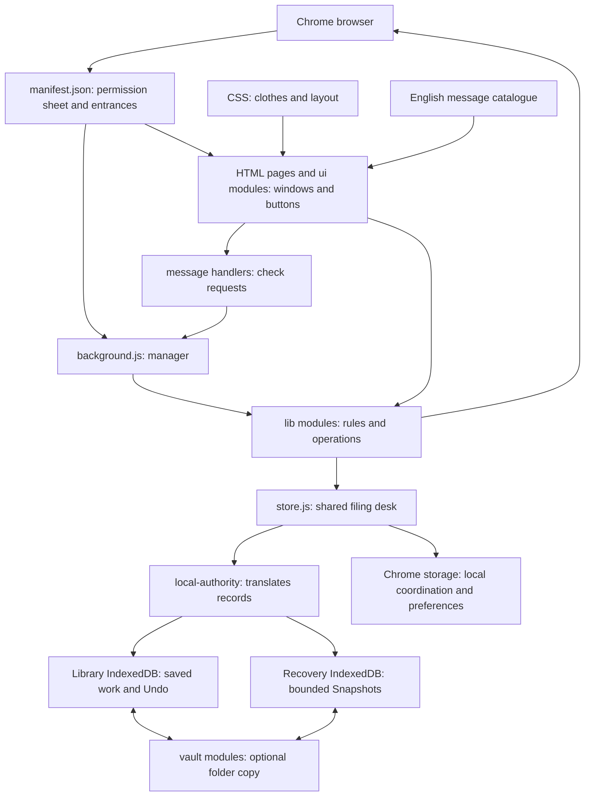

# EveryTab, explained simply

Open the [searchable file explorer](CODEBASE-EXPLORER.html). Generated for source **1.0.0**.

Imagine your browser is a desk covered in picture cards. Each card is a web page.

- **Open** is what is on your desk now.
- **Inbox** is a tray where you put cards for later.
- **Archive** is the cupboard for older cards.
- **Named Sessions** are named sets of cards you can put back on the desk again.
- **Labels** are stickers; Label groups and Session groups are lists that organize stickers or sets.
- **Snooze** is an alarm clock attached to a card.
- **Suspend** leaves a lightweight placeholder where a page was open.
- **Focus** is a helper asking you to leave distracting pages until later.
- **Snapshots** are automatic lists of what was open earlier.
- **Vault** is an optional second copy in your own folder.

These cards mostly remember addresses and titles. They do not preserve everything inside a website, such as an unfinished form.

## The building

The browser can put the background manager to sleep and wake it later. Important unfinished work therefore needs a saved receipt; a JavaScript variable alone is not enough.

## Follow a card

1. You press **Inbox** beside a live tab in Dashboard or Popup.
2. The screen sends a request. A message handler checks its shape.
3. A domain operation captures the page and saves a record through the shared store.
4. Only after saving does it ask Chrome to close the page, checking that the live page is still the intended one.
5. Other screens hear that storage changed and refresh their lists.
6. If connected, a later Vault sync copies the durable change into the chosen folder.

The filing cabinet, browser tabs, and folder are separate things. Saving, closing a tab, and copying a file cannot all be one indivisible action. Receipts, identity checks, retries, and honest partial results are what make the process recoverable.

## Read the project in this order

Start with `manifest.json`, one HTML page, its `ui` entry point, its feature `*-surface.js`, `list-configs.js`, the corresponding `lib` operation, and then `store.js`. Read storage and Vault internals when working on durability. Start from the matching test when investigating a particular behavior.

| Location | Like a five-year-old would describe it | Actual job |
|---|---|---|
| `extension/*.html` | Doors and empty rooms | Page markup and script/style entry points |
| `extension/js/ui/` | Buttons, shelves, and labels you see | Presentation, input, refresh, and focus |
| `extension/js/background/` | The manager's mailboxes | Chrome event owners and validated messages |
| `extension/js/lib/` | The rule book and helpers | Product operations and shared data contracts |
| `extension/js/lib/storage/` | The filing cabinet machinery | Transactions, records, versions, assets, and recovery |
| `extension/js/vault/` | The helper making a second copy | Folder permission, replication, checkpoints, and Restore |
| `extension/css/` | Clothes and room layout | Appearance tokens and shared/page styles |
| `extension/_locales/` | The word book | Translatable product text |
| `extension/test/` | Practice games for the helpers | Assertions, browser fixtures, and synthetic adapters |
| `tools/` | The workshop | Testing, diagnostics, capture, marketing production, packaging tools |
| `.github/` | The automatic examiner | CI jobs selected from the shared test inventory |
| Root Markdown files | The instruction books | Product, engineering, design, testing, and current work |

## How to read the file atlas

Every current runtime JavaScript file has a plain-language description below. The maintained files in `extension/`, `tools/`, `.github/`, and the selected root guides are indexed. Runtime files show their literal local imports, their reverse importers, and declared exports. HTML/CSS/test references appear separately.

**An import means “uses code from.” It does not mean “owns,” “calls every function,” or “has full test coverage.”** The scan includes literal dynamic imports; computed paths, messages, Chrome events, and dependency-injected calls are not a complete static call graph. JSDoc type imports and quoted source examples are excluded. Template bodies and destructured export declarations are not expanded; the scanner is intentionally a partial static graph. Review the architecture story above for those non-import relationships. Tests that merely read source text are references, not runtime imports.

Other folders have different roles: `docs/` contains guides, prototypes and launch material; `plans/` contains proposals; `design/`, `campaign-assets/`, and `screenshots/` contain design assets; `review-evidence/` contains dated receipts; `dist/` holds preserved packages; `archive/` is historical material. Those trees are not the shipped source and are not individually audited here. Personal Vault/test-data folders and installed browser data were not inspected. Hidden skill packages are instructions/tooling, not extension runtime.

The companion [CODEBASE-ATLAS.json](CODEBASE-ATLAS.json) contains source hashes and literal relationships. Regenerate with `node tools/build-codebase-guide.mjs --write`; verify without changing files with `node tools/build-codebase-guide.mjs --check`.

Generated learning files are excluded from their own input scan. The scan reads regular files in `extension/`, `tools/`, and `.github/`, plus a fixed list of root guides and configuration. It skips hidden files, dependency folders and all symlinks. It never scans arbitrary root files or personal data folders.

## What happens when a helper stops halfway?

Imagine asking the helper to put two cards back on your desk. It writes a little
to-do note first. If it falls asleep after placing the cards but before ticking
the note, it cannot safely assume the cards are missing and place two more.
It reports an incomplete result and asks you to check the desk.

`close-day.js` owns that note for Close-the-day Undo. It updates the note and
Activity together. `background.js` finishes checking old notes before letting new
actions start. Saved records, browser pages and Vault files still remain separate
steps. A successful database change does not prove every browser action finished.

For the Vault, cancelling the folder picker leaves the old folder alone. A new
handle is retained only after its database transaction commits. The profile-owned
filesystem test proves storage/reload behavior; it does not prove native folder
permissions or two-device cloud transport. See [TESTING.md](TESTING.md) for the
evidence types and [the handoff](handoff-prompt.md) for remaining acceptance.

Suspended pages also need identity: two cards with the same address can still be
two different tabs in different windows. The suspension owner tracks each
occurrence so deliberately closing one does not erase or reopen another.

The shared diagnostic helper records only a fixed operation name and an error
class. It does not print page addresses, titles, or raw error messages.

## Entrances, styles, text, and assets (29 files)

### extension/README.md

[README.md](<extension/README.md>): Project guide or configuration: README.

### extension/_locales/en/messages.json

[messages.json](<extension/_locales/en/messages.json>): The word book used to translate product labels and feedback.

### extension/_locales/fr/messages.json

[messages.json](<extension/_locales/fr/messages.json>): The word book used to translate product labels and feedback.

### extension/css/dashboard.css

[dashboard.css](<extension/css/dashboard.css>): Appearance rules for dashboard: layout, colors and controls.

### extension/css/interface-style.css

[interface-style.css](<extension/css/interface-style.css>): Appearance rules for interface style: layout, colors and controls.

### extension/css/new-tab-choices.css

[new-tab-choices.css](<extension/css/new-tab-choices.css>): Appearance rules for new tab choices: layout, colors and controls.

### extension/css/newtab.css

[newtab.css](<extension/css/newtab.css>): Appearance rules for newtab: layout, colors and controls.

### extension/css/onboarding.css

[onboarding.css](<extension/css/onboarding.css>): Appearance rules for onboarding: layout, colors and controls.

### extension/css/primitives.css

[primitives.css](<extension/css/primitives.css>): Appearance rules for primitives: layout, colors and controls.

### extension/css/scheme-editor.css

[scheme-editor.css](<extension/css/scheme-editor.css>): Appearance rules for scheme editor: layout, colors and controls.

### extension/css/settings-schemes.css

[settings-schemes.css](<extension/css/settings-schemes.css>): Appearance rules for settings schemes: layout, colors and controls.

### extension/css/sidepanel.css

[sidepanel.css](<extension/css/sidepanel.css>): Appearance rules for sidepanel: layout, colors and controls.

### extension/css/tablist-d4.css

[tablist-d4.css](<extension/css/tablist-d4.css>): Appearance rules for tablist d4: layout, colors and controls.

### extension/css/tokens.css

[tokens.css](<extension/css/tokens.css>): Appearance rules for tokens: layout, colors and controls.

### extension/dashboard.html

[dashboard.html](<extension/dashboard.html>): The dashboard page skeleton; its references show the scripts and styles it loads.

Other literal file references: [extension/css/dashboard.css](<extension/css/dashboard.css>), [extension/css/interface-style.css](<extension/css/interface-style.css>), [extension/css/new-tab-choices.css](<extension/css/new-tab-choices.css>), [extension/css/onboarding.css](<extension/css/onboarding.css>), [extension/css/primitives.css](<extension/css/primitives.css>), [extension/css/settings-schemes.css](<extension/css/settings-schemes.css>), [extension/css/tablist-d4.css](<extension/css/tablist-d4.css>), [extension/css/tokens.css](<extension/css/tokens.css>), [extension/js/boot.js](<extension/js/boot.js>), [extension/js/ui/dashboard.js](<extension/js/ui/dashboard.js>).

### extension/focus.html

[focus.html](<extension/focus.html>): The focus page skeleton; its references show the scripts and styles it loads.

Other literal file references: [extension/css/interface-style.css](<extension/css/interface-style.css>), [extension/css/primitives.css](<extension/css/primitives.css>), [extension/css/tokens.css](<extension/css/tokens.css>), [extension/dashboard.html](<extension/dashboard.html>), [extension/js/boot.js](<extension/js/boot.js>), [extension/js/ui/focus-page.js](<extension/js/ui/focus-page.js>).

### extension/icon.png

[icon.png](<extension/icon.png>): A packaged app icon; Chrome chooses a size for its surface.

### extension/icon16.png

[icon16.png](<extension/icon16.png>): A packaged app icon; Chrome chooses a size for its surface.

### extension/icon24.png

[icon24.png](<extension/icon24.png>): A packaged app icon; Chrome chooses a size for its surface.

### extension/icon32.png

[icon32.png](<extension/icon32.png>): A packaged app icon; Chrome chooses a size for its surface.

### extension/icon48.png

[icon48.png](<extension/icon48.png>): A packaged app icon; Chrome chooses a size for its surface.

### extension/manifest.json

[manifest.json](<extension/manifest.json>): Chrome reads this permission sheet to find the app entrances, worker and icons.

Other literal file references: [extension/icon.png](<extension/icon.png>), [extension/icon16.png](<extension/icon16.png>), [extension/icon24.png](<extension/icon24.png>), [extension/icon32.png](<extension/icon32.png>), [extension/icon48.png](<extension/icon48.png>), [extension/js/background.js](<extension/js/background.js>), [extension/newtab.html](<extension/newtab.html>), [extension/options.html](<extension/options.html>), [extension/popup.html](<extension/popup.html>), [extension/sidepanel.html](<extension/sidepanel.html>).

### extension/newtab.html

[newtab.html](<extension/newtab.html>): The newtab page skeleton; its references show the scripts and styles it loads.

Other literal file references: [extension/css/dashboard.css](<extension/css/dashboard.css>), [extension/css/interface-style.css](<extension/css/interface-style.css>), [extension/css/new-tab-choices.css](<extension/css/new-tab-choices.css>), [extension/css/newtab.css](<extension/css/newtab.css>), [extension/css/onboarding.css](<extension/css/onboarding.css>), [extension/css/primitives.css](<extension/css/primitives.css>), [extension/css/settings-schemes.css](<extension/css/settings-schemes.css>), [extension/css/tablist-d4.css](<extension/css/tablist-d4.css>), [extension/css/tokens.css](<extension/css/tokens.css>), [extension/js/boot.js](<extension/js/boot.js>), [extension/js/ui/newtab-entry.js](<extension/js/ui/newtab-entry.js>).

### extension/options.html

[options.html](<extension/options.html>): The options page skeleton; its references show the scripts and styles it loads.

Other literal file references: [extension/css/interface-style.css](<extension/css/interface-style.css>), [extension/css/new-tab-choices.css](<extension/css/new-tab-choices.css>), [extension/css/onboarding.css](<extension/css/onboarding.css>), [extension/css/settings-schemes.css](<extension/css/settings-schemes.css>), [extension/css/tokens.css](<extension/css/tokens.css>), [extension/js/boot.js](<extension/js/boot.js>), [extension/js/ui/options.js](<extension/js/ui/options.js>).

### extension/package.json

[package.json](<extension/package.json>): Project guide or configuration: package.

### extension/popup.html

[popup.html](<extension/popup.html>): The popup page skeleton; its references show the scripts and styles it loads.

Other literal file references: [extension/css/interface-style.css](<extension/css/interface-style.css>), [extension/css/primitives.css](<extension/css/primitives.css>), [extension/css/tablist-d4.css](<extension/css/tablist-d4.css>), [extension/css/tokens.css](<extension/css/tokens.css>), [extension/js/boot.js](<extension/js/boot.js>), [extension/js/ui/popup.js](<extension/js/ui/popup.js>).

### extension/scheme-editor.html

[scheme-editor.html](<extension/scheme-editor.html>): The scheme editor page skeleton; its references show the scripts and styles it loads.

Other literal file references: [extension/css/dashboard.css](<extension/css/dashboard.css>), [extension/css/interface-style.css](<extension/css/interface-style.css>), [extension/css/primitives.css](<extension/css/primitives.css>), [extension/css/scheme-editor.css](<extension/css/scheme-editor.css>), [extension/css/tablist-d4.css](<extension/css/tablist-d4.css>), [extension/css/tokens.css](<extension/css/tokens.css>), [extension/js/boot.js](<extension/js/boot.js>), [extension/js/ui/scheme-editor.js](<extension/js/ui/scheme-editor.js>).

### extension/sidepanel.html

[sidepanel.html](<extension/sidepanel.html>): The sidepanel page skeleton; its references show the scripts and styles it loads.

Other literal file references: [extension/css/interface-style.css](<extension/css/interface-style.css>), [extension/css/primitives.css](<extension/css/primitives.css>), [extension/css/sidepanel.css](<extension/css/sidepanel.css>), [extension/css/tablist-d4.css](<extension/css/tablist-d4.css>), [extension/css/tokens.css](<extension/css/tokens.css>), [extension/js/boot.js](<extension/js/boot.js>), [extension/js/ui/sidepanel.js](<extension/js/ui/sidepanel.js>).

### extension/suspend.html

[suspend.html](<extension/suspend.html>): The suspend page skeleton; its references show the scripts and styles it loads.

Other literal file references: [extension/css/interface-style.css](<extension/css/interface-style.css>), [extension/css/tokens.css](<extension/css/tokens.css>), [extension/js/boot.js](<extension/js/boot.js>), [extension/js/ui/suspend-page.js](<extension/js/ui/suspend-page.js>).

## Runtime files (230 files)

### extension/js/background.js

[background.js](<extension/js/background.js>): The manager: connects browser events, messages, and feature operations.

Uses modules: [extension/js/background/alarm-owner.js](<extension/js/background/alarm-owner.js>), [extension/js/background/close-day-message-handlers.js](<extension/js/background/close-day-message-handlers.js>), [extension/js/background/context-menu-owner.js](<extension/js/background/context-menu-owner.js>), [extension/js/background/duplicate-message-handlers.js](<extension/js/background/duplicate-message-handlers.js>), [extension/js/background/inbox-capture-message-handlers.js](<extension/js/background/inbox-capture-message-handlers.js>), [extension/js/background/journal-message-handlers.js](<extension/js/background/journal-message-handlers.js>), [extension/js/background/keyboard-command-owner.js](<extension/js/background/keyboard-command-owner.js>), [extension/js/background/live-close-message-handlers.js](<extension/js/background/live-close-message-handlers.js>), [extension/js/background/maintenance-schedule.js](<extension/js/background/maintenance-schedule.js>), [extension/js/background/navigation-actions.js](<extension/js/background/navigation-actions.js>), [extension/js/background/navigation-message-handlers.js](<extension/js/background/navigation-message-handlers.js>), [extension/js/background/new-tab-message-handlers.js](<extension/js/background/new-tab-message-handlers.js>), [extension/js/background/new-tab-rotation-owner.js](<extension/js/background/new-tab-rotation-owner.js>), [extension/js/background/new-tab-singleton-owner.js](<extension/js/background/new-tab-singleton-owner.js>), [extension/js/background/notification-owner.js](<extension/js/background/notification-owner.js>), [extension/js/background/omnibox-owner.js](<extension/js/background/omnibox-owner.js>), [extension/js/background/open-tab-message-handlers.js](<extension/js/background/open-tab-message-handlers.js>), [extension/js/background/recovery-message-handlers.js](<extension/js/background/recovery-message-handlers.js>), [extension/js/background/runtime-lifecycle-owner.js](<extension/js/background/runtime-lifecycle-owner.js>), [extension/js/background/scheme-rotation-trace.js](<extension/js/background/scheme-rotation-trace.js>), [extension/js/background/session-message-handlers.js](<extension/js/background/session-message-handlers.js>), [extension/js/background/settings-change-owner.js](<extension/js/background/settings-change-owner.js>), [extension/js/background/snooze-actions.js](<extension/js/background/snooze-actions.js>), [extension/js/background/snooze-message-handlers.js](<extension/js/background/snooze-message-handlers.js>), [extension/js/background/suspend-recovery-owner.js](<extension/js/background/suspend-recovery-owner.js>), [extension/js/background/suspension-message-handlers.js](<extension/js/background/suspension-message-handlers.js>), [extension/js/background/tab-lifecycle-owner.js](<extension/js/background/tab-lifecycle-owner.js>), [extension/js/background/window-lifecycle-owner.js](<extension/js/background/window-lifecycle-owner.js>), [extension/js/background/worker-startup-owner.js](<extension/js/background/worker-startup-owner.js>), [extension/js/lib/actions.js](<extension/js/lib/actions.js>), [extension/js/lib/archive.js](<extension/js/lib/archive.js>), [extension/js/lib/automation-protection.js](<extension/js/lib/automation-protection.js>), [extension/js/lib/close-day.js](<extension/js/lib/close-day.js>), [extension/js/lib/close-window.js](<extension/js/lib/close-window.js>), [extension/js/lib/dedup.js](<extension/js/lib/dedup.js>), [extension/js/lib/duplicate-domain-rules.js](<extension/js/lib/duplicate-domain-rules.js>), [extension/js/lib/failure-diagnostic.js](<extension/js/lib/failure-diagnostic.js>), [extension/js/lib/focus-guard.js](<extension/js/lib/focus-guard.js>), [extension/js/lib/history-access.js](<extension/js/lib/history-access.js>), [extension/js/lib/i18n.js](<extension/js/lib/i18n.js>), [extension/js/lib/journal.js](<extension/js/lib/journal.js>), [extension/js/lib/live-close.js](<extension/js/lib/live-close.js>), [extension/js/lib/message-handler-registry.js](<extension/js/lib/message-handler-registry.js>), [extension/js/lib/open-tab-move.js](<extension/js/lib/open-tab-move.js>), [extension/js/lib/organize.js](<extension/js/lib/organize.js>), [extension/js/lib/scheme-rotation.js](<extension/js/lib/scheme-rotation.js>), [extension/js/lib/schemes.js](<extension/js/lib/schemes.js>), [extension/js/lib/search.js](<extension/js/lib/search.js>), [extension/js/lib/sessions.js](<extension/js/lib/sessions.js>), [extension/js/lib/snapshot-recovery.js](<extension/js/lib/snapshot-recovery.js>), [extension/js/lib/snooze-delivery.js](<extension/js/lib/snooze-delivery.js>), [extension/js/lib/snooze-placement.js](<extension/js/lib/snooze-placement.js>), [extension/js/lib/snooze.js](<extension/js/lib/snooze.js>), [extension/js/lib/storage/authority-runtime.js](<extension/js/lib/storage/authority-runtime.js>), [extension/js/lib/store.js](<extension/js/lib/store.js>), [extension/js/lib/suspend-recent-recovery.js](<extension/js/lib/suspend-recent-recovery.js>), [extension/js/lib/suspend.js](<extension/js/lib/suspend.js>), [extension/js/lib/tab-activity.js](<extension/js/lib/tab-activity.js>).

Imported by: [extension/test/suspend-recovery-background-root.mjs](<extension/test/suspend-recovery-background-root.mjs>).

### extension/js/background/alarm-owner.js

[alarm-owner.js](<extension/js/background/alarm-owner.js>): Routes browser alarms to the feature that owns the scheduled work.

Uses modules: [extension/js/lib/failure-diagnostic.js](<extension/js/lib/failure-diagnostic.js>), [extension/js/lib/focus-guard.js](<extension/js/lib/focus-guard.js>), [extension/js/lib/scheme-rotation.js](<extension/js/lib/scheme-rotation.js>), [extension/js/lib/snapshot-schedule.js](<extension/js/lib/snapshot-schedule.js>), [extension/js/lib/snooze.js](<extension/js/lib/snooze.js>), [extension/js/lib/suspend.js](<extension/js/lib/suspend.js>).

Imported by: [extension/js/background.js](<extension/js/background.js>), [extension/js/background/maintenance-schedule.js](<extension/js/background/maintenance-schedule.js>), [extension/js/background/runtime-lifecycle-owner.js](<extension/js/background/runtime-lifecycle-owner.js>), [extension/js/background/suspend-recovery-owner.js](<extension/js/background/suspend-recovery-owner.js>), [extension/test/alarm-owner.mjs](<extension/test/alarm-owner.mjs>), [extension/test/maintenance-schedule.mjs](<extension/test/maintenance-schedule.mjs>), [extension/test/suspend-recovery-owner.mjs](<extension/test/suspend-recovery-owner.mjs>).

Declared exports: `ARCHIVE_ALARM`, `DEDUP_GRACE_PREFIX`, `RECOVERY_ALARM`, `SUSPEND_ALARM`, `SUSPEND_METADATA_REPAIR_ALARM`, `installAlarmOwner`.

### extension/js/background/close-day-message-handlers.js

[close-day-message-handlers.js](<extension/js/background/close-day-message-handlers.js>): Checks and routes requests for end-of-day review and commit.

Imported by: [extension/js/background.js](<extension/js/background.js>), [extension/test/action-recovery-readiness.mjs](<extension/test/action-recovery-readiness.mjs>), [extension/test/close-day-message-handlers.mjs](<extension/test/close-day-message-handlers.mjs>).

Declared exports: `createCloseDayMessageHandlers`.

### extension/js/background/context-menu-owner.js

[context-menu-owner.js](<extension/js/background/context-menu-owner.js>): Installs right-click menu entries and runs their chosen action.

Uses modules: [extension/js/lib/i18n.js](<extension/js/lib/i18n.js>), [extension/js/lib/snooze.js](<extension/js/lib/snooze.js>).

Imported by: [extension/js/background.js](<extension/js/background.js>), [extension/test/context-menu-owner.mjs](<extension/test/context-menu-owner.mjs>).

Declared exports: `createContextMenuOwner`.

### extension/js/background/duplicate-message-handlers.js

[duplicate-message-handlers.js](<extension/js/background/duplicate-message-handlers.js>): Checks and routes requests for duplicate closing and matching rules.

Imported by: [extension/js/background.js](<extension/js/background.js>), [extension/test/duplicate-message-handlers.mjs](<extension/test/duplicate-message-handlers.mjs>).

Declared exports: `createDuplicateMessageHandlers`.

### extension/js/background/inbox-capture-message-handlers.js

[inbox-capture-message-handlers.js](<extension/js/background/inbox-capture-message-handlers.js>): Checks and routes requests for saving live tabs to Inbox.

Imported by: [extension/js/background.js](<extension/js/background.js>), [extension/test/inbox-capture-message-handlers.mjs](<extension/test/inbox-capture-message-handlers.mjs>).

Declared exports: `createInboxCaptureMessageHandlers`.

### extension/js/background/journal-message-handlers.js

[journal-message-handlers.js](<extension/js/background/journal-message-handlers.js>): Checks and routes requests for Activity Undo and clearing.

Imported by: [extension/js/background.js](<extension/js/background.js>), [extension/test/journal-message-handlers.mjs](<extension/test/journal-message-handlers.mjs>).

Declared exports: `createJournalMessageHandlers`.

### extension/js/background/keyboard-command-owner.js

[keyboard-command-owner.js](<extension/js/background/keyboard-command-owner.js>): Routes Chrome-wide keyboard commands to the corresponding actions.

Uses modules: [extension/js/lib/i18n.js](<extension/js/lib/i18n.js>), [extension/js/lib/search-popup.js](<extension/js/lib/search-popup.js>), [extension/js/lib/snooze.js](<extension/js/lib/snooze.js>).

Imported by: [extension/js/background.js](<extension/js/background.js>), [extension/test/keyboard-command-owner.mjs](<extension/test/keyboard-command-owner.mjs>).

Declared exports: `installKeyboardCommandOwner`.

### extension/js/background/live-close-message-handlers.js

[live-close-message-handlers.js](<extension/js/background/live-close-message-handlers.js>): Checks and routes requests for recoverable live-tab/window closing.

Imported by: [extension/js/background.js](<extension/js/background.js>), [extension/test/action-recovery-readiness.mjs](<extension/test/action-recovery-readiness.mjs>), [extension/test/live-close-message-handlers.mjs](<extension/test/live-close-message-handlers.mjs>).

Declared exports: `createLiveCloseMessageHandlers`.

### extension/js/background/maintenance-schedule.js

[maintenance-schedule.js](<extension/js/background/maintenance-schedule.js>): Sets up recurring maintenance alarms and save-count debounce.

Uses modules: [extension/js/background/alarm-owner.js](<extension/js/background/alarm-owner.js>), [extension/js/lib/failure-diagnostic.js](<extension/js/lib/failure-diagnostic.js>), [extension/js/lib/snapshot-schedule.js](<extension/js/lib/snapshot-schedule.js>).

Imported by: [extension/js/background.js](<extension/js/background.js>), [extension/test/maintenance-schedule.mjs](<extension/test/maintenance-schedule.mjs>).

Declared exports: `createMaintenanceSchedule`.

### extension/js/background/navigation-actions.js

[navigation-actions.js](<extension/js/background/navigation-actions.js>): Opens or focuses Search and address-bar targets, including waking suspended pages.

Uses modules: [extension/js/lib/failure-diagnostic.js](<extension/js/lib/failure-diagnostic.js>), [extension/js/lib/starred.js](<extension/js/lib/starred.js>), [extension/js/lib/tabs.js](<extension/js/lib/tabs.js>).

Imported by: [extension/js/background.js](<extension/js/background.js>), [extension/test/navigation-actions.mjs](<extension/test/navigation-actions.mjs>).

Declared exports: `createNavigationActions`.

### extension/js/background/navigation-message-handlers.js

[navigation-message-handlers.js](<extension/js/background/navigation-message-handlers.js>): Checks and routes requests for opening and focusing search targets.

Imported by: [extension/js/background.js](<extension/js/background.js>), [extension/test/navigation-message-handlers.mjs](<extension/test/navigation-message-handlers.mjs>).

Declared exports: `createNavigationMessageHandlers`.

### extension/js/background/new-tab-message-handlers.js

[new-tab-message-handlers.js](<extension/js/background/new-tab-message-handlers.js>): Checks and routes requests for mounted New Tab coordination.

Imported by: [extension/js/background.js](<extension/js/background.js>), [extension/test/new-tab-message-handlers.mjs](<extension/test/new-tab-message-handlers.mjs>).

Declared exports: `createNewTabMessageHandlers`.

### extension/js/background/new-tab-rotation-owner.js

[new-tab-rotation-owner.js](<extension/js/background/new-tab-rotation-owner.js>): Coordinates exactly one appearance rotation per mounted New Tab identity.

Uses modules: [extension/js/lib/failure-diagnostic.js](<extension/js/lib/failure-diagnostic.js>).

Imported by: [extension/js/background.js](<extension/js/background.js>), [extension/test/new-tab-rotation-owner.mjs](<extension/test/new-tab-rotation-owner.mjs>).

Declared exports: `createNewTabRotationOwner`.

### extension/js/background/new-tab-singleton-owner.js

[new-tab-singleton-owner.js](<extension/js/background/new-tab-singleton-owner.js>): Retires extra New Tabs after checking their current identity.

Uses modules: [extension/js/lib/newtab-singleton.js](<extension/js/lib/newtab-singleton.js>).

Imported by: [extension/js/background.js](<extension/js/background.js>), [extension/test/new-tab-singleton-owner.mjs](<extension/test/new-tab-singleton-owner.mjs>).

Declared exports: `createNewTabSingletonOwner`.

### extension/js/background/notification-owner.js

[notification-owner.js](<extension/js/background/notification-owner.js>): Routes notification clicks/buttons and keeps exact Undo receipt identity.

Uses modules: [extension/js/lib/failure-diagnostic.js](<extension/js/lib/failure-diagnostic.js>), [extension/js/lib/i18n.js](<extension/js/lib/i18n.js>).

Imported by: [extension/js/background.js](<extension/js/background.js>), [extension/test/notification-owner.mjs](<extension/test/notification-owner.mjs>).

Declared exports: `createNotificationOwner`.

### extension/js/background/omnibox-owner.js

[omnibox-owner.js](<extension/js/background/omnibox-owner.js>): Connects Chrome's address bar to the shared search engine.

Uses modules: [extension/js/lib/omnibox.js](<extension/js/lib/omnibox.js>).

Imported by: [extension/js/background.js](<extension/js/background.js>), [extension/test/omnibox-owner.mjs](<extension/test/omnibox-owner.mjs>).

Declared exports: `installOmniboxOwner`.

### extension/js/background/open-tab-message-handlers.js

[open-tab-message-handlers.js](<extension/js/background/open-tab-message-handlers.js>): Checks and routes requests for moving and organizing live tabs.

Imported by: [extension/js/background.js](<extension/js/background.js>), [extension/test/open-tab-message-handlers.mjs](<extension/test/open-tab-message-handlers.mjs>).

Declared exports: `createOpenTabMessageHandlers`.

### extension/js/background/recovery-message-handlers.js

[recovery-message-handlers.js](<extension/js/background/recovery-message-handlers.js>): Checks and routes requests for Snapshot and recently closed recovery.

Imported by: [extension/js/background.js](<extension/js/background.js>), [extension/test/recovery-message-handlers.mjs](<extension/test/recovery-message-handlers.mjs>).

Declared exports: `createRecoveryMessageHandlers`.

### extension/js/background/runtime-lifecycle-owner.js

[runtime-lifecycle-owner.js](<extension/js/background/runtime-lifecycle-owner.js>): Handles extension install, updates, and browser startup.

Uses modules: [extension/js/background/alarm-owner.js](<extension/js/background/alarm-owner.js>), [extension/js/lib/failure-diagnostic.js](<extension/js/lib/failure-diagnostic.js>).

Imported by: [extension/js/background.js](<extension/js/background.js>), [extension/test/runtime-lifecycle-owner.mjs](<extension/test/runtime-lifecycle-owner.mjs>), [extension/test/suspend-recovery-startup-activity.mjs](<extension/test/suspend-recovery-startup-activity.mjs>).

Declared exports: `installRuntimeLifecycleOwner`.

### extension/js/background/scheme-rotation-trace.js

[scheme-rotation-trace.js](<extension/js/background/scheme-rotation-trace.js>): Collects bounded, opt-in diagnostics for appearance rotation.

Imported by: [extension/js/background.js](<extension/js/background.js>), [extension/test/scheme-rotation-diagnostics.mjs](<extension/test/scheme-rotation-diagnostics.mjs>).

Declared exports: `createSchemeRotationDiagnostics`.

### extension/js/background/session-message-handlers.js

[session-message-handlers.js](<extension/js/background/session-message-handlers.js>): Checks and routes requests for Session saving and restoration.

Imported by: [extension/js/background.js](<extension/js/background.js>), [extension/test/session-message-handlers.mjs](<extension/test/session-message-handlers.mjs>).

Declared exports: `createSessionMessageHandlers`.

### extension/js/background/settings-change-owner.js

[settings-change-owner.js](<extension/js/background/settings-change-owner.js>): Starts the required maintenance when stored settings change.

Uses modules: [extension/js/lib/failure-diagnostic.js](<extension/js/lib/failure-diagnostic.js>), [extension/js/lib/snapshot-schedule.js](<extension/js/lib/snapshot-schedule.js>), [extension/js/lib/storage/constants.js](<extension/js/lib/storage/constants.js>).

Imported by: [extension/js/background.js](<extension/js/background.js>), [extension/test/settings-change-owner.mjs](<extension/test/settings-change-owner.mjs>), [extension/test/ui-language-setting.mjs](<extension/test/ui-language-setting.mjs>).

Declared exports: `installSettingsChangeOwner`.

### extension/js/background/snooze-actions.js

[snooze-actions.js](<extension/js/background/snooze-actions.js>): Captures live tabs for Snooze before asking Chrome to close them.

Uses modules: [extension/js/lib/live-close.js](<extension/js/lib/live-close.js>), [extension/js/lib/tabs.js](<extension/js/lib/tabs.js>).

Imported by: [extension/js/background.js](<extension/js/background.js>), [extension/test/snooze-actions.mjs](<extension/test/snooze-actions.mjs>), [extension/test/snooze-live-persist-first.mjs](<extension/test/snooze-live-persist-first.mjs>).

Declared exports: `createSnoozeActions`.

### extension/js/background/snooze-message-handlers.js

[snooze-message-handlers.js](<extension/js/background/snooze-message-handlers.js>): Checks and routes requests for Snooze creation and delivery.

Imported by: [extension/js/background.js](<extension/js/background.js>), [extension/test/snooze-message-handlers.mjs](<extension/test/snooze-message-handlers.mjs>).

Declared exports: `createSnoozeMessageHandlers`.

### extension/js/background/suspend-recovery-owner.js

[suspend-recovery-owner.js](<extension/js/background/suspend-recovery-owner.js>): Owns a suspended-tab reload recovery cycle and its notifications.

Uses modules: [extension/js/background/alarm-owner.js](<extension/js/background/alarm-owner.js>), [extension/js/lib/failure-diagnostic.js](<extension/js/lib/failure-diagnostic.js>), [extension/js/lib/i18n.js](<extension/js/lib/i18n.js>), [extension/js/lib/suspend-recovery-schedule.js](<extension/js/lib/suspend-recovery-schedule.js>), [extension/js/lib/suspend.js](<extension/js/lib/suspend.js>).

Imported by: [extension/js/background.js](<extension/js/background.js>), [extension/test/recovery-ready-summary.mjs](<extension/test/recovery-ready-summary.mjs>), [extension/test/suspend-recovery-owner.mjs](<extension/test/suspend-recovery-owner.mjs>), [extension/test/suspend-recovery-startup-activity.mjs](<extension/test/suspend-recovery-startup-activity.mjs>).

Declared exports: `createSuspendRecoveryOwner`.

### extension/js/background/suspension-message-handlers.js

[suspension-message-handlers.js](<extension/js/background/suspension-message-handlers.js>): Checks and routes requests for suspending and waking live tabs.

Imported by: [extension/js/background.js](<extension/js/background.js>), [extension/test/suspension-message-handlers.mjs](<extension/test/suspension-message-handlers.mjs>).

Declared exports: `createSuspensionMessageHandlers`.

### extension/js/background/tab-lifecycle-owner.js

[tab-lifecycle-owner.js](<extension/js/background/tab-lifecycle-owner.js>): Routes tab changes, removals, moves, and related refresh work.

Uses modules: [extension/js/lib/failure-diagnostic.js](<extension/js/lib/failure-diagnostic.js>), [extension/js/lib/newtab-singleton.js](<extension/js/lib/newtab-singleton.js>), [extension/js/lib/tabs.js](<extension/js/lib/tabs.js>).

Imported by: [extension/js/background.js](<extension/js/background.js>), [extension/test/tab-lifecycle-owner.mjs](<extension/test/tab-lifecycle-owner.mjs>).

Declared exports: `installTabLifecycleOwner`.

### extension/js/background/window-lifecycle-owner.js

[window-lifecycle-owner.js](<extension/js/background/window-lifecycle-owner.js>): Routes window-focus and window-removal cleanup.

Uses modules: [extension/js/lib/failure-diagnostic.js](<extension/js/lib/failure-diagnostic.js>).

Imported by: [extension/js/background.js](<extension/js/background.js>), [extension/test/window-lifecycle-owner.mjs](<extension/test/window-lifecycle-owner.mjs>).

Declared exports: `installWindowLifecycleOwner`.

### extension/js/background/worker-startup-owner.js

[worker-startup-owner.js](<extension/js/background/worker-startup-owner.js>): Starts ordinary background-worker initialization and maintenance.

Uses modules: [extension/js/lib/failure-diagnostic.js](<extension/js/lib/failure-diagnostic.js>).

Imported by: [extension/js/background.js](<extension/js/background.js>), [extension/test/startup-inbox-safety.mjs](<extension/test/startup-inbox-safety.mjs>), [extension/test/suspend-recovery-owner.mjs](<extension/test/suspend-recovery-owner.mjs>), [extension/test/suspend-recovery-startup-activity.mjs](<extension/test/suspend-recovery-startup-activity.mjs>), [extension/test/worker-startup-owner.mjs](<extension/test/worker-startup-owner.mjs>).

Declared exports: `createWorkerStartupOwner`.

### extension/js/boot.js

[boot.js](<extension/js/boot.js>): Paints the saved appearance before the rest of a page loads.

### extension/js/lib/actions.js

[actions.js](<extension/js/lib/actions.js>): Saves live tabs and moves, restores, or removes saved tab selections.

Uses modules: [extension/js/lib/counters.js](<extension/js/lib/counters.js>), [extension/js/lib/failure-diagnostic.js](<extension/js/lib/failure-diagnostic.js>), [extension/js/lib/journal.js](<extension/js/lib/journal.js>), [extension/js/lib/label-meta.js](<extension/js/lib/label-meta.js>), [extension/js/lib/live-close.js](<extension/js/lib/live-close.js>), [extension/js/lib/newtab-focus.js](<extension/js/lib/newtab-focus.js>), [extension/js/lib/organization.js](<extension/js/lib/organization.js>), [extension/js/lib/saved-selection-safety.js](<extension/js/lib/saved-selection-safety.js>), [extension/js/lib/sessions.js](<extension/js/lib/sessions.js>), [extension/js/lib/snooze.js](<extension/js/lib/snooze.js>), [extension/js/lib/store.js](<extension/js/lib/store.js>), [extension/js/lib/tabs.js](<extension/js/lib/tabs.js>), [extension/js/lib/types.js](<extension/js/lib/types.js>).

Imported by: [extension/js/background.js](<extension/js/background.js>), [extension/js/lib/archive.js](<extension/js/lib/archive.js>), [extension/js/lib/focus-guard.js](<extension/js/lib/focus-guard.js>), [extension/js/lib/labels.js](<extension/js/lib/labels.js>), [extension/js/ui/archive-surface.js](<extension/js/ui/archive-surface.js>), [extension/js/ui/inbox-surface.js](<extension/js/ui/inbox-surface.js>), [extension/js/ui/list-configs.js](<extension/js/ui/list-configs.js>), [extension/js/ui/open-surface.js](<extension/js/ui/open-surface.js>), [extension/js/ui/popup.js](<extension/js/ui/popup.js>), [extension/test/inbox-restore-safety.mjs](<extension/test/inbox-restore-safety.mjs>), [extension/test/journal-transaction.mjs](<extension/test/journal-transaction.mjs>), [extension/test/live-close-identity-safety.mjs](<extension/test/live-close-identity-safety.mjs>), [extension/test/saved-drag-safety.mjs](<extension/test/saved-drag-safety.mjs>), [extension/test/saved-exit-safety.mjs](<extension/test/saved-exit-safety.mjs>), [extension/test/saved-transfer-safety.mjs](<extension/test/saved-transfer-safety.mjs>), [extension/test/smoke-focus.mjs](<extension/test/smoke-focus.mjs>), [extension/test/smoke-list-workflows.mjs](<extension/test/smoke-list-workflows.mjs>), [extension/test/smoke-saved-data-workflows.mjs](<extension/test/smoke-saved-data-workflows.mjs>), [extension/test/smoke-storage-concurrency.mjs](<extension/test/smoke-storage-concurrency.mjs>), [extension/test/smoke.mjs](<extension/test/smoke.mjs>), [extension/test/snooze-metadata-conservation.mjs](<extension/test/snooze-metadata-conservation.mjs>).

Declared exports: `FOCUS_SAVE_RECEIPTS_KEY`, `deleteTabsFromItems`, `dumpTab`, `dumpTabs`, `dumpWindow`, `mapWithTabsRemoved`, `moveInboxTab`, `moveInboxTabs`, `moveTabsToSession`, `openDashboard`, `openTabsFromItems`, `removeTabFromInboxItem`, `removeTabsFromInboxItem`, `removeTabsFromItem`, `restoreInboxItem`, `restoreSingleTab`, `restoreTabsFromItems`, `saveRefToInbox`, `snoozeTabRefs`.

### extension/js/lib/archive.js

[archive.js](<extension/js/lib/archive.js>): Automatically saves idle tabs and moves old Inbox items into Archive.

Uses modules: [extension/js/lib/actions.js](<extension/js/lib/actions.js>), [extension/js/lib/automation-protection.js](<extension/js/lib/automation-protection.js>), [extension/js/lib/counters.js](<extension/js/lib/counters.js>), [extension/js/lib/failure-diagnostic.js](<extension/js/lib/failure-diagnostic.js>), [extension/js/lib/i18n.js](<extension/js/lib/i18n.js>), [extension/js/lib/journal.js](<extension/js/lib/journal.js>), [extension/js/lib/live-close.js](<extension/js/lib/live-close.js>), [extension/js/lib/store.js](<extension/js/lib/store.js>), [extension/js/lib/tab-activity.js](<extension/js/lib/tab-activity.js>), [extension/js/lib/tabs.js](<extension/js/lib/tabs.js>), [extension/js/lib/types.js](<extension/js/lib/types.js>).

Imported by: [extension/js/background.js](<extension/js/background.js>), [extension/js/lib/automation-awareness-policy.js](<extension/js/lib/automation-awareness-policy.js>), [extension/js/ui/archive-surface.js](<extension/js/ui/archive-surface.js>), [extension/test/automation-protection.mjs](<extension/test/automation-protection.mjs>), [extension/test/journal-transaction.mjs](<extension/test/journal-transaction.mjs>), [extension/test/protection-duration-batch.mjs](<extension/test/protection-duration-batch.mjs>), [extension/test/smoke-storage-concurrency.mjs](<extension/test/smoke-storage-concurrency.mjs>), [extension/test/smoke.mjs](<extension/test/smoke.mjs>), [extension/test/startup-inbox-safety.mjs](<extension/test/startup-inbox-safety.mjs>).

Declared exports: `archiveSweep`, `isArchiveExempt`, `matchesWhitelist`, `openArchiveItem`, `setArchiveUndoRegistrar`, `sweepInboxExpiry`.

### extension/js/lib/automation-awareness-policy.js

[automation-awareness-policy.js](<extension/js/lib/automation-awareness-policy.js>): Decides which automatic-action explanation to show beside a tab.

Uses modules: [extension/js/lib/archive.js](<extension/js/lib/archive.js>), [extension/js/lib/automation-protection.js](<extension/js/lib/automation-protection.js>), [extension/js/lib/store.js](<extension/js/lib/store.js>), [extension/js/lib/suspend.js](<extension/js/lib/suspend.js>), [extension/js/lib/tab-activity.js](<extension/js/lib/tab-activity.js>), [extension/js/lib/tabs.js](<extension/js/lib/tabs.js>).

Imported by: [extension/js/ui/inbox-surface.js](<extension/js/ui/inbox-surface.js>), [extension/js/ui/open-surface.js](<extension/js/ui/open-surface.js>), [extension/test/automation-awareness-policy.mjs](<extension/test/automation-awareness-policy.mjs>).

Declared exports: `projectInboxAutomationAwareness`, `projectOpenAutomationAwareness`, `projectOpenTabAwareness`, `readAutomationAwarenessSnapshot`.

### extension/js/lib/automation-protection.js

[automation-protection.js](<extension/js/lib/automation-protection.js>): Protects chosen pages, sites, or browser tabs from automatic actions.

Uses modules: [extension/js/lib/store.js](<extension/js/lib/store.js>), [extension/js/lib/tabs.js](<extension/js/lib/tabs.js>).

Imported by: [extension/js/background.js](<extension/js/background.js>), [extension/js/lib/archive.js](<extension/js/lib/archive.js>), [extension/js/lib/automation-awareness-policy.js](<extension/js/lib/automation-awareness-policy.js>), [extension/js/lib/suspend.js](<extension/js/lib/suspend.js>), [extension/js/ui/automation-protection.js](<extension/js/ui/automation-protection.js>), [extension/js/ui/inbox-surface.js](<extension/js/ui/inbox-surface.js>), [extension/js/ui/popup.js](<extension/js/ui/popup.js>), [extension/js/ui/settings-form.js](<extension/js/ui/settings-form.js>), [extension/test/automation-protection.mjs](<extension/test/automation-protection.mjs>), [extension/test/protection-duration-batch.mjs](<extension/test/protection-duration-batch.mjs>).

Declared exports: `TAB_PROTECTIONS_KEY`, `TAB_PROTECTION_MS`, `beginTabProtectionBrowserSession`, `listTemporaryTabProtections`, `patchAutomationProtectionSettings`, `protectionStatus`, `readProtectionStatus`, `readTabProtections`, `removeProtection`, `removeTemporaryTabProtection`, `removeTemporaryTabProtectionOnClose`, `setProtection`, `setProtections`, `withAutomationProtectionEffect`, `withAutomationProtectionWrite`.

### extension/js/lib/close-day-planner.js

[close-day-planner.js](<extension/js/lib/close-day-planner.js>): Makes a proposed end-of-day plan without changing the browser.

Uses modules: [extension/js/lib/url-key.js](<extension/js/lib/url-key.js>).

Imported by: [extension/js/lib/close-day.js](<extension/js/lib/close-day.js>), [extension/js/ui/close-day-surface.js](<extension/js/ui/close-day-surface.js>), [extension/test/close-day-dom-page.mjs](<extension/test/close-day-dom-page.mjs>), [extension/test/close-day-undo-storage.mjs](<extension/test/close-day-undo-storage.mjs>), [extension/test/close-day.mjs](<extension/test/close-day.mjs>).

Declared exports: `CLOSE_DAY_ACTIONS`, `applyCloseDayChoice`, `applyCloseDayChoices`, `applyCloseDayWindowMode`, `buildCloseDayPlan`, `closeDayFingerprint`, `closeDayFingerprintKey`, `closeDayFingerprintMatches`, `closeDayMapRevision`, `closeDayUrlKey`, `mergeAddedSessionRefs`, `serializeCloseDayChoices`, `summarizeCloseDayPlan`.

### extension/js/lib/close-day.js

[close-day.js](<extension/js/lib/close-day.js>): Saves an end-of-day batch before closing it. Undo keeps a saved receipt and reports uncertain browser results without creating duplicates.

Uses modules: [extension/js/lib/close-day-planner.js](<extension/js/lib/close-day-planner.js>), [extension/js/lib/counters.js](<extension/js/lib/counters.js>), [extension/js/lib/journal.js](<extension/js/lib/journal.js>), [extension/js/lib/label-meta.js](<extension/js/lib/label-meta.js>), [extension/js/lib/organization.js](<extension/js/lib/organization.js>), [extension/js/lib/sessions.js](<extension/js/lib/sessions.js>), [extension/js/lib/snooze.js](<extension/js/lib/snooze.js>), [extension/js/lib/store.js](<extension/js/lib/store.js>), [extension/js/lib/tabs.js](<extension/js/lib/tabs.js>), [extension/js/lib/types.js](<extension/js/lib/types.js>).

Imported by: [extension/js/background.js](<extension/js/background.js>), [extension/js/lib/journal.js](<extension/js/lib/journal.js>), [extension/test/close-day-undo-storage.mjs](<extension/test/close-day-undo-storage.mjs>), [extension/test/close-day.mjs](<extension/test/close-day.mjs>).

Declared exports: `CLOSE_DAY_DRAFT_KEY`, `CLOSE_DAY_RECEIPTS_KEY`, `applyCloseDayCloses`, `captureCloseDayReview`, `checkCloseDayReview`, `closeDayStatus`, `commitCloseDay`, `discardCloseDayDraft`, `recoverInterruptedCloseDayUndos`, `resumeCloseDayTransactions`, `undoCloseDayTransaction`, `updateCloseDayChoice`, `updateCloseDayChoices`, `updateCloseDayWindowMode`.

### extension/js/lib/close-window.js

[close-window.js](<extension/js/lib/close-window.js>): Checks the reviewed window identity before closing that window.

Uses modules: [extension/js/lib/live-close.js](<extension/js/lib/live-close.js>), [extension/js/lib/tabs.js](<extension/js/lib/tabs.js>).

Imported by: [extension/js/background.js](<extension/js/background.js>), [extension/test/live-close-window-identity.mjs](<extension/test/live-close-window-identity.mjs>), [extension/test/smoke.mjs](<extension/test/smoke.mjs>).

Declared exports: `closeWindowSafely`, `sameWindowFingerprint`, `windowFingerprint`.

### extension/js/lib/counters.js

[counters.js](<extension/js/lib/counters.js>): Counts completed actions for the statistics screen.

Uses modules: [extension/js/lib/store.js](<extension/js/lib/store.js>).

Imported by: [extension/js/lib/actions.js](<extension/js/lib/actions.js>), [extension/js/lib/archive.js](<extension/js/lib/archive.js>), [extension/js/lib/close-day.js](<extension/js/lib/close-day.js>), [extension/js/lib/dedup.js](<extension/js/lib/dedup.js>), [extension/js/lib/snooze-delivery.js](<extension/js/lib/snooze-delivery.js>), [extension/js/lib/suspend.js](<extension/js/lib/suspend.js>), [extension/js/ui/stats-surface.js](<extension/js/ui/stats-surface.js>), [extension/js/vault/sync.js](<extension/js/vault/sync.js>).

Declared exports: `COUNTERS_KEY`, `bump`, `bumpedCounters`, `getCounters`.

### extension/js/lib/custom-scheme-store.js

[custom-scheme-store.js](<extension/js/lib/custom-scheme-store.js>): Saves custom appearance drafts and repairs settings when a scheme is removed.

Uses modules: [extension/js/lib/custom-schemes.js](<extension/js/lib/custom-schemes.js>), [extension/js/lib/scheme-rotation.js](<extension/js/lib/scheme-rotation.js>), [extension/js/lib/store.js](<extension/js/lib/store.js>), [extension/js/lib/types.js](<extension/js/lib/types.js>).

Imported by: [extension/js/ui/custom-schemes-settings.js](<extension/js/ui/custom-schemes-settings.js>), [extension/js/ui/scheme-editor.js](<extension/js/ui/scheme-editor.js>), [extension/test/custom-schemes.mjs](<extension/test/custom-schemes.mjs>).

Declared exports: `deleteCustomSchemeAndRepair`, `loadCustomSchemeDraft`, `saveCustomSchemeDraft`.

### extension/js/lib/custom-schemes.js

[custom-schemes.js](<extension/js/lib/custom-schemes.js>): Validates, imports, and compiles user-made appearance schemes.

Uses modules: [extension/js/lib/scheme-tokens.js](<extension/js/lib/scheme-tokens.js>), [extension/js/lib/schemes.js](<extension/js/lib/schemes.js>), [extension/js/lib/types.js](<extension/js/lib/types.js>).

Imported by: [extension/js/lib/custom-scheme-store.js](<extension/js/lib/custom-scheme-store.js>), [extension/js/lib/portable-state-registry.js](<extension/js/lib/portable-state-registry.js>), [extension/js/lib/scheme-rotation.js](<extension/js/lib/scheme-rotation.js>), [extension/js/lib/store.js](<extension/js/lib/store.js>), [extension/js/ui/custom-schemes-settings.js](<extension/js/ui/custom-schemes-settings.js>), [extension/js/ui/dashboard.js](<extension/js/ui/dashboard.js>), [extension/js/ui/scheme-editor.js](<extension/js/ui/scheme-editor.js>), [extension/js/ui/settings-form.js](<extension/js/ui/settings-form.js>), [extension/js/ui/theme.js](<extension/js/ui/theme.js>), [extension/test/custom-schemes-dom-page.mjs](<extension/test/custom-schemes-dom-page.mjs>), [extension/test/custom-schemes.mjs](<extension/test/custom-schemes.mjs>), [extension/test/portable-state.mjs](<extension/test/portable-state.mjs>), [extension/test/scheme-rotation-diagnostics-model.mjs](<extension/test/scheme-rotation-diagnostics-model.mjs>), [tools/diagnostics/scheme-rotation-diagnostics-model.js](<tools/diagnostics/scheme-rotation-diagnostics-model.js>).

Declared exports: `CUSTOM_SCHEME_CSS_PROPERTIES`, `CUSTOM_SCHEME_DRAFT_KEY`, `CUSTOM_SCHEME_NOTICE_KEY`, `CUSTOM_SCHEME_PREFIX`, `CUSTOM_SCHEME_SHARE_VERSION`, `MAX_CUSTOM_SCHEME_BYTES`, `assertCustomSchemeRecord`, `availableSchemeIds`, `createCustomSchemeRecord`, `createDefaultCustomSchemeDraft`, `customSchemeCatalogue`, `customSchemeCssProperties`, `customSchemeDraftFromRecord`, `customSchemeFileName`, `customSchemeIdFromRef`, `customSchemeRef`, `duplicateCustomSchemeRecord`, `isRuntimeCustomSchemeRecord`, `normalizeSchemeSelection`, `parseCustomSchemeShare`, `resolveCustomSchemeMode`, `resolveSchemeSelection`, `runtimeCustomSchemeCssProperties`, `serializeCustomSchemeShare`, `validateCustomSchemeRecord`.

### extension/js/lib/dedup.js

[dedup.js](<extension/js/lib/dedup.js>): Finds duplicate live pages and closes eligible extra copies.

Uses modules: [extension/js/lib/counters.js](<extension/js/lib/counters.js>), [extension/js/lib/duplicate-domain-rules.js](<extension/js/lib/duplicate-domain-rules.js>), [extension/js/lib/live-close.js](<extension/js/lib/live-close.js>), [extension/js/lib/tabs.js](<extension/js/lib/tabs.js>), [extension/js/lib/url-key.js](<extension/js/lib/url-key.js>).

Imported by: [extension/js/background.js](<extension/js/background.js>), [extension/js/lib/saved-label-index.js](<extension/js/lib/saved-label-index.js>), [extension/js/lib/search.js](<extension/js/lib/search.js>), [extension/js/lib/starred.js](<extension/js/lib/starred.js>), [extension/js/ui/archive-surface.js](<extension/js/ui/archive-surface.js>), [extension/js/ui/display-tab-reads.js](<extension/js/ui/display-tab-reads.js>), [extension/js/ui/duplicates-surface.js](<extension/js/ui/duplicates-surface.js>), [extension/js/ui/inbox-surface.js](<extension/js/ui/inbox-surface.js>), [extension/js/ui/open-surface.js](<extension/js/ui/open-surface.js>), [extension/js/ui/popup.js](<extension/js/ui/popup.js>), [extension/js/ui/stats-surface.js](<extension/js/ui/stats-surface.js>), [extension/test/archive-render-performance.mjs](<extension/test/archive-render-performance.mjs>), [extension/test/duplicate-domain-rules.mjs](<extension/test/duplicate-domain-rules.mjs>), [extension/test/live-close-identity-safety.mjs](<extension/test/live-close-identity-safety.mjs>), [extension/test/smoke.mjs](<extension/test/smoke.mjs>).

Declared exports: `closeDuplicates`, `duplicateCount`, `findDuplicateGroups`, `findDuplicateGroupsFromTabs`, `normalizeUrl`, `updateDupBadge`.

### extension/js/lib/duplicate-domain-rules.js

[duplicate-domain-rules.js](<extension/js/lib/duplicate-domain-rules.js>): Stores exact-host exceptions to duplicate matching.

Uses modules: [extension/js/lib/store.js](<extension/js/lib/store.js>), [extension/js/lib/url-key.js](<extension/js/lib/url-key.js>).

Imported by: [extension/js/background.js](<extension/js/background.js>), [extension/js/lib/dedup.js](<extension/js/lib/dedup.js>), [extension/js/lib/portable-state-registry.js](<extension/js/lib/portable-state-registry.js>), [extension/js/ui/display-tab-reads.js](<extension/js/ui/display-tab-reads.js>), [extension/js/ui/duplicates-surface.js](<extension/js/ui/duplicates-surface.js>), [extension/js/ui/popup.js](<extension/js/ui/popup.js>), [extension/js/ui/refresh-scheduler.js](<extension/js/ui/refresh-scheduler.js>), [extension/js/vault/sync.js](<extension/js/vault/sync.js>), [extension/test/dashboard-hidden-refresh.mjs](<extension/test/dashboard-hidden-refresh.mjs>), [extension/test/duplicate-domain-rules.mjs](<extension/test/duplicate-domain-rules.mjs>), [extension/test/storage-authority.mjs](<extension/test/storage-authority.mjs>).

Declared exports: `DUPLICATE_DOMAIN_RULES_KEY`, `DUPLICATE_DOMAIN_RULES_MIGRATION_KEY`, `DUPLICATE_RULE_MODES`, `duplicateDomainRuleMap`, `duplicateUrlKey`, `ensureDuplicateDomainRulesPortable`, `normalizeDuplicateDomainRules`, `normalizeDuplicateHostname`, `readDuplicateDomainRules`, `setDuplicateDomainRule`.

### extension/js/lib/export.js

[export.js](<extension/js/lib/export.js>): Turns saved work into portable JSON or readable Markdown and exposes import helpers.

Uses modules: [extension/js/lib/portable-state.js](<extension/js/lib/portable-state.js>), [extension/js/lib/store.js](<extension/js/lib/store.js>), [extension/js/lib/tabs.js](<extension/js/lib/tabs.js>).

Imported by: [extension/js/ui/data-surface.js](<extension/js/ui/data-surface.js>), [extension/js/ui/list-helpers.js](<extension/js/ui/list-helpers.js>), [extension/js/ui/popup.js](<extension/js/ui/popup.js>), [extension/test/smoke.mjs](<extension/test/smoke.mjs>).

Declared exports: `buildJsonExport`, `buildOneTabExport`, `importJson`, `linksToMarkdown`, `parseOneTabImport`, `sessionToMarkdown`.

### extension/js/lib/failure-diagnostic.js

[failure-diagnostic.js](<extension/js/lib/failure-diagnostic.js>): Reports only a fixed operation name and safe error class, keeping page addresses and user text out of logs.

Imported by: [extension/js/background.js](<extension/js/background.js>), [extension/js/background/alarm-owner.js](<extension/js/background/alarm-owner.js>), [extension/js/background/maintenance-schedule.js](<extension/js/background/maintenance-schedule.js>), [extension/js/background/navigation-actions.js](<extension/js/background/navigation-actions.js>), [extension/js/background/new-tab-rotation-owner.js](<extension/js/background/new-tab-rotation-owner.js>), [extension/js/background/notification-owner.js](<extension/js/background/notification-owner.js>), [extension/js/background/runtime-lifecycle-owner.js](<extension/js/background/runtime-lifecycle-owner.js>), [extension/js/background/settings-change-owner.js](<extension/js/background/settings-change-owner.js>), [extension/js/background/suspend-recovery-owner.js](<extension/js/background/suspend-recovery-owner.js>), [extension/js/background/tab-lifecycle-owner.js](<extension/js/background/tab-lifecycle-owner.js>), [extension/js/background/window-lifecycle-owner.js](<extension/js/background/window-lifecycle-owner.js>), [extension/js/background/worker-startup-owner.js](<extension/js/background/worker-startup-owner.js>), [extension/js/lib/actions.js](<extension/js/lib/actions.js>), [extension/js/lib/archive.js](<extension/js/lib/archive.js>), [extension/js/lib/focus-guard.js](<extension/js/lib/focus-guard.js>), [extension/js/lib/i18n.js](<extension/js/lib/i18n.js>), [extension/js/lib/merge.js](<extension/js/lib/merge.js>), [extension/js/lib/sessions.js](<extension/js/lib/sessions.js>), [extension/js/lib/snooze-delivery.js](<extension/js/lib/snooze-delivery.js>), [extension/js/lib/storage/authority-runtime.js](<extension/js/lib/storage/authority-runtime.js>), [extension/js/lib/suspend-recovery-schedule.js](<extension/js/lib/suspend-recovery-schedule.js>), [extension/js/lib/suspend.js](<extension/js/lib/suspend.js>), [extension/js/lib/tab-groups.js](<extension/js/lib/tab-groups.js>), [extension/js/ui/automation-protection.js](<extension/js/ui/automation-protection.js>), [extension/js/ui/data-hub.js](<extension/js/ui/data-hub.js>), [extension/js/ui/inbox-surface.js](<extension/js/ui/inbox-surface.js>), [extension/js/ui/list-helpers.js](<extension/js/ui/list-helpers.js>), [extension/js/ui/onboarding.js](<extension/js/ui/onboarding.js>), [extension/js/ui/open-surface.js](<extension/js/ui/open-surface.js>), [extension/js/ui/popup.js](<extension/js/ui/popup.js>), [extension/js/ui/session-picker-commit.js](<extension/js/ui/session-picker-commit.js>), [extension/js/ui/settings-form.js](<extension/js/ui/settings-form.js>), [extension/js/ui/sidepanel.js](<extension/js/ui/sidepanel.js>), [extension/js/ui/vault-surface.js](<extension/js/ui/vault-surface.js>), [extension/js/vault/sync.js](<extension/js/vault/sync.js>), [extension/js/vault/vault.js](<extension/js/vault/vault.js>), [extension/test/action-recovery-readiness.mjs](<extension/test/action-recovery-readiness.mjs>), [extension/test/background-failure-diagnostic.mjs](<extension/test/background-failure-diagnostic.mjs>), [extension/test/vault-quarantine.mjs](<extension/test/vault-quarantine.mjs>).

Declared exports: `classifyFailure`, `reportFailure`.

### extension/js/lib/focus-copy.js

[focus-copy.js](<extension/js/lib/focus-copy.js>): Turns Focus state into translated explanations and countdown text.

Uses modules: [extension/js/lib/focus.js](<extension/js/lib/focus.js>), [extension/js/lib/i18n.js](<extension/js/lib/i18n.js>).

Imported by: [extension/js/ui/automation-protection.js](<extension/js/ui/automation-protection.js>), [extension/js/ui/focus-page.js](<extension/js/ui/focus-page.js>), [extension/js/ui/focus-strip.js](<extension/js/ui/focus-strip.js>), [extension/js/ui/minimal-focus-action.js](<extension/js/ui/minimal-focus-action.js>), [extension/js/ui/popup.js](<extension/js/ui/popup.js>), [extension/js/ui/settings-form.js](<extension/js/ui/settings-form.js>), [extension/test/smoke-focus.mjs](<extension/test/smoke-focus.mjs>).

Declared exports: `blockedSitesSummary`, `focusPopupDurationInfo`, `formatRemaining`, `guardView`, `minutesLabel`, `pauseCountdownText`.

### extension/js/lib/focus-guard.js

[focus-guard.js](<extension/js/lib/focus-guard.js>): Runs Focus sessions and manages blocked pages, temporary access, and return actions.

Uses modules: [extension/js/lib/actions.js](<extension/js/lib/actions.js>), [extension/js/lib/failure-diagnostic.js](<extension/js/lib/failure-diagnostic.js>), [extension/js/lib/focus.js](<extension/js/lib/focus.js>), [extension/js/lib/i18n.js](<extension/js/lib/i18n.js>), [extension/js/lib/live-close.js](<extension/js/lib/live-close.js>), [extension/js/lib/newtab-focus.js](<extension/js/lib/newtab-focus.js>), [extension/js/lib/store.js](<extension/js/lib/store.js>).

Imported by: [extension/js/background.js](<extension/js/background.js>), [extension/js/background/alarm-owner.js](<extension/js/background/alarm-owner.js>), [extension/test/focus-close-live-identity.mjs](<extension/test/focus-close-live-identity.mjs>), [extension/test/smoke-focus.mjs](<extension/test/smoke-focus.mjs>).

Declared exports: `ACCESS_ALARM`, `ACCESS_KEY`, `ATTEMPTS_KEY`, `GUARD_END_ALARM`, `GUARD_GRACE_KEY`, `GUARD_REGISTRY_KEY`, `GUARD_STATE_KEY`, `RETURN_URLS_KEY`, `claimGuardLifecycle`, `continueToSite`, `endFocus`, `extendFocusAccess`, `getFocusAccessStatus`, `getGuardStatus`, `grantAccess`, `guardContext`, `handleAccessAlarm`, `handleFocusGuardMessage`, `handleGuardEndAlarm`, `isAccessNotification`, `isGuardAlarm`, `markGuardGrace`, `onAccessNotificationButton`, `onAccessNotificationClicked`, `onRulesChanged`, `onTabActivated`, `onTabRemoved`, `onTabUpdated`, `recoverGuard`, `recoverGuardTabs`, `returnAndClose`, `safeReturn`, `scheduleGuardWorkerRecovery`, `startFocus`, `stopFocusAccess`.

### extension/js/lib/focus.js

[focus.js](<extension/js/lib/focus.js>): Pure rules for matching Focus domains and calculating end times.

Imported by: [extension/js/lib/focus-copy.js](<extension/js/lib/focus-copy.js>), [extension/js/lib/focus-guard.js](<extension/js/lib/focus-guard.js>), [extension/js/ui/popup.js](<extension/js/ui/popup.js>), [extension/js/ui/settings-form.js](<extension/js/ui/settings-form.js>), [extension/test/smoke-focus.mjs](<extension/test/smoke-focus.mjs>).

Declared exports: `ACCESS_PAUSE_MS`, `GRANT_MINUTES`, `accessUnlocked`, `canonicalizeDomain`, `elapsedAccessMinutes`, `hostMatchesDomain`, `hostnameOfUrl`, `isGuardableUrl`, `isValidGrantMinutes`, `matchingRule`, `nextLocalWallClock`, `nextWallClockInfo`, `pauseRemainingMs`, `resolveEndChoice`, `resolveFocusEndTime`, `ruleApplies`, `ruleIndexForDomain`, `siteFocusStatus`, `siteRuleCounts`.

### extension/js/lib/history-access.js

[history-access.js](<extension/js/lib/history-access.js>): Requests, checks, and removes optional browser-history permission.

Imported by: [extension/js/background.js](<extension/js/background.js>), [extension/js/ui/dashboard.js](<extension/js/ui/dashboard.js>), [extension/js/ui/history-access.js](<extension/js/ui/history-access.js>), [extension/js/ui/searchbox.js](<extension/js/ui/searchbox.js>), [extension/js/ui/settings-form.js](<extension/js/ui/settings-form.js>), [extension/test/history-search.mjs](<extension/test/history-search.mjs>).

Declared exports: `hasHistoryAccess`, `onHistoryAccessChanged`, `removeHistoryAccess`, `requestHistoryAccess`.

### extension/js/lib/i18n.js

[i18n.js](<extension/js/lib/i18n.js>): Looks up translated messages, formats local numbers/dates, and localizes documents.

Uses modules: [extension/js/lib/failure-diagnostic.js](<extension/js/lib/failure-diagnostic.js>), [extension/js/lib/types.js](<extension/js/lib/types.js>).

Imported by: [extension/js/background.js](<extension/js/background.js>), [extension/js/background/context-menu-owner.js](<extension/js/background/context-menu-owner.js>), [extension/js/background/keyboard-command-owner.js](<extension/js/background/keyboard-command-owner.js>), [extension/js/background/notification-owner.js](<extension/js/background/notification-owner.js>), [extension/js/background/suspend-recovery-owner.js](<extension/js/background/suspend-recovery-owner.js>), [extension/js/lib/archive.js](<extension/js/lib/archive.js>), [extension/js/lib/focus-copy.js](<extension/js/lib/focus-copy.js>), [extension/js/lib/focus-guard.js](<extension/js/lib/focus-guard.js>), [extension/js/lib/import-copy.js](<extension/js/lib/import-copy.js>), [extension/js/lib/omnibox.js](<extension/js/lib/omnibox.js>), [extension/js/lib/onboarding-copy.js](<extension/js/lib/onboarding-copy.js>), [extension/js/lib/relative-time.js](<extension/js/lib/relative-time.js>), [extension/js/lib/search-copy.js](<extension/js/lib/search-copy.js>), [extension/js/lib/search-popup.js](<extension/js/lib/search-popup.js>), [extension/js/lib/snooze-delivery.js](<extension/js/lib/snooze-delivery.js>), [extension/js/ui/activity-copy.js](<extension/js/ui/activity-copy.js>), [extension/js/ui/activity-surface.js](<extension/js/ui/activity-surface.js>), [extension/js/ui/archive-surface.js](<extension/js/ui/archive-surface.js>), [extension/js/ui/automation-awareness.js](<extension/js/ui/automation-awareness.js>), [extension/js/ui/automation-protection.js](<extension/js/ui/automation-protection.js>), [extension/js/ui/close-day-surface.js](<extension/js/ui/close-day-surface.js>), [extension/js/ui/combobox.js](<extension/js/ui/combobox.js>), [extension/js/ui/command-box.js](<extension/js/ui/command-box.js>), [extension/js/ui/dashboard.js](<extension/js/ui/dashboard.js>), [extension/js/ui/data-copy.js](<extension/js/ui/data-copy.js>), [extension/js/ui/data-hub.js](<extension/js/ui/data-hub.js>), [extension/js/ui/data-surface.js](<extension/js/ui/data-surface.js>), [extension/js/ui/duplicates-surface.js](<extension/js/ui/duplicates-surface.js>), [extension/js/ui/focus-access.js](<extension/js/ui/focus-access.js>), [extension/js/ui/focus-page-actions.js](<extension/js/ui/focus-page-actions.js>), [extension/js/ui/focus-page.js](<extension/js/ui/focus-page.js>), [extension/js/ui/focus-strip.js](<extension/js/ui/focus-strip.js>), [extension/js/ui/history-access-copy.js](<extension/js/ui/history-access-copy.js>), [extension/js/ui/inbox-surface.js](<extension/js/ui/inbox-surface.js>), [extension/js/ui/indexbar.js](<extension/js/ui/indexbar.js>), [extension/js/ui/labelinput.js](<extension/js/ui/labelinput.js>), [extension/js/ui/labels-surface.js](<extension/js/ui/labels-surface.js>), [extension/js/ui/list-configs.js](<extension/js/ui/list-configs.js>), [extension/js/ui/list-copy.js](<extension/js/ui/list-copy.js>), [extension/js/ui/list-helpers.js](<extension/js/ui/list-helpers.js>), [extension/js/ui/loading.js](<extension/js/ui/loading.js>), [extension/js/ui/minimal-focus-action.js](<extension/js/ui/minimal-focus-action.js>), [extension/js/ui/new-tab-choices.js](<extension/js/ui/new-tab-choices.js>), [extension/js/ui/newtab-entry.js](<extension/js/ui/newtab-entry.js>), [extension/js/ui/newtab.js](<extension/js/ui/newtab.js>), [extension/js/ui/onboarding-choices.js](<extension/js/ui/onboarding-choices.js>), [extension/js/ui/onboarding.js](<extension/js/ui/onboarding.js>), [extension/js/ui/open-surface.js](<extension/js/ui/open-surface.js>), [extension/js/ui/options.js](<extension/js/ui/options.js>), [extension/js/ui/organization-controls.js](<extension/js/ui/organization-controls.js>), [extension/js/ui/popup-copy.js](<extension/js/ui/popup-copy.js>), [extension/js/ui/popup.js](<extension/js/ui/popup.js>), [extension/js/ui/restore-panel.js](<extension/js/ui/restore-panel.js>), [extension/js/ui/scheme-editor.js](<extension/js/ui/scheme-editor.js>), [extension/js/ui/searchbox.js](<extension/js/ui/searchbox.js>), [extension/js/ui/sessions-surface.js](<extension/js/ui/sessions-surface.js>), [extension/js/ui/settings-copy.js](<extension/js/ui/settings-copy.js>), [extension/js/ui/settings-form.js](<extension/js/ui/settings-form.js>), [extension/js/ui/shell-copy.js](<extension/js/ui/shell-copy.js>), [extension/js/ui/shortcuts.js](<extension/js/ui/shortcuts.js>), [extension/js/ui/sidepanel.js](<extension/js/ui/sidepanel.js>), [extension/js/ui/snapshots-surface.js](<extension/js/ui/snapshots-surface.js>), [extension/js/ui/starred-button.js](<extension/js/ui/starred-button.js>), [extension/js/ui/stats-surface.js](<extension/js/ui/stats-surface.js>), [extension/js/ui/suspend-page.js](<extension/js/ui/suspend-page.js>), [extension/js/ui/tablist.js](<extension/js/ui/tablist.js>), [extension/js/ui/theme.js](<extension/js/ui/theme.js>), [extension/js/ui/toast.js](<extension/js/ui/toast.js>), [extension/js/ui/vault-copy.js](<extension/js/ui/vault-copy.js>), [extension/js/ui/vault-surface.js](<extension/js/ui/vault-surface.js>), [extension/test/i18n-foundation.mjs](<extension/test/i18n-foundation.mjs>), [extension/test/locale-fr-completeness.mjs](<extension/test/locale-fr-completeness.mjs>), [extension/test/presentation-memoization.mjs](<extension/test/presentation-memoization.mjs>), [extension/test/ui-language-setting.mjs](<extension/test/ui-language-setting.mjs>), [tools/diagnostics/theme-rotation-diagnostics-copy.js](<tools/diagnostics/theme-rotation-diagnostics-copy.js>).

Declared exports: `applyDocumentLocale`, `applyUiLanguage`, `browserUiLocale`, `canonicalLocale`, `createMessageResolver`, `formatCatalogueMessage`, `formatDate`, `formatList`, `formatNumber`, `formatRelativeTime`, `formatTime`, `formatTimeParts`, `installedUiLanguage`, `msg`, `normalizeUiLanguage`, `pluralCategory`, `uiLocale`.

### extension/js/lib/idb.js

[idb.js](<extension/js/lib/idb.js>): Keeps the chosen Vault folder handle in IndexedDB. A save succeeds only after the transaction commits; aborts preserve the previous handle.

Imported by: [extension/js/vault/vault.js](<extension/js/vault/vault.js>), [extension/test/idb-transaction-lifecycle.mjs](<extension/test/idb-transaction-lifecycle.mjs>).

Declared exports: `idbDelete`, `idbGet`, `idbSet`.

### extension/js/lib/import-commit.js

[import-commit.js](<extension/js/lib/import-commit.js>): Commits parsed imports and their Undo record together.

Uses modules: [extension/js/lib/import-copy.js](<extension/js/lib/import-copy.js>), [extension/js/lib/import-formats.js](<extension/js/lib/import-formats.js>), [extension/js/lib/journal.js](<extension/js/lib/journal.js>), [extension/js/lib/label-meta.js](<extension/js/lib/label-meta.js>), [extension/js/lib/store.js](<extension/js/lib/store.js>), [extension/js/lib/types.js](<extension/js/lib/types.js>).

Imported by: [extension/js/ui/data-surface.js](<extension/js/ui/data-surface.js>), [extension/test/import-commit.mjs](<extension/test/import-commit.mjs>).

Declared exports: `commitParsedImport`.

### extension/js/lib/import-copy.js

[import-copy.js](<extension/js/lib/import-copy.js>): Provides translated names and messages for imported formats.

Uses modules: [extension/js/lib/i18n.js](<extension/js/lib/i18n.js>), [extension/js/lib/import-formats.js](<extension/js/lib/import-formats.js>).

Imported by: [extension/js/lib/import-commit.js](<extension/js/lib/import-commit.js>), [extension/js/ui/data-copy.js](<extension/js/ui/data-copy.js>), [extension/js/ui/data-surface.js](<extension/js/ui/data-surface.js>), [extension/test/i18n-foundation.mjs](<extension/test/i18n-foundation.mjs>), [extension/test/smoke.mjs](<extension/test/smoke.mjs>).

Declared exports: `importDefaultSessionName`, `importFormatLabel`, `importFormatOptions`, `importJournalDescription`.

### extension/js/lib/import-formats.js

[import-formats.js](<extension/js/lib/import-formats.js>): Recognizes other tab tools' exports and converts them to a common shape.

Uses modules: [extension/js/lib/import-markdown.js](<extension/js/lib/import-markdown.js>), [extension/js/lib/tabs.js](<extension/js/lib/tabs.js>).

Imported by: [extension/js/lib/import-commit.js](<extension/js/lib/import-commit.js>), [extension/js/lib/import-copy.js](<extension/js/lib/import-copy.js>), [extension/js/ui/data-surface.js](<extension/js/ui/data-surface.js>), [extension/test/smoke.mjs](<extension/test/smoke.mjs>).

Declared exports: `IMPORT_FORMAT_IDS`, `detectFormat`, `importCounts`, `parseCsv`, `parseImport`.

### extension/js/lib/import-markdown.js

[import-markdown.js](<extension/js/lib/import-markdown.js>): Reads EveryTab's Markdown lists back into saved links.

Uses modules: [extension/js/lib/tabs.js](<extension/js/lib/tabs.js>).

Imported by: [extension/js/lib/import-formats.js](<extension/js/lib/import-formats.js>).

Declared exports: `isEveryTabMarkdown`, `parseEveryTabMarkdown`.

### extension/js/lib/journal-descriptor.js

[journal-descriptor.js](<extension/js/lib/journal-descriptor.js>): Converts older Activity labels into structured descriptions for translation.

Imported by: [extension/js/lib/journal.js](<extension/js/lib/journal.js>), [extension/test/batch5-contracts.mjs](<extension/test/batch5-contracts.mjs>).

Declared exports: `inferJournalDescriptor`, `normalizedJournalParams`.

### extension/js/lib/journal-state.js

[journal-state.js](<extension/js/lib/journal-state.js>): Defines and checks exact Undo targets and deletion versions.

Uses modules: [extension/js/lib/types.js](<extension/js/lib/types.js>).

Imported by: [extension/js/lib/journal.js](<extension/js/lib/journal.js>), [extension/js/lib/storage/local-authority.js](<extension/js/lib/storage/local-authority.js>), [extension/js/lib/store.js](<extension/js/lib/store.js>), [extension/test/snapshot-delete-undo.mjs](<extension/test/snapshot-delete-undo.mjs>).

Declared exports: `JOURNAL_CAP`, `JOURNAL_KEY`, `JOURNAL_UNDO_CONTRACT_VERSION`, `hasValidUndoContract`, `journalStaleStores`, `journalTargetStores`, `sealCommittedJournalDeletions`, `sealJournalCommit`.

### extension/js/lib/journal.js

[journal.js](<extension/js/lib/journal.js>): Records Activity and routes Undo. Interrupted browser actions become incomplete instead of being blindly replayed.

Uses modules: [extension/js/lib/close-day.js](<extension/js/lib/close-day.js>), [extension/js/lib/journal-descriptor.js](<extension/js/lib/journal-descriptor.js>), [extension/js/lib/journal-state.js](<extension/js/lib/journal-state.js>), [extension/js/lib/portable-state.js](<extension/js/lib/portable-state.js>), [extension/js/lib/store.js](<extension/js/lib/store.js>), [extension/js/lib/types.js](<extension/js/lib/types.js>).

Imported by: [extension/js/background.js](<extension/js/background.js>), [extension/js/lib/actions.js](<extension/js/lib/actions.js>), [extension/js/lib/archive.js](<extension/js/lib/archive.js>), [extension/js/lib/close-day.js](<extension/js/lib/close-day.js>), [extension/js/lib/import-commit.js](<extension/js/lib/import-commit.js>), [extension/js/lib/labels.js](<extension/js/lib/labels.js>), [extension/js/lib/live-close.js](<extension/js/lib/live-close.js>), [extension/js/lib/open-tab-move.js](<extension/js/lib/open-tab-move.js>), [extension/js/lib/organization.js](<extension/js/lib/organization.js>), [extension/js/lib/organize.js](<extension/js/lib/organize.js>), [extension/js/lib/portable-state-transaction.js](<extension/js/lib/portable-state-transaction.js>), [extension/js/lib/saved-item-actions.js](<extension/js/lib/saved-item-actions.js>), [extension/js/lib/sessions.js](<extension/js/lib/sessions.js>), [extension/js/lib/snooze-delivery.js](<extension/js/lib/snooze-delivery.js>), [extension/js/lib/snooze.js](<extension/js/lib/snooze.js>), [extension/js/lib/starred.js](<extension/js/lib/starred.js>), [extension/js/ui/activity-surface.js](<extension/js/ui/activity-surface.js>), [extension/js/ui/command-box.js](<extension/js/ui/command-box.js>), [extension/js/ui/dashboard.js](<extension/js/ui/dashboard.js>), [extension/js/ui/popup.js](<extension/js/ui/popup.js>), [extension/js/ui/sidepanel.js](<extension/js/ui/sidepanel.js>), [extension/test/close-day-undo-storage.mjs](<extension/test/close-day-undo-storage.mjs>), [extension/test/import-commit.mjs](<extension/test/import-commit.mjs>), [extension/test/inbox-restore-safety.mjs](<extension/test/inbox-restore-safety.mjs>), [extension/test/journal-library-authority.mjs](<extension/test/journal-library-authority.mjs>), [extension/test/journal-transaction.mjs](<extension/test/journal-transaction.mjs>), [extension/test/label-edit-safety.mjs](<extension/test/label-edit-safety.mjs>), [extension/test/list-selection-polish.mjs](<extension/test/list-selection-polish.mjs>), [extension/test/live-close-identity-safety.mjs](<extension/test/live-close-identity-safety.mjs>), [extension/test/live-close-window-identity.mjs](<extension/test/live-close-window-identity.mjs>), [extension/test/live-close.mjs](<extension/test/live-close.mjs>), [extension/test/portable-state.mjs](<extension/test/portable-state.mjs>), [extension/test/saved-drag-safety.mjs](<extension/test/saved-drag-safety.mjs>), [extension/test/saved-duplicate-badges.mjs](<extension/test/saved-duplicate-badges.mjs>), [extension/test/saved-exit-safety.mjs](<extension/test/saved-exit-safety.mjs>), [extension/test/saved-transfer-safety.mjs](<extension/test/saved-transfer-safety.mjs>), [extension/test/smoke-list-workflows.mjs](<extension/test/smoke-list-workflows.mjs>), [extension/test/smoke-saved-data-workflows.mjs](<extension/test/smoke-saved-data-workflows.mjs>), [extension/test/smoke-storage-concurrency.mjs](<extension/test/smoke-storage-concurrency.mjs>), [extension/test/smoke.mjs](<extension/test/smoke.mjs>), [extension/test/snapshot-delete-undo.mjs](<extension/test/snapshot-delete-undo.mjs>), [extension/test/snooze-live-persist-first.mjs](<extension/test/snooze-live-persist-first.mjs>), [extension/test/snooze-stale-edit-wake-safety.mjs](<extension/test/snooze-stale-edit-wake-safety.mjs>), [extension/test/snooze-stale-production-storage.mjs](<extension/test/snooze-stale-production-storage.mjs>), [extension/test/store-commit-cache-invalidation.mjs](<extension/test/store-commit-cache-invalidation.mjs>).

Declared exports: `JOURNAL_CAP`, `JOURNAL_KEY`, `appendedJournal`, `clearJournal`, `clearJournalSafely`, `isVisibleActivityEntry`, `listActions`, `makeJournalEntry`, `recordAction`, `recoverInterruptedUndos`, `undoAction`, `undoActionResult`.

### extension/js/lib/label-meta.js

[label-meta.js](<extension/js/lib/label-meta.js>): Remembers when each Label was last used.

Uses modules: [extension/js/lib/store.js](<extension/js/lib/store.js>).

Imported by: [extension/js/lib/actions.js](<extension/js/lib/actions.js>), [extension/js/lib/close-day.js](<extension/js/lib/close-day.js>), [extension/js/lib/import-commit.js](<extension/js/lib/import-commit.js>), [extension/js/lib/labels.js](<extension/js/lib/labels.js>), [extension/js/lib/portable-state-planner.js](<extension/js/lib/portable-state-planner.js>), [extension/js/lib/portable-state-registry.js](<extension/js/lib/portable-state-registry.js>), [extension/js/lib/portable-state-transaction.js](<extension/js/lib/portable-state-transaction.js>), [extension/js/ui/searchbox.js](<extension/js/ui/searchbox.js>), [extension/js/ui/sidepanel.js](<extension/js/ui/sidepanel.js>), [extension/test/import-commit.mjs](<extension/test/import-commit.mjs>), [extension/test/label-edit-safety.mjs](<extension/test/label-edit-safety.mjs>), [extension/test/saved-exit-safety.mjs](<extension/test/saved-exit-safety.mjs>), [extension/test/smoke-saved-data-workflows.mjs](<extension/test/smoke-saved-data-workflows.mjs>).

Declared exports: `LABEL_META_KEY`, `getLabelMeta`, `renamedLabelMeta`, `touchLabels`, `touchedLabelMeta`.

### extension/js/lib/labels.js

[labels.js](<extension/js/lib/labels.js>): Applies, renames, removes, collects, and filters Labels on saved work.

Uses modules: [extension/js/lib/actions.js](<extension/js/lib/actions.js>), [extension/js/lib/journal.js](<extension/js/lib/journal.js>), [extension/js/lib/label-meta.js](<extension/js/lib/label-meta.js>), [extension/js/lib/organization.js](<extension/js/lib/organization.js>), [extension/js/lib/perf.js](<extension/js/lib/perf.js>), [extension/js/lib/saved-selection-safety.js](<extension/js/lib/saved-selection-safety.js>), [extension/js/lib/storage/canonical.js](<extension/js/lib/storage/canonical.js>), [extension/js/lib/store.js](<extension/js/lib/store.js>), [extension/js/lib/types.js](<extension/js/lib/types.js>).

Imported by: [extension/js/lib/saved-label-index.js](<extension/js/lib/saved-label-index.js>), [extension/js/lib/search.js](<extension/js/lib/search.js>), [extension/js/ui/archive-surface.js](<extension/js/ui/archive-surface.js>), [extension/js/ui/dashboard.js](<extension/js/ui/dashboard.js>), [extension/js/ui/labelinput.js](<extension/js/ui/labelinput.js>), [extension/js/ui/labels-surface.js](<extension/js/ui/labels-surface.js>), [extension/js/ui/list-configs.js](<extension/js/ui/list-configs.js>), [extension/js/ui/popup-label-data.js](<extension/js/ui/popup-label-data.js>), [extension/js/ui/popup.js](<extension/js/ui/popup.js>), [extension/js/ui/sessions-surface.js](<extension/js/ui/sessions-surface.js>), [extension/js/ui/sidepanel.js](<extension/js/ui/sidepanel.js>), [extension/js/ui/stats-surface.js](<extension/js/ui/stats-surface.js>), [extension/test/journal-transaction.mjs](<extension/test/journal-transaction.mjs>), [extension/test/label-edit-safety.mjs](<extension/test/label-edit-safety.mjs>), [extension/test/label-intersection.mjs](<extension/test/label-intersection.mjs>), [extension/test/organization.mjs](<extension/test/organization.mjs>), [extension/test/perf.mjs](<extension/test/perf.mjs>), [extension/test/saved-exit-safety.mjs](<extension/test/saved-exit-safety.mjs>), [extension/test/session-refresh-responsiveness.mjs](<extension/test/session-refresh-responsiveness.mjs>), [extension/test/smoke-list-workflows.mjs](<extension/test/smoke-list-workflows.mjs>), [extension/test/smoke-saved-data-workflows.mjs](<extension/test/smoke-saved-data-workflows.mjs>), [extension/test/smoke-storage-concurrency.mjs](<extension/test/smoke-storage-concurrency.mjs>), [extension/test/smoke.mjs](<extension/test/smoke.mjs>), [extension/test/tab-event-refresh-performance.mjs](<extension/test/tab-event-refresh-performance.mjs>), [extension/test/tab-refresh-live-tasks.mjs](<extension/test/tab-refresh-live-tasks.mjs>).

Declared exports: `addLabel`, `applyLabels`, `applyLabelsToSelections`, `archiveTabsFromItems`, `collectLabels`, `collectLabelsFromSnapshots`, `deleteLabelEverywhere`, `filterLabelGroups`, `intersectLabelGroups`, `labelAndArchive`, `labelCreatedAt`, `labelLastUsedAt`, `labelSessionTabs`, `labelTabsFromItems`, `readLabelNavigationSnapshot`, `removeLabel`, `removeLabelFromTab`, `removeLabelsFromSelections`, `removeSessionLabel`, `renameLabel`, `saveLabeledCopies`, `sortLabelGroups`, `tabLabels`.

### extension/js/lib/live-close.js

[live-close.js](<extension/js/lib/live-close.js>): Saves recovery receipts and checks live page identity before closing tabs.

Uses modules: [extension/js/lib/journal.js](<extension/js/lib/journal.js>), [extension/js/lib/store.js](<extension/js/lib/store.js>), [extension/js/lib/tabs.js](<extension/js/lib/tabs.js>).

Imported by: [extension/js/background.js](<extension/js/background.js>), [extension/js/background/snooze-actions.js](<extension/js/background/snooze-actions.js>), [extension/js/lib/actions.js](<extension/js/lib/actions.js>), [extension/js/lib/archive.js](<extension/js/lib/archive.js>), [extension/js/lib/close-window.js](<extension/js/lib/close-window.js>), [extension/js/lib/dedup.js](<extension/js/lib/dedup.js>), [extension/js/lib/focus-guard.js](<extension/js/lib/focus-guard.js>), [extension/js/lib/snooze.js](<extension/js/lib/snooze.js>), [extension/js/lib/suspend.js](<extension/js/lib/suspend.js>), [extension/test/live-close-identity-safety.mjs](<extension/test/live-close-identity-safety.mjs>), [extension/test/live-close.mjs](<extension/test/live-close.mjs>), [extension/test/snooze-live-persist-first.mjs](<extension/test/snooze-live-persist-first.mjs>).

Declared exports: `closeLiveTabsById`, `closeReceiptTabs`, `closeTabsWithReceipt`, `closeUnchangedLiveTabs`, `closeUnchangedLiveTabsInBatches`, `closeUnsaveableTabsById`, `finishPendingLiveClose`, `liveTabCloseIdentity`, `recoverPendingLiveCloses`, `revalidateLiveTabsForClose`, `sameLiveTabCloseIdentity`.

### extension/js/lib/merge.js

[merge.js](<extension/js/lib/merge.js>): Resolves competing saved records and combines Label recency metadata.

Uses modules: [extension/js/lib/failure-diagnostic.js](<extension/js/lib/failure-diagnostic.js>), [extension/js/lib/types.js](<extension/js/lib/types.js>).

Imported by: [extension/js/lib/portable-state-planner.js](<extension/js/lib/portable-state-planner.js>), [extension/test/perf.mjs](<extension/test/perf.mjs>), [extension/test/smoke-saved-data-workflows.mjs](<extension/test/smoke-saved-data-workflows.mjs>), [extension/test/smoke-storage-concurrency.mjs](<extension/test/smoke-storage-concurrency.mjs>), [extension/test/smoke.mjs](<extension/test/smoke.mjs>).

Declared exports: `acceptableSchema`, `mergeLabelMeta`, `mergeMaps`, `mergeRecord`, `migrateRecord`.

### extension/js/lib/message-handler-registry.js

[message-handler-registry.js](<extension/js/lib/message-handler-registry.js>): Validates and dispatches extension messages to named handlers.

Imported by: [extension/js/background.js](<extension/js/background.js>), [extension/test/action-recovery-readiness.mjs](<extension/test/action-recovery-readiness.mjs>), [extension/test/close-day-message-handlers.mjs](<extension/test/close-day-message-handlers.mjs>), [extension/test/duplicate-message-handlers.mjs](<extension/test/duplicate-message-handlers.mjs>), [extension/test/inbox-capture-message-handlers.mjs](<extension/test/inbox-capture-message-handlers.mjs>), [extension/test/journal-message-handlers.mjs](<extension/test/journal-message-handlers.mjs>), [extension/test/live-close-message-handlers.mjs](<extension/test/live-close-message-handlers.mjs>), [extension/test/message-handler-registry.mjs](<extension/test/message-handler-registry.mjs>), [extension/test/navigation-message-handlers.mjs](<extension/test/navigation-message-handlers.mjs>), [extension/test/new-tab-message-handlers.mjs](<extension/test/new-tab-message-handlers.mjs>), [extension/test/open-tab-message-handlers.mjs](<extension/test/open-tab-message-handlers.mjs>), [extension/test/recovery-message-handlers.mjs](<extension/test/recovery-message-handlers.mjs>), [extension/test/session-message-handlers.mjs](<extension/test/session-message-handlers.mjs>), [extension/test/snooze-message-handlers.mjs](<extension/test/snooze-message-handlers.mjs>), [extension/test/suspension-message-handlers.mjs](<extension/test/suspension-message-handlers.mjs>).

Declared exports: `createMessageListener`.

### extension/js/lib/nav-mode.js

[nav-mode.js](<extension/js/lib/nav-mode.js>): Chooses the Dashboard navigation layout from available width and preference.

Imported by: [extension/js/ui/dashboard.js](<extension/js/ui/dashboard.js>), [extension/test/smoke-presentation-contracts.mjs](<extension/test/smoke-presentation-contracts.mjs>).

Declared exports: `NAV_COMPACT_MAX`, `NAV_HEADER_MAX`, `resolveNavMode`.

### extension/js/lib/newtab-focus.js

[newtab-focus.js](<extension/js/lib/newtab-focus.js>): Plans which New Tab view opens and where keyboard focus should begin.

Imported by: [extension/js/lib/actions.js](<extension/js/lib/actions.js>), [extension/js/lib/focus-guard.js](<extension/js/lib/focus-guard.js>), [extension/js/ui/dashboard.js](<extension/js/ui/dashboard.js>), [extension/js/ui/focus-page.js](<extension/js/ui/focus-page.js>), [extension/js/ui/newtab-entry.js](<extension/js/ui/newtab-entry.js>), [extension/js/ui/newtab.js](<extension/js/ui/newtab.js>), [extension/js/ui/onboarding.js](<extension/js/ui/onboarding.js>), [extension/js/ui/sidepanel.js](<extension/js/ui/sidepanel.js>), [extension/test/smoke.mjs](<extension/test/smoke.mjs>).

Declared exports: `dashboardHref`, `dashboardSearchIntent`, `newTabEntryPlan`.

### extension/js/lib/newtab-open-prefetch.js

[newtab-open-prefetch.js](<extension/js/lib/newtab-open-prefetch.js>): Starts a bounded live-tab read while New Tab is still loading.

Imported by: [extension/js/ui/newtab-entry.js](<extension/js/ui/newtab-entry.js>), [extension/test/newtab-open-prefetch.mjs](<extension/test/newtab-open-prefetch.mjs>).

Declared exports: `createNewTabOpenPrefetch`.

### extension/js/lib/newtab-singleton.js

[newtab-singleton.js](<extension/js/lib/newtab-singleton.js>): Plans safe retirement of extra EveryTab New Tabs in one window.

Imported by: [extension/js/background/new-tab-singleton-owner.js](<extension/js/background/new-tab-singleton-owner.js>), [extension/js/background/tab-lifecycle-owner.js](<extension/js/background/tab-lifecycle-owner.js>), [extension/test/newtab-singleton.mjs](<extension/test/newtab-singleton.mjs>).

Declared exports: `isEveryTabNewTabUrl`, `planNewTabRetirement`, `shouldReconcileNewTabUpdate`.

### extension/js/lib/omnibox.js

[omnibox.js](<extension/js/lib/omnibox.js>): Parses and formats address-bar searches and protects against stale queries.

Uses modules: [extension/js/lib/i18n.js](<extension/js/lib/i18n.js>), [extension/js/lib/search-copy.js](<extension/js/lib/search-copy.js>), [extension/js/lib/search-handoff.js](<extension/js/lib/search-handoff.js>), [extension/js/lib/search.js](<extension/js/lib/search.js>).

Imported by: [extension/js/background/omnibox-owner.js](<extension/js/background/omnibox-owner.js>), [extension/test/history-search.mjs](<extension/test/history-search.mjs>), [extension/test/organization-search.mjs](<extension/test/organization-search.mjs>), [extension/test/search-domain-filter.mjs](<extension/test/search-domain-filter.mjs>), [extension/test/smoke.mjs](<extension/test/smoke.mjs>).

Declared exports: `OMNIBOX_DEFAULT_SUGGESTION`, `createOmniboxQueryController`, `decodeOmniboxTarget`, `encodeOmniboxTarget`, `escapeOmniboxText`, `executeOmniboxPlan`, `formatOmniboxDescription`, `omniboxFilterCompletions`, `omniboxNavigationPlan`, `omniboxSuggestion`, `omniboxTargetForInput`.

### extension/js/lib/onboarding-copy.js

[onboarding-copy.js](<extension/js/lib/onboarding-copy.js>): Defines translated first-run steps and Help topics.

Uses modules: [extension/js/lib/i18n.js](<extension/js/lib/i18n.js>).

Imported by: [extension/js/ui/dashboard.js](<extension/js/ui/dashboard.js>), [extension/js/ui/onboarding.js](<extension/js/ui/onboarding.js>), [extension/test/i18n-foundation.mjs](<extension/test/i18n-foundation.mjs>), [extension/test/onboarding-choices.mjs](<extension/test/onboarding-choices.mjs>), [extension/test/onboarding-icons.mjs](<extension/test/onboarding-icons.mjs>), [extension/test/smoke-focus.mjs](<extension/test/smoke-focus.mjs>), [extension/test/smoke.mjs](<extension/test/smoke.mjs>).

Declared exports: `HELP_GROUPS`, `HELP_TOPICS`, `LEGACY_ONBOARDING_STEP`, `ONBOARDING_FEATURES`, `ONBOARDING_PAGES`, `SECTION_TO_PAGE`, `helpTopicId`, `onboardingStatic`, `onboardingStepId`.

### extension/js/lib/open-tab-move.js

[open-tab-move.js](<extension/js/lib/open-tab-move.js>): Moves selected live tabs between browser windows.

Uses modules: [extension/js/lib/journal.js](<extension/js/lib/journal.js>).

Imported by: [extension/js/background.js](<extension/js/background.js>), [extension/test/open-tab-move.mjs](<extension/test/open-tab-move.mjs>).

Declared exports: `moveSelectedOpenTabs`.

### extension/js/lib/organization.js

[organization.js](<extension/js/lib/organization.js>): Manages Label groups, Session groups, memberships, conflicts, and Undo.

Uses modules: [extension/js/lib/journal.js](<extension/js/lib/journal.js>), [extension/js/lib/store.js](<extension/js/lib/store.js>), [extension/js/lib/types.js](<extension/js/lib/types.js>).

Imported by: [extension/js/lib/actions.js](<extension/js/lib/actions.js>), [extension/js/lib/close-day.js](<extension/js/lib/close-day.js>), [extension/js/lib/labels.js](<extension/js/lib/labels.js>), [extension/js/lib/portable-state-registry.js](<extension/js/lib/portable-state-registry.js>), [extension/js/lib/search.js](<extension/js/lib/search.js>), [extension/js/lib/sessions.js](<extension/js/lib/sessions.js>), [extension/js/ui/dashboard.js](<extension/js/ui/dashboard.js>), [extension/js/ui/labels-surface.js](<extension/js/ui/labels-surface.js>), [extension/js/ui/list-helpers.js](<extension/js/ui/list-helpers.js>), [extension/js/ui/organization-controls.js](<extension/js/ui/organization-controls.js>), [extension/js/ui/popup.js](<extension/js/ui/popup.js>), [extension/js/ui/sessions-surface.js](<extension/js/ui/sessions-surface.js>), [extension/js/ui/sidepanel.js](<extension/js/ui/sidepanel.js>), [extension/test/organization-controls-dom-page.mjs](<extension/test/organization-controls-dom-page.mjs>), [extension/test/organization.mjs](<extension/test/organization.mjs>), [extension/test/search-projection-parity.mjs](<extension/test/search-projection-parity.mjs>).

Declared exports: `ALL_LENS`, `ORGANIZATION_KINDS`, `ORGANIZATION_MEMBERSHIP_FORMAT`, `UNGROUPED_LENS`, `applyOrganizationMemberPlan`, `assignNewOrganizationMembers`, `createOrganizationGroup`, `deleteNamedSession`, `deleteOrganizationGroup`, `deleteOrganizationMembershipsForMember`, `isOrganizationKind`, `organizationMembershipId`, `projectOrganization`, `readOrganizationState`, `renameLabelOrganizationMemberships`, `renameOrganizationGroup`, `replaceGroupMembers`, `replaceMemberGroups`.

### extension/js/lib/organize.js

[organize.js](<extension/js/lib/organize.js>): Plans and performs live-tab sorting and gathering by website.

Uses modules: [extension/js/lib/journal.js](<extension/js/lib/journal.js>), [extension/js/lib/tabs.js](<extension/js/lib/tabs.js>).

Imported by: [extension/js/background.js](<extension/js/background.js>), [extension/js/lib/search-popup.js](<extension/js/lib/search-popup.js>), [extension/js/lib/search.js](<extension/js/lib/search.js>), [extension/js/ui/list-helpers.js](<extension/js/ui/list-helpers.js>), [extension/js/ui/open-surface.js](<extension/js/ui/open-surface.js>), [extension/test/smoke.mjs](<extension/test/smoke.mjs>).

Declared exports: `SORT_LABELS`, `SORT_MODES`, `domainKeyOf`, `gatherDomainToNewWindow`, `gatherOptionsFor`, `gatherPlanFor`, `hostnameOf`, `registrableDomain`, `sortOrderFor`, `sortWindowById`.

### extension/js/lib/perf.js

[perf.js](<extension/js/lib/perf.js>): Collects optional local performance measurements.

Uses modules: [extension/js/lib/storage/authority-runtime.js](<extension/js/lib/storage/authority-runtime.js>).

Imported by: [extension/js/lib/labels.js](<extension/js/lib/labels.js>), [extension/js/lib/store.js](<extension/js/lib/store.js>), [extension/js/ui/dashboard.js](<extension/js/ui/dashboard.js>), [extension/js/ui/labels-surface.js](<extension/js/ui/labels-surface.js>), [extension/js/ui/open-surface.js](<extension/js/ui/open-surface.js>), [extension/js/ui/popup.js](<extension/js/ui/popup.js>), [extension/js/ui/searchbox.js](<extension/js/ui/searchbox.js>), [extension/test/perf.mjs](<extension/test/perf.mjs>), [extension/test/smoke-storage-concurrency.mjs](<extension/test/smoke-storage-concurrency.mjs>).

Declared exports: `activateFromSettings`, `initPerf`, `pcount`, `perfActive`, `pmark`, `precord`, `preport`, `pspan`.

### extension/js/lib/portable-state-planner.js

[portable-state-planner.js](<extension/js/lib/portable-state-planner.js>): Calculates portable export/restore changes without writing them.

Uses modules: [extension/js/lib/label-meta.js](<extension/js/lib/label-meta.js>), [extension/js/lib/merge.js](<extension/js/lib/merge.js>), [extension/js/lib/portable-state-registry.js](<extension/js/lib/portable-state-registry.js>), [extension/js/lib/types.js](<extension/js/lib/types.js>).

Imported by: [extension/js/lib/portable-state-transaction.js](<extension/js/lib/portable-state-transaction.js>).

Declared exports: `exportPortableEnvelope`, `localPortableState`, `planPortableRestore`, `sameValue`, `stableValue`, `valueFingerprint`.

### extension/js/lib/portable-state-registry.js

[portable-state-registry.js](<extension/js/lib/portable-state-registry.js>): Lists the saved-data families and settings included in portable files.

Uses modules: [extension/js/lib/custom-schemes.js](<extension/js/lib/custom-schemes.js>), [extension/js/lib/duplicate-domain-rules.js](<extension/js/lib/duplicate-domain-rules.js>), [extension/js/lib/label-meta.js](<extension/js/lib/label-meta.js>), [extension/js/lib/organization.js](<extension/js/lib/organization.js>), [extension/js/lib/schemes.js](<extension/js/lib/schemes.js>), [extension/js/lib/tabs.js](<extension/js/lib/tabs.js>), [extension/js/lib/types.js](<extension/js/lib/types.js>), [extension/js/lib/welcome-phrases.js](<extension/js/lib/welcome-phrases.js>).

Imported by: [extension/js/lib/portable-state-planner.js](<extension/js/lib/portable-state-planner.js>), [extension/js/lib/portable-state-transaction.js](<extension/js/lib/portable-state-transaction.js>), [extension/js/lib/portable-state.js](<extension/js/lib/portable-state.js>), [extension/test/minimal-personalization.mjs](<extension/test/minimal-personalization.mjs>), [extension/test/smoke-presentation-contracts.mjs](<extension/test/smoke-presentation-contracts.mjs>), [extension/test/snooze-metadata-conservation.mjs](<extension/test/snooze-metadata-conservation.mjs>), [extension/test/ui-language-setting.mjs](<extension/test/ui-language-setting.mjs>).

Declared exports: `PORTABLE_EXCLUDED_KINDS`, `PORTABLE_EXPORT_MAX_BYTES`, `PORTABLE_EXPORT_VERSION`, `SETTINGS_KEY`, `SETTINGS_MODIFIED_AT_KEY`, `assertPortableRestoreTextSize`, `inspectPortableRecord`, `isPortableRecordId`, `isPortableVaultFile`, `isValidPortableRecord`, `normalizePortableLabelMeta`, `normalizePortableSettings`, `parsePortableExport`, `portableRecordEntries`, `portableStateEntries`, `portableVaultFileId`, `portableVaultFileName`, `registerPortableState`, `sourceHash`.

### extension/js/lib/portable-state-transaction.js

[portable-state-transaction.js](<extension/js/lib/portable-state-transaction.js>): Previews, commits, and undoes JSON Restore operations.

Uses modules: [extension/js/lib/journal.js](<extension/js/lib/journal.js>), [extension/js/lib/label-meta.js](<extension/js/lib/label-meta.js>), [extension/js/lib/portable-state-planner.js](<extension/js/lib/portable-state-planner.js>), [extension/js/lib/portable-state-registry.js](<extension/js/lib/portable-state-registry.js>), [extension/js/lib/session-identity-index.js](<extension/js/lib/session-identity-index.js>), [extension/js/lib/store.js](<extension/js/lib/store.js>), [extension/js/lib/types.js](<extension/js/lib/types.js>).

Imported by: [extension/js/lib/portable-state.js](<extension/js/lib/portable-state.js>).

Declared exports: `RESTORE_CHECKPOINT_KEY`, `buildPortableExport`, `buildRestoreCheckpointExport`, `previewPortableRestore`, `readPortableLogicalState`, `readPortableRestoreCheckpoint`, `readPortableRestoreFile`, `restorePortableState`, `undoPortableRestore`, `withPortableLogicalState`.

### extension/js/lib/portable-state.js

[portable-state.js](<extension/js/lib/portable-state.js>): The stable public entry point for portable export and Restore helpers.

Uses modules: [extension/js/lib/portable-state-registry.js](<extension/js/lib/portable-state-registry.js>), [extension/js/lib/portable-state-transaction.js](<extension/js/lib/portable-state-transaction.js>).

Imported by: [extension/js/lib/export.js](<extension/js/lib/export.js>), [extension/js/lib/journal.js](<extension/js/lib/journal.js>), [extension/js/ui/activity-surface.js](<extension/js/ui/activity-surface.js>), [extension/js/ui/restore-panel.js](<extension/js/ui/restore-panel.js>), [extension/test/organization.mjs](<extension/test/organization.mjs>), [extension/test/portable-state.mjs](<extension/test/portable-state.mjs>), [extension/test/snooze-metadata-conservation.mjs](<extension/test/snooze-metadata-conservation.mjs>).

Declared exports: `PORTABLE_EXCLUDED_KINDS`, `PORTABLE_EXPORT_MAX_BYTES`, `PORTABLE_EXPORT_VERSION`, `RESTORE_CHECKPOINT_KEY`, `assertPortableRestoreTextSize`, `buildPortableExport`, `buildRestoreCheckpointExport`, `inspectPortableRecord`, `isPortableRecordId`, `isPortableVaultFile`, `isValidPortableRecord`, `normalizePortableSettings`, `portableStateEntries`, `portableVaultFileId`, `portableVaultFileName`, `previewPortableRestore`, `readPortableLogicalState`, `readPortableRestoreCheckpoint`, `readPortableRestoreFile`, `registerPortableState`, `restorePortableState`, `undoPortableRestore`, `withPortableLogicalState`.

### extension/js/lib/relative-time.js

[relative-time.js](<extension/js/lib/relative-time.js>): Formats a compact age such as how long ago an item was saved.

Uses modules: [extension/js/lib/i18n.js](<extension/js/lib/i18n.js>).

Imported by: [extension/js/lib/search-copy.js](<extension/js/lib/search-copy.js>), [extension/js/ui/list-copy.js](<extension/js/ui/list-copy.js>), [extension/js/ui/tablist.js](<extension/js/ui/tablist.js>), [extension/js/ui/vault-copy.js](<extension/js/ui/vault-copy.js>), [extension/js/ui/vault-surface.js](<extension/js/ui/vault-surface.js>), [extension/test/i18n-foundation.mjs](<extension/test/i18n-foundation.mjs>).

Declared exports: `compactRelativeAge`.

### extension/js/lib/saved-item-actions.js

[saved-item-actions.js](<extension/js/lib/saved-item-actions.js>): Deletes a complete saved item with recoverable Undo information.

Uses modules: [extension/js/lib/journal.js](<extension/js/lib/journal.js>), [extension/js/lib/saved-selection-safety.js](<extension/js/lib/saved-selection-safety.js>), [extension/js/lib/store.js](<extension/js/lib/store.js>).

Imported by: [extension/js/ui/archive-surface.js](<extension/js/ui/archive-surface.js>), [extension/js/ui/inbox-surface.js](<extension/js/ui/inbox-surface.js>), [extension/js/ui/sidepanel.js](<extension/js/ui/sidepanel.js>), [extension/js/ui/snapshots-surface.js](<extension/js/ui/snapshots-surface.js>), [extension/test/journal-library-authority.mjs](<extension/test/journal-library-authority.mjs>), [extension/test/journal-transaction.mjs](<extension/test/journal-transaction.mjs>), [extension/test/saved-exit-safety.mjs](<extension/test/saved-exit-safety.mjs>), [extension/test/smoke-saved-data-workflows.mjs](<extension/test/smoke-saved-data-workflows.mjs>), [extension/test/smoke.mjs](<extension/test/smoke.mjs>), [extension/test/snapshot-delete-undo.mjs](<extension/test/snapshot-delete-undo.mjs>).

Declared exports: `deleteSavedItem`.

### extension/js/lib/saved-label-index.js

[saved-label-index.js](<extension/js/lib/saved-label-index.js>): Builds a lookup from page address to saved Labels.

Uses modules: [extension/js/lib/dedup.js](<extension/js/lib/dedup.js>), [extension/js/lib/labels.js](<extension/js/lib/labels.js>).

Imported by: [extension/js/ui/open-surface.js](<extension/js/ui/open-surface.js>), [extension/test/perf.mjs](<extension/test/perf.mjs>), [extension/test/smoke-storage-concurrency.mjs](<extension/test/smoke-storage-concurrency.mjs>).

Declared exports: `buildSavedLabelsByUrl`.

### extension/js/lib/saved-selection-safety.js

[saved-selection-safety.js](<extension/js/lib/saved-selection-safety.js>): Checks that a selected saved record still matches the current record.

Uses modules: [extension/js/lib/storage/canonical.js](<extension/js/lib/storage/canonical.js>).

Imported by: [extension/js/lib/actions.js](<extension/js/lib/actions.js>), [extension/js/lib/labels.js](<extension/js/lib/labels.js>), [extension/js/lib/saved-item-actions.js](<extension/js/lib/saved-item-actions.js>), [extension/js/lib/sessions.js](<extension/js/lib/sessions.js>), [extension/js/lib/snooze-record.js](<extension/js/lib/snooze-record.js>).

Declared exports: `canUseCurrentSavedCarrier`, `groupSavedItems`, `groupSavedTabSelections`, `sameSavedRecord`.

### extension/js/lib/scheme-candidates.js

[scheme-candidates.js](<extension/js/lib/scheme-candidates.js>): Contains proposed appearance palettes and creates editable candidate drafts.

Uses modules: [extension/js/lib/scheme-tokens.js](<extension/js/lib/scheme-tokens.js>).

Imported by: [extension/js/ui/scheme-editor.js](<extension/js/ui/scheme-editor.js>), [extension/test/scheme-editor-model.mjs](<extension/test/scheme-editor-model.mjs>).

Declared exports: `SCHEME_CANDIDATES`, `SCHEME_CANDIDATE_META`, `createCandidateSchemeDraft`.

### extension/js/lib/scheme-editor-model.js

[scheme-editor-model.js](<extension/js/lib/scheme-editor-model.js>): Manages appearance-editor drafts, validation, and simple/advanced color editing.

Uses modules: [extension/js/lib/scheme-tokens.js](<extension/js/lib/scheme-tokens.js>).

Imported by: [extension/js/ui/custom-schemes-settings.js](<extension/js/ui/custom-schemes-settings.js>), [extension/js/ui/scheme-editor.js](<extension/js/ui/scheme-editor.js>), [extension/test/scheme-editor-model.mjs](<extension/test/scheme-editor-model.mjs>).

Declared exports: `ADVANCED_DERIVED_DEPENDENCIES`, `SCHEME_EDITOR_DRAFT_VERSION`, `SCHEME_EDITOR_PREVIEW_META`, `SIMPLE_ROLE_DEPENDENCIES`, `VALIDATION_ROLE_FIELDS`, `convertDraftToGuided`, `createBuiltInSchemeDraft`, `fieldDependencies`, `normalizeEditorHex`, `previewProperties`, `schemeEditorEnvelope`, `simpleSourceFromRoles`, `validateSchemeEditorEnvelope`.

### extension/js/lib/scheme-rotation.js

[scheme-rotation.js](<extension/js/lib/scheme-rotation.js>): Chooses and schedules automatic changes of appearance scheme.

Uses modules: [extension/js/lib/custom-schemes.js](<extension/js/lib/custom-schemes.js>), [extension/js/lib/store.js](<extension/js/lib/store.js>), [extension/js/lib/types.js](<extension/js/lib/types.js>).

Imported by: [extension/js/background.js](<extension/js/background.js>), [extension/js/background/alarm-owner.js](<extension/js/background/alarm-owner.js>), [extension/js/lib/custom-scheme-store.js](<extension/js/lib/custom-scheme-store.js>), [extension/js/ui/theme.js](<extension/js/ui/theme.js>), [extension/test/custom-schemes.mjs](<extension/test/custom-schemes.mjs>), [extension/test/scheme-rotation-null-state.mjs](<extension/test/scheme-rotation-null-state.mjs>), [extension/test/smoke-theme-rotation.mjs](<extension/test/smoke-theme-rotation.mjs>), [tools/diagnostics/scheme-rotation-diagnostics-model.js](<tools/diagnostics/scheme-rotation-diagnostics-model.js>).

Declared exports: `SCHEME_ROTATION_ALARM`, `SCHEME_ROTATION_PREPARED_KEY`, `drawNextScheme`, `ensureSchemeRotationAlarm`, `maybeRotateSchemeOnOpen`, `prepareNextSchemeOnOpen`, `rotateScheme`, `rotationPool`.

### extension/js/lib/scheme-token-color.js

[scheme-token-color.js](<extension/js/lib/scheme-token-color.js>): Color conversion, mixing, contrast, and gradient calculations.

Imported by: [extension/js/lib/scheme-token-contract.js](<extension/js/lib/scheme-token-contract.js>), [extension/js/lib/scheme-tokens.js](<extension/js/lib/scheme-tokens.js>).

Declared exports: `averageSrgb`, `colorToCss`, `contrastRatio`, `gradientCss`, `hexToRgb`, `isHexColor`, `mixHex`, `mixSrgb`, `normalizeHex`, `parseGradientCss`, `relativeLuminance`, `rgbToHex`, `toRgb`.

### extension/js/lib/scheme-token-contract.js

[scheme-token-contract.js](<extension/js/lib/scheme-token-contract.js>): Defines appearance roles and their required contrast rules.

Uses modules: [extension/js/lib/scheme-token-color.js](<extension/js/lib/scheme-token-color.js>).

Imported by: [extension/js/lib/scheme-token-draft.js](<extension/js/lib/scheme-token-draft.js>), [extension/js/lib/scheme-tokens.js](<extension/js/lib/scheme-tokens.js>).

Declared exports: `COLOR_ROLE_KEYS`, `CONTRAST_THRESHOLDS`, `CSS_ROLE_KEYS`, `FIXED_BRAND_TOKENS`, `GRADIENT_ROLE_KEYS`, `MODES`, `ROLE_CSS_NAMES`, `ROLE_DEFINITIONS`, `ROLE_KEYS`, `SIMPLE_COLOR_KEYS`, `SIMPLE_COLOR_LABELS`, `STAR_ACTION_STATES`, `STATUS_MARKER_PLACEMENTS`, `deriveComponentMaterials`, `exactKeys`, `gradientCss`, `isHexColor`, `issue`, `normalizeHex`, `parseBuiltInTokenCss`, `parseGradientCss`, `roleMapToCssProperties`, `validateGradientStops`, `validateHexField`, `validateRoleMap`, `validateSimpleSource`.

### extension/js/lib/scheme-token-draft.js

[scheme-token-draft.js](<extension/js/lib/scheme-token-draft.js>): Reads and validates editable appearance-token files.

Uses modules: [extension/js/lib/scheme-token-contract.js](<extension/js/lib/scheme-token-contract.js>).

Imported by: [extension/js/lib/scheme-tokens.js](<extension/js/lib/scheme-tokens.js>).

Declared exports: `DRAFT_FORMAT_VERSION`, `MAX_DRAFT_BYTES`, `MAX_SCHEME_NAME_LENGTH`, `SCHEME_FORMAT_VERSION`, `createDraftFixture`, `parseDraftFixture`, `serializeDraftFixture`, `validateDraftFixture`.

### extension/js/lib/scheme-tokens.js

[scheme-tokens.js](<extension/js/lib/scheme-tokens.js>): Compiles a simple palette into the complete set of appearance roles.

Uses modules: [extension/js/lib/scheme-token-color.js](<extension/js/lib/scheme-token-color.js>), [extension/js/lib/scheme-token-contract.js](<extension/js/lib/scheme-token-contract.js>), [extension/js/lib/scheme-token-draft.js](<extension/js/lib/scheme-token-draft.js>).

Imported by: [extension/js/lib/custom-schemes.js](<extension/js/lib/custom-schemes.js>), [extension/js/lib/scheme-candidates.js](<extension/js/lib/scheme-candidates.js>), [extension/js/lib/scheme-editor-model.js](<extension/js/lib/scheme-editor-model.js>), [extension/js/ui/scheme-editor.js](<extension/js/ui/scheme-editor.js>), [extension/test/scheme-editor-model.mjs](<extension/test/scheme-editor-model.mjs>), [extension/test/scheme-tokens.mjs](<extension/test/scheme-tokens.mjs>), [tools/scheme-lab.js](<tools/scheme-lab.js>).

Declared exports: `*`, `compileSimpleMode`.

### extension/js/lib/schemes.js

[schemes.js](<extension/js/lib/schemes.js>): Lists built-in schemes and resolves scheme/mode choices.

Imported by: [extension/js/background.js](<extension/js/background.js>), [extension/js/lib/custom-schemes.js](<extension/js/lib/custom-schemes.js>), [extension/js/lib/portable-state-registry.js](<extension/js/lib/portable-state-registry.js>), [extension/js/ui/onboarding-choices.js](<extension/js/ui/onboarding-choices.js>), [extension/js/ui/scheme-editor.js](<extension/js/ui/scheme-editor.js>), [extension/js/ui/theme.js](<extension/js/ui/theme.js>), [extension/test/dashboard-polish.mjs](<extension/test/dashboard-polish.mjs>), [extension/test/onboarding-choices.mjs](<extension/test/onboarding-choices.mjs>), [extension/test/scheme-editor-model.mjs](<extension/test/scheme-editor-model.mjs>), [extension/test/scheme-tokens.mjs](<extension/test/scheme-tokens.mjs>), [extension/test/smoke-theme-rotation.mjs](<extension/test/smoke-theme-rotation.mjs>), [tools/diagnostics/scheme-rotation-diagnostics-model.js](<tools/diagnostics/scheme-rotation-diagnostics-model.js>), [tools/scheme-lab.js](<tools/scheme-lab.js>).

Declared exports: `SCHEMES`, `SCHEME_ACCENTS`, `SCHEME_GROUPS`, `SCHEME_LABELS`, `SCHEME_META`, `normalizeScheme`, `resolveSchemeMode`.

### extension/js/lib/search-copy.js

[search-copy.js](<extension/js/lib/search-copy.js>): Provides translated search-result descriptions and counts.

Uses modules: [extension/js/lib/i18n.js](<extension/js/lib/i18n.js>), [extension/js/lib/relative-time.js](<extension/js/lib/relative-time.js>).

Imported by: [extension/js/lib/omnibox.js](<extension/js/lib/omnibox.js>), [extension/js/ui/searchbox.js](<extension/js/ui/searchbox.js>), [extension/test/i18n-foundation.mjs](<extension/test/i18n-foundation.mjs>), [extension/test/smoke.mjs](<extension/test/smoke.mjs>).

Declared exports: `searchCount`, `searchRelativeAge`, `searchResultAction`, `searchResultMeta`.

### extension/js/lib/search-handoff.js

[search-handoff.js](<extension/js/lib/search-handoff.js>): Decides when typed input should open an address or use browser search.

Imported by: [extension/js/lib/omnibox.js](<extension/js/lib/omnibox.js>), [extension/js/ui/searchbox.js](<extension/js/ui/searchbox.js>), [extension/test/smoke.mjs](<extension/test/smoke.mjs>).

Declared exports: `browserHandoffForInput`, `isBareHost`, `isExplicitWebUrl`, `isPartialFilterKeyword`, `isRecognizedFilterExpression`.

### extension/js/lib/search-popup.js

[search-popup.js](<extension/js/lib/search-popup.js>): Coordinates the special search-popup mode and recent live-tab suggestions.

Uses modules: [extension/js/lib/i18n.js](<extension/js/lib/i18n.js>), [extension/js/lib/organize.js](<extension/js/lib/organize.js>), [extension/js/lib/tabs.js](<extension/js/lib/tabs.js>).

Imported by: [extension/js/background/keyboard-command-owner.js](<extension/js/background/keyboard-command-owner.js>), [extension/js/ui/popup.js](<extension/js/ui/popup.js>), [extension/js/ui/searchbox.js](<extension/js/ui/searchbox.js>), [extension/test/smoke-search-popup.mjs](<extension/test/smoke-search-popup.mjs>).

Declared exports: `RECENT_TAB_LIMIT`, `SEARCH_POPUP_MODE_KEY`, `SEARCH_POPUP_MODE_TTL_MS`, `armSearchPopupMode`, `clearSearchPopupMode`, `consumeSearchPopupMode`, `isFreshSearchPopupMode`, `recentOpenTabResults`.

### extension/js/lib/search.js

[search.js](<extension/js/lib/search.js>): Builds, ranks and progressively returns search results from favicon-free saved records.

Uses modules: [extension/js/lib/dedup.js](<extension/js/lib/dedup.js>), [extension/js/lib/labels.js](<extension/js/lib/labels.js>), [extension/js/lib/organization.js](<extension/js/lib/organization.js>), [extension/js/lib/organize.js](<extension/js/lib/organize.js>), [extension/js/lib/session-identity-index.js](<extension/js/lib/session-identity-index.js>), [extension/js/lib/snooze-record.js](<extension/js/lib/snooze-record.js>), [extension/js/lib/storage/constants.js](<extension/js/lib/storage/constants.js>), [extension/js/lib/store.js](<extension/js/lib/store.js>), [extension/js/lib/tabs.js](<extension/js/lib/tabs.js>), [extension/js/lib/types.js](<extension/js/lib/types.js>).

Imported by: [extension/js/background.js](<extension/js/background.js>), [extension/js/lib/omnibox.js](<extension/js/lib/omnibox.js>), [extension/js/ui/searchbox.js](<extension/js/ui/searchbox.js>), [extension/test/history-search.mjs](<extension/test/history-search.mjs>), [extension/test/native-mixed-search-benchmark-page.mjs](<extension/test/native-mixed-search-benchmark-page.mjs>), [extension/test/native-search-benchmark-page.mjs](<extension/test/native-search-benchmark-page.mjs>), [extension/test/organization-search.mjs](<extension/test/organization-search.mjs>), [extension/test/perf.mjs](<extension/test/perf.mjs>), [extension/test/search-cooperative-build.mjs](<extension/test/search-cooperative-build.mjs>), [extension/test/search-domain-filter.mjs](<extension/test/search-domain-filter.mjs>), [extension/test/search-label-facets.mjs](<extension/test/search-label-facets.mjs>), [extension/test/search-mature-performance.mjs](<extension/test/search-mature-performance.mjs>), [extension/test/search-open-source-refresh.mjs](<extension/test/search-open-source-refresh.mjs>), [extension/test/search-presentation-refresh-performance.mjs](<extension/test/search-presentation-refresh-performance.mjs>), [extension/test/search-projection-parity.mjs](<extension/test/search-projection-parity.mjs>), [extension/test/smoke-saved-data-workflows.mjs](<extension/test/smoke-saved-data-workflows.mjs>), [extension/test/smoke-storage-concurrency.mjs](<extension/test/smoke-storage-concurrency.mjs>), [extension/test/smoke.mjs](<extension/test/smoke.mjs>), [tools/testing/native-mixed-search-fixture.test.mjs](<tools/testing/native-mixed-search-fixture.test.mjs>).

Declared exports: `HISTORY_FETCH_LIMIT`, `HISTORY_UNSCOPED_LIMIT`, `HISTORY_WINDOW_MS`, `IN_SCOPES`, `SEARCH_DEBOUNCE_MS`, `SEARCH_STORE_KEYS`, `bindSearchSnapshotInvalidation`, `buildPrimarySearchSnapshot`, `buildSearchSnapshot`, `createRunGeneration`, `createSearchSession`, `createSearchSnapshot`, `createSearchSnapshotAsync`, `matchSearchSnapshot`, `parseScope`, `resolveScope`, `resolveScopeFromSnapshot`, `resolveSearchFiltersFromSnapshot`, `searchAll`, `searchResultTarget`, `searchSnapshotWithOpenTabs`.

### extension/js/lib/session-identity-index.js

[session-identity-index.js](<extension/js/lib/session-identity-index.js>): Builds compact Session identity and navigation indexes.

Uses modules: [extension/js/lib/url-key.js](<extension/js/lib/url-key.js>).

Imported by: [extension/js/lib/portable-state-transaction.js](<extension/js/lib/portable-state-transaction.js>), [extension/js/lib/search.js](<extension/js/lib/search.js>), [extension/js/lib/session-identity-store.js](<extension/js/lib/session-identity-store.js>), [extension/js/lib/storage/local-authority.js](<extension/js/lib/storage/local-authority.js>), [extension/js/lib/store.js](<extension/js/lib/store.js>), [extension/js/ui/archive-surface.js](<extension/js/ui/archive-surface.js>), [extension/js/ui/command-box.js](<extension/js/ui/command-box.js>), [extension/js/ui/dashboard.js](<extension/js/ui/dashboard.js>), [extension/js/ui/inbox-surface.js](<extension/js/ui/inbox-surface.js>), [extension/js/ui/newtab-entry.js](<extension/js/ui/newtab-entry.js>), [extension/js/ui/open-surface.js](<extension/js/ui/open-surface.js>), [extension/js/ui/refresh-scheduler.js](<extension/js/ui/refresh-scheduler.js>), [extension/js/ui/sidepanel.js](<extension/js/ui/sidepanel.js>), [extension/test/authority-session-read-sharing.mjs](<extension/test/authority-session-read-sharing.mjs>), [extension/test/dashboard-hidden-refresh.mjs](<extension/test/dashboard-hidden-refresh.mjs>), [extension/test/inbox-filter-performance.mjs](<extension/test/inbox-filter-performance.mjs>), [extension/test/inbox-filter-reuse.mjs](<extension/test/inbox-filter-reuse.mjs>), [extension/test/organization.mjs](<extension/test/organization.mjs>), [extension/test/perf.mjs](<extension/test/perf.mjs>), [extension/test/portable-state.mjs](<extension/test/portable-state.mjs>), [extension/test/search-presentation-refresh-performance.mjs](<extension/test/search-presentation-refresh-performance.mjs>), [extension/test/search-projection-cache.mjs](<extension/test/search-projection-cache.mjs>), [extension/test/search-projection-parity.mjs](<extension/test/search-projection-parity.mjs>), [extension/test/search-storage-projection.mjs](<extension/test/search-storage-projection.mjs>), [extension/test/session-refresh-responsiveness.mjs](<extension/test/session-refresh-responsiveness.mjs>), [extension/test/smoke-list-workflows.mjs](<extension/test/smoke-list-workflows.mjs>), [extension/test/smoke-storage-concurrency.mjs](<extension/test/smoke-storage-concurrency.mjs>), [extension/test/storage-authority-fixture.mjs](<extension/test/storage-authority-fixture.mjs>), [extension/test/storage-authority.mjs](<extension/test/storage-authority.mjs>), [extension/test/tab-event-refresh-performance.mjs](<extension/test/tab-event-refresh-performance.mjs>).

Declared exports: `NAMED_SESSION_RECORDS_KEY`, `SESSION_IDENTITY_INDEX_KEY`, `SESSION_NAVIGATION_REVISION_KEY`, `buildNamedSessionRecords`, `buildSessionIdentityIndex`, `buildSessionMembershipsByUrl`, `buildSessionNamesByUrl`, `buildSessionNavigationRevision`, `isNamedSessionRecords`, `isSessionIdentityIndex`, `sessionNavigationSnapshot`, `sessionUrlsForWindow`.

### extension/js/lib/session-identity-store.js

[session-identity-store.js](<extension/js/lib/session-identity-store.js>): Reads the Session identity index through the storage interface.

Uses modules: [extension/js/lib/session-identity-index.js](<extension/js/lib/session-identity-index.js>), [extension/js/lib/store.js](<extension/js/lib/store.js>).

Imported by: [extension/js/ui/archive-surface.js](<extension/js/ui/archive-surface.js>), [extension/js/ui/command-box.js](<extension/js/ui/command-box.js>), [extension/js/ui/dashboard.js](<extension/js/ui/dashboard.js>), [extension/js/ui/inbox-surface.js](<extension/js/ui/inbox-surface.js>), [extension/js/ui/newtab-entry.js](<extension/js/ui/newtab-entry.js>), [extension/js/ui/open-surface.js](<extension/js/ui/open-surface.js>), [extension/test/perf.mjs](<extension/test/perf.mjs>).

Declared exports: `readSessionIdentities`.

### extension/js/lib/sessions.js

[sessions.js](<extension/js/lib/sessions.js>): Saves Named Sessions and Snapshots, restores windows, and tracks Session bindings.

Uses modules: [extension/js/lib/failure-diagnostic.js](<extension/js/lib/failure-diagnostic.js>), [extension/js/lib/journal.js](<extension/js/lib/journal.js>), [extension/js/lib/organization.js](<extension/js/lib/organization.js>), [extension/js/lib/saved-selection-safety.js](<extension/js/lib/saved-selection-safety.js>), [extension/js/lib/store.js](<extension/js/lib/store.js>), [extension/js/lib/tab-groups.js](<extension/js/lib/tab-groups.js>), [extension/js/lib/tabs.js](<extension/js/lib/tabs.js>), [extension/js/lib/types.js](<extension/js/lib/types.js>).

Imported by: [extension/js/background.js](<extension/js/background.js>), [extension/js/lib/actions.js](<extension/js/lib/actions.js>), [extension/js/lib/close-day.js](<extension/js/lib/close-day.js>), [extension/js/lib/snapshot-recovery.js](<extension/js/lib/snapshot-recovery.js>), [extension/js/ui/dashboard.js](<extension/js/ui/dashboard.js>), [extension/js/ui/list-configs.js](<extension/js/ui/list-configs.js>), [extension/js/ui/open-surface.js](<extension/js/ui/open-surface.js>), [extension/js/ui/sessions-surface.js](<extension/js/ui/sessions-surface.js>), [extension/test/native-mixed-search-benchmark-page.mjs](<extension/test/native-mixed-search-benchmark-page.mjs>), [extension/test/saved-drag-safety.mjs](<extension/test/saved-drag-safety.mjs>), [extension/test/session-write-responsiveness.mjs](<extension/test/session-write-responsiveness.mjs>), [extension/test/smoke-dashboard-contracts.mjs](<extension/test/smoke-dashboard-contracts.mjs>), [extension/test/smoke-list-workflows.mjs](<extension/test/smoke-list-workflows.mjs>), [extension/test/smoke-saved-data-workflows.mjs](<extension/test/smoke-saved-data-workflows.mjs>), [extension/test/smoke-storage-concurrency.mjs](<extension/test/smoke-storage-concurrency.mjs>), [extension/test/smoke.mjs](<extension/test/smoke.mjs>), [extension/test/snapshot-recovery-outcomes.mjs](<extension/test/snapshot-recovery-outcomes.mjs>).

Declared exports: `addAllWindowsToSession`, `addTabsToSession`, `addWindowToSession`, `addWindowsToSession`, `bindWindowToSession`, `buildSessionFromWindows`, `createSessionFromWindows`, `createSessionFromWindowsJournaled`, `deleteSessionTabs`, `getSessionBindings`, `liveSessionBindings`, `moveSessionTab`, `moveSessionTabs`, `moveSessionTabsWithin`, `pruneSessionBindings`, `removeSessionTab`, `removeSessionTabs`, `renameSession`, `restoreSession`, `restoreSessionById`, `restoreSessionTabs`, `restoreSessionWindow`, `restoreSessionWindows`, `restoreWindowRefs`, `restoreWindowRefsWithReceipt`, `saveAllWindowsAsSession`, `saveTabsAsSession`, `saveWindowAsSession`, `sessionTabCount`, `sortSessions`, `takeSnapshot`, `unbindWindow`, `updateSessionWindow`.

### extension/js/lib/snapshot-recovery.js

[snapshot-recovery.js](<extension/js/lib/snapshot-recovery.js>): Compares a Snapshot with live tabs and restores selected missing occurrences.

Uses modules: [extension/js/lib/sessions.js](<extension/js/lib/sessions.js>), [extension/js/lib/store.js](<extension/js/lib/store.js>), [extension/js/lib/tabs.js](<extension/js/lib/tabs.js>), [extension/js/lib/types.js](<extension/js/lib/types.js>).

Imported by: [extension/js/background.js](<extension/js/background.js>), [extension/test/snapshot-recovery-outcomes.mjs](<extension/test/snapshot-recovery-outcomes.mjs>), [extension/test/snapshot-recovery.mjs](<extension/test/snapshot-recovery.mjs>).

Declared exports: `inspectSnapshotRecovery`, `planMissingSnapshotTabs`, `recoverMissingSnapshotTabs`, `reviewSnapshotRecovery`, `snapshotRecoveryLimits`.

### extension/js/lib/snapshot-schedule.js

[snapshot-schedule.js](<extension/js/lib/snapshot-schedule.js>): Calculates and repairs automatic Snapshot alarms.

Imported by: [extension/js/background/alarm-owner.js](<extension/js/background/alarm-owner.js>), [extension/js/background/maintenance-schedule.js](<extension/js/background/maintenance-schedule.js>), [extension/js/background/settings-change-owner.js](<extension/js/background/settings-change-owner.js>), [extension/test/auto-snapshot-scheduler.mjs](<extension/test/auto-snapshot-scheduler.mjs>), [extension/test/maintenance-schedule.mjs](<extension/test/maintenance-schedule.mjs>).

Declared exports: `SNAPSHOT_ALARM`, `reconcileSnapshotAlarm`, `snapshotCadenceChanged`, `snapshotPeriodMinutes`.

### extension/js/lib/snooze-delivery.js

[snooze-delivery.js](<extension/js/lib/snooze-delivery.js>): Claims due Snoozes, opens their pages, and records completed or interrupted delivery.

Uses modules: [extension/js/lib/counters.js](<extension/js/lib/counters.js>), [extension/js/lib/failure-diagnostic.js](<extension/js/lib/failure-diagnostic.js>), [extension/js/lib/i18n.js](<extension/js/lib/i18n.js>), [extension/js/lib/journal.js](<extension/js/lib/journal.js>), [extension/js/lib/snooze-placement.js](<extension/js/lib/snooze-placement.js>), [extension/js/lib/snooze-record.js](<extension/js/lib/snooze-record.js>), [extension/js/lib/snooze-schedule.js](<extension/js/lib/snooze-schedule.js>), [extension/js/lib/store.js](<extension/js/lib/store.js>), [extension/js/lib/types.js](<extension/js/lib/types.js>).

Imported by: [extension/js/background.js](<extension/js/background.js>), [extension/js/lib/snooze.js](<extension/js/lib/snooze.js>), [extension/test/snooze-metadata-conservation.mjs](<extension/test/snooze-metadata-conservation.mjs>), [extension/test/snooze-placement.mjs](<extension/test/snooze-placement.mjs>), [extension/test/snooze-session-source-unavailable.mjs](<extension/test/snooze-session-source-unavailable.mjs>), [extension/test/snooze-single-owner.mjs](<extension/test/snooze-single-owner.mjs>), [extension/test/snooze-stale-edit-wake-safety.mjs](<extension/test/snooze-stale-edit-wake-safety.mjs>), [extension/test/snooze-stale-production-storage.mjs](<extension/test/snooze-stale-production-storage.mjs>), [extension/test/snoozed-ui-safety.mjs](<extension/test/snoozed-ui-safety.mjs>).

Declared exports: `SNOOZE_ALARM_PREFIX`, `SNOOZE_DELIVERY_KEY`, `fireSnooze`, `recoverInterruptedSnoozeDeliveries`, `snoozeDeliveryConflict`, `wakeSnoozeSelections`.

### extension/js/lib/snooze-placement.js

[snooze-placement.js](<extension/js/lib/snooze-placement.js>): Remembers where a Snoozed tab should return and opens it there.

Uses modules: [extension/js/lib/tabs.js](<extension/js/lib/tabs.js>), [extension/js/lib/url-key.js](<extension/js/lib/url-key.js>).

Imported by: [extension/js/background.js](<extension/js/background.js>), [extension/js/lib/snooze-delivery.js](<extension/js/lib/snooze-delivery.js>), [extension/js/lib/snooze.js](<extension/js/lib/snooze.js>), [extension/test/snooze-placement.mjs](<extension/test/snooze-placement.mjs>).

Declared exports: `SNOOZE_PLACEMENT_KEY`, `captureSnoozePlacement`, `openSnoozedTab`, `placementForSnooze`, `snoozePlacementMap`, `wakeUrl`.

### extension/js/lib/snooze-record.js

[snooze-record.js](<extension/js/lib/snooze-record.js>): Interprets Snooze records and checks selected tab identities.

Uses modules: [extension/js/lib/saved-selection-safety.js](<extension/js/lib/saved-selection-safety.js>).

Imported by: [extension/js/lib/search.js](<extension/js/lib/search.js>), [extension/js/lib/snooze-delivery.js](<extension/js/lib/snooze-delivery.js>), [extension/js/lib/snooze.js](<extension/js/lib/snooze.js>).

Declared exports: `isWindowSnooze`, `normalizedSnoozeSelections`, `sameSnoozeRecord`, `snoozeRefs`, `snoozeWithoutIndexes`.

### extension/js/lib/snooze-schedule.js

[snooze-schedule.js](<extension/js/lib/snooze-schedule.js>): Calculates the next date for a repeating Snooze.

Imported by: [extension/js/lib/snooze-delivery.js](<extension/js/lib/snooze-delivery.js>), [extension/js/lib/snooze.js](<extension/js/lib/snooze.js>).

Declared exports: `nextOccurrence`.

### extension/js/lib/snooze.js

[snooze.js](<extension/js/lib/snooze.js>): Creates, reschedules, cancels, and wakes Snoozes.

Uses modules: [extension/js/lib/journal.js](<extension/js/lib/journal.js>), [extension/js/lib/live-close.js](<extension/js/lib/live-close.js>), [extension/js/lib/snooze-delivery.js](<extension/js/lib/snooze-delivery.js>), [extension/js/lib/snooze-placement.js](<extension/js/lib/snooze-placement.js>), [extension/js/lib/snooze-record.js](<extension/js/lib/snooze-record.js>), [extension/js/lib/snooze-schedule.js](<extension/js/lib/snooze-schedule.js>), [extension/js/lib/store.js](<extension/js/lib/store.js>), [extension/js/lib/types.js](<extension/js/lib/types.js>).

Imported by: [extension/js/background.js](<extension/js/background.js>), [extension/js/background/alarm-owner.js](<extension/js/background/alarm-owner.js>), [extension/js/background/context-menu-owner.js](<extension/js/background/context-menu-owner.js>), [extension/js/background/keyboard-command-owner.js](<extension/js/background/keyboard-command-owner.js>), [extension/js/lib/actions.js](<extension/js/lib/actions.js>), [extension/js/lib/close-day.js](<extension/js/lib/close-day.js>), [extension/js/ui/list-configs.js](<extension/js/ui/list-configs.js>), [extension/js/ui/list-helpers.js](<extension/js/ui/list-helpers.js>), [extension/js/ui/tablist.js](<extension/js/ui/tablist.js>), [extension/test/smoke-list-workflows.mjs](<extension/test/smoke-list-workflows.mjs>), [extension/test/smoke-storage-concurrency.mjs](<extension/test/smoke-storage-concurrency.mjs>), [extension/test/smoke.mjs](<extension/test/smoke.mjs>), [extension/test/snooze-live-persist-first.mjs](<extension/test/snooze-live-persist-first.mjs>), [extension/test/snooze-metadata-conservation.mjs](<extension/test/snooze-metadata-conservation.mjs>), [extension/test/snooze-placement.mjs](<extension/test/snooze-placement.mjs>), [extension/test/snooze-session-source-unavailable.mjs](<extension/test/snooze-session-source-unavailable.mjs>), [extension/test/snooze-single-owner.mjs](<extension/test/snooze-single-owner.mjs>), [extension/test/snooze-stale-edit-wake-safety.mjs](<extension/test/snooze-stale-edit-wake-safety.mjs>).

Declared exports: `RECURRENCE_OPTIONS`, `SNOOZE_ALARM_PREFIX`, `buildSnooze`, `cancelSnoozeJournaled`, `cancelSnoozeTabs`, `createLiveSnoozeWithReceipt`, `createSnooze`, `fireSnooze`, `isWindowSnooze`, `nextOccurrence`, `presetDue`, `recoverInterruptedSnoozeDeliveries`, `recurrenceLabel`, `rescheduleSnooze`, `snoozeRefs`, `snoozeSession`, `sweepOverdueSnoozes`, `wakeSnoozeTabs`.

### extension/js/lib/starred.js

[starred.js](<extension/js/lib/starred.js>): Maintains the user's ordered favorite-page shortcuts.

Uses modules: [extension/js/lib/dedup.js](<extension/js/lib/dedup.js>), [extension/js/lib/journal.js](<extension/js/lib/journal.js>), [extension/js/lib/store.js](<extension/js/lib/store.js>), [extension/js/lib/types.js](<extension/js/lib/types.js>).

Imported by: [extension/js/background/navigation-actions.js](<extension/js/background/navigation-actions.js>), [extension/js/ui/command-box.js](<extension/js/ui/command-box.js>), [extension/js/ui/newtab.js](<extension/js/ui/newtab.js>), [extension/js/ui/popup.js](<extension/js/ui/popup.js>), [extension/js/ui/starred-button.js](<extension/js/ui/starred-button.js>), [extension/test/smoke-presentation-contracts.mjs](<extension/test/smoke-presentation-contracts.mjs>), [extension/test/smoke-saved-data-workflows.mjs](<extension/test/smoke-saved-data-workflows.mjs>).

Declared exports: `byStarredOrder`, `canonicalStarUrl`, `isStarredUrl`, `listStarred`, `moveStarred`, `renameStarred`, `reorderStarred`, `starIdForUrl`, `starTab`, `toggleStarred`, `unstarTab`, `unstarUrl`.

### extension/js/lib/storage/asset-retention.js

[asset-retention.js](<extension/js/lib/storage/asset-retention.js>): Finds favicon assets that no remaining record needs.

Uses modules: [extension/js/lib/storage/record-format.js](<extension/js/lib/storage/record-format.js>), [extension/js/lib/storage/schema.js](<extension/js/lib/storage/schema.js>).

Imported by: [extension/js/lib/storage/library-store.js](<extension/js/lib/storage/library-store.js>).

Declared exports: `collectLibraryAssets`.

### extension/js/lib/storage/assets.js

[assets.js](<extension/js/lib/storage/assets.js>): Stores embedded favicons once, restores complete records, or omits icons for Search reads.

Uses modules: [extension/js/lib/storage/canonical.js](<extension/js/lib/storage/canonical.js>).

Imported by: [extension/js/lib/storage/library-store.js](<extension/js/lib/storage/library-store.js>), [extension/js/lib/storage/recovery-store.js](<extension/js/lib/storage/recovery-store.js>), [extension/js/vault/readable-views.js](<extension/js/vault/readable-views.js>), [extension/js/vault/transaction-retention.js](<extension/js/vault/transaction-retention.js>), [extension/test/native-storage-benchmark-page.mjs](<extension/test/native-storage-benchmark-page.mjs>), [extension/test/search-storage-projection.mjs](<extension/test/search-storage-projection.mjs>), [tools/testing/native-storage-benchmark.test.mjs](<tools/testing/native-storage-benchmark.test.mjs>).

Declared exports: `assetDigestsIn`, `externalizeEmbeddedFavicons`, `hydrateEmbeddedFavicons`, `readAssetsByDigest`.

### extension/js/lib/storage/authority-record.js

[authority-record.js](<extension/js/lib/storage/authority-record.js>): Validates the permanent pointer to the chosen local databases.

Imported by: [extension/js/lib/storage/authority-runtime.js](<extension/js/lib/storage/authority-runtime.js>), [extension/js/lib/store.js](<extension/js/lib/store.js>), [extension/test/dashboard-polish-dom-page.mjs](<extension/test/dashboard-polish-dom-page.mjs>), [extension/test/fresh-install-page-grace.mjs](<extension/test/fresh-install-page-grace.mjs>), [extension/test/native-mixed-search-benchmark-page.mjs](<extension/test/native-mixed-search-benchmark-page.mjs>), [extension/test/native-search-benchmark-page.mjs](<extension/test/native-search-benchmark-page.mjs>), [extension/test/storage-authority-record.mjs](<extension/test/storage-authority-record.mjs>).

Declared exports: `STORAGE_AUTHORITY_KEY`, `createStorageAuthorityRecord`, `isStorageAuthorityRecord`.

### extension/js/lib/storage/authority-runtime.js

[authority-runtime.js](<extension/js/lib/storage/authority-runtime.js>): Opens the chosen databases and publishes storage-change notifications.

Uses modules: [extension/js/lib/failure-diagnostic.js](<extension/js/lib/failure-diagnostic.js>), [extension/js/lib/storage/authority-record.js](<extension/js/lib/storage/authority-record.js>), [extension/js/lib/storage/constants.js](<extension/js/lib/storage/constants.js>), [extension/js/lib/storage/library-store.js](<extension/js/lib/storage/library-store.js>), [extension/js/lib/storage/local-authority.js](<extension/js/lib/storage/local-authority.js>), [extension/js/lib/storage/recovery-store.js](<extension/js/lib/storage/recovery-store.js>), [extension/js/lib/storage/schema.js](<extension/js/lib/storage/schema.js>).

Imported by: [extension/js/background.js](<extension/js/background.js>), [extension/js/lib/perf.js](<extension/js/lib/perf.js>), [extension/js/lib/store.js](<extension/js/lib/store.js>), [extension/js/ui/vault-surface.js](<extension/js/ui/vault-surface.js>), [extension/js/vault/sync.js](<extension/js/vault/sync.js>), [extension/js/vault/vault.js](<extension/js/vault/vault.js>), [extension/test/activity-arrival.mjs](<extension/test/activity-arrival.mjs>), [extension/test/close-day-undo-storage.mjs](<extension/test/close-day-undo-storage.mjs>), [extension/test/custom-schemes.mjs](<extension/test/custom-schemes.mjs>), [extension/test/dashboard-polish-dom-page.mjs](<extension/test/dashboard-polish-dom-page.mjs>), [extension/test/data-import-lifecycle.mjs](<extension/test/data-import-lifecycle.mjs>), [extension/test/deferred-list-control-copy.mjs](<extension/test/deferred-list-control-copy.mjs>), [extension/test/inbox-restore-safety.mjs](<extension/test/inbox-restore-safety.mjs>), [extension/test/journal-library-authority.mjs](<extension/test/journal-library-authority.mjs>), [extension/test/label-edit-safety.mjs](<extension/test/label-edit-safety.mjs>), [extension/test/library-revision-repair.mjs](<extension/test/library-revision-repair.mjs>), [extension/test/native-mixed-search-benchmark-page.mjs](<extension/test/native-mixed-search-benchmark-page.mjs>), [extension/test/native-search-benchmark-page.mjs](<extension/test/native-search-benchmark-page.mjs>), [extension/test/saved-drag-safety.mjs](<extension/test/saved-drag-safety.mjs>), [extension/test/saved-duplicate-badges.mjs](<extension/test/saved-duplicate-badges.mjs>), [extension/test/saved-exit-safety.mjs](<extension/test/saved-exit-safety.mjs>), [extension/test/saved-transfer-safety.mjs](<extension/test/saved-transfer-safety.mjs>), [extension/test/search-projection-cache.mjs](<extension/test/search-projection-cache.mjs>), [extension/test/search-projection-parity.mjs](<extension/test/search-projection-parity.mjs>), [extension/test/snapshot-delete-undo.mjs](<extension/test/snapshot-delete-undo.mjs>), [extension/test/snapshot-retention-setting.mjs](<extension/test/snapshot-retention-setting.mjs>), [extension/test/snooze-metadata-conservation.mjs](<extension/test/snooze-metadata-conservation.mjs>), [extension/test/snooze-stale-production-storage.mjs](<extension/test/snooze-stale-production-storage.mjs>), [extension/test/storage-authority-fixture.mjs](<extension/test/storage-authority-fixture.mjs>), [extension/test/storage-authority.mjs](<extension/test/storage-authority.mjs>), [extension/test/storage-revision-publication.mjs](<extension/test/storage-revision-publication.mjs>), [extension/test/store-commit-cache-invalidation.mjs](<extension/test/store-commit-cache-invalidation.mjs>), [extension/test/suspend-recovery-background-root.mjs](<extension/test/suspend-recovery-background-root.mjs>), [extension/test/upgrade-from-0.8.632.mjs](<extension/test/upgrade-from-0.8.632.mjs>).

Declared exports: `activeStorageAuthority`, `activeVaultStores`, `collectUnusedLibraryAssets`, `currentStorageAuthorityRecord`, `initializeStorageAuthority`, `publishStorageRevision`, `resumeStorageAuthorityInitialization`, `setStorageAuthorityForTests`, `startAuthorityPrewarm`, `storageChangedKeys`.

### extension/js/lib/storage/canonical.js

[canonical.js](<extension/js/lib/storage/canonical.js>): Creates stable serialized values and cryptographic content hashes.

Imported by: [extension/js/lib/labels.js](<extension/js/lib/labels.js>), [extension/js/lib/saved-selection-safety.js](<extension/js/lib/saved-selection-safety.js>), [extension/js/lib/storage/assets.js](<extension/js/lib/storage/assets.js>), [extension/js/lib/storage/library-store.js](<extension/js/lib/storage/library-store.js>), [extension/js/lib/storage/local-authority.js](<extension/js/lib/storage/local-authority.js>), [extension/js/lib/storage/outbox-history.js](<extension/js/lib/storage/outbox-history.js>), [extension/js/lib/storage/recovery-store.js](<extension/js/lib/storage/recovery-store.js>), [extension/js/vault/protocol-io.js](<extension/js/vault/protocol-io.js>), [extension/js/vault/transaction-retention.js](<extension/js/vault/transaction-retention.js>), [extension/test/native-mixed-search-benchmark-page.mjs](<extension/test/native-mixed-search-benchmark-page.mjs>), [extension/test/recovery-record-format.mjs](<extension/test/recovery-record-format.mjs>), [extension/test/smoke-list-workflows.mjs](<extension/test/smoke-list-workflows.mjs>), [extension/test/storage-record-format.mjs](<extension/test/storage-record-format.mjs>).

Declared exports: `canonicalJson`, `canonicalValue`, `contentHash`, `sha256Bytes`.

### extension/js/lib/storage/constants.js

[constants.js](<extension/js/lib/storage/constants.js>): Defines stable storage-family names and revision notification identities.

Imported by: [extension/js/background/settings-change-owner.js](<extension/js/background/settings-change-owner.js>), [extension/js/lib/search.js](<extension/js/lib/search.js>), [extension/js/lib/storage/authority-runtime.js](<extension/js/lib/storage/authority-runtime.js>), [extension/js/lib/storage/library-store.js](<extension/js/lib/storage/library-store.js>), [extension/js/lib/storage/local-authority.js](<extension/js/lib/storage/local-authority.js>), [extension/js/lib/storage/record-format.js](<extension/js/lib/storage/record-format.js>), [extension/js/ui/dashboard.js](<extension/js/ui/dashboard.js>), [extension/js/ui/newtab-entry.js](<extension/js/ui/newtab-entry.js>), [extension/js/ui/newtab.js](<extension/js/ui/newtab.js>), [extension/js/ui/popup.js](<extension/js/ui/popup.js>), [extension/js/ui/settings-form.js](<extension/js/ui/settings-form.js>), [extension/js/ui/sidepanel.js](<extension/js/ui/sidepanel.js>), [extension/js/ui/starred-button.js](<extension/js/ui/starred-button.js>), [extension/js/ui/theme.js](<extension/js/ui/theme.js>), [extension/test/search-projection-cache.mjs](<extension/test/search-projection-cache.mjs>), [extension/test/search-storage-projection.mjs](<extension/test/search-storage-projection.mjs>), [extension/test/storage-authority.mjs](<extension/test/storage-authority.mjs>), [extension/test/upgrade-from-0.8.632.mjs](<extension/test/upgrade-from-0.8.632.mjs>).

Declared exports: `STORAGE_AUTHORITY_INITIALIZATION_KEY`, `STORAGE_DURABLE_REVISION_LOCAL_KEY`, `STORAGE_LABEL_META_FAMILY`, `STORAGE_PENDING_LIBRARY_REVISION_LOCAL_KEY`, `STORAGE_REVISION_KEY`, `STORAGE_SETTINGS_FAMILY`, `STORAGE_SINGLETON_ID`, `expandStorageChanges`, `pendingLibraryFamilies`, `storageChangedKeys`.

### extension/js/lib/storage/indexeddb-adapter.js

[indexeddb-adapter.js](<extension/js/lib/storage/indexeddb-adapter.js>): Performs native IndexedDB reads and transactions.

Imported by: [extension/js/lib/storage/library-store.js](<extension/js/lib/storage/library-store.js>), [extension/js/lib/storage/recovery-store.js](<extension/js/lib/storage/recovery-store.js>).

Declared exports: `createIndexedDbAdapter`.

### extension/js/lib/storage/library-store.js

[library-store.js](<extension/js/lib/storage/library-store.js>): Owns saved records, deletion markers, favicon assets, versions and outgoing sync changes; supports lighter Search reads.

Uses modules: [extension/js/lib/storage/asset-retention.js](<extension/js/lib/storage/asset-retention.js>), [extension/js/lib/storage/assets.js](<extension/js/lib/storage/assets.js>), [extension/js/lib/storage/canonical.js](<extension/js/lib/storage/canonical.js>), [extension/js/lib/storage/constants.js](<extension/js/lib/storage/constants.js>), [extension/js/lib/storage/indexeddb-adapter.js](<extension/js/lib/storage/indexeddb-adapter.js>), [extension/js/lib/storage/outbox-history.js](<extension/js/lib/storage/outbox-history.js>), [extension/js/lib/storage/record-format.js](<extension/js/lib/storage/record-format.js>), [extension/js/lib/storage/schema.js](<extension/js/lib/storage/schema.js>), [extension/js/lib/storage/version.js](<extension/js/lib/storage/version.js>).

Imported by: [extension/js/lib/storage/authority-runtime.js](<extension/js/lib/storage/authority-runtime.js>), [extension/js/vault/transaction-retention.js](<extension/js/vault/transaction-retention.js>), [extension/test/activity-arrival.mjs](<extension/test/activity-arrival.mjs>), [extension/test/authority-session-read-sharing.mjs](<extension/test/authority-session-read-sharing.mjs>), [extension/test/close-day-undo-storage.mjs](<extension/test/close-day-undo-storage.mjs>), [extension/test/custom-schemes.mjs](<extension/test/custom-schemes.mjs>), [extension/test/dashboard-polish-dom-page.mjs](<extension/test/dashboard-polish-dom-page.mjs>), [extension/test/data-import-lifecycle.mjs](<extension/test/data-import-lifecycle.mjs>), [extension/test/inbox-restore-safety.mjs](<extension/test/inbox-restore-safety.mjs>), [extension/test/indexeddb-adapter-dom-page.mjs](<extension/test/indexeddb-adapter-dom-page.mjs>), [extension/test/journal-library-authority.mjs](<extension/test/journal-library-authority.mjs>), [extension/test/label-edit-safety.mjs](<extension/test/label-edit-safety.mjs>), [extension/test/library-asset-hydration.mjs](<extension/test/library-asset-hydration.mjs>), [extension/test/library-asset-retention.mjs](<extension/test/library-asset-retention.mjs>), [extension/test/library-restore-freshness.mjs](<extension/test/library-restore-freshness.mjs>), [extension/test/library-revision-repair.mjs](<extension/test/library-revision-repair.mjs>), [extension/test/library-store.mjs](<extension/test/library-store.mjs>), [extension/test/native-mixed-search-benchmark-page.mjs](<extension/test/native-mixed-search-benchmark-page.mjs>), [extension/test/native-search-benchmark-page.mjs](<extension/test/native-search-benchmark-page.mjs>), [extension/test/native-storage-benchmark-page.mjs](<extension/test/native-storage-benchmark-page.mjs>), [extension/test/outbox-history.mjs](<extension/test/outbox-history.mjs>), [extension/test/saved-drag-safety.mjs](<extension/test/saved-drag-safety.mjs>), [extension/test/saved-exit-safety.mjs](<extension/test/saved-exit-safety.mjs>), [extension/test/saved-transfer-safety.mjs](<extension/test/saved-transfer-safety.mjs>), [extension/test/search-projection-parity.mjs](<extension/test/search-projection-parity.mjs>), [extension/test/search-storage-projection.mjs](<extension/test/search-storage-projection.mjs>), [extension/test/snapshot-delete-undo.mjs](<extension/test/snapshot-delete-undo.mjs>), [extension/test/snapshot-retention-setting.mjs](<extension/test/snapshot-retention-setting.mjs>), [extension/test/snooze-metadata-conservation.mjs](<extension/test/snooze-metadata-conservation.mjs>), [extension/test/snooze-stale-production-storage.mjs](<extension/test/snooze-stale-production-storage.mjs>), [extension/test/storage-authority-fresh-install-race.mjs](<extension/test/storage-authority-fresh-install-race.mjs>), [extension/test/storage-authority.mjs](<extension/test/storage-authority.mjs>), [extension/test/storage-record-format.mjs](<extension/test/storage-record-format.mjs>), [extension/test/store-commit-cache-invalidation.mjs](<extension/test/store-commit-cache-invalidation.mjs>), [extension/test/suspend-recovery-background-root.mjs](<extension/test/suspend-recovery-background-root.mjs>), [extension/test/upgrade-from-0.8.632.mjs](<extension/test/upgrade-from-0.8.632.mjs>), [extension/test/vault-favicon-scaling.mjs](<extension/test/vault-favicon-scaling.mjs>), [extension/test/vault-library-commit.mjs](<extension/test/vault-library-commit.mjs>), [extension/test/vault-progress-watchdog.mjs](<extension/test/vault-progress-watchdog.mjs>), [extension/test/vault-protocol.mjs](<extension/test/vault-protocol.mjs>), [extension/test/vault-quarantine.mjs](<extension/test/vault-quarantine.mjs>), [extension/test/vault-restore-point-race.mjs](<extension/test/vault-restore-point-race.mjs>).

Declared exports: `createLibraryStore`, `openLibraryStore`, `verifyLibraryCheckpoint`.

### extension/js/lib/storage/local-authority.js

[local-authority.js](<extension/js/lib/storage/local-authority.js>): Translates logical records into Library and Recovery operations; shares Session reads within one request while returning independent views.

Uses modules: [extension/js/lib/journal-state.js](<extension/js/lib/journal-state.js>), [extension/js/lib/session-identity-index.js](<extension/js/lib/session-identity-index.js>), [extension/js/lib/storage/canonical.js](<extension/js/lib/storage/canonical.js>), [extension/js/lib/storage/constants.js](<extension/js/lib/storage/constants.js>), [extension/js/lib/storage/recovery-store.js](<extension/js/lib/storage/recovery-store.js>), [extension/js/lib/types.js](<extension/js/lib/types.js>).

Imported by: [extension/js/lib/storage/authority-runtime.js](<extension/js/lib/storage/authority-runtime.js>), [extension/test/activity-arrival.mjs](<extension/test/activity-arrival.mjs>), [extension/test/authority-session-read-sharing.mjs](<extension/test/authority-session-read-sharing.mjs>), [extension/test/close-day-undo-storage.mjs](<extension/test/close-day-undo-storage.mjs>), [extension/test/custom-schemes.mjs](<extension/test/custom-schemes.mjs>), [extension/test/data-import-lifecycle.mjs](<extension/test/data-import-lifecycle.mjs>), [extension/test/inbox-restore-safety.mjs](<extension/test/inbox-restore-safety.mjs>), [extension/test/indexeddb-adapter-dom-page.mjs](<extension/test/indexeddb-adapter-dom-page.mjs>), [extension/test/journal-library-authority.mjs](<extension/test/journal-library-authority.mjs>), [extension/test/label-edit-safety.mjs](<extension/test/label-edit-safety.mjs>), [extension/test/library-revision-repair.mjs](<extension/test/library-revision-repair.mjs>), [extension/test/saved-drag-safety.mjs](<extension/test/saved-drag-safety.mjs>), [extension/test/saved-exit-safety.mjs](<extension/test/saved-exit-safety.mjs>), [extension/test/saved-transfer-safety.mjs](<extension/test/saved-transfer-safety.mjs>), [extension/test/search-projection-parity.mjs](<extension/test/search-projection-parity.mjs>), [extension/test/search-storage-projection.mjs](<extension/test/search-storage-projection.mjs>), [extension/test/snapshot-delete-undo.mjs](<extension/test/snapshot-delete-undo.mjs>), [extension/test/snapshot-retention-setting.mjs](<extension/test/snapshot-retention-setting.mjs>), [extension/test/snooze-metadata-conservation.mjs](<extension/test/snooze-metadata-conservation.mjs>), [extension/test/snooze-stale-production-storage.mjs](<extension/test/snooze-stale-production-storage.mjs>), [extension/test/storage-authority.mjs](<extension/test/storage-authority.mjs>), [extension/test/store-commit-cache-invalidation.mjs](<extension/test/store-commit-cache-invalidation.mjs>), [extension/test/suspend-recovery-background-root.mjs](<extension/test/suspend-recovery-background-root.mjs>), [extension/test/upgrade-from-0.8.632.mjs](<extension/test/upgrade-from-0.8.632.mjs>), [extension/test/vault-library-commit.mjs](<extension/test/vault-library-commit.mjs>), [extension/test/vault-protocol.mjs](<extension/test/vault-protocol.mjs>), [extension/test/vault-quarantine.mjs](<extension/test/vault-quarantine.mjs>), [extension/test/vault-restore-point-race.mjs](<extension/test/vault-restore-point-race.mjs>).

Declared exports: `createStorageAuthority`, `mapFromLibraryEntities`, `planLibraryFamilyChanges`.

### extension/js/lib/storage/outbox-history.js

[outbox-history.js](<extension/js/lib/storage/outbox-history.js>): Keeps bounded history of changes waiting for or already sent to Vault.

Uses modules: [extension/js/lib/storage/canonical.js](<extension/js/lib/storage/canonical.js>), [extension/js/lib/storage/schema.js](<extension/js/lib/storage/schema.js>).

Imported by: [extension/js/lib/storage/library-store.js](<extension/js/lib/storage/library-store.js>).

Declared exports: `OUTBOX_MAX_BYTES`, `OUTBOX_MAX_ENTRIES`, `acknowledgeOutboxHistory`, `readCompactedSequence`, `recordOutboxChanges`.

### extension/js/lib/storage/record-format.js

[record-format.js](<extension/js/lib/storage/record-format.js>): Validates stored record shapes and their interpretation.

Uses modules: [extension/js/lib/storage/constants.js](<extension/js/lib/storage/constants.js>), [extension/js/lib/types.js](<extension/js/lib/types.js>).

Imported by: [extension/js/lib/storage/asset-retention.js](<extension/js/lib/storage/asset-retention.js>), [extension/js/lib/storage/library-store.js](<extension/js/lib/storage/library-store.js>), [extension/js/lib/storage/recovery-store.js](<extension/js/lib/storage/recovery-store.js>), [extension/js/vault/readable-views.js](<extension/js/vault/readable-views.js>), [extension/js/vault/transaction-retention.js](<extension/js/vault/transaction-retention.js>).

Declared exports: `requireSupportedEntity`, `requireSupportedFamily`, `requireSupportedValue`.

### extension/js/lib/storage/recovery-store.js

[recovery-store.js](<extension/js/lib/storage/recovery-store.js>): Stores bounded automatic Snapshots separately and can read their searchable fields without loading icons.

Uses modules: [extension/js/lib/storage/assets.js](<extension/js/lib/storage/assets.js>), [extension/js/lib/storage/canonical.js](<extension/js/lib/storage/canonical.js>), [extension/js/lib/storage/indexeddb-adapter.js](<extension/js/lib/storage/indexeddb-adapter.js>), [extension/js/lib/storage/record-format.js](<extension/js/lib/storage/record-format.js>), [extension/js/lib/storage/schema.js](<extension/js/lib/storage/schema.js>).

Imported by: [extension/js/lib/storage/authority-runtime.js](<extension/js/lib/storage/authority-runtime.js>), [extension/js/lib/storage/local-authority.js](<extension/js/lib/storage/local-authority.js>), [extension/test/activity-arrival.mjs](<extension/test/activity-arrival.mjs>), [extension/test/authority-session-read-sharing.mjs](<extension/test/authority-session-read-sharing.mjs>), [extension/test/close-day-undo-storage.mjs](<extension/test/close-day-undo-storage.mjs>), [extension/test/custom-schemes.mjs](<extension/test/custom-schemes.mjs>), [extension/test/data-import-lifecycle.mjs](<extension/test/data-import-lifecycle.mjs>), [extension/test/inbox-restore-safety.mjs](<extension/test/inbox-restore-safety.mjs>), [extension/test/indexeddb-adapter-dom-page.mjs](<extension/test/indexeddb-adapter-dom-page.mjs>), [extension/test/journal-library-authority.mjs](<extension/test/journal-library-authority.mjs>), [extension/test/label-edit-safety.mjs](<extension/test/label-edit-safety.mjs>), [extension/test/library-asset-hydration.mjs](<extension/test/library-asset-hydration.mjs>), [extension/test/library-revision-repair.mjs](<extension/test/library-revision-repair.mjs>), [extension/test/library-store.mjs](<extension/test/library-store.mjs>), [extension/test/native-mixed-search-benchmark-page.mjs](<extension/test/native-mixed-search-benchmark-page.mjs>), [extension/test/recovery-record-format.mjs](<extension/test/recovery-record-format.mjs>), [extension/test/saved-drag-safety.mjs](<extension/test/saved-drag-safety.mjs>), [extension/test/saved-exit-safety.mjs](<extension/test/saved-exit-safety.mjs>), [extension/test/saved-transfer-safety.mjs](<extension/test/saved-transfer-safety.mjs>), [extension/test/search-projection-parity.mjs](<extension/test/search-projection-parity.mjs>), [extension/test/search-storage-projection.mjs](<extension/test/search-storage-projection.mjs>), [extension/test/snapshot-delete-undo.mjs](<extension/test/snapshot-delete-undo.mjs>), [extension/test/snapshot-retention-setting.mjs](<extension/test/snapshot-retention-setting.mjs>), [extension/test/snooze-metadata-conservation.mjs](<extension/test/snooze-metadata-conservation.mjs>), [extension/test/snooze-stale-production-storage.mjs](<extension/test/snooze-stale-production-storage.mjs>), [extension/test/storage-authority-fresh-install-race.mjs](<extension/test/storage-authority-fresh-install-race.mjs>), [extension/test/storage-authority.mjs](<extension/test/storage-authority.mjs>), [extension/test/store-commit-cache-invalidation.mjs](<extension/test/store-commit-cache-invalidation.mjs>), [extension/test/suspend-recovery-background-root.mjs](<extension/test/suspend-recovery-background-root.mjs>), [extension/test/upgrade-from-0.8.632.mjs](<extension/test/upgrade-from-0.8.632.mjs>), [extension/test/vault-favicon-scaling.mjs](<extension/test/vault-favicon-scaling.mjs>), [extension/test/vault-library-commit.mjs](<extension/test/vault-library-commit.mjs>), [extension/test/vault-progress-watchdog.mjs](<extension/test/vault-progress-watchdog.mjs>), [extension/test/vault-protocol.mjs](<extension/test/vault-protocol.mjs>), [extension/test/vault-quarantine.mjs](<extension/test/vault-quarantine.mjs>), [extension/test/vault-recovery-receipt-bounds.mjs](<extension/test/vault-recovery-receipt-bounds.mjs>), [extension/test/vault-restore-point-race.mjs](<extension/test/vault-restore-point-race.mjs>).

Declared exports: `MAX_RECOVERY_DELETION_MARKERS`, `MAX_RECOVERY_SNAPSHOTS`, `createRecoveryStore`, `makeRecoveryDeletionMarker`, `normalizeRecoveryRetention`, `openRecoveryStore`.

### extension/js/lib/storage/schema.js

[schema.js](<extension/js/lib/storage/schema.js>): Defines physical database names and stores; these names are persistent contracts.

Imported by: [extension/js/lib/storage/asset-retention.js](<extension/js/lib/storage/asset-retention.js>), [extension/js/lib/storage/authority-runtime.js](<extension/js/lib/storage/authority-runtime.js>), [extension/js/lib/storage/library-store.js](<extension/js/lib/storage/library-store.js>), [extension/js/lib/storage/outbox-history.js](<extension/js/lib/storage/outbox-history.js>), [extension/js/lib/storage/recovery-store.js](<extension/js/lib/storage/recovery-store.js>), [extension/test/activity-arrival.mjs](<extension/test/activity-arrival.mjs>), [extension/test/authority-session-read-sharing.mjs](<extension/test/authority-session-read-sharing.mjs>), [extension/test/close-day-undo-storage.mjs](<extension/test/close-day-undo-storage.mjs>), [extension/test/custom-schemes.mjs](<extension/test/custom-schemes.mjs>), [extension/test/data-import-lifecycle.mjs](<extension/test/data-import-lifecycle.mjs>), [extension/test/inbox-restore-safety.mjs](<extension/test/inbox-restore-safety.mjs>), [extension/test/journal-library-authority.mjs](<extension/test/journal-library-authority.mjs>), [extension/test/label-edit-safety.mjs](<extension/test/label-edit-safety.mjs>), [extension/test/library-asset-hydration.mjs](<extension/test/library-asset-hydration.mjs>), [extension/test/library-asset-retention.mjs](<extension/test/library-asset-retention.mjs>), [extension/test/library-restore-freshness.mjs](<extension/test/library-restore-freshness.mjs>), [extension/test/library-revision-repair.mjs](<extension/test/library-revision-repair.mjs>), [extension/test/library-store.mjs](<extension/test/library-store.mjs>), [extension/test/outbox-history.mjs](<extension/test/outbox-history.mjs>), [extension/test/recovery-record-format.mjs](<extension/test/recovery-record-format.mjs>), [extension/test/saved-drag-safety.mjs](<extension/test/saved-drag-safety.mjs>), [extension/test/saved-exit-safety.mjs](<extension/test/saved-exit-safety.mjs>), [extension/test/saved-transfer-safety.mjs](<extension/test/saved-transfer-safety.mjs>), [extension/test/search-projection-parity.mjs](<extension/test/search-projection-parity.mjs>), [extension/test/search-storage-projection.mjs](<extension/test/search-storage-projection.mjs>), [extension/test/snapshot-delete-undo.mjs](<extension/test/snapshot-delete-undo.mjs>), [extension/test/snapshot-retention-setting.mjs](<extension/test/snapshot-retention-setting.mjs>), [extension/test/snooze-metadata-conservation.mjs](<extension/test/snooze-metadata-conservation.mjs>), [extension/test/snooze-stale-production-storage.mjs](<extension/test/snooze-stale-production-storage.mjs>), [extension/test/storage-authority-fresh-install-race.mjs](<extension/test/storage-authority-fresh-install-race.mjs>), [extension/test/storage-authority.mjs](<extension/test/storage-authority.mjs>), [extension/test/storage-record-format.mjs](<extension/test/storage-record-format.mjs>), [extension/test/store-commit-cache-invalidation.mjs](<extension/test/store-commit-cache-invalidation.mjs>), [extension/test/suspend-recovery-background-root.mjs](<extension/test/suspend-recovery-background-root.mjs>), [extension/test/upgrade-from-0.8.632.mjs](<extension/test/upgrade-from-0.8.632.mjs>), [extension/test/vault-favicon-scaling.mjs](<extension/test/vault-favicon-scaling.mjs>), [extension/test/vault-library-commit.mjs](<extension/test/vault-library-commit.mjs>), [extension/test/vault-progress-watchdog.mjs](<extension/test/vault-progress-watchdog.mjs>), [extension/test/vault-protocol.mjs](<extension/test/vault-protocol.mjs>), [extension/test/vault-quarantine.mjs](<extension/test/vault-quarantine.mjs>), [extension/test/vault-recovery-receipt-bounds.mjs](<extension/test/vault-recovery-receipt-bounds.mjs>), [extension/test/vault-restore-point-race.mjs](<extension/test/vault-restore-point-race.mjs>).

Declared exports: `LIBRARY_DATABASE_NAME`, `LIBRARY_SCHEMA`, `LIBRARY_SCHEMA_VERSION`, `LIBRARY_STORES`, `RECOVERY_DATABASE_NAME`, `RECOVERY_SCHEMA`, `RECOVERY_SCHEMA_VERSION`, `RECOVERY_STORES`.

### extension/js/lib/storage/version.js

[version.js](<extension/js/lib/storage/version.js>): Orders competing record edits using time and device identity.

Imported by: [extension/js/lib/storage/library-store.js](<extension/js/lib/storage/library-store.js>), [extension/js/vault/transaction-retention.js](<extension/js/vault/transaction-retention.js>), [extension/test/library-store.mjs](<extension/test/library-store.mjs>).

Declared exports: `compareVersions`, `greatestVersion`, `nextVersion`, `normalizeVersion`.

### extension/js/lib/store.js

[store.js](<extension/js/lib/store.js>): The shared front door for fresh reads, locked changes and invalidation, with a separate lighter Search cache.

Uses modules: [extension/js/lib/custom-schemes.js](<extension/js/lib/custom-schemes.js>), [extension/js/lib/journal-state.js](<extension/js/lib/journal-state.js>), [extension/js/lib/perf.js](<extension/js/lib/perf.js>), [extension/js/lib/session-identity-index.js](<extension/js/lib/session-identity-index.js>), [extension/js/lib/storage/authority-record.js](<extension/js/lib/storage/authority-record.js>), [extension/js/lib/storage/authority-runtime.js](<extension/js/lib/storage/authority-runtime.js>), [extension/js/lib/tabs.js](<extension/js/lib/tabs.js>), [extension/js/lib/types.js](<extension/js/lib/types.js>), [extension/js/lib/welcome-phrases.js](<extension/js/lib/welcome-phrases.js>).

Imported by: [extension/js/background.js](<extension/js/background.js>), [extension/js/lib/actions.js](<extension/js/lib/actions.js>), [extension/js/lib/archive.js](<extension/js/lib/archive.js>), [extension/js/lib/automation-awareness-policy.js](<extension/js/lib/automation-awareness-policy.js>), [extension/js/lib/automation-protection.js](<extension/js/lib/automation-protection.js>), [extension/js/lib/close-day.js](<extension/js/lib/close-day.js>), [extension/js/lib/counters.js](<extension/js/lib/counters.js>), [extension/js/lib/custom-scheme-store.js](<extension/js/lib/custom-scheme-store.js>), [extension/js/lib/duplicate-domain-rules.js](<extension/js/lib/duplicate-domain-rules.js>), [extension/js/lib/export.js](<extension/js/lib/export.js>), [extension/js/lib/focus-guard.js](<extension/js/lib/focus-guard.js>), [extension/js/lib/import-commit.js](<extension/js/lib/import-commit.js>), [extension/js/lib/journal.js](<extension/js/lib/journal.js>), [extension/js/lib/label-meta.js](<extension/js/lib/label-meta.js>), [extension/js/lib/labels.js](<extension/js/lib/labels.js>), [extension/js/lib/live-close.js](<extension/js/lib/live-close.js>), [extension/js/lib/organization.js](<extension/js/lib/organization.js>), [extension/js/lib/portable-state-transaction.js](<extension/js/lib/portable-state-transaction.js>), [extension/js/lib/saved-item-actions.js](<extension/js/lib/saved-item-actions.js>), [extension/js/lib/scheme-rotation.js](<extension/js/lib/scheme-rotation.js>), [extension/js/lib/search.js](<extension/js/lib/search.js>), [extension/js/lib/session-identity-store.js](<extension/js/lib/session-identity-store.js>), [extension/js/lib/sessions.js](<extension/js/lib/sessions.js>), [extension/js/lib/snapshot-recovery.js](<extension/js/lib/snapshot-recovery.js>), [extension/js/lib/snooze-delivery.js](<extension/js/lib/snooze-delivery.js>), [extension/js/lib/snooze.js](<extension/js/lib/snooze.js>), [extension/js/lib/starred.js](<extension/js/lib/starred.js>), [extension/js/lib/suspend.js](<extension/js/lib/suspend.js>), [extension/js/lib/tab-activity.js](<extension/js/lib/tab-activity.js>), [extension/js/ui/archive-surface.js](<extension/js/ui/archive-surface.js>), [extension/js/ui/command-box.js](<extension/js/ui/command-box.js>), [extension/js/ui/custom-schemes-settings.js](<extension/js/ui/custom-schemes-settings.js>), [extension/js/ui/dashboard.js](<extension/js/ui/dashboard.js>), [extension/js/ui/focus-page.js](<extension/js/ui/focus-page.js>), [extension/js/ui/inbox-surface.js](<extension/js/ui/inbox-surface.js>), [extension/js/ui/labels-surface.js](<extension/js/ui/labels-surface.js>), [extension/js/ui/list-helpers.js](<extension/js/ui/list-helpers.js>), [extension/js/ui/newtab-entry.js](<extension/js/ui/newtab-entry.js>), [extension/js/ui/newtab.js](<extension/js/ui/newtab.js>), [extension/js/ui/onboarding.js](<extension/js/ui/onboarding.js>), [extension/js/ui/open-surface.js](<extension/js/ui/open-surface.js>), [extension/js/ui/options.js](<extension/js/ui/options.js>), [extension/js/ui/popup-label-data.js](<extension/js/ui/popup-label-data.js>), [extension/js/ui/popup.js](<extension/js/ui/popup.js>), [extension/js/ui/scheme-editor.js](<extension/js/ui/scheme-editor.js>), [extension/js/ui/sessions-surface.js](<extension/js/ui/sessions-surface.js>), [extension/js/ui/settings-form.js](<extension/js/ui/settings-form.js>), [extension/js/ui/sidepanel.js](<extension/js/ui/sidepanel.js>), [extension/js/ui/snapshots-surface.js](<extension/js/ui/snapshots-surface.js>), [extension/js/ui/snoozed-surface.js](<extension/js/ui/snoozed-surface.js>), [extension/js/ui/stats-surface.js](<extension/js/ui/stats-surface.js>), [extension/js/ui/suspend-page.js](<extension/js/ui/suspend-page.js>), [extension/js/ui/theme.js](<extension/js/ui/theme.js>), [extension/js/vault/restore.js](<extension/js/vault/restore.js>), [extension/js/vault/sync.js](<extension/js/vault/sync.js>), [extension/test/close-day-undo-storage.mjs](<extension/test/close-day-undo-storage.mjs>), [extension/test/custom-schemes-dom-page.mjs](<extension/test/custom-schemes-dom-page.mjs>), [extension/test/data-import-lifecycle.mjs](<extension/test/data-import-lifecycle.mjs>), [extension/test/import-commit.mjs](<extension/test/import-commit.mjs>), [extension/test/journal-library-authority.mjs](<extension/test/journal-library-authority.mjs>), [extension/test/label-edit-safety.mjs](<extension/test/label-edit-safety.mjs>), [extension/test/library-revision-repair.mjs](<extension/test/library-revision-repair.mjs>), [extension/test/native-mixed-search-benchmark-page.mjs](<extension/test/native-mixed-search-benchmark-page.mjs>), [extension/test/native-search-benchmark-page.mjs](<extension/test/native-search-benchmark-page.mjs>), [extension/test/onboarding-help-dom-page.mjs](<extension/test/onboarding-help-dom-page.mjs>), [extension/test/perf.mjs](<extension/test/perf.mjs>), [extension/test/portable-state.mjs](<extension/test/portable-state.mjs>), [extension/test/recovery-ready-summary.mjs](<extension/test/recovery-ready-summary.mjs>), [extension/test/saved-drag-safety.mjs](<extension/test/saved-drag-safety.mjs>), [extension/test/saved-duplicate-badges.mjs](<extension/test/saved-duplicate-badges.mjs>), [extension/test/saved-exit-safety.mjs](<extension/test/saved-exit-safety.mjs>), [extension/test/search-projection-cache.mjs](<extension/test/search-projection-cache.mjs>), [extension/test/search-projection-parity.mjs](<extension/test/search-projection-parity.mjs>), [extension/test/session-picker-commit.mjs](<extension/test/session-picker-commit.mjs>), [extension/test/session-write-responsiveness.mjs](<extension/test/session-write-responsiveness.mjs>), [extension/test/smoke-dashboard-contracts.mjs](<extension/test/smoke-dashboard-contracts.mjs>), [extension/test/smoke-focus.mjs](<extension/test/smoke-focus.mjs>), [extension/test/smoke-list-workflows.mjs](<extension/test/smoke-list-workflows.mjs>), [extension/test/smoke-presentation-contracts.mjs](<extension/test/smoke-presentation-contracts.mjs>), [extension/test/smoke-saved-data-workflows.mjs](<extension/test/smoke-saved-data-workflows.mjs>), [extension/test/smoke-storage-concurrency.mjs](<extension/test/smoke-storage-concurrency.mjs>), [extension/test/smoke-theme-rotation.mjs](<extension/test/smoke-theme-rotation.mjs>), [extension/test/smoke.mjs](<extension/test/smoke.mjs>), [extension/test/snapshot-delete-undo.mjs](<extension/test/snapshot-delete-undo.mjs>), [extension/test/snapshot-retention-setting.mjs](<extension/test/snapshot-retention-setting.mjs>), [extension/test/startup-inbox-safety.mjs](<extension/test/startup-inbox-safety.mjs>), [extension/test/store-commit-cache-invalidation.mjs](<extension/test/store-commit-cache-invalidation.mjs>), [extension/test/suspend-close-occurrence.mjs](<extension/test/suspend-close-occurrence.mjs>), [extension/test/suspend-recovery-occurrence-duplicate.mjs](<extension/test/suspend-recovery-occurrence-duplicate.mjs>), [extension/test/suspend-recovery-startup-activity.mjs](<extension/test/suspend-recovery-startup-activity.mjs>), [extension/test/tab-event-refresh-performance.mjs](<extension/test/tab-event-refresh-performance.mjs>), [extension/test/tab-refresh-live-tasks.mjs](<extension/test/tab-refresh-live-tasks.mjs>), [extension/test/theme-context-pressure.mjs](<extension/test/theme-context-pressure.mjs>), [extension/test/ui-language-setting.mjs](<extension/test/ui-language-setting.mjs>), [extension/test/upgrade-from-0.8.632.mjs](<extension/test/upgrade-from-0.8.632.mjs>), [extension/test/vault-library-commit.mjs](<extension/test/vault-library-commit.mjs>), [extension/test/vault-protocol.mjs](<extension/test/vault-protocol.mjs>), [extension/test/vault-quarantine.mjs](<extension/test/vault-quarantine.mjs>), [extension/test/vault-restore-point-race.mjs](<extension/test/vault-restore-point-race.mjs>), [tools/diagnostics/theme-rotation-diagnostics.js](<tools/diagnostics/theme-rotation-diagnostics.js>).

Declared exports: `archiveBaseFromMutationMaps`, `commitLibraryChange`, `countInboxTabs`, `countItems`, `ensureSessionIdentityIndex`, `getDeviceId`, `getFreshItem`, `getFreshSettings`, `getItem`, `getSettings`, `inboxItemTabCount`, `listItems`, `listNamedSessions`, `listSearchItems`, `mergeArchiveMaps`, `mergeSessionMaps`, `mutateNamedSessionStores`, `mutateStores`, `newMeta`, `normalizeAppearanceSettings`, `patchSettings`, `readFreshStoreMap`, `readFreshStoreMaps`, `readGeneration`, `readSessionNavigationData`, `readStoreMap`, `readStoreValue`, `saveSettings`, `settingsFromStored`, `tombstoneItem`, `upsertItem`, `withStoreLock`.

### extension/js/lib/suspend-recent-recovery.js

[suspend-recent-recovery.js](<extension/js/lib/suspend-recent-recovery.js>): Finds and restores recently closed suspended-tab occurrences.

Uses modules: [extension/js/lib/suspend.js](<extension/js/lib/suspend.js>).

Imported by: [extension/js/background.js](<extension/js/background.js>), [extension/test/suspend-recent-recovery.mjs](<extension/test/suspend-recent-recovery.mjs>).

Declared exports: `__test`, `inspectRecentlyClosedSuspendedTabs`, `recoverRecentlyClosedSuspendedTabs`.

### extension/js/lib/suspend-recovery-schedule.js

[suspend-recovery-schedule.js](<extension/js/lib/suspend-recovery-schedule.js>): Plans delayed reload-recovery passes and notification retries.

Uses modules: [extension/js/lib/failure-diagnostic.js](<extension/js/lib/failure-diagnostic.js>).

Imported by: [extension/js/background/suspend-recovery-owner.js](<extension/js/background/suspend-recovery-owner.js>), [extension/js/lib/suspend.js](<extension/js/lib/suspend.js>), [extension/test/alarm-minimum-delay.mjs](<extension/test/alarm-minimum-delay.mjs>), [extension/test/suspend-recovery-latency.mjs](<extension/test/suspend-recovery-latency.mjs>).

Declared exports: `MAX_RECOVERY_NOTIFICATION_ATTEMPTS`, `SUSPEND_RELOAD_RECOVERY_DELAYS_MS`, `advanceRecoveryNotification`, `recoveryNotificationId`, `recoveryNotificationRetryDelay`, `recoveryNotificationStateAfterRecovery`, `recoveryStartingNotificationId`, `scheduleSuspendRecoveryPasses`.

### extension/js/lib/suspend.js

[suspend.js](<extension/js/lib/suspend.js>): Suspends and wakes tabs and repairs suspended-tab state after extension reloads.

Uses modules: [extension/js/lib/automation-protection.js](<extension/js/lib/automation-protection.js>), [extension/js/lib/counters.js](<extension/js/lib/counters.js>), [extension/js/lib/failure-diagnostic.js](<extension/js/lib/failure-diagnostic.js>), [extension/js/lib/live-close.js](<extension/js/lib/live-close.js>), [extension/js/lib/store.js](<extension/js/lib/store.js>), [extension/js/lib/suspend-recovery-schedule.js](<extension/js/lib/suspend-recovery-schedule.js>), [extension/js/lib/tab-activity.js](<extension/js/lib/tab-activity.js>), [extension/js/lib/tabs.js](<extension/js/lib/tabs.js>), [extension/js/lib/types.js](<extension/js/lib/types.js>).

Imported by: [extension/js/background.js](<extension/js/background.js>), [extension/js/background/alarm-owner.js](<extension/js/background/alarm-owner.js>), [extension/js/background/suspend-recovery-owner.js](<extension/js/background/suspend-recovery-owner.js>), [extension/js/lib/automation-awareness-policy.js](<extension/js/lib/automation-awareness-policy.js>), [extension/js/lib/suspend-recent-recovery.js](<extension/js/lib/suspend-recent-recovery.js>), [extension/js/ui/popup.js](<extension/js/ui/popup.js>), [extension/js/ui/settings-form.js](<extension/js/ui/settings-form.js>), [extension/test/automation-protection.mjs](<extension/test/automation-protection.mjs>), [extension/test/protection-duration-batch.mjs](<extension/test/protection-duration-batch.mjs>), [extension/test/recovery-ready-summary.mjs](<extension/test/recovery-ready-summary.mjs>), [extension/test/smoke.mjs](<extension/test/smoke.mjs>), [extension/test/startup-inbox-safety.mjs](<extension/test/startup-inbox-safety.mjs>), [extension/test/suspend-close-cleanup-retry.mjs](<extension/test/suspend-close-cleanup-retry.mjs>), [extension/test/suspend-close-occurrence.mjs](<extension/test/suspend-close-occurrence.mjs>), [extension/test/suspend-effect-live-identity.mjs](<extension/test/suspend-effect-live-identity.mjs>), [extension/test/suspend-error-page-recovery.mjs](<extension/test/suspend-error-page-recovery.mjs>), [extension/test/suspend-favicon-recovery.mjs](<extension/test/suspend-favicon-recovery.mjs>), [extension/test/suspend-loss-conservation.mjs](<extension/test/suspend-loss-conservation.mjs>), [extension/test/suspend-metadata-backfill.mjs](<extension/test/suspend-metadata-backfill.mjs>), [extension/test/suspend-recovery-close-race.mjs](<extension/test/suspend-recovery-close-race.mjs>), [extension/test/suspend-recovery-grace-race.mjs](<extension/test/suspend-recovery-grace-race.mjs>), [extension/test/suspend-recovery-late-close-race.mjs](<extension/test/suspend-recovery-late-close-race.mjs>), [extension/test/suspend-recovery-occurrence-duplicate.mjs](<extension/test/suspend-recovery-occurrence-duplicate.mjs>), [extension/test/suspend-recovery-owner.mjs](<extension/test/suspend-recovery-owner.mjs>), [extension/test/suspend-recovery-performance.mjs](<extension/test/suspend-recovery-performance.mjs>), [extension/test/suspend-recovery-register-race.mjs](<extension/test/suspend-recovery-register-race.mjs>), [extension/test/suspend-recovery-startup-activity.mjs](<extension/test/suspend-recovery-startup-activity.mjs>), [extension/test/suspend-recovery-tail.mjs](<extension/test/suspend-recovery-tail.mjs>), [extension/test/suspend-recovery-transient-failure.mjs](<extension/test/suspend-recovery-transient-failure.mjs>), [extension/test/suspend-reload-order.mjs](<extension/test/suspend-reload-order.mjs>), [extension/test/suspend-reload-position.mjs](<extension/test/suspend-reload-position.mjs>), [extension/test/suspend-upgrade-adoption.mjs](<extension/test/suspend-upgrade-adoption.mjs>).

Declared exports: `SUSPEND_CLOSE_CLEANUP_ALARM`, `SUSPEND_EXEMPTION_DAY_MS`, `SUSPEND_RECOVERY_CYCLE_KEY`, `SUSPEND_REGISTRY_KEY`, `TEMPORARY_SUSPEND_EXEMPTIONS_KEY`, `adoptSuspendedPage`, `autoSuspendPageStatus`, `exactSuspendPageRule`, `exactSuspendPageUrl`, `exemptTabFromAutoSuspend`, `getSuspendRegistry`, `inRecoveryGrace`, `isSuspendExempt`, `listAutoSuspendPageExceptions`, `markRecoveryGrace`, `matchesSuspendWhitelist`, `queueRecovery`, `queueSuspendMetadataRepair`, `queueSuspendedCloseCleanup`, `recentSuspendFloorIds`, `recoverSuspendedTabs`, `refreshAlreadyReadyRecoveryOccurrences`, `registerSuspended`, `removeAutoSuspendPageException`, `retrySuspendedCloseCleanups`, `suspendOthers`, `suspendSweep`, `suspendTab`, `unregisterSuspended`, `unregisterSuspendedOnClose`, `wakeTab`.

### extension/js/lib/tab-activity.js

[tab-activity.js](<extension/js/lib/tab-activity.js>): Tracks when live tabs and windows were last used.

Uses modules: [extension/js/lib/store.js](<extension/js/lib/store.js>).

Imported by: [extension/js/background.js](<extension/js/background.js>), [extension/js/lib/archive.js](<extension/js/lib/archive.js>), [extension/js/lib/automation-awareness-policy.js](<extension/js/lib/automation-awareness-policy.js>), [extension/js/lib/suspend.js](<extension/js/lib/suspend.js>), [extension/js/ui/inbox-surface.js](<extension/js/ui/inbox-surface.js>), [extension/test/smoke.mjs](<extension/test/smoke.mjs>), [extension/test/suspend-recovery-startup-activity.mjs](<extension/test/suspend-recovery-startup-activity.mjs>), [extension/test/tab-activity-concurrency.mjs](<extension/test/tab-activity-concurrency.mjs>), [extension/test/tab-activity.mjs](<extension/test/tab-activity.mjs>).

Declared exports: `ACTIVITY_CONTEXT_KEY`, `ACTIVITY_KEY`, `createTabActivityOwner`, `tabActivity`.

### extension/js/lib/tab-groups.js

[tab-groups.js](<extension/js/lib/tab-groups.js>): Captures and recreates native Chrome tab groups with optional permission.

Uses modules: [extension/js/lib/failure-diagnostic.js](<extension/js/lib/failure-diagnostic.js>).

Imported by: [extension/js/lib/sessions.js](<extension/js/lib/sessions.js>), [extension/js/ui/dashboard.js](<extension/js/ui/dashboard.js>), [extension/js/ui/open-surface.js](<extension/js/ui/open-surface.js>), [extension/js/ui/settings-form.js](<extension/js/ui/settings-form.js>), [extension/js/ui/tablist.js](<extension/js/ui/tablist.js>), [extension/test/smoke.mjs](<extension/test/smoke.mjs>).

Declared exports: `GROUP_COLOR_HEX`, `TAB_GROUPS_PERMISSION`, `ensureTabGroupsPermission`, `fetchGroupTemplates`, `fetchLiveGroupDetails`, `groupPlanFromRefs`, `hasTabGroupsPermission`, `mapGroupIndexes`, `recreateWindowGroups`, `setGroupRestoreNotifier`.

### extension/js/lib/tabs.js

[tabs.js](<extension/js/lib/tabs.js>): Interprets page addresses and preserves eligibility and private-tab provenance.

Imported by: [extension/js/background/navigation-actions.js](<extension/js/background/navigation-actions.js>), [extension/js/background/snooze-actions.js](<extension/js/background/snooze-actions.js>), [extension/js/background/tab-lifecycle-owner.js](<extension/js/background/tab-lifecycle-owner.js>), [extension/js/lib/actions.js](<extension/js/lib/actions.js>), [extension/js/lib/archive.js](<extension/js/lib/archive.js>), [extension/js/lib/automation-awareness-policy.js](<extension/js/lib/automation-awareness-policy.js>), [extension/js/lib/automation-protection.js](<extension/js/lib/automation-protection.js>), [extension/js/lib/close-day.js](<extension/js/lib/close-day.js>), [extension/js/lib/close-window.js](<extension/js/lib/close-window.js>), [extension/js/lib/dedup.js](<extension/js/lib/dedup.js>), [extension/js/lib/export.js](<extension/js/lib/export.js>), [extension/js/lib/import-formats.js](<extension/js/lib/import-formats.js>), [extension/js/lib/import-markdown.js](<extension/js/lib/import-markdown.js>), [extension/js/lib/live-close.js](<extension/js/lib/live-close.js>), [extension/js/lib/organize.js](<extension/js/lib/organize.js>), [extension/js/lib/portable-state-registry.js](<extension/js/lib/portable-state-registry.js>), [extension/js/lib/search-popup.js](<extension/js/lib/search-popup.js>), [extension/js/lib/search.js](<extension/js/lib/search.js>), [extension/js/lib/sessions.js](<extension/js/lib/sessions.js>), [extension/js/lib/snapshot-recovery.js](<extension/js/lib/snapshot-recovery.js>), [extension/js/lib/snooze-placement.js](<extension/js/lib/snooze-placement.js>), [extension/js/lib/store.js](<extension/js/lib/store.js>), [extension/js/lib/suspend.js](<extension/js/lib/suspend.js>), [extension/js/ui/automation-protection.js](<extension/js/ui/automation-protection.js>), [extension/js/ui/command-box.js](<extension/js/ui/command-box.js>), [extension/js/ui/duplicates-surface.js](<extension/js/ui/duplicates-surface.js>), [extension/js/ui/inbox-surface.js](<extension/js/ui/inbox-surface.js>), [extension/js/ui/open-surface.js](<extension/js/ui/open-surface.js>), [extension/js/ui/popup-label-data.js](<extension/js/ui/popup-label-data.js>), [extension/js/ui/popup.js](<extension/js/ui/popup.js>), [extension/js/ui/stats-surface.js](<extension/js/ui/stats-surface.js>), [extension/js/ui/tablist.js](<extension/js/ui/tablist.js>), [extension/test/automation-protection.mjs](<extension/test/automation-protection.mjs>), [extension/test/incognito-capture.mjs](<extension/test/incognito-capture.mjs>), [extension/test/protection-duration-batch.mjs](<extension/test/protection-duration-batch.mjs>), [extension/test/smoke.mjs](<extension/test/smoke.mjs>).

Declared exports: `EXACT_AUTOMATION_PAGE_PREFIX`, `EXACT_AUTOMATION_SITE_PREFIX`, `TEMPORARY_AUTOMATION_EXEMPTIONS_KEY`, `canonicalRef`, `canonicalUrlOf`, `exactAutomationPageRule`, `exactAutomationPageUrl`, `exactAutomationSiteHostname`, `exactAutomationSiteRule`, `isHttpTab`, `isOwnSuspendPage`, `isSaveableTab`, `isTemporarilyAutomationProtected`, `matchesAutomationExclusion`, `matchesWhitelist`, `organizeTabOf`, `ownSuspendedRef`, `recoverableTabRef`, `saveableTabRef`, `toRef`, `unifiedAutomationExclusions`, `unwrapSuspendedUrl`, `urlOf`.

### extension/js/lib/types.js

[types.js](<extension/js/lib/types.js>): Documents shared data shapes, default settings, and stable stored names.

Imported by: [extension/js/lib/actions.js](<extension/js/lib/actions.js>), [extension/js/lib/archive.js](<extension/js/lib/archive.js>), [extension/js/lib/close-day.js](<extension/js/lib/close-day.js>), [extension/js/lib/custom-scheme-store.js](<extension/js/lib/custom-scheme-store.js>), [extension/js/lib/custom-schemes.js](<extension/js/lib/custom-schemes.js>), [extension/js/lib/i18n.js](<extension/js/lib/i18n.js>), [extension/js/lib/import-commit.js](<extension/js/lib/import-commit.js>), [extension/js/lib/journal-state.js](<extension/js/lib/journal-state.js>), [extension/js/lib/journal.js](<extension/js/lib/journal.js>), [extension/js/lib/labels.js](<extension/js/lib/labels.js>), [extension/js/lib/merge.js](<extension/js/lib/merge.js>), [extension/js/lib/organization.js](<extension/js/lib/organization.js>), [extension/js/lib/portable-state-planner.js](<extension/js/lib/portable-state-planner.js>), [extension/js/lib/portable-state-registry.js](<extension/js/lib/portable-state-registry.js>), [extension/js/lib/portable-state-transaction.js](<extension/js/lib/portable-state-transaction.js>), [extension/js/lib/scheme-rotation.js](<extension/js/lib/scheme-rotation.js>), [extension/js/lib/search.js](<extension/js/lib/search.js>), [extension/js/lib/sessions.js](<extension/js/lib/sessions.js>), [extension/js/lib/snapshot-recovery.js](<extension/js/lib/snapshot-recovery.js>), [extension/js/lib/snooze-delivery.js](<extension/js/lib/snooze-delivery.js>), [extension/js/lib/snooze.js](<extension/js/lib/snooze.js>), [extension/js/lib/starred.js](<extension/js/lib/starred.js>), [extension/js/lib/storage/local-authority.js](<extension/js/lib/storage/local-authority.js>), [extension/js/lib/storage/record-format.js](<extension/js/lib/storage/record-format.js>), [extension/js/lib/store.js](<extension/js/lib/store.js>), [extension/js/lib/suspend.js](<extension/js/lib/suspend.js>), [extension/js/ui/archive-surface.js](<extension/js/ui/archive-surface.js>), [extension/js/ui/automation-threshold-controls.js](<extension/js/ui/automation-threshold-controls.js>), [extension/js/ui/command-box.js](<extension/js/ui/command-box.js>), [extension/js/ui/custom-schemes-settings.js](<extension/js/ui/custom-schemes-settings.js>), [extension/js/ui/dashboard.js](<extension/js/ui/dashboard.js>), [extension/js/ui/inbox-surface.js](<extension/js/ui/inbox-surface.js>), [extension/js/ui/list-configs.js](<extension/js/ui/list-configs.js>), [extension/js/ui/newtab-entry.js](<extension/js/ui/newtab-entry.js>), [extension/js/ui/newtab.js](<extension/js/ui/newtab.js>), [extension/js/ui/open-surface.js](<extension/js/ui/open-surface.js>), [extension/js/ui/popup-label-data.js](<extension/js/ui/popup-label-data.js>), [extension/js/ui/popup.js](<extension/js/ui/popup.js>), [extension/js/ui/refresh-scheduler.js](<extension/js/ui/refresh-scheduler.js>), [extension/js/ui/scheme-editor.js](<extension/js/ui/scheme-editor.js>), [extension/js/ui/sessions-surface.js](<extension/js/ui/sessions-surface.js>), [extension/js/ui/settings-copy.js](<extension/js/ui/settings-copy.js>), [extension/js/ui/settings-form.js](<extension/js/ui/settings-form.js>), [extension/js/ui/sidepanel.js](<extension/js/ui/sidepanel.js>), [extension/js/ui/snapshots-surface.js](<extension/js/ui/snapshots-surface.js>), [extension/js/ui/snoozed-surface.js](<extension/js/ui/snoozed-surface.js>), [extension/js/ui/starred-button.js](<extension/js/ui/starred-button.js>), [extension/js/ui/stats-surface.js](<extension/js/ui/stats-surface.js>), [extension/js/ui/theme.js](<extension/js/ui/theme.js>), [extension/js/vault/vault.js](<extension/js/vault/vault.js>), [extension/test/archive-render-performance.mjs](<extension/test/archive-render-performance.mjs>), [extension/test/custom-schemes-dom-page.mjs](<extension/test/custom-schemes-dom-page.mjs>), [extension/test/import-commit.mjs](<extension/test/import-commit.mjs>), [extension/test/inbox-filter-performance.mjs](<extension/test/inbox-filter-performance.mjs>), [extension/test/inbox-filter-reuse.mjs](<extension/test/inbox-filter-reuse.mjs>), [extension/test/journal-library-authority.mjs](<extension/test/journal-library-authority.mjs>), [extension/test/journal-transaction.mjs](<extension/test/journal-transaction.mjs>), [extension/test/label-edit-safety.mjs](<extension/test/label-edit-safety.mjs>), [extension/test/onboarding-help-dom-page.mjs](<extension/test/onboarding-help-dom-page.mjs>), [extension/test/organization.mjs](<extension/test/organization.mjs>), [extension/test/perf.mjs](<extension/test/perf.mjs>), [extension/test/portable-state.mjs](<extension/test/portable-state.mjs>), [extension/test/restore-panel-dom-page.mjs](<extension/test/restore-panel-dom-page.mjs>), [extension/test/saved-drag-safety.mjs](<extension/test/saved-drag-safety.mjs>), [extension/test/saved-exit-safety.mjs](<extension/test/saved-exit-safety.mjs>), [extension/test/search-mature-performance.mjs](<extension/test/search-mature-performance.mjs>), [extension/test/search-presentation-refresh-performance.mjs](<extension/test/search-presentation-refresh-performance.mjs>), [extension/test/search-projection-cache.mjs](<extension/test/search-projection-cache.mjs>), [extension/test/search-projection-parity.mjs](<extension/test/search-projection-parity.mjs>), [extension/test/search-storage-projection.mjs](<extension/test/search-storage-projection.mjs>), [extension/test/session-picker-commit.mjs](<extension/test/session-picker-commit.mjs>), [extension/test/smoke-dashboard-contracts.mjs](<extension/test/smoke-dashboard-contracts.mjs>), [extension/test/smoke-focus.mjs](<extension/test/smoke-focus.mjs>), [extension/test/smoke-list-workflows.mjs](<extension/test/smoke-list-workflows.mjs>), [extension/test/smoke-presentation-contracts.mjs](<extension/test/smoke-presentation-contracts.mjs>), [extension/test/smoke-saved-data-workflows.mjs](<extension/test/smoke-saved-data-workflows.mjs>), [extension/test/smoke-storage-concurrency.mjs](<extension/test/smoke-storage-concurrency.mjs>), [extension/test/smoke.mjs](<extension/test/smoke.mjs>), [extension/test/snapshot-delete-undo.mjs](<extension/test/snapshot-delete-undo.mjs>), [extension/test/snapshot-retention-setting.mjs](<extension/test/snapshot-retention-setting.mjs>), [extension/test/snooze-metadata-conservation.mjs](<extension/test/snooze-metadata-conservation.mjs>), [extension/test/snooze-placement.mjs](<extension/test/snooze-placement.mjs>), [extension/test/snooze-single-owner.mjs](<extension/test/snooze-single-owner.mjs>), [extension/test/snooze-stale-edit-wake-safety.mjs](<extension/test/snooze-stale-edit-wake-safety.mjs>), [extension/test/storage-authority-fixture.mjs](<extension/test/storage-authority-fixture.mjs>), [extension/test/store-commit-cache-invalidation.mjs](<extension/test/store-commit-cache-invalidation.mjs>), [extension/test/tab-event-refresh-performance.mjs](<extension/test/tab-event-refresh-performance.mjs>), [extension/test/tab-refresh-live-tasks.mjs](<extension/test/tab-refresh-live-tasks.mjs>), [extension/test/ui-language-setting.mjs](<extension/test/ui-language-setting.mjs>), [extension/test/upgrade-from-0.8.632.mjs](<extension/test/upgrade-from-0.8.632.mjs>), [tools/diagnostics/scheme-rotation-diagnostics-model.js](<tools/diagnostics/scheme-rotation-diagnostics-model.js>), [tools/diagnostics/theme-rotation-diagnostics.js](<tools/diagnostics/theme-rotation-diagnostics.js>), [tools/perf-seed.mjs](<tools/perf-seed.mjs>).

Declared exports: `ARCHIVE_OVERLAY_KEY`, `DEFAULT_SETTINGS`, `SCHEMA_VERSION`, `SNAPSHOT_KEEP_MAX`, `SNAPSHOT_KEEP_MIN`, `STORE_KEYS`, `UI_LANGUAGE_VALUES`, `effectiveSnapshotKeep`.

### extension/js/lib/url-key.js

[url-key.js](<extension/js/lib/url-key.js>): Normalizes page addresses for general identity comparisons.

Imported by: [extension/js/lib/close-day-planner.js](<extension/js/lib/close-day-planner.js>), [extension/js/lib/dedup.js](<extension/js/lib/dedup.js>), [extension/js/lib/duplicate-domain-rules.js](<extension/js/lib/duplicate-domain-rules.js>), [extension/js/lib/session-identity-index.js](<extension/js/lib/session-identity-index.js>), [extension/js/lib/snooze-placement.js](<extension/js/lib/snooze-placement.js>), [extension/js/ui/command-box.js](<extension/js/ui/command-box.js>), [extension/js/ui/popup-label-data.js](<extension/js/ui/popup-label-data.js>), [extension/test/smoke-list-workflows.mjs](<extension/test/smoke-list-workflows.mjs>).

Declared exports: `normalizeUrl`.

### extension/js/lib/welcome-phrases.js

[welcome-phrases.js](<extension/js/lib/welcome-phrases.js>): Validates and rotates the Minimal page's welcome phrases.

Imported by: [extension/js/lib/portable-state-registry.js](<extension/js/lib/portable-state-registry.js>), [extension/js/lib/store.js](<extension/js/lib/store.js>), [extension/js/ui/newtab.js](<extension/js/ui/newtab.js>), [extension/js/ui/settings-form.js](<extension/js/ui/settings-form.js>), [extension/test/minimal-personalization.mjs](<extension/test/minimal-personalization.mjs>).

Declared exports: `WELCOME_PHRASE_MAX_COUNT`, `WELCOME_PHRASE_MAX_LENGTH`, `WELCOME_PHRASE_STATE_VERSION`, `drawWelcomePhrase`, `normalizeWelcomePhrases`.

### extension/js/ui/activity-copy.js

[activity-copy.js](<extension/js/ui/activity-copy.js>): Turns saved Activity entries into readable translated text.

Uses modules: [extension/js/lib/i18n.js](<extension/js/lib/i18n.js>).

Imported by: [extension/js/ui/activity-surface.js](<extension/js/ui/activity-surface.js>), [extension/js/ui/command-box.js](<extension/js/ui/command-box.js>), [extension/test/activity-arrival.mjs](<extension/test/activity-arrival.mjs>).

Declared exports: `activityAffectedTabs`, `activityAttentionLabel`, `activityEntryLabel`, `activityTabDetailsCopy`.

### extension/js/ui/activity-surface.js

[activity-surface.js](<extension/js/ui/activity-surface.js>): Shows the Activity timeline and its Undo actions.

Uses modules: [extension/js/lib/i18n.js](<extension/js/lib/i18n.js>), [extension/js/lib/journal.js](<extension/js/lib/journal.js>), [extension/js/lib/portable-state.js](<extension/js/lib/portable-state.js>), [extension/js/ui/activity-copy.js](<extension/js/ui/activity-copy.js>), [extension/js/ui/dom.js](<extension/js/ui/dom.js>), [extension/js/ui/icons.js](<extension/js/ui/icons.js>), [extension/js/ui/shell-copy.js](<extension/js/ui/shell-copy.js>), [extension/js/ui/undo-client.js](<extension/js/ui/undo-client.js>).

Imported by: [extension/js/ui/dashboard.js](<extension/js/ui/dashboard.js>), [extension/test/activity-arrival.mjs](<extension/test/activity-arrival.mjs>), [extension/test/dashboard-section-controllers.mjs](<extension/test/dashboard-section-controllers.mjs>).

Declared exports: `activityDayLabel`, `createActivitySurface`.

### extension/js/ui/archive-surface.js

[archive-surface.js](<extension/js/ui/archive-surface.js>): Loads and displays the long-term Archive list.

Uses modules: [extension/js/lib/actions.js](<extension/js/lib/actions.js>), [extension/js/lib/archive.js](<extension/js/lib/archive.js>), [extension/js/lib/dedup.js](<extension/js/lib/dedup.js>), [extension/js/lib/i18n.js](<extension/js/lib/i18n.js>), [extension/js/lib/labels.js](<extension/js/lib/labels.js>), [extension/js/lib/saved-item-actions.js](<extension/js/lib/saved-item-actions.js>), [extension/js/lib/session-identity-index.js](<extension/js/lib/session-identity-index.js>), [extension/js/lib/session-identity-store.js](<extension/js/lib/session-identity-store.js>), [extension/js/lib/store.js](<extension/js/lib/store.js>), [extension/js/lib/types.js](<extension/js/lib/types.js>), [extension/js/ui/dom.js](<extension/js/ui/dom.js>), [extension/js/ui/labelinput.js](<extension/js/ui/labelinput.js>), [extension/js/ui/list-helpers.js](<extension/js/ui/list-helpers.js>), [extension/js/ui/starred-button.js](<extension/js/ui/starred-button.js>), [extension/js/ui/tablist.js](<extension/js/ui/tablist.js>).

Imported by: [extension/js/ui/dashboard.js](<extension/js/ui/dashboard.js>), [extension/test/dashboard-section-controllers.mjs](<extension/test/dashboard-section-controllers.mjs>).

Declared exports: `createArchiveSurface`.

### extension/js/ui/arrow-navigation.js

[arrow-navigation.js](<extension/js/ui/arrow-navigation.js>): Moves keyboard focus through compact controls with arrow keys.

Imported by: [extension/js/ui/popup.js](<extension/js/ui/popup.js>), [extension/js/ui/sidepanel.js](<extension/js/ui/sidepanel.js>).

Declared exports: `createListArrowNavigator`, `createSpatialArrowNavigator`, `spatialArrowTarget`.

### extension/js/ui/automation-awareness.js

[automation-awareness.js](<extension/js/ui/automation-awareness.js>): Shows why and when a tab may be saved or suspended automatically.

Uses modules: [extension/js/lib/i18n.js](<extension/js/lib/i18n.js>), [extension/js/ui/automation-protection.js](<extension/js/ui/automation-protection.js>), [extension/js/ui/dom.js](<extension/js/ui/dom.js>), [extension/js/ui/icons.js](<extension/js/ui/icons.js>), [extension/js/ui/settings-copy.js](<extension/js/ui/settings-copy.js>), [extension/js/ui/tablist.js](<extension/js/ui/tablist.js>).

Imported by: [extension/js/ui/dashboard.js](<extension/js/ui/dashboard.js>), [extension/test/automation-awareness-batching.mjs](<extension/test/automation-awareness-batching.mjs>), [extension/test/automation-awareness-dom-page.mjs](<extension/test/automation-awareness-dom-page.mjs>), [extension/test/automation-awareness-inbox-batching.mjs](<extension/test/automation-awareness-inbox-batching.mjs>), [extension/test/selection-geometry-dom-page.mjs](<extension/test/selection-geometry-dom-page.mjs>).

Declared exports: `createAutomationAwareness`.

### extension/js/ui/automation-protection.js

[automation-protection.js](<extension/js/ui/automation-protection.js>): The shared picker for protecting a tab or website.

Uses modules: [extension/js/lib/automation-protection.js](<extension/js/lib/automation-protection.js>), [extension/js/lib/failure-diagnostic.js](<extension/js/lib/failure-diagnostic.js>), [extension/js/lib/focus-copy.js](<extension/js/lib/focus-copy.js>), [extension/js/lib/i18n.js](<extension/js/lib/i18n.js>), [extension/js/lib/tabs.js](<extension/js/lib/tabs.js>), [extension/js/ui/dom.js](<extension/js/ui/dom.js>).

Imported by: [extension/js/ui/automation-awareness.js](<extension/js/ui/automation-awareness.js>), [extension/js/ui/list-configs.js](<extension/js/ui/list-configs.js>), [extension/js/ui/open-surface.js](<extension/js/ui/open-surface.js>), [extension/js/ui/popup.js](<extension/js/ui/popup.js>), [extension/test/automation-awareness-dom-page.mjs](<extension/test/automation-awareness-dom-page.mjs>).

Declared exports: `buildProtectionPanel`, `currentProtection`, `protectionStatusText`.

### extension/js/ui/automation-threshold-controls.js

[automation-threshold-controls.js](<extension/js/ui/automation-threshold-controls.js>): Shared time/count controls for automatic behaviors.

Uses modules: [extension/js/lib/types.js](<extension/js/lib/types.js>), [extension/js/ui/dom.js](<extension/js/ui/dom.js>), [extension/js/ui/settings-copy.js](<extension/js/ui/settings-copy.js>), [extension/js/ui/slider.js](<extension/js/ui/slider.js>).

Imported by: [extension/js/ui/settings-form.js](<extension/js/ui/settings-form.js>).

Declared exports: `createAutomationThresholdControls`.

### extension/js/ui/close-day-surface.js

[close-day-surface.js](<extension/js/ui/close-day-surface.js>): The screen for reviewing and applying the end-of-day plan.

Uses modules: [extension/js/lib/close-day-planner.js](<extension/js/lib/close-day-planner.js>), [extension/js/lib/i18n.js](<extension/js/lib/i18n.js>), [extension/js/ui/combobox.js](<extension/js/ui/combobox.js>), [extension/js/ui/dom.js](<extension/js/ui/dom.js>), [extension/js/ui/favicon-source.js](<extension/js/ui/favicon-source.js>), [extension/js/ui/icons.js](<extension/js/ui/icons.js>), [extension/js/ui/labelinput.js](<extension/js/ui/labelinput.js>), [extension/js/ui/list-helpers.js](<extension/js/ui/list-helpers.js>), [extension/js/ui/organization-controls.js](<extension/js/ui/organization-controls.js>), [extension/js/ui/tablist.js](<extension/js/ui/tablist.js>).

Imported by: [extension/js/ui/dashboard.js](<extension/js/ui/dashboard.js>), [extension/test/close-day-dom-page.mjs](<extension/test/close-day-dom-page.mjs>).

Declared exports: `closeDayLockedReason`, `createCloseDaySurface`, `reviewDestinationOptions`.

### extension/js/ui/combobox.js

[combobox.js](<extension/js/ui/combobox.js>): A shared keyboard-friendly choose-or-create input.

Uses modules: [extension/js/lib/i18n.js](<extension/js/lib/i18n.js>), [extension/js/ui/dom.js](<extension/js/ui/dom.js>).

Imported by: [extension/js/ui/close-day-surface.js](<extension/js/ui/close-day-surface.js>), [extension/js/ui/list-configs.js](<extension/js/ui/list-configs.js>), [extension/js/ui/list-helpers.js](<extension/js/ui/list-helpers.js>), [extension/test/smoke.mjs](<extension/test/smoke.mjs>), [extension/test/ui-interaction-safety-cases.js](<extension/test/ui-interaction-safety-cases.js>).

Declared exports: `createCombobox`, `swapInCombobox`.

### extension/js/ui/command-box.js

[command-box.js](<extension/js/ui/command-box.js>): Composes the search area, activity line, and Starred shortcuts.

Uses modules: [extension/js/lib/i18n.js](<extension/js/lib/i18n.js>), [extension/js/lib/journal.js](<extension/js/lib/journal.js>), [extension/js/lib/session-identity-index.js](<extension/js/lib/session-identity-index.js>), [extension/js/lib/session-identity-store.js](<extension/js/lib/session-identity-store.js>), [extension/js/lib/starred.js](<extension/js/lib/starred.js>), [extension/js/lib/store.js](<extension/js/lib/store.js>), [extension/js/lib/tabs.js](<extension/js/lib/tabs.js>), [extension/js/lib/types.js](<extension/js/lib/types.js>), [extension/js/lib/url-key.js](<extension/js/lib/url-key.js>), [extension/js/ui/activity-copy.js](<extension/js/ui/activity-copy.js>), [extension/js/ui/display-tab-reads.js](<extension/js/ui/display-tab-reads.js>), [extension/js/ui/dom.js](<extension/js/ui/dom.js>), [extension/js/ui/favicon-source.js](<extension/js/ui/favicon-source.js>), [extension/js/ui/icons.js](<extension/js/ui/icons.js>), [extension/js/ui/shell-copy.js](<extension/js/ui/shell-copy.js>), [extension/js/ui/startup-arrival.js](<extension/js/ui/startup-arrival.js>), [extension/js/ui/undo-client.js](<extension/js/ui/undo-client.js>), [extension/js/vault/vault.js](<extension/js/vault/vault.js>).

Imported by: [extension/js/ui/dashboard.js](<extension/js/ui/dashboard.js>), [extension/test/dashboard-polish-dom-page.mjs](<extension/test/dashboard-polish-dom-page.mjs>), [extension/test/pre-localization-polish.mjs](<extension/test/pre-localization-polish.mjs>), [extension/test/smoke-dashboard-contracts.mjs](<extension/test/smoke-dashboard-contracts.mjs>), [extension/test/smoke-presentation-contracts.mjs](<extension/test/smoke-presentation-contracts.mjs>), [extension/test/tab-event-refresh-performance.mjs](<extension/test/tab-event-refresh-performance.mjs>), [extension/test/tab-refresh-live-tasks.mjs](<extension/test/tab-refresh-live-tasks.mjs>).

Declared exports: `ATTENTION_LIMIT`, `INBOX_ATTENTION_AGE_MS`, `INBOX_ATTENTION_COUNT`, `RECENT_AUTOMATIC_MS`, `attentionItems`, `countOverdueSnoozes`, `createPageUtilities`, `recentAutomaticAttention`, `sessionDriftFact`.

### extension/js/ui/custom-schemes-settings.js

[custom-schemes-settings.js](<extension/js/ui/custom-schemes-settings.js>): Lists custom appearance schemes and opens their editor.

Uses modules: [extension/js/lib/custom-scheme-store.js](<extension/js/lib/custom-scheme-store.js>), [extension/js/lib/custom-schemes.js](<extension/js/lib/custom-schemes.js>), [extension/js/lib/scheme-editor-model.js](<extension/js/lib/scheme-editor-model.js>), [extension/js/lib/store.js](<extension/js/lib/store.js>), [extension/js/lib/types.js](<extension/js/lib/types.js>), [extension/js/ui/dom.js](<extension/js/ui/dom.js>), [extension/js/ui/settings-copy.js](<extension/js/ui/settings-copy.js>).

Imported by: [extension/js/ui/settings-form.js](<extension/js/ui/settings-form.js>).

Declared exports: `createCustomSchemeSettings`.

### extension/js/ui/dashboard-focus-bridge.js

[dashboard-focus-bridge.js](<extension/js/ui/dashboard-focus-bridge.js>): Moves keyboard focus between Dashboard content and navigation.

Imported by: [extension/js/ui/dashboard.js](<extension/js/ui/dashboard.js>), [extension/test/dashboard-focus-bridge.mjs](<extension/test/dashboard-focus-bridge.mjs>).

Declared exports: `createDashboardFocusBridge`.

### extension/js/ui/dashboard.js

[dashboard.js](<extension/js/ui/dashboard.js>): Assembles the main app: routes, navigation, loading, refresh, and feature screens.

Uses modules: [extension/js/lib/custom-schemes.js](<extension/js/lib/custom-schemes.js>), [extension/js/lib/history-access.js](<extension/js/lib/history-access.js>), [extension/js/lib/i18n.js](<extension/js/lib/i18n.js>), [extension/js/lib/journal.js](<extension/js/lib/journal.js>), [extension/js/lib/labels.js](<extension/js/lib/labels.js>), [extension/js/lib/nav-mode.js](<extension/js/lib/nav-mode.js>), [extension/js/lib/newtab-focus.js](<extension/js/lib/newtab-focus.js>), [extension/js/lib/onboarding-copy.js](<extension/js/lib/onboarding-copy.js>), [extension/js/lib/organization.js](<extension/js/lib/organization.js>), [extension/js/lib/perf.js](<extension/js/lib/perf.js>), [extension/js/lib/session-identity-index.js](<extension/js/lib/session-identity-index.js>), [extension/js/lib/session-identity-store.js](<extension/js/lib/session-identity-store.js>), [extension/js/lib/sessions.js](<extension/js/lib/sessions.js>), [extension/js/lib/storage/constants.js](<extension/js/lib/storage/constants.js>), [extension/js/lib/store.js](<extension/js/lib/store.js>), [extension/js/lib/tab-groups.js](<extension/js/lib/tab-groups.js>), [extension/js/lib/types.js](<extension/js/lib/types.js>), [extension/js/ui/activity-surface.js](<extension/js/ui/activity-surface.js>), [extension/js/ui/archive-surface.js](<extension/js/ui/archive-surface.js>), [extension/js/ui/automation-awareness.js](<extension/js/ui/automation-awareness.js>), [extension/js/ui/close-day-surface.js](<extension/js/ui/close-day-surface.js>), [extension/js/ui/command-box.js](<extension/js/ui/command-box.js>), [extension/js/ui/dashboard-focus-bridge.js](<extension/js/ui/dashboard-focus-bridge.js>), [extension/js/ui/data-hub.js](<extension/js/ui/data-hub.js>), [extension/js/ui/data-surface.js](<extension/js/ui/data-surface.js>), [extension/js/ui/disclosure-motion.js](<extension/js/ui/disclosure-motion.js>), [extension/js/ui/display-tab-reads.js](<extension/js/ui/display-tab-reads.js>), [extension/js/ui/dom.js](<extension/js/ui/dom.js>), [extension/js/ui/duplicates-surface.js](<extension/js/ui/duplicates-surface.js>), [extension/js/ui/focus-strip.js](<extension/js/ui/focus-strip.js>), [extension/js/ui/history-access.js](<extension/js/ui/history-access.js>), [extension/js/ui/icons.js](<extension/js/ui/icons.js>), [extension/js/ui/inbox-surface.js](<extension/js/ui/inbox-surface.js>), [extension/js/ui/input-modality.js](<extension/js/ui/input-modality.js>), [extension/js/ui/labels-surface.js](<extension/js/ui/labels-surface.js>), [extension/js/ui/list-configs.js](<extension/js/ui/list-configs.js>), [extension/js/ui/list-helpers.js](<extension/js/ui/list-helpers.js>), [extension/js/ui/loading.js](<extension/js/ui/loading.js>), [extension/js/ui/onboarding.js](<extension/js/ui/onboarding.js>), [extension/js/ui/open-surface.js](<extension/js/ui/open-surface.js>), [extension/js/ui/refresh-scheduler.js](<extension/js/ui/refresh-scheduler.js>), [extension/js/ui/search-reveal.js](<extension/js/ui/search-reveal.js>), [extension/js/ui/searchbox.js](<extension/js/ui/searchbox.js>), [extension/js/ui/sessions-surface.js](<extension/js/ui/sessions-surface.js>), [extension/js/ui/settings-copy.js](<extension/js/ui/settings-copy.js>), [extension/js/ui/settings-form.js](<extension/js/ui/settings-form.js>), [extension/js/ui/shell-copy.js](<extension/js/ui/shell-copy.js>), [extension/js/ui/shortcuts.js](<extension/js/ui/shortcuts.js>), [extension/js/ui/snapshots-surface.js](<extension/js/ui/snapshots-surface.js>), [extension/js/ui/snoozed-surface.js](<extension/js/ui/snoozed-surface.js>), [extension/js/ui/starred-transition.js](<extension/js/ui/starred-transition.js>), [extension/js/ui/startup-arrival.js](<extension/js/ui/startup-arrival.js>), [extension/js/ui/stats-surface.js](<extension/js/ui/stats-surface.js>), [extension/js/ui/tablist.js](<extension/js/ui/tablist.js>), [extension/js/ui/theme.js](<extension/js/ui/theme.js>), [extension/js/ui/toast.js](<extension/js/ui/toast.js>), [extension/js/ui/tooltip.js](<extension/js/ui/tooltip.js>), [extension/js/ui/vault-surface.js](<extension/js/ui/vault-surface.js>).

Imported by: [extension/js/ui/newtab-entry.js](<extension/js/ui/newtab-entry.js>).

### extension/js/ui/data-copy.js

[data-copy.js](<extension/js/ui/data-copy.js>): Translated labels and explanations for the Data screen.

Uses modules: [extension/js/lib/i18n.js](<extension/js/lib/i18n.js>), [extension/js/lib/import-copy.js](<extension/js/lib/import-copy.js>).

Imported by: [extension/js/ui/data-surface.js](<extension/js/ui/data-surface.js>), [extension/test/i18n-foundation.mjs](<extension/test/i18n-foundation.mjs>).

Declared exports: `dataCandidateMeta`, `dataImportNoLinks`, `dataRecentlyClosedAction`, `dataRecentlyClosedFound`, `dataRecentlyClosedProgress`, `dataRecentlyClosedResult`, `dataSnapshotAction`, `dataSnapshotCandidateMeta`, `dataSnapshotMissing`, `dataSnapshotOption`, `dataSnapshotProgress`, `dataSnapshotResult`, `dataSnapshotsAvailable`, `dataStatic`.

### extension/js/ui/data-hub.js

[data-hub.js](<extension/js/ui/data-hub.js>): Owns Data-screen render failures and shared navigation helpers.

Uses modules: [extension/js/lib/failure-diagnostic.js](<extension/js/lib/failure-diagnostic.js>), [extension/js/lib/i18n.js](<extension/js/lib/i18n.js>), [extension/js/ui/dom.js](<extension/js/ui/dom.js>).

Imported by: [extension/js/ui/dashboard.js](<extension/js/ui/dashboard.js>), [extension/test/dashboard-polish-dom-page.mjs](<extension/test/dashboard-polish-dom-page.mjs>), [extension/test/data-consolidation.mjs](<extension/test/data-consolidation.mjs>).

Declared exports: `DATA_AREA_IDS`, `createDataHub`, `dataRoute`, `nextDataRouteState`, `ownDataRender`.

### extension/js/ui/data-recovery-picker.js

[data-recovery-picker.js](<extension/js/ui/data-recovery-picker.js>): Lets the user choose exactly which missing pages to recover.

Uses modules: [extension/js/ui/dom.js](<extension/js/ui/dom.js>).

Imported by: [extension/js/ui/data-surface.js](<extension/js/ui/data-surface.js>), [extension/test/data-recovery-picker.mjs](<extension/test/data-recovery-picker.mjs>).

Declared exports: `createDataRecoveryPicker`.

### extension/js/ui/data-surface.js

[data-surface.js](<extension/js/ui/data-surface.js>): The Data screen's import, export, restore, and recovery controls.

Uses modules: [extension/js/lib/export.js](<extension/js/lib/export.js>), [extension/js/lib/i18n.js](<extension/js/lib/i18n.js>), [extension/js/lib/import-commit.js](<extension/js/lib/import-commit.js>), [extension/js/lib/import-copy.js](<extension/js/lib/import-copy.js>), [extension/js/lib/import-formats.js](<extension/js/lib/import-formats.js>), [extension/js/ui/data-copy.js](<extension/js/ui/data-copy.js>), [extension/js/ui/data-recovery-picker.js](<extension/js/ui/data-recovery-picker.js>), [extension/js/ui/dom.js](<extension/js/ui/dom.js>), [extension/js/ui/restore-panel.js](<extension/js/ui/restore-panel.js>), [extension/js/ui/shell-copy.js](<extension/js/ui/shell-copy.js>).

Imported by: [extension/js/ui/dashboard.js](<extension/js/ui/dashboard.js>), [extension/test/dashboard-polish-dom-page.mjs](<extension/test/dashboard-polish-dom-page.mjs>), [extension/test/dashboard-section-controllers.mjs](<extension/test/dashboard-section-controllers.mjs>), [extension/test/data-consolidation.mjs](<extension/test/data-consolidation.mjs>), [extension/test/data-import-lifecycle.mjs](<extension/test/data-import-lifecycle.mjs>), [extension/test/suspend-recent-recovery-ui.mjs](<extension/test/suspend-recent-recovery-ui.mjs>).

Declared exports: `createDataSurface`.

### extension/js/ui/disclosure-motion.js

[disclosure-motion.js](<extension/js/ui/disclosure-motion.js>): Animates opening and closing expandable content.

Imported by: [extension/js/ui/dashboard.js](<extension/js/ui/dashboard.js>), [extension/js/ui/tablist.js](<extension/js/ui/tablist.js>).

Declared exports: `animateDisclosure`, `finishDisclosure`.

### extension/js/ui/display-tab-reads.js

[display-tab-reads.js](<extension/js/ui/display-tab-reads.js>): Reads the normal browser windows shown in Open and shares derived data per refresh.

Uses modules: [extension/js/lib/dedup.js](<extension/js/lib/dedup.js>), [extension/js/lib/duplicate-domain-rules.js](<extension/js/lib/duplicate-domain-rules.js>).

Imported by: [extension/js/ui/command-box.js](<extension/js/ui/command-box.js>), [extension/js/ui/dashboard.js](<extension/js/ui/dashboard.js>), [extension/js/ui/duplicates-surface.js](<extension/js/ui/duplicates-surface.js>), [extension/test/display-tab-reads.mjs](<extension/test/display-tab-reads.mjs>), [extension/test/tab-event-refresh-performance.mjs](<extension/test/tab-event-refresh-performance.mjs>), [extension/test/tab-refresh-live-tasks.mjs](<extension/test/tab-refresh-live-tasks.mjs>).

Declared exports: `createDisplayTabReads`, `ordinaryWindowTabs`.

### extension/js/ui/dom.js

[dom.js](<extension/js/ui/dom.js>): Creates elements safely and provides small shared DOM/timing helpers.

Imported by: [extension/js/ui/activity-surface.js](<extension/js/ui/activity-surface.js>), [extension/js/ui/archive-surface.js](<extension/js/ui/archive-surface.js>), [extension/js/ui/automation-awareness.js](<extension/js/ui/automation-awareness.js>), [extension/js/ui/automation-protection.js](<extension/js/ui/automation-protection.js>), [extension/js/ui/automation-threshold-controls.js](<extension/js/ui/automation-threshold-controls.js>), [extension/js/ui/close-day-surface.js](<extension/js/ui/close-day-surface.js>), [extension/js/ui/combobox.js](<extension/js/ui/combobox.js>), [extension/js/ui/command-box.js](<extension/js/ui/command-box.js>), [extension/js/ui/custom-schemes-settings.js](<extension/js/ui/custom-schemes-settings.js>), [extension/js/ui/dashboard.js](<extension/js/ui/dashboard.js>), [extension/js/ui/data-hub.js](<extension/js/ui/data-hub.js>), [extension/js/ui/data-recovery-picker.js](<extension/js/ui/data-recovery-picker.js>), [extension/js/ui/data-surface.js](<extension/js/ui/data-surface.js>), [extension/js/ui/duplicates-surface.js](<extension/js/ui/duplicates-surface.js>), [extension/js/ui/focus-access.js](<extension/js/ui/focus-access.js>), [extension/js/ui/focus-page.js](<extension/js/ui/focus-page.js>), [extension/js/ui/focus-strip.js](<extension/js/ui/focus-strip.js>), [extension/js/ui/history-access.js](<extension/js/ui/history-access.js>), [extension/js/ui/inbox-surface.js](<extension/js/ui/inbox-surface.js>), [extension/js/ui/indexbar.js](<extension/js/ui/indexbar.js>), [extension/js/ui/labelinput.js](<extension/js/ui/labelinput.js>), [extension/js/ui/labels-surface.js](<extension/js/ui/labels-surface.js>), [extension/js/ui/list-configs.js](<extension/js/ui/list-configs.js>), [extension/js/ui/list-helpers.js](<extension/js/ui/list-helpers.js>), [extension/js/ui/loading.js](<extension/js/ui/loading.js>), [extension/js/ui/minimal-focus-action.js](<extension/js/ui/minimal-focus-action.js>), [extension/js/ui/new-tab-choices.js](<extension/js/ui/new-tab-choices.js>), [extension/js/ui/newtab.js](<extension/js/ui/newtab.js>), [extension/js/ui/onboarding-choices.js](<extension/js/ui/onboarding-choices.js>), [extension/js/ui/onboarding.js](<extension/js/ui/onboarding.js>), [extension/js/ui/open-surface.js](<extension/js/ui/open-surface.js>), [extension/js/ui/options.js](<extension/js/ui/options.js>), [extension/js/ui/organization-controls.js](<extension/js/ui/organization-controls.js>), [extension/js/ui/popup.js](<extension/js/ui/popup.js>), [extension/js/ui/restore-panel.js](<extension/js/ui/restore-panel.js>), [extension/js/ui/scheme-editor-preview.js](<extension/js/ui/scheme-editor-preview.js>), [extension/js/ui/scheme-editor.js](<extension/js/ui/scheme-editor.js>), [extension/js/ui/searchbox.js](<extension/js/ui/searchbox.js>), [extension/js/ui/sessions-surface.js](<extension/js/ui/sessions-surface.js>), [extension/js/ui/settings-form.js](<extension/js/ui/settings-form.js>), [extension/js/ui/shortcuts.js](<extension/js/ui/shortcuts.js>), [extension/js/ui/sidepanel.js](<extension/js/ui/sidepanel.js>), [extension/js/ui/slider.js](<extension/js/ui/slider.js>), [extension/js/ui/snapshots-surface.js](<extension/js/ui/snapshots-surface.js>), [extension/js/ui/snoozed-surface.js](<extension/js/ui/snoozed-surface.js>), [extension/js/ui/starred-button.js](<extension/js/ui/starred-button.js>), [extension/js/ui/stats-surface.js](<extension/js/ui/stats-surface.js>), [extension/js/ui/tab-drag.js](<extension/js/ui/tab-drag.js>), [extension/js/ui/tab-filter-control.js](<extension/js/ui/tab-filter-control.js>), [extension/js/ui/tablist.js](<extension/js/ui/tablist.js>), [extension/js/ui/toast.js](<extension/js/ui/toast.js>), [extension/js/ui/vault-surface.js](<extension/js/ui/vault-surface.js>), [extension/test/close-day-dom-page.mjs](<extension/test/close-day-dom-page.mjs>), [extension/test/dashboard-tab-move-refresh.mjs](<extension/test/dashboard-tab-move-refresh.mjs>), [extension/test/data-consolidation.mjs](<extension/test/data-consolidation.mjs>), [extension/test/display-tab-reads.mjs](<extension/test/display-tab-reads.mjs>), [extension/test/inbox-filter-performance.mjs](<extension/test/inbox-filter-performance.mjs>), [extension/test/inbox-filter-reuse.mjs](<extension/test/inbox-filter-reuse.mjs>), [extension/test/organization-controls-dom-page.mjs](<extension/test/organization-controls-dom-page.mjs>), [extension/test/popup-keyboard-ownership.mjs](<extension/test/popup-keyboard-ownership.mjs>), [extension/test/smoke.mjs](<extension/test/smoke.mjs>), [tools/diagnostics/theme-rotation-diagnostics.js](<tools/diagnostics/theme-rotation-diagnostics.js>).

Declared exports: `coalesce`, `coalesceLatest`, `el`, `eventOwnsTextEntry`, `isComposingKey`, `settleAnchor`, `settleCue`, `timeAgo`.

### extension/js/ui/duplicates-surface.js

[duplicates-surface.js](<extension/js/ui/duplicates-surface.js>): Shows duplicate groups and their matching-rule controls.

Uses modules: [extension/js/lib/dedup.js](<extension/js/lib/dedup.js>), [extension/js/lib/duplicate-domain-rules.js](<extension/js/lib/duplicate-domain-rules.js>), [extension/js/lib/i18n.js](<extension/js/lib/i18n.js>), [extension/js/lib/tabs.js](<extension/js/lib/tabs.js>), [extension/js/ui/display-tab-reads.js](<extension/js/ui/display-tab-reads.js>), [extension/js/ui/dom.js](<extension/js/ui/dom.js>), [extension/js/ui/icons.js](<extension/js/ui/icons.js>), [extension/js/ui/shell-copy.js](<extension/js/ui/shell-copy.js>), [extension/js/ui/tablist.js](<extension/js/ui/tablist.js>).

Imported by: [extension/js/ui/dashboard.js](<extension/js/ui/dashboard.js>), [extension/test/dashboard-polish-dom-page.mjs](<extension/test/dashboard-polish-dom-page.mjs>), [extension/test/dashboard-section-controllers.mjs](<extension/test/dashboard-section-controllers.mjs>), [extension/test/display-tab-reads.mjs](<extension/test/display-tab-reads.mjs>), [extension/test/duplicate-rules-ui.mjs](<extension/test/duplicate-rules-ui.mjs>), [extension/test/selection-geometry-dom-page.mjs](<extension/test/selection-geometry-dom-page.mjs>).

Declared exports: `createDuplicatesSurface`, `duplicateAddressLabel`, `duplicateGroupHostname`, `duplicateIdentityBanner`, `duplicateKeepRule`, `duplicateTitleNote`, `withDuplicateRule`.

### extension/js/ui/favicon-source.js

[favicon-source.js](<extension/js/ui/favicon-source.js>): Chooses safe icon sources without fetching imported icon-server URLs.

Imported by: [extension/js/ui/close-day-surface.js](<extension/js/ui/close-day-surface.js>), [extension/js/ui/command-box.js](<extension/js/ui/command-box.js>), [extension/js/ui/newtab.js](<extension/js/ui/newtab.js>), [extension/js/ui/popup.js](<extension/js/ui/popup.js>), [extension/js/ui/suspend-page.js](<extension/js/ui/suspend-page.js>), [extension/js/ui/tablist.js](<extension/js/ui/tablist.js>), [extension/test/favicon-source.mjs](<extension/test/favicon-source.mjs>).

Declared exports: `cachedFaviconUrl`, `faviconSource`.

### extension/js/ui/focus-access.js

[focus-access.js](<extension/js/ui/focus-access.js>): Shows temporary Focus access and lets the user extend it.

Uses modules: [extension/js/lib/i18n.js](<extension/js/lib/i18n.js>), [extension/js/ui/dom.js](<extension/js/ui/dom.js>), [extension/js/ui/pending.js](<extension/js/ui/pending.js>).

Imported by: [extension/js/ui/focus-strip.js](<extension/js/ui/focus-strip.js>), [extension/js/ui/newtab.js](<extension/js/ui/newtab.js>), [extension/js/ui/popup.js](<extension/js/ui/popup.js>), [extension/test/smoke-focus.mjs](<extension/test/smoke-focus.mjs>).

Declared exports: `createFocusAccessPanel`, `extendFocusAccess`, `formatAccessRemaining`, `getFocusAccessStatus`, `stopFocusAccess`.

### extension/js/ui/focus-page-actions.js

[focus-page-actions.js](<extension/js/ui/focus-page-actions.js>): Runs actions from the blocked-page screen.

Uses modules: [extension/js/lib/i18n.js](<extension/js/lib/i18n.js>).

Imported by: [extension/js/ui/focus-page.js](<extension/js/ui/focus-page.js>), [extension/test/smoke-focus.mjs](<extension/test/smoke-focus.mjs>).

Declared exports: `createGuardActionRunner`, `guardFailureText`.

### extension/js/ui/focus-page-state.js

[focus-page-state.js](<extension/js/ui/focus-page-state.js>): Remembers which blocked-page control should keep keyboard focus after refresh.

Imported by: [extension/js/ui/focus-page.js](<extension/js/ui/focus-page.js>), [extension/test/smoke-focus.mjs](<extension/test/smoke-focus.mjs>).

Declared exports: `captureGuardFocus`, `createPauseCountdown`, `markGuardFocus`, `restoreGuardFocus`.

### extension/js/ui/focus-page.js

[focus-page.js](<extension/js/ui/focus-page.js>): Displays the trusted Focus guard screen in a blocked browser tab.

Uses modules: [extension/js/lib/focus-copy.js](<extension/js/lib/focus-copy.js>), [extension/js/lib/i18n.js](<extension/js/lib/i18n.js>), [extension/js/lib/newtab-focus.js](<extension/js/lib/newtab-focus.js>), [extension/js/lib/store.js](<extension/js/lib/store.js>), [extension/js/ui/dom.js](<extension/js/ui/dom.js>), [extension/js/ui/focus-page-actions.js](<extension/js/ui/focus-page-actions.js>), [extension/js/ui/focus-page-state.js](<extension/js/ui/focus-page-state.js>), [extension/js/ui/icons.js](<extension/js/ui/icons.js>), [extension/js/ui/theme.js](<extension/js/ui/theme.js>).

### extension/js/ui/focus-strip.js

[focus-strip.js](<extension/js/ui/focus-strip.js>): Shows a compact Focus status and end-action strip.

Uses modules: [extension/js/lib/focus-copy.js](<extension/js/lib/focus-copy.js>), [extension/js/lib/i18n.js](<extension/js/lib/i18n.js>), [extension/js/ui/dom.js](<extension/js/ui/dom.js>), [extension/js/ui/focus-access.js](<extension/js/ui/focus-access.js>).

Imported by: [extension/js/ui/dashboard.js](<extension/js/ui/dashboard.js>), [extension/js/ui/minimal-focus-action.js](<extension/js/ui/minimal-focus-action.js>), [extension/js/ui/sidepanel.js](<extension/js/ui/sidepanel.js>), [extension/test/dashboard-polish-dom-page.mjs](<extension/test/dashboard-polish-dom-page.mjs>).

Declared exports: `createFocusStrip`, `endFocusGuard`, `getFocusGuardStatus`, `startFocusGuard`.

### extension/js/ui/history-access-copy.js

[history-access-copy.js](<extension/js/ui/history-access-copy.js>): Translated explanations for optional History access.

Uses modules: [extension/js/lib/i18n.js](<extension/js/lib/i18n.js>).

Imported by: [extension/js/ui/history-access.js](<extension/js/ui/history-access.js>), [extension/js/ui/settings-form.js](<extension/js/ui/settings-form.js>).

Declared exports: `historyAccessCopy`.

### extension/js/ui/history-access.js

[history-access.js](<extension/js/ui/history-access.js>): Shows the inline History permission prompt.

Uses modules: [extension/js/lib/history-access.js](<extension/js/lib/history-access.js>), [extension/js/ui/dom.js](<extension/js/ui/dom.js>), [extension/js/ui/history-access-copy.js](<extension/js/ui/history-access-copy.js>).

Imported by: [extension/js/ui/dashboard.js](<extension/js/ui/dashboard.js>).

Declared exports: `createHistoryAccessDisclosure`.

### extension/js/ui/icons.js

[icons.js](<extension/js/ui/icons.js>): The shared library of monochrome interface icons.

Imported by: [extension/js/ui/activity-surface.js](<extension/js/ui/activity-surface.js>), [extension/js/ui/automation-awareness.js](<extension/js/ui/automation-awareness.js>), [extension/js/ui/close-day-surface.js](<extension/js/ui/close-day-surface.js>), [extension/js/ui/command-box.js](<extension/js/ui/command-box.js>), [extension/js/ui/dashboard.js](<extension/js/ui/dashboard.js>), [extension/js/ui/duplicates-surface.js](<extension/js/ui/duplicates-surface.js>), [extension/js/ui/focus-page.js](<extension/js/ui/focus-page.js>), [extension/js/ui/list-configs.js](<extension/js/ui/list-configs.js>), [extension/js/ui/list-helpers.js](<extension/js/ui/list-helpers.js>), [extension/js/ui/minimal-focus-action.js](<extension/js/ui/minimal-focus-action.js>), [extension/js/ui/new-tab-choices.js](<extension/js/ui/new-tab-choices.js>), [extension/js/ui/newtab.js](<extension/js/ui/newtab.js>), [extension/js/ui/onboarding-choices.js](<extension/js/ui/onboarding-choices.js>), [extension/js/ui/onboarding.js](<extension/js/ui/onboarding.js>), [extension/js/ui/open-surface.js](<extension/js/ui/open-surface.js>), [extension/js/ui/popup.js](<extension/js/ui/popup.js>), [extension/js/ui/scheme-editor-preview.js](<extension/js/ui/scheme-editor-preview.js>), [extension/js/ui/scheme-editor.js](<extension/js/ui/scheme-editor.js>), [extension/js/ui/settings-form.js](<extension/js/ui/settings-form.js>), [extension/js/ui/starred-button.js](<extension/js/ui/starred-button.js>), [extension/js/ui/suspend-page.js](<extension/js/ui/suspend-page.js>), [extension/js/ui/tab-drag.js](<extension/js/ui/tab-drag.js>), [extension/js/ui/tablist.js](<extension/js/ui/tablist.js>), [extension/test/automation-awareness-dom-page.mjs](<extension/test/automation-awareness-dom-page.mjs>), [extension/test/onboarding-choices.mjs](<extension/test/onboarding-choices.mjs>), [extension/test/onboarding-icons.mjs](<extension/test/onboarding-icons.mjs>), [extension/test/presentation-memoization.mjs](<extension/test/presentation-memoization.mjs>), [tools/scheme-lab.js](<tools/scheme-lab.js>).

Declared exports: `icon`.

### extension/js/ui/inbox-surface.js

[inbox-surface.js](<extension/js/ui/inbox-surface.js>): Loads and displays Inbox and its local filters and automation hints.

Uses modules: [extension/js/lib/actions.js](<extension/js/lib/actions.js>), [extension/js/lib/automation-awareness-policy.js](<extension/js/lib/automation-awareness-policy.js>), [extension/js/lib/automation-protection.js](<extension/js/lib/automation-protection.js>), [extension/js/lib/dedup.js](<extension/js/lib/dedup.js>), [extension/js/lib/failure-diagnostic.js](<extension/js/lib/failure-diagnostic.js>), [extension/js/lib/i18n.js](<extension/js/lib/i18n.js>), [extension/js/lib/saved-item-actions.js](<extension/js/lib/saved-item-actions.js>), [extension/js/lib/session-identity-index.js](<extension/js/lib/session-identity-index.js>), [extension/js/lib/session-identity-store.js](<extension/js/lib/session-identity-store.js>), [extension/js/lib/store.js](<extension/js/lib/store.js>), [extension/js/lib/tab-activity.js](<extension/js/lib/tab-activity.js>), [extension/js/lib/tabs.js](<extension/js/lib/tabs.js>), [extension/js/lib/types.js](<extension/js/lib/types.js>), [extension/js/ui/dom.js](<extension/js/ui/dom.js>), [extension/js/ui/list-configs.js](<extension/js/ui/list-configs.js>), [extension/js/ui/tab-drag.js](<extension/js/ui/tab-drag.js>), [extension/js/ui/tab-filter-control.js](<extension/js/ui/tab-filter-control.js>), [extension/js/ui/tablist.js](<extension/js/ui/tablist.js>).

Imported by: [extension/js/ui/dashboard.js](<extension/js/ui/dashboard.js>), [extension/js/ui/sidepanel.js](<extension/js/ui/sidepanel.js>), [extension/test/inbox-filter-performance.mjs](<extension/test/inbox-filter-performance.mjs>), [extension/test/inbox-filter-reuse.mjs](<extension/test/inbox-filter-reuse.mjs>), [extension/test/smoke-dashboard-contracts.mjs](<extension/test/smoke-dashboard-contracts.mjs>).

Declared exports: `createInboxSurface`.

### extension/js/ui/indexbar.js

[indexbar.js](<extension/js/ui/indexbar.js>): Shared filter, sorting, and jump controls for long grouped lists.

Uses modules: [extension/js/lib/i18n.js](<extension/js/lib/i18n.js>), [extension/js/ui/dom.js](<extension/js/ui/dom.js>).

Imported by: [extension/js/ui/labels-surface.js](<extension/js/ui/labels-surface.js>), [extension/js/ui/sessions-surface.js](<extension/js/ui/sessions-surface.js>), [extension/test/dashboard-polish-dom-page.mjs](<extension/test/dashboard-polish-dom-page.mjs>), [extension/test/organization-controls-dom-page.mjs](<extension/test/organization-controls-dom-page.mjs>).

Declared exports: `createIndexBar`.

### extension/js/ui/input-modality.js

[input-modality.js](<extension/js/ui/input-modality.js>): Remembers whether the user is navigating with pointer or keyboard.

Imported by: [extension/js/ui/dashboard.js](<extension/js/ui/dashboard.js>), [extension/js/ui/labels-surface.js](<extension/js/ui/labels-surface.js>), [extension/js/ui/sessions-surface.js](<extension/js/ui/sessions-surface.js>), [extension/js/ui/sidepanel.js](<extension/js/ui/sidepanel.js>), [extension/test/smoke-dashboard-contracts.mjs](<extension/test/smoke-dashboard-contracts.mjs>).

Declared exports: `initInputModality`, `pointerDriven`, `setInputModality`.

### extension/js/ui/intrinsic-block-motion.js

[intrinsic-block-motion.js](<extension/js/ui/intrinsic-block-motion.js>): Animates blocks whose height is determined by their content.

Imported by: [extension/js/ui/newtab.js](<extension/js/ui/newtab.js>), [extension/test/dashboard-polish-dom-page.mjs](<extension/test/dashboard-polish-dom-page.mjs>).

Declared exports: `createIntrinsicBlockMotion`.

### extension/js/ui/labelinput.js

[labelinput.js](<extension/js/ui/labelinput.js>): The multi-Label editor with suggestions and keyboard selection.

Uses modules: [extension/js/lib/i18n.js](<extension/js/lib/i18n.js>), [extension/js/lib/labels.js](<extension/js/lib/labels.js>), [extension/js/ui/dom.js](<extension/js/ui/dom.js>).

Imported by: [extension/js/ui/archive-surface.js](<extension/js/ui/archive-surface.js>), [extension/js/ui/close-day-surface.js](<extension/js/ui/close-day-surface.js>), [extension/js/ui/list-helpers.js](<extension/js/ui/list-helpers.js>), [extension/js/ui/popup.js](<extension/js/ui/popup.js>), [extension/test/label-input-create.mjs](<extension/test/label-input-create.mjs>), [extension/test/smoke.mjs](<extension/test/smoke.mjs>), [extension/test/ui-interaction-safety-cases.js](<extension/test/ui-interaction-safety-cases.js>).

Declared exports: `createLabelInput`.

### extension/js/ui/labels-surface.js

[labels-surface.js](<extension/js/ui/labels-surface.js>): Shows saved tabs through Labels, filters, and organization groups.

Uses modules: [extension/js/lib/i18n.js](<extension/js/lib/i18n.js>), [extension/js/lib/labels.js](<extension/js/lib/labels.js>), [extension/js/lib/organization.js](<extension/js/lib/organization.js>), [extension/js/lib/perf.js](<extension/js/lib/perf.js>), [extension/js/lib/store.js](<extension/js/lib/store.js>), [extension/js/ui/dom.js](<extension/js/ui/dom.js>), [extension/js/ui/indexbar.js](<extension/js/ui/indexbar.js>), [extension/js/ui/input-modality.js](<extension/js/ui/input-modality.js>), [extension/js/ui/list-configs.js](<extension/js/ui/list-configs.js>), [extension/js/ui/list-copy.js](<extension/js/ui/list-copy.js>), [extension/js/ui/organization-controls.js](<extension/js/ui/organization-controls.js>), [extension/js/ui/tablist.js](<extension/js/ui/tablist.js>).

Imported by: [extension/js/ui/dashboard.js](<extension/js/ui/dashboard.js>), [extension/js/ui/sidepanel.js](<extension/js/ui/sidepanel.js>).

Declared exports: `createLabelsSurface`.

### extension/js/ui/list-configs.js

[list-configs.js](<extension/js/ui/list-configs.js>): Defines which actions and drag behaviors each kind of tab list offers.

Uses modules: [extension/js/lib/actions.js](<extension/js/lib/actions.js>), [extension/js/lib/i18n.js](<extension/js/lib/i18n.js>), [extension/js/lib/labels.js](<extension/js/lib/labels.js>), [extension/js/lib/sessions.js](<extension/js/lib/sessions.js>), [extension/js/lib/snooze.js](<extension/js/lib/snooze.js>), [extension/js/lib/types.js](<extension/js/lib/types.js>), [extension/js/ui/automation-protection.js](<extension/js/ui/automation-protection.js>), [extension/js/ui/combobox.js](<extension/js/ui/combobox.js>), [extension/js/ui/dom.js](<extension/js/ui/dom.js>), [extension/js/ui/icons.js](<extension/js/ui/icons.js>), [extension/js/ui/list-copy.js](<extension/js/ui/list-copy.js>), [extension/js/ui/list-helpers.js](<extension/js/ui/list-helpers.js>), [extension/js/ui/starred-button.js](<extension/js/ui/starred-button.js>), [extension/js/ui/tablist.js](<extension/js/ui/tablist.js>).

Imported by: [extension/js/ui/dashboard.js](<extension/js/ui/dashboard.js>), [extension/js/ui/inbox-surface.js](<extension/js/ui/inbox-surface.js>), [extension/js/ui/labels-surface.js](<extension/js/ui/labels-surface.js>), [extension/js/ui/open-surface.js](<extension/js/ui/open-surface.js>), [extension/js/ui/sessions-surface.js](<extension/js/ui/sessions-surface.js>), [extension/js/ui/sidepanel.js](<extension/js/ui/sidepanel.js>), [extension/js/ui/snapshots-surface.js](<extension/js/ui/snapshots-surface.js>), [extension/js/ui/snoozed-surface.js](<extension/js/ui/snoozed-surface.js>), [extension/test/dashboard-polish-dom-page.mjs](<extension/test/dashboard-polish-dom-page.mjs>), [extension/test/list-selection-polish.mjs](<extension/test/list-selection-polish.mjs>), [extension/test/open-bulk-actions.mjs](<extension/test/open-bulk-actions.mjs>), [extension/test/open-group-rail.mjs](<extension/test/open-group-rail.mjs>), [extension/test/saved-duplicate-badges.mjs](<extension/test/saved-duplicate-badges.mjs>), [extension/test/session-picker-commit.mjs](<extension/test/session-picker-commit.mjs>), [extension/test/smoke-presentation-contracts.mjs](<extension/test/smoke-presentation-contracts.mjs>), [extension/test/smoke.mjs](<extension/test/smoke.mjs>), [extension/test/snoozed-ui-safety.mjs](<extension/test/snoozed-ui-safety.mjs>).

Declared exports: `buildInboxListConfig`, `buildLabelsListConfig`, `buildOpenListConfig`, `buildSessionListConfig`, `buildSnoozedListConfig`.

### extension/js/ui/list-copy.js

[list-copy.js](<extension/js/ui/list-copy.js>): Translated titles, counts, action names, and metadata for shared lists.

Uses modules: [extension/js/lib/i18n.js](<extension/js/lib/i18n.js>), [extension/js/lib/relative-time.js](<extension/js/lib/relative-time.js>).

Imported by: [extension/js/ui/labels-surface.js](<extension/js/ui/labels-surface.js>), [extension/js/ui/list-configs.js](<extension/js/ui/list-configs.js>), [extension/js/ui/list-helpers.js](<extension/js/ui/list-helpers.js>), [extension/js/ui/open-surface.js](<extension/js/ui/open-surface.js>), [extension/js/ui/organization-controls.js](<extension/js/ui/organization-controls.js>), [extension/js/ui/popup-copy.js](<extension/js/ui/popup-copy.js>), [extension/js/ui/popup.js](<extension/js/ui/popup.js>), [extension/js/ui/tab-drag.js](<extension/js/ui/tab-drag.js>), [extension/js/ui/tablist.js](<extension/js/ui/tablist.js>), [extension/test/i18n-foundation.mjs](<extension/test/i18n-foundation.mjs>).

Declared exports: `listArchiveMeta`, `listCurrentWindowBadge`, `listDuplicateMeta`, `listInboxMeta`, `listLabelMeta`, `listOpenWindowMeta`, `listOpenWindowTitle`, `listPanelCopy`, `listRecurrenceOptionLabel`, `listSelectionSummary`, `listSessionMeta`, `listSessionWindowMeta`, `listShortActionLabel`, `listSingleTabTitle`, `listSnoozePresetLabel`, `listSortLabel`, `listSourceLabel`, `listUnit`, `listWindowCardTitle`.

### extension/js/ui/list-helpers.js

[list-helpers.js](<extension/js/ui/list-helpers.js>): Shared inline confirmation, Label, Session, and Snooze controls.

Uses modules: [extension/js/lib/export.js](<extension/js/lib/export.js>), [extension/js/lib/failure-diagnostic.js](<extension/js/lib/failure-diagnostic.js>), [extension/js/lib/i18n.js](<extension/js/lib/i18n.js>), [extension/js/lib/organization.js](<extension/js/lib/organization.js>), [extension/js/lib/organize.js](<extension/js/lib/organize.js>), [extension/js/lib/snooze.js](<extension/js/lib/snooze.js>), [extension/js/lib/store.js](<extension/js/lib/store.js>), [extension/js/ui/combobox.js](<extension/js/ui/combobox.js>), [extension/js/ui/dom.js](<extension/js/ui/dom.js>), [extension/js/ui/icons.js](<extension/js/ui/icons.js>), [extension/js/ui/labelinput.js](<extension/js/ui/labelinput.js>), [extension/js/ui/list-copy.js](<extension/js/ui/list-copy.js>), [extension/js/ui/organization-controls.js](<extension/js/ui/organization-controls.js>), [extension/js/ui/session-picker-commit.js](<extension/js/ui/session-picker-commit.js>), [extension/js/ui/tablist.js](<extension/js/ui/tablist.js>).

Imported by: [extension/js/ui/archive-surface.js](<extension/js/ui/archive-surface.js>), [extension/js/ui/close-day-surface.js](<extension/js/ui/close-day-surface.js>), [extension/js/ui/dashboard.js](<extension/js/ui/dashboard.js>), [extension/js/ui/list-configs.js](<extension/js/ui/list-configs.js>), [extension/js/ui/open-surface.js](<extension/js/ui/open-surface.js>), [extension/js/ui/popup.js](<extension/js/ui/popup.js>), [extension/js/ui/sessions-surface.js](<extension/js/ui/sessions-surface.js>), [extension/js/ui/sidepanel.js](<extension/js/ui/sidepanel.js>), [extension/js/ui/snapshots-surface.js](<extension/js/ui/snapshots-surface.js>), [extension/js/ui/snoozed-surface.js](<extension/js/ui/snoozed-surface.js>), [extension/test/dashboard-polish-dom-page.mjs](<extension/test/dashboard-polish-dom-page.mjs>), [extension/test/deferred-list-control-copy.mjs](<extension/test/deferred-list-control-copy.mjs>), [extension/test/organization-controls-dom-page.mjs](<extension/test/organization-controls-dom-page.mjs>).

Declared exports: `buildSnoozePanel`, `buildSortChoices`, `cardLabelPanel`, `confirmDelete`, `confirmWindowClose`, `createCopyHelpers`, `flashNote`, `mark`, `selectionActionButton`, `selectionRefs`, `sessionComboboxButton`.

### extension/js/ui/loading.js

[loading.js](<extension/js/ui/loading.js>): Shows delayed loading feedback without flashing on fast reads.

Uses modules: [extension/js/lib/i18n.js](<extension/js/lib/i18n.js>), [extension/js/ui/dom.js](<extension/js/ui/dom.js>).

Imported by: [extension/js/ui/dashboard.js](<extension/js/ui/dashboard.js>), [extension/js/ui/restore-panel.js](<extension/js/ui/restore-panel.js>), [extension/js/ui/sidepanel.js](<extension/js/ui/sidepanel.js>), [extension/test/loading-starvation.mjs](<extension/test/loading-starvation.mjs>), [extension/test/smoke-focus.mjs](<extension/test/smoke-focus.mjs>).

Declared exports: `LOADING_FEEDBACK_DELAY_MS`, `createLoadingGate`, `showLoadingFeedback`.

### extension/js/ui/minimal-focus-action.js

[minimal-focus-action.js](<extension/js/ui/minimal-focus-action.js>): The compact Focus control on the Minimal page.

Uses modules: [extension/js/lib/focus-copy.js](<extension/js/lib/focus-copy.js>), [extension/js/lib/i18n.js](<extension/js/lib/i18n.js>), [extension/js/ui/dom.js](<extension/js/ui/dom.js>), [extension/js/ui/focus-strip.js](<extension/js/ui/focus-strip.js>), [extension/js/ui/icons.js](<extension/js/ui/icons.js>).

Imported by: [extension/js/ui/newtab.js](<extension/js/ui/newtab.js>), [extension/test/minimal-personalization.mjs](<extension/test/minimal-personalization.mjs>).

Declared exports: `createMinimalFocusAction`.

### extension/js/ui/minimal-navigation.js

[minimal-navigation.js](<extension/js/ui/minimal-navigation.js>): Keyboard movement between Minimal Search, Starred shortcuts, and footer.

Imported by: [extension/js/ui/newtab.js](<extension/js/ui/newtab.js>), [extension/test/dashboard-polish-dom-page.mjs](<extension/test/dashboard-polish-dom-page.mjs>), [extension/test/minimal-navigation.mjs](<extension/test/minimal-navigation.mjs>).

Declared exports: `createMinimalNavigation`, `minimalDirectionTarget`.

### extension/js/ui/minimal-search-layout.js

[minimal-search-layout.js](<extension/js/ui/minimal-search-layout.js>): Calculates Minimal Search layout geometry.

Imported by: [extension/js/ui/newtab.js](<extension/js/ui/newtab.js>), [extension/test/dashboard-polish-dom-page.mjs](<extension/test/dashboard-polish-dom-page.mjs>), [extension/test/minimal-personalization.mjs](<extension/test/minimal-personalization.mjs>).

Declared exports: `minimalExpandedDeckHeight`, `minimalSearchResultsRoom`.

### extension/js/ui/new-tab-choices.js

[new-tab-choices.js](<extension/js/ui/new-tab-choices.js>): Shared controls for choosing the New Tab page and initial focus.

Uses modules: [extension/js/lib/i18n.js](<extension/js/lib/i18n.js>), [extension/js/ui/dom.js](<extension/js/ui/dom.js>), [extension/js/ui/icons.js](<extension/js/ui/icons.js>).

Imported by: [extension/js/ui/onboarding.js](<extension/js/ui/onboarding.js>), [extension/js/ui/settings-form.js](<extension/js/ui/settings-form.js>), [extension/test/new-tab-choices.mjs](<extension/test/new-tab-choices.mjs>).

Declared exports: `createNewTabChoices`.

### extension/js/ui/newtab-entry.js

[newtab-entry.js](<extension/js/ui/newtab-entry.js>): Mounts Dashboard, Minimal, or Blank inside the single New Tab document.

Uses modules: [extension/js/lib/i18n.js](<extension/js/lib/i18n.js>), [extension/js/lib/newtab-focus.js](<extension/js/lib/newtab-focus.js>), [extension/js/lib/newtab-open-prefetch.js](<extension/js/lib/newtab-open-prefetch.js>), [extension/js/lib/session-identity-index.js](<extension/js/lib/session-identity-index.js>), [extension/js/lib/session-identity-store.js](<extension/js/lib/session-identity-store.js>), [extension/js/lib/storage/constants.js](<extension/js/lib/storage/constants.js>), [extension/js/lib/store.js](<extension/js/lib/store.js>), [extension/js/lib/types.js](<extension/js/lib/types.js>), [extension/js/ui/dashboard.js](<extension/js/ui/dashboard.js>), [extension/js/ui/newtab.js](<extension/js/ui/newtab.js>).

### extension/js/ui/newtab.js

[newtab.js](<extension/js/ui/newtab.js>): Assembles Minimal and Blank views, clock, welcome, and search.

Uses modules: [extension/js/lib/i18n.js](<extension/js/lib/i18n.js>), [extension/js/lib/newtab-focus.js](<extension/js/lib/newtab-focus.js>), [extension/js/lib/starred.js](<extension/js/lib/starred.js>), [extension/js/lib/storage/constants.js](<extension/js/lib/storage/constants.js>), [extension/js/lib/store.js](<extension/js/lib/store.js>), [extension/js/lib/types.js](<extension/js/lib/types.js>), [extension/js/lib/welcome-phrases.js](<extension/js/lib/welcome-phrases.js>), [extension/js/ui/dom.js](<extension/js/ui/dom.js>), [extension/js/ui/favicon-source.js](<extension/js/ui/favicon-source.js>), [extension/js/ui/focus-access.js](<extension/js/ui/focus-access.js>), [extension/js/ui/icons.js](<extension/js/ui/icons.js>), [extension/js/ui/intrinsic-block-motion.js](<extension/js/ui/intrinsic-block-motion.js>), [extension/js/ui/minimal-focus-action.js](<extension/js/ui/minimal-focus-action.js>), [extension/js/ui/minimal-navigation.js](<extension/js/ui/minimal-navigation.js>), [extension/js/ui/minimal-search-layout.js](<extension/js/ui/minimal-search-layout.js>), [extension/js/ui/searchbox.js](<extension/js/ui/searchbox.js>), [extension/js/ui/theme.js](<extension/js/ui/theme.js>), [extension/js/ui/tooltip.js](<extension/js/ui/tooltip.js>).

Imported by: [extension/js/ui/newtab-entry.js](<extension/js/ui/newtab-entry.js>).

### extension/js/ui/onboarding-choices.js

[onboarding-choices.js](<extension/js/ui/onboarding-choices.js>): Shared first-run preference controls.

Uses modules: [extension/js/lib/i18n.js](<extension/js/lib/i18n.js>), [extension/js/lib/schemes.js](<extension/js/lib/schemes.js>), [extension/js/ui/dom.js](<extension/js/ui/dom.js>), [extension/js/ui/icons.js](<extension/js/ui/icons.js>), [extension/js/ui/settings-copy.js](<extension/js/ui/settings-copy.js>), [extension/js/ui/slider.js](<extension/js/ui/slider.js>).

Imported by: [extension/js/ui/onboarding.js](<extension/js/ui/onboarding.js>), [extension/test/onboarding-choices.mjs](<extension/test/onboarding-choices.mjs>).

Declared exports: `createOnboardingAppearance`, `createOnboardingAutomation`.

### extension/js/ui/onboarding.js

[onboarding.js](<extension/js/ui/onboarding.js>): First-run setup and the permanent Help library.

Uses modules: [extension/js/lib/failure-diagnostic.js](<extension/js/lib/failure-diagnostic.js>), [extension/js/lib/i18n.js](<extension/js/lib/i18n.js>), [extension/js/lib/newtab-focus.js](<extension/js/lib/newtab-focus.js>), [extension/js/lib/onboarding-copy.js](<extension/js/lib/onboarding-copy.js>), [extension/js/lib/store.js](<extension/js/lib/store.js>), [extension/js/ui/dom.js](<extension/js/ui/dom.js>), [extension/js/ui/icons.js](<extension/js/ui/icons.js>), [extension/js/ui/new-tab-choices.js](<extension/js/ui/new-tab-choices.js>), [extension/js/ui/onboarding-choices.js](<extension/js/ui/onboarding-choices.js>), [extension/js/ui/settings-copy.js](<extension/js/ui/settings-copy.js>), [extension/js/vault/vault.js](<extension/js/vault/vault.js>).

Imported by: [extension/js/ui/dashboard.js](<extension/js/ui/dashboard.js>), [extension/js/ui/settings-form.js](<extension/js/ui/settings-form.js>), [extension/test/onboarding-help-dom-page.mjs](<extension/test/onboarding-help-dom-page.mjs>), [extension/test/onboarding-runtime.mjs](<extension/test/onboarding-runtime.mjs>).

Declared exports: `maybeShowOnboarding`, `openHelp`, `openOnboardingPage`, `replayOnboarding`, `showOnboarding`.

### extension/js/ui/open-surface.js

[open-surface.js](<extension/js/ui/open-surface.js>): Loads live windows and tabs and displays their shared Open list.

Uses modules: [extension/js/lib/actions.js](<extension/js/lib/actions.js>), [extension/js/lib/automation-awareness-policy.js](<extension/js/lib/automation-awareness-policy.js>), [extension/js/lib/dedup.js](<extension/js/lib/dedup.js>), [extension/js/lib/failure-diagnostic.js](<extension/js/lib/failure-diagnostic.js>), [extension/js/lib/i18n.js](<extension/js/lib/i18n.js>), [extension/js/lib/organize.js](<extension/js/lib/organize.js>), [extension/js/lib/perf.js](<extension/js/lib/perf.js>), [extension/js/lib/saved-label-index.js](<extension/js/lib/saved-label-index.js>), [extension/js/lib/session-identity-index.js](<extension/js/lib/session-identity-index.js>), [extension/js/lib/session-identity-store.js](<extension/js/lib/session-identity-store.js>), [extension/js/lib/sessions.js](<extension/js/lib/sessions.js>), [extension/js/lib/store.js](<extension/js/lib/store.js>), [extension/js/lib/tab-groups.js](<extension/js/lib/tab-groups.js>), [extension/js/lib/tabs.js](<extension/js/lib/tabs.js>), [extension/js/lib/types.js](<extension/js/lib/types.js>), [extension/js/ui/automation-protection.js](<extension/js/ui/automation-protection.js>), [extension/js/ui/dom.js](<extension/js/ui/dom.js>), [extension/js/ui/icons.js](<extension/js/ui/icons.js>), [extension/js/ui/list-configs.js](<extension/js/ui/list-configs.js>), [extension/js/ui/list-copy.js](<extension/js/ui/list-copy.js>), [extension/js/ui/list-helpers.js](<extension/js/ui/list-helpers.js>), [extension/js/ui/open-window-order.js](<extension/js/ui/open-window-order.js>), [extension/js/ui/tab-drag.js](<extension/js/ui/tab-drag.js>), [extension/js/ui/tab-filter-control.js](<extension/js/ui/tab-filter-control.js>), [extension/js/ui/tablist.js](<extension/js/ui/tablist.js>).

Imported by: [extension/js/ui/dashboard.js](<extension/js/ui/dashboard.js>), [extension/js/ui/sidepanel.js](<extension/js/ui/sidepanel.js>), [extension/test/automation-awareness-batching.mjs](<extension/test/automation-awareness-batching.mjs>), [extension/test/open-idle-nudge.mjs](<extension/test/open-idle-nudge.mjs>), [extension/test/open-placement.mjs](<extension/test/open-placement.mjs>), [extension/test/open-preparation.mjs](<extension/test/open-preparation.mjs>), [extension/test/open-selected-drag.mjs](<extension/test/open-selected-drag.mjs>), [extension/test/pre-localization-polish.mjs](<extension/test/pre-localization-polish.mjs>).

Declared exports: `createIdleNudge`, `createOpenSurface`, `filterOpenGroups`, `reconcileOpenTabUpdate`.

### extension/js/ui/open-window-order.js

[open-window-order.js](<extension/js/ui/open-window-order.js>): Keeps window cards in a stable order while the page is open.

Imported by: [extension/js/ui/open-surface.js](<extension/js/ui/open-surface.js>), [extension/test/smoke-presentation-contracts.mjs](<extension/test/smoke-presentation-contracts.mjs>).

Declared exports: `orderOpenWindowGroups`.

### extension/js/ui/options.js

[options.js](<extension/js/ui/options.js>): Mounts the shared settings form in Chrome's standalone options page.

Uses modules: [extension/js/lib/i18n.js](<extension/js/lib/i18n.js>), [extension/js/lib/store.js](<extension/js/lib/store.js>), [extension/js/ui/dom.js](<extension/js/ui/dom.js>), [extension/js/ui/settings-copy.js](<extension/js/ui/settings-copy.js>), [extension/js/ui/settings-form.js](<extension/js/ui/settings-form.js>), [extension/js/ui/theme.js](<extension/js/ui/theme.js>).

### extension/js/ui/organization-controls.js

[organization-controls.js](<extension/js/ui/organization-controls.js>): Edits and browses Label-group and Session-group memberships.

Uses modules: [extension/js/lib/i18n.js](<extension/js/lib/i18n.js>), [extension/js/lib/organization.js](<extension/js/lib/organization.js>), [extension/js/ui/dom.js](<extension/js/ui/dom.js>), [extension/js/ui/list-copy.js](<extension/js/ui/list-copy.js>), [extension/js/ui/tablist.js](<extension/js/ui/tablist.js>).

Imported by: [extension/js/ui/close-day-surface.js](<extension/js/ui/close-day-surface.js>), [extension/js/ui/labels-surface.js](<extension/js/ui/labels-surface.js>), [extension/js/ui/list-helpers.js](<extension/js/ui/list-helpers.js>), [extension/js/ui/popup.js](<extension/js/ui/popup.js>), [extension/js/ui/sessions-surface.js](<extension/js/ui/sessions-surface.js>), [extension/test/organization-controls-dom-page.mjs](<extension/test/organization-controls-dom-page.mjs>), [extension/test/organization-ui-policy.mjs](<extension/test/organization-ui-policy.mjs>).

Declared exports: `ALL_ORGANIZATION_LENS`, `UNGROUPED_ORGANIZATION_LENS`, `createInlineOrganizationEditor`, `createOrganizationControls`, `membersForOrganizationLens`, `organizationLensAfterMemberCreate`, `organizationLensAfterRootCreate`, `organizationMembershipFocusTarget`, `revealOrganizationLensResult`.

### extension/js/ui/pending.js

[pending.js](<extension/js/ui/pending.js>): Disables a control while its asynchronous action is running.

Imported by: [extension/js/ui/focus-access.js](<extension/js/ui/focus-access.js>), [extension/js/ui/popup.js](<extension/js/ui/popup.js>), [extension/test/smoke-focus.mjs](<extension/test/smoke-focus.mjs>).

Declared exports: `withPending`.

### extension/js/ui/popup-copy.js

[popup-copy.js](<extension/js/ui/popup-copy.js>): Translated popup labels, summaries, and action outcomes.

Uses modules: [extension/js/lib/i18n.js](<extension/js/lib/i18n.js>), [extension/js/ui/list-copy.js](<extension/js/ui/list-copy.js>).

Imported by: [extension/js/ui/popup.js](<extension/js/ui/popup.js>), [extension/test/i18n-foundation.mjs](<extension/test/i18n-foundation.mjs>).

Declared exports: `popupCloseDuplicates`, `popupClosedDuplicates`, `popupCopiedLinks`, `popupDefaultDuration`, `popupDueToday`, `popupDuplicateHint`, `popupDuplicateWhere`, `popupFocusSummary`, `popupGuardedSites`, `popupInboxCount`, `popupKeepAwakeFor`, `popupLabeledWith`, `popupMoreLabelsTitle`, `popupOpenAllLabels`, `popupOpenLabel`, `popupRenameFailed`, `popupRenamed`, `popupSavedSession`, `popupSavedTabs`, `popupSnoozedUntil`, `popupSortedBy`, `popupStatic`, `popupStatusSummary`, `popupSuspendedTabs`, `popupUntilTime`, `popupUntilTomorrow`.

### extension/js/ui/popup-label-data.js

[popup-label-data.js](<extension/js/ui/popup-label-data.js>): Reads saved Labels for the currently active page.

Uses modules: [extension/js/lib/labels.js](<extension/js/lib/labels.js>), [extension/js/lib/store.js](<extension/js/lib/store.js>), [extension/js/lib/tabs.js](<extension/js/lib/tabs.js>), [extension/js/lib/types.js](<extension/js/lib/types.js>), [extension/js/lib/url-key.js](<extension/js/lib/url-key.js>).

Imported by: [extension/js/ui/popup.js](<extension/js/ui/popup.js>), [extension/test/popup-label-data.mjs](<extension/test/popup-label-data.mjs>).

Declared exports: `readPopupTabLabels`.

### extension/js/ui/popup.js

[popup.js](<extension/js/ui/popup.js>): Assembles the toolbar's quick-action popup.

Uses modules: [extension/js/lib/actions.js](<extension/js/lib/actions.js>), [extension/js/lib/automation-protection.js](<extension/js/lib/automation-protection.js>), [extension/js/lib/dedup.js](<extension/js/lib/dedup.js>), [extension/js/lib/duplicate-domain-rules.js](<extension/js/lib/duplicate-domain-rules.js>), [extension/js/lib/export.js](<extension/js/lib/export.js>), [extension/js/lib/failure-diagnostic.js](<extension/js/lib/failure-diagnostic.js>), [extension/js/lib/focus-copy.js](<extension/js/lib/focus-copy.js>), [extension/js/lib/focus.js](<extension/js/lib/focus.js>), [extension/js/lib/i18n.js](<extension/js/lib/i18n.js>), [extension/js/lib/journal.js](<extension/js/lib/journal.js>), [extension/js/lib/labels.js](<extension/js/lib/labels.js>), [extension/js/lib/organization.js](<extension/js/lib/organization.js>), [extension/js/lib/perf.js](<extension/js/lib/perf.js>), [extension/js/lib/search-popup.js](<extension/js/lib/search-popup.js>), [extension/js/lib/starred.js](<extension/js/lib/starred.js>), [extension/js/lib/storage/constants.js](<extension/js/lib/storage/constants.js>), [extension/js/lib/store.js](<extension/js/lib/store.js>), [extension/js/lib/suspend.js](<extension/js/lib/suspend.js>), [extension/js/lib/tabs.js](<extension/js/lib/tabs.js>), [extension/js/lib/types.js](<extension/js/lib/types.js>), [extension/js/ui/arrow-navigation.js](<extension/js/ui/arrow-navigation.js>), [extension/js/ui/automation-protection.js](<extension/js/ui/automation-protection.js>), [extension/js/ui/dom.js](<extension/js/ui/dom.js>), [extension/js/ui/favicon-source.js](<extension/js/ui/favicon-source.js>), [extension/js/ui/focus-access.js](<extension/js/ui/focus-access.js>), [extension/js/ui/icons.js](<extension/js/ui/icons.js>), [extension/js/ui/labelinput.js](<extension/js/ui/labelinput.js>), [extension/js/ui/list-copy.js](<extension/js/ui/list-copy.js>), [extension/js/ui/list-helpers.js](<extension/js/ui/list-helpers.js>), [extension/js/ui/organization-controls.js](<extension/js/ui/organization-controls.js>), [extension/js/ui/pending.js](<extension/js/ui/pending.js>), [extension/js/ui/popup-copy.js](<extension/js/ui/popup-copy.js>), [extension/js/ui/popup-label-data.js](<extension/js/ui/popup-label-data.js>), [extension/js/ui/searchbox.js](<extension/js/ui/searchbox.js>), [extension/js/ui/tablist.js](<extension/js/ui/tablist.js>), [extension/js/ui/theme.js](<extension/js/ui/theme.js>), [extension/js/ui/tooltip.js](<extension/js/ui/tooltip.js>), [extension/js/vault/vault.js](<extension/js/vault/vault.js>).

### extension/js/ui/refresh-scheduler.js

[refresh-scheduler.js](<extension/js/ui/refresh-scheduler.js>): Coalesces refresh requests and keeps expensive reads away from active interactions.

Uses modules: [extension/js/lib/duplicate-domain-rules.js](<extension/js/lib/duplicate-domain-rules.js>), [extension/js/lib/session-identity-index.js](<extension/js/lib/session-identity-index.js>), [extension/js/lib/types.js](<extension/js/lib/types.js>).

Imported by: [extension/js/ui/dashboard.js](<extension/js/ui/dashboard.js>), [extension/js/ui/sidepanel.js](<extension/js/ui/sidepanel.js>), [extension/js/ui/visible-document-tasks.js](<extension/js/ui/visible-document-tasks.js>), [extension/test/anchored-refresh-dom-page.mjs](<extension/test/anchored-refresh-dom-page.mjs>), [extension/test/automation-awareness-policy.mjs](<extension/test/automation-awareness-policy.mjs>), [extension/test/dashboard-hidden-refresh.mjs](<extension/test/dashboard-hidden-refresh.mjs>), [extension/test/dashboard-tab-move-refresh.mjs](<extension/test/dashboard-tab-move-refresh.mjs>), [extension/test/portable-state.mjs](<extension/test/portable-state.mjs>), [extension/test/session-refresh-responsiveness.mjs](<extension/test/session-refresh-responsiveness.mjs>), [extension/test/smoke-dashboard-contracts.mjs](<extension/test/smoke-dashboard-contracts.mjs>), [extension/test/smoke-storage-concurrency.mjs](<extension/test/smoke-storage-concurrency.mjs>), [extension/test/tab-event-refresh-performance.mjs](<extension/test/tab-event-refresh-performance.mjs>), [extension/test/tab-refresh-live-tasks.mjs](<extension/test/tab-refresh-live-tasks.mjs>).

Declared exports: `LIVE_ONLY_REFRESH_TASKS`, `TAB_REFRESH_TASKS`, `createForegroundTaskQueue`, `createForegroundTrailingRefresh`, `createFrameRefreshScheduler`, `createInteractionRefreshGate`, `createLeadingTrailingRefresh`, `dashboardTasksForStorage`, `withoutSupersededLiveTasks`.

### extension/js/ui/restore-panel-focus.js

[restore-panel-focus.js](<extension/js/ui/restore-panel-focus.js>): Preserves focus when JSON Restore replaces controls.

Imported by: [extension/js/ui/restore-panel.js](<extension/js/ui/restore-panel.js>), [extension/test/portable-state.mjs](<extension/test/portable-state.mjs>).

Declared exports: `captureRestoreFocus`, `markRestoreFocus`, `restoreRestoreFocus`.

### extension/js/ui/restore-panel.js

[restore-panel.js](<extension/js/ui/restore-panel.js>): Shows JSON Restore preview, confirmation, outcome, and Undo.

Uses modules: [extension/js/lib/i18n.js](<extension/js/lib/i18n.js>), [extension/js/lib/portable-state.js](<extension/js/lib/portable-state.js>), [extension/js/ui/dom.js](<extension/js/ui/dom.js>), [extension/js/ui/loading.js](<extension/js/ui/loading.js>), [extension/js/ui/restore-panel-focus.js](<extension/js/ui/restore-panel-focus.js>).

Imported by: [extension/js/ui/data-surface.js](<extension/js/ui/data-surface.js>), [extension/test/restore-panel-dom-page.mjs](<extension/test/restore-panel-dom-page.mjs>).

Declared exports: `createRestorePanel`.

### extension/js/ui/scheme-editor-preview.js

[scheme-editor-preview.js](<extension/js/ui/scheme-editor-preview.js>): Builds real interface specimens for previewing a custom scheme.

Uses modules: [extension/js/ui/dom.js](<extension/js/ui/dom.js>), [extension/js/ui/icons.js](<extension/js/ui/icons.js>), [extension/js/ui/tablist.js](<extension/js/ui/tablist.js>).

Imported by: [extension/js/ui/scheme-editor.js](<extension/js/ui/scheme-editor.js>).

Declared exports: `clearPreviewHighlights`, `createSchemeEditorPreview`, `highlightPreviewDependencies`.

### extension/js/ui/scheme-editor.js

[scheme-editor.js](<extension/js/ui/scheme-editor.js>): The standalone custom appearance editor.

Uses modules: [extension/js/lib/custom-scheme-store.js](<extension/js/lib/custom-scheme-store.js>), [extension/js/lib/custom-schemes.js](<extension/js/lib/custom-schemes.js>), [extension/js/lib/i18n.js](<extension/js/lib/i18n.js>), [extension/js/lib/scheme-candidates.js](<extension/js/lib/scheme-candidates.js>), [extension/js/lib/scheme-editor-model.js](<extension/js/lib/scheme-editor-model.js>), [extension/js/lib/scheme-tokens.js](<extension/js/lib/scheme-tokens.js>), [extension/js/lib/schemes.js](<extension/js/lib/schemes.js>), [extension/js/lib/store.js](<extension/js/lib/store.js>), [extension/js/lib/types.js](<extension/js/lib/types.js>), [extension/js/ui/dom.js](<extension/js/ui/dom.js>), [extension/js/ui/icons.js](<extension/js/ui/icons.js>), [extension/js/ui/scheme-editor-preview.js](<extension/js/ui/scheme-editor-preview.js>), [extension/js/ui/theme.js](<extension/js/ui/theme.js>).

Imported by: [tools/scheme-editor-harness.js](<tools/scheme-editor-harness.js>).

Other literal file references: [extension/css/tokens.css](<extension/css/tokens.css>).

### extension/js/ui/search-reveal.js

[search-reveal.js](<extension/js/ui/search-reveal.js>): Animates the arrival of Search results.

Imported by: [extension/js/ui/dashboard.js](<extension/js/ui/dashboard.js>).

Declared exports: `bindSearchReveal`.

### extension/js/ui/searchbox.js

[searchbox.js](<extension/js/ui/searchbox.js>): The shared Search input, suggestions, results, and keyboard behavior.

Uses modules: [extension/js/lib/history-access.js](<extension/js/lib/history-access.js>), [extension/js/lib/i18n.js](<extension/js/lib/i18n.js>), [extension/js/lib/label-meta.js](<extension/js/lib/label-meta.js>), [extension/js/lib/perf.js](<extension/js/lib/perf.js>), [extension/js/lib/search-copy.js](<extension/js/lib/search-copy.js>), [extension/js/lib/search-handoff.js](<extension/js/lib/search-handoff.js>), [extension/js/lib/search-popup.js](<extension/js/lib/search-popup.js>), [extension/js/lib/search.js](<extension/js/lib/search.js>), [extension/js/ui/dom.js](<extension/js/ui/dom.js>).

Imported by: [extension/js/ui/dashboard.js](<extension/js/ui/dashboard.js>), [extension/js/ui/newtab.js](<extension/js/ui/newtab.js>), [extension/js/ui/popup.js](<extension/js/ui/popup.js>), [extension/js/ui/sidepanel.js](<extension/js/ui/sidepanel.js>), [extension/test/dashboard-polish-dom-page.mjs](<extension/test/dashboard-polish-dom-page.mjs>), [extension/test/native-mixed-search-benchmark-page.mjs](<extension/test/native-mixed-search-benchmark-page.mjs>), [extension/test/native-search-benchmark-page.mjs](<extension/test/native-search-benchmark-page.mjs>), [extension/test/search-refresh-continuity-dom-page.mjs](<extension/test/search-refresh-continuity-dom-page.mjs>), [extension/test/smoke.mjs](<extension/test/smoke.mjs>), [extension/test/ui-interaction-safety-cases.js](<extension/test/ui-interaction-safety-cases.js>).

Declared exports: `createSearchBox`, `toNavigationUrl`.

### extension/js/ui/session-picker-commit.js

[session-picker-commit.js](<extension/js/ui/session-picker-commit.js>): Coordinates saving a chosen Session and its optional organization assignment.

Uses modules: [extension/js/lib/failure-diagnostic.js](<extension/js/lib/failure-diagnostic.js>).

Imported by: [extension/js/ui/list-helpers.js](<extension/js/ui/list-helpers.js>), [extension/test/session-picker-commit.mjs](<extension/test/session-picker-commit.mjs>).

Declared exports: `commitSessionPick`.

### extension/js/ui/sessions-surface.js

[sessions-surface.js](<extension/js/ui/sessions-surface.js>): Loads and displays Named Sessions and their organization controls.

Uses modules: [extension/js/lib/i18n.js](<extension/js/lib/i18n.js>), [extension/js/lib/labels.js](<extension/js/lib/labels.js>), [extension/js/lib/organization.js](<extension/js/lib/organization.js>), [extension/js/lib/sessions.js](<extension/js/lib/sessions.js>), [extension/js/lib/store.js](<extension/js/lib/store.js>), [extension/js/lib/types.js](<extension/js/lib/types.js>), [extension/js/ui/dom.js](<extension/js/ui/dom.js>), [extension/js/ui/indexbar.js](<extension/js/ui/indexbar.js>), [extension/js/ui/input-modality.js](<extension/js/ui/input-modality.js>), [extension/js/ui/list-configs.js](<extension/js/ui/list-configs.js>), [extension/js/ui/list-helpers.js](<extension/js/ui/list-helpers.js>), [extension/js/ui/organization-controls.js](<extension/js/ui/organization-controls.js>), [extension/js/ui/tab-drag.js](<extension/js/ui/tab-drag.js>), [extension/js/ui/tablist.js](<extension/js/ui/tablist.js>).

Imported by: [extension/js/ui/dashboard.js](<extension/js/ui/dashboard.js>), [extension/js/ui/sidepanel.js](<extension/js/ui/sidepanel.js>).

Declared exports: `createSessionsSurface`.

### extension/js/ui/settings-copy.js

[settings-copy.js](<extension/js/ui/settings-copy.js>): Translated settings labels and descriptions.

Uses modules: [extension/js/lib/i18n.js](<extension/js/lib/i18n.js>), [extension/js/lib/types.js](<extension/js/lib/types.js>).

Imported by: [extension/js/ui/automation-awareness.js](<extension/js/ui/automation-awareness.js>), [extension/js/ui/automation-threshold-controls.js](<extension/js/ui/automation-threshold-controls.js>), [extension/js/ui/custom-schemes-settings.js](<extension/js/ui/custom-schemes-settings.js>), [extension/js/ui/dashboard.js](<extension/js/ui/dashboard.js>), [extension/js/ui/onboarding-choices.js](<extension/js/ui/onboarding-choices.js>), [extension/js/ui/onboarding.js](<extension/js/ui/onboarding.js>), [extension/js/ui/options.js](<extension/js/ui/options.js>), [extension/js/ui/settings-form.js](<extension/js/ui/settings-form.js>), [extension/test/i18n-foundation.mjs](<extension/test/i18n-foundation.mjs>), [extension/test/ui-language-setting.mjs](<extension/test/ui-language-setting.mjs>).

Declared exports: `customSchemeSettingsCopy`, `settingsApplySchemeAria`, `settingsDurationLabel`, `settingsExceptionDescription`, `settingsFavoriteAria`, `settingsFavoritesHelp`, `settingsFavoritesSummary`, `settingsGroupTitle`, `settingsInvalidSite`, `settingsLanguageOptions`, `settingsLanguageOwnName`, `settingsModeChoiceLabel`, `settingsOptionLabel`, `settingsOptions`, `settingsRowCopy`, `settingsSchemeGroupLabel`, `settingsStatic`.

### extension/js/ui/settings-form.js

[settings-form.js](<extension/js/ui/settings-form.js>): The shared settings form used by Dashboard and standalone options.

Uses modules: [extension/js/lib/automation-protection.js](<extension/js/lib/automation-protection.js>), [extension/js/lib/custom-schemes.js](<extension/js/lib/custom-schemes.js>), [extension/js/lib/failure-diagnostic.js](<extension/js/lib/failure-diagnostic.js>), [extension/js/lib/focus-copy.js](<extension/js/lib/focus-copy.js>), [extension/js/lib/focus.js](<extension/js/lib/focus.js>), [extension/js/lib/history-access.js](<extension/js/lib/history-access.js>), [extension/js/lib/i18n.js](<extension/js/lib/i18n.js>), [extension/js/lib/storage/constants.js](<extension/js/lib/storage/constants.js>), [extension/js/lib/store.js](<extension/js/lib/store.js>), [extension/js/lib/suspend.js](<extension/js/lib/suspend.js>), [extension/js/lib/tab-groups.js](<extension/js/lib/tab-groups.js>), [extension/js/lib/types.js](<extension/js/lib/types.js>), [extension/js/lib/welcome-phrases.js](<extension/js/lib/welcome-phrases.js>), [extension/js/ui/automation-threshold-controls.js](<extension/js/ui/automation-threshold-controls.js>), [extension/js/ui/custom-schemes-settings.js](<extension/js/ui/custom-schemes-settings.js>), [extension/js/ui/dom.js](<extension/js/ui/dom.js>), [extension/js/ui/history-access-copy.js](<extension/js/ui/history-access-copy.js>), [extension/js/ui/icons.js](<extension/js/ui/icons.js>), [extension/js/ui/new-tab-choices.js](<extension/js/ui/new-tab-choices.js>), [extension/js/ui/onboarding.js](<extension/js/ui/onboarding.js>), [extension/js/ui/settings-copy.js](<extension/js/ui/settings-copy.js>), [extension/js/ui/shortcuts.js](<extension/js/ui/shortcuts.js>), [extension/js/ui/theme.js](<extension/js/ui/theme.js>).

Imported by: [extension/js/ui/dashboard.js](<extension/js/ui/dashboard.js>), [extension/js/ui/options.js](<extension/js/ui/options.js>), [extension/test/theme-interaction-dom-page.mjs](<extension/test/theme-interaction-dom-page.mjs>), [tools/custom-scheme-harness.js](<tools/custom-scheme-harness.js>).

Declared exports: `mountSettingsForm`.

### extension/js/ui/shell-copy.js

[shell-copy.js](<extension/js/ui/shell-copy.js>): Translated navigation and page-shell labels.

Uses modules: [extension/js/lib/i18n.js](<extension/js/lib/i18n.js>).

Imported by: [extension/js/ui/activity-surface.js](<extension/js/ui/activity-surface.js>), [extension/js/ui/command-box.js](<extension/js/ui/command-box.js>), [extension/js/ui/dashboard.js](<extension/js/ui/dashboard.js>), [extension/js/ui/data-surface.js](<extension/js/ui/data-surface.js>), [extension/js/ui/duplicates-surface.js](<extension/js/ui/duplicates-surface.js>), [extension/js/ui/sidepanel.js](<extension/js/ui/sidepanel.js>), [extension/js/ui/snapshots-surface.js](<extension/js/ui/snapshots-surface.js>), [extension/js/ui/snoozed-surface.js](<extension/js/ui/snoozed-surface.js>), [extension/js/ui/stats-surface.js](<extension/js/ui/stats-surface.js>), [extension/js/ui/vault-surface.js](<extension/js/ui/vault-surface.js>), [extension/test/i18n-foundation.mjs](<extension/test/i18n-foundation.mjs>).

Declared exports: `shellAllLink`, `shellAutoSnapshotsTitle`, `shellLoadingSection`, `shellMoreSelected`, `shellNavLabel`, `shellNavName`, `shellNavToggleLabel`, `shellPanelTabLabel`, `shellRestoreSessionAria`, `shellRestoreSessionTitle`, `shellSectionCountTitle`, `shellSectionIntro`, `shellSectionTitle`, `shellSidebarToggleLabel`, `shellStatic`.

### extension/js/ui/shortcuts.js

[shortcuts.js](<extension/js/ui/shortcuts.js>): The single catalogue used to explain keyboard shortcuts.

Uses modules: [extension/js/lib/i18n.js](<extension/js/lib/i18n.js>), [extension/js/ui/dom.js](<extension/js/ui/dom.js>).

Imported by: [extension/js/ui/dashboard.js](<extension/js/ui/dashboard.js>), [extension/js/ui/settings-form.js](<extension/js/ui/settings-form.js>), [extension/test/smoke.mjs](<extension/test/smoke.mjs>).

Declared exports: `COMMAND_LABELS`, `SHORTCUTS`, `openShortcutsOverlay`, `openShortcutsPage`, `renderBrowserCommands`, `renderShortcutList`.

### extension/js/ui/sidepanel.js

[sidepanel.js](<extension/js/ui/sidepanel.js>): Assembles the compact side panel from shared feature screens.

Uses modules: [extension/js/lib/failure-diagnostic.js](<extension/js/lib/failure-diagnostic.js>), [extension/js/lib/i18n.js](<extension/js/lib/i18n.js>), [extension/js/lib/journal.js](<extension/js/lib/journal.js>), [extension/js/lib/label-meta.js](<extension/js/lib/label-meta.js>), [extension/js/lib/labels.js](<extension/js/lib/labels.js>), [extension/js/lib/newtab-focus.js](<extension/js/lib/newtab-focus.js>), [extension/js/lib/organization.js](<extension/js/lib/organization.js>), [extension/js/lib/saved-item-actions.js](<extension/js/lib/saved-item-actions.js>), [extension/js/lib/session-identity-index.js](<extension/js/lib/session-identity-index.js>), [extension/js/lib/storage/constants.js](<extension/js/lib/storage/constants.js>), [extension/js/lib/store.js](<extension/js/lib/store.js>), [extension/js/lib/types.js](<extension/js/lib/types.js>), [extension/js/ui/arrow-navigation.js](<extension/js/ui/arrow-navigation.js>), [extension/js/ui/dom.js](<extension/js/ui/dom.js>), [extension/js/ui/focus-strip.js](<extension/js/ui/focus-strip.js>), [extension/js/ui/inbox-surface.js](<extension/js/ui/inbox-surface.js>), [extension/js/ui/input-modality.js](<extension/js/ui/input-modality.js>), [extension/js/ui/labels-surface.js](<extension/js/ui/labels-surface.js>), [extension/js/ui/list-configs.js](<extension/js/ui/list-configs.js>), [extension/js/ui/list-helpers.js](<extension/js/ui/list-helpers.js>), [extension/js/ui/loading.js](<extension/js/ui/loading.js>), [extension/js/ui/open-surface.js](<extension/js/ui/open-surface.js>), [extension/js/ui/refresh-scheduler.js](<extension/js/ui/refresh-scheduler.js>), [extension/js/ui/searchbox.js](<extension/js/ui/searchbox.js>), [extension/js/ui/sessions-surface.js](<extension/js/ui/sessions-surface.js>), [extension/js/ui/shell-copy.js](<extension/js/ui/shell-copy.js>), [extension/js/ui/tablist.js](<extension/js/ui/tablist.js>), [extension/js/ui/theme.js](<extension/js/ui/theme.js>), [extension/js/ui/toast.js](<extension/js/ui/toast.js>), [extension/js/ui/tooltip.js](<extension/js/ui/tooltip.js>), [extension/js/ui/visible-document-tasks.js](<extension/js/ui/visible-document-tasks.js>).

### extension/js/ui/slider.js

[slider.js](<extension/js/ui/slider.js>): The shared discrete-value slider control.

Uses modules: [extension/js/ui/dom.js](<extension/js/ui/dom.js>).

Imported by: [extension/js/ui/automation-threshold-controls.js](<extension/js/ui/automation-threshold-controls.js>), [extension/js/ui/onboarding-choices.js](<extension/js/ui/onboarding-choices.js>), [extension/test/onboarding-choices.mjs](<extension/test/onboarding-choices.mjs>), [extension/test/smoke.mjs](<extension/test/smoke.mjs>).

Declared exports: `AUTO_DUMP_MINUTES`, `AUTO_DUMP_STOPS`, `SUSPEND_STOPS`, `autoDumpLabel`, `autoDumpPatch`, `createSlider`, `nearestIndex`, `suspendLabel`, `suspendPatch`.

### extension/js/ui/snapshots-surface.js

[snapshots-surface.js](<extension/js/ui/snapshots-surface.js>): Displays immutable automatic Snapshots.

Uses modules: [extension/js/lib/i18n.js](<extension/js/lib/i18n.js>), [extension/js/lib/saved-item-actions.js](<extension/js/lib/saved-item-actions.js>), [extension/js/lib/store.js](<extension/js/lib/store.js>), [extension/js/lib/types.js](<extension/js/lib/types.js>), [extension/js/ui/dom.js](<extension/js/ui/dom.js>), [extension/js/ui/list-configs.js](<extension/js/ui/list-configs.js>), [extension/js/ui/list-helpers.js](<extension/js/ui/list-helpers.js>), [extension/js/ui/shell-copy.js](<extension/js/ui/shell-copy.js>), [extension/js/ui/tablist.js](<extension/js/ui/tablist.js>).

Imported by: [extension/js/ui/dashboard.js](<extension/js/ui/dashboard.js>), [extension/test/dashboard-section-controllers.mjs](<extension/test/dashboard-section-controllers.mjs>).

Declared exports: `createSnapshotsSurface`.

### extension/js/ui/snoozed-surface.js

[snoozed-surface.js](<extension/js/ui/snoozed-surface.js>): Displays Snoozes and their wake, reschedule, and cancel actions.

Uses modules: [extension/js/lib/store.js](<extension/js/lib/store.js>), [extension/js/lib/types.js](<extension/js/lib/types.js>), [extension/js/ui/dom.js](<extension/js/ui/dom.js>), [extension/js/ui/list-configs.js](<extension/js/ui/list-configs.js>), [extension/js/ui/list-helpers.js](<extension/js/ui/list-helpers.js>), [extension/js/ui/shell-copy.js](<extension/js/ui/shell-copy.js>), [extension/js/ui/tablist.js](<extension/js/ui/tablist.js>).

Imported by: [extension/js/ui/dashboard.js](<extension/js/ui/dashboard.js>), [extension/test/dashboard-section-controllers.mjs](<extension/test/dashboard-section-controllers.mjs>).

Declared exports: `createSnoozedSurface`.

### extension/js/ui/starred-button.js

[starred-button.js](<extension/js/ui/starred-button.js>): The shared star/unstar control with per-render lookup reuse.

Uses modules: [extension/js/lib/i18n.js](<extension/js/lib/i18n.js>), [extension/js/lib/starred.js](<extension/js/lib/starred.js>), [extension/js/lib/storage/constants.js](<extension/js/lib/storage/constants.js>), [extension/js/lib/types.js](<extension/js/lib/types.js>), [extension/js/ui/dom.js](<extension/js/ui/dom.js>), [extension/js/ui/icons.js](<extension/js/ui/icons.js>).

Imported by: [extension/js/ui/archive-surface.js](<extension/js/ui/archive-surface.js>), [extension/js/ui/list-configs.js](<extension/js/ui/list-configs.js>), [extension/test/list-selection-polish.mjs](<extension/test/list-selection-polish.mjs>).

Declared exports: `createStarredButton`, `starredRowAction`.

### extension/js/ui/starred-transition.js

[starred-transition.js](<extension/js/ui/starred-transition.js>): Animates changes to the Starred rail safely around sticky content.

Imported by: [extension/js/ui/dashboard.js](<extension/js/ui/dashboard.js>), [extension/test/starred-transition.mjs](<extension/test/starred-transition.mjs>).

Declared exports: `shouldTransitionStarredRail`.

### extension/js/ui/startup-arrival.js

[startup-arrival.js](<extension/js/ui/startup-arrival.js>): Coordinates one-time arrival feedback when initial page data becomes usable.

Uses modules: [extension/js/ui/window-group-arrival.js](<extension/js/ui/window-group-arrival.js>).

Imported by: [extension/js/ui/command-box.js](<extension/js/ui/command-box.js>), [extension/js/ui/dashboard.js](<extension/js/ui/dashboard.js>), [extension/test/dashboard-focus-bridge.mjs](<extension/test/dashboard-focus-bridge.mjs>), [extension/test/startup-count-style-reads.mjs](<extension/test/startup-count-style-reads.mjs>).

Declared exports: `createStartupArrival`.

### extension/js/ui/stats-surface.js

[stats-surface.js](<extension/js/ui/stats-surface.js>): Displays activity counters and saved-library statistics.

Uses modules: [extension/js/lib/counters.js](<extension/js/lib/counters.js>), [extension/js/lib/dedup.js](<extension/js/lib/dedup.js>), [extension/js/lib/i18n.js](<extension/js/lib/i18n.js>), [extension/js/lib/labels.js](<extension/js/lib/labels.js>), [extension/js/lib/store.js](<extension/js/lib/store.js>), [extension/js/lib/tabs.js](<extension/js/lib/tabs.js>), [extension/js/lib/types.js](<extension/js/lib/types.js>), [extension/js/ui/dom.js](<extension/js/ui/dom.js>), [extension/js/ui/shell-copy.js](<extension/js/ui/shell-copy.js>).

Imported by: [extension/js/ui/dashboard.js](<extension/js/ui/dashboard.js>), [extension/test/dashboard-section-controllers.mjs](<extension/test/dashboard-section-controllers.mjs>).

Declared exports: `createStatsSurface`.

### extension/js/ui/suspend-page.js

[suspend-page.js](<extension/js/ui/suspend-page.js>): Displays a suspended page's saved address and wakes it on interaction.

Uses modules: [extension/js/lib/i18n.js](<extension/js/lib/i18n.js>), [extension/js/lib/store.js](<extension/js/lib/store.js>), [extension/js/ui/favicon-source.js](<extension/js/ui/favicon-source.js>), [extension/js/ui/icons.js](<extension/js/ui/icons.js>), [extension/js/ui/theme.js](<extension/js/ui/theme.js>).

### extension/js/ui/tab-drag.js

[tab-drag.js](<extension/js/ui/tab-drag.js>): Shared pointer drag mechanics; each feature decides what a move means.

Uses modules: [extension/js/ui/dom.js](<extension/js/ui/dom.js>), [extension/js/ui/icons.js](<extension/js/ui/icons.js>), [extension/js/ui/list-copy.js](<extension/js/ui/list-copy.js>).

Imported by: [extension/js/ui/inbox-surface.js](<extension/js/ui/inbox-surface.js>), [extension/js/ui/open-surface.js](<extension/js/ui/open-surface.js>), [extension/js/ui/sessions-surface.js](<extension/js/ui/sessions-surface.js>).

Declared exports: `createTabDragController`, `createTabDropZone`.

### extension/js/ui/tab-filter-control.js

[tab-filter-control.js](<extension/js/ui/tab-filter-control.js>): A text filter that keeps focus while Open or Inbox refreshes.

Uses modules: [extension/js/ui/dom.js](<extension/js/ui/dom.js>).

Imported by: [extension/js/ui/inbox-surface.js](<extension/js/ui/inbox-surface.js>), [extension/js/ui/open-surface.js](<extension/js/ui/open-surface.js>), [extension/test/inbox-filter.mjs](<extension/test/inbox-filter.mjs>).

Declared exports: `createTabFilterControl`.

### extension/js/ui/tablist.js

[tablist.js](<extension/js/ui/tablist.js>): Builds all tab-list rows, groups, selection, keyboard controls, and action lanes.

Uses modules: [extension/js/lib/i18n.js](<extension/js/lib/i18n.js>), [extension/js/lib/relative-time.js](<extension/js/lib/relative-time.js>), [extension/js/lib/snooze.js](<extension/js/lib/snooze.js>), [extension/js/lib/tab-groups.js](<extension/js/lib/tab-groups.js>), [extension/js/lib/tabs.js](<extension/js/lib/tabs.js>), [extension/js/ui/disclosure-motion.js](<extension/js/ui/disclosure-motion.js>), [extension/js/ui/dom.js](<extension/js/ui/dom.js>), [extension/js/ui/favicon-source.js](<extension/js/ui/favicon-source.js>), [extension/js/ui/icons.js](<extension/js/ui/icons.js>), [extension/js/ui/list-copy.js](<extension/js/ui/list-copy.js>).

Imported by: [extension/js/ui/archive-surface.js](<extension/js/ui/archive-surface.js>), [extension/js/ui/automation-awareness.js](<extension/js/ui/automation-awareness.js>), [extension/js/ui/close-day-surface.js](<extension/js/ui/close-day-surface.js>), [extension/js/ui/dashboard.js](<extension/js/ui/dashboard.js>), [extension/js/ui/duplicates-surface.js](<extension/js/ui/duplicates-surface.js>), [extension/js/ui/inbox-surface.js](<extension/js/ui/inbox-surface.js>), [extension/js/ui/labels-surface.js](<extension/js/ui/labels-surface.js>), [extension/js/ui/list-configs.js](<extension/js/ui/list-configs.js>), [extension/js/ui/list-helpers.js](<extension/js/ui/list-helpers.js>), [extension/js/ui/open-surface.js](<extension/js/ui/open-surface.js>), [extension/js/ui/organization-controls.js](<extension/js/ui/organization-controls.js>), [extension/js/ui/popup.js](<extension/js/ui/popup.js>), [extension/js/ui/scheme-editor-preview.js](<extension/js/ui/scheme-editor-preview.js>), [extension/js/ui/sessions-surface.js](<extension/js/ui/sessions-surface.js>), [extension/js/ui/sidepanel.js](<extension/js/ui/sidepanel.js>), [extension/js/ui/snapshots-surface.js](<extension/js/ui/snapshots-surface.js>), [extension/js/ui/snoozed-surface.js](<extension/js/ui/snoozed-surface.js>), [extension/test/anchored-refresh-dom-page.mjs](<extension/test/anchored-refresh-dom-page.mjs>), [extension/test/archive-render-performance.mjs](<extension/test/archive-render-performance.mjs>), [extension/test/automation-awareness-batching.mjs](<extension/test/automation-awareness-batching.mjs>), [extension/test/automation-awareness-dom-page.mjs](<extension/test/automation-awareness-dom-page.mjs>), [extension/test/dashboard-polish-dom-page.mjs](<extension/test/dashboard-polish-dom-page.mjs>), [extension/test/deferred-list-control-copy.mjs](<extension/test/deferred-list-control-copy.mjs>), [extension/test/delight-interactions-browser.js](<extension/test/delight-interactions-browser.js>), [extension/test/inbox-filter.mjs](<extension/test/inbox-filter.mjs>), [extension/test/open-group-rail-dom-page.mjs](<extension/test/open-group-rail-dom-page.mjs>), [extension/test/open-group-rail.mjs](<extension/test/open-group-rail.mjs>), [extension/test/open-placement.mjs](<extension/test/open-placement.mjs>), [extension/test/open-preparation-dom-page.mjs](<extension/test/open-preparation-dom-page.mjs>), [extension/test/open-preparation.mjs](<extension/test/open-preparation.mjs>), [extension/test/open-selected-drag.mjs](<extension/test/open-selected-drag.mjs>), [extension/test/organization-controls-dom-page.mjs](<extension/test/organization-controls-dom-page.mjs>), [extension/test/organization-ui-policy.mjs](<extension/test/organization-ui-policy.mjs>), [extension/test/presentation-memoization.mjs](<extension/test/presentation-memoization.mjs>), [extension/test/saved-duplicate-badges.mjs](<extension/test/saved-duplicate-badges.mjs>), [extension/test/selection-feedback.mjs](<extension/test/selection-feedback.mjs>), [extension/test/selection-geometry-dom-page.mjs](<extension/test/selection-geometry-dom-page.mjs>), [extension/test/selection-identity-cases.js](<extension/test/selection-identity-cases.js>), [extension/test/session-picker-commit.mjs](<extension/test/session-picker-commit.mjs>), [extension/test/smoke-list-workflows.mjs](<extension/test/smoke-list-workflows.mjs>), [extension/test/smoke-presentation-contracts.mjs](<extension/test/smoke-presentation-contracts.mjs>), [extension/test/smoke-saved-data-workflows.mjs](<extension/test/smoke-saved-data-workflows.mjs>), [extension/test/tablist-action-resolution.mjs](<extension/test/tablist-action-resolution.mjs>), [extension/test/ui-interaction-safety-cases.js](<extension/test/ui-interaction-safety-cases.js>), [tools/scheme-lab-specimen.js](<tools/scheme-lab-specimen.js>).

Declared exports: `ANCHORED_PANEL_COMMIT_EVENT`, `SOURCE_LABELS`, `allocateInitialRowCaps`, `anchoredPanelOpenWithin`, `clearSelection`, `createAnchoredPanel`, `createTabList`, `dismissAnchoredPanel`, `fromArchiveItems`, `fromDuplicateGroups`, `fromInboxItems`, `fromOpenWindows`, `fromSessions`, `fromSnoozes`, `isImmutableGroup`, `lazyOpenRefSubset`, `nameAndOrderOpenWindows`, `reconcileOpenPlacement`, `rowActionsFor`, `selectableFor`, `selectionSummary`, `shouldRepositionAnchoredPanelOnScroll`, `sourceLabel`, `subscribeAnchoredPanelChange`, `visibleGroupActions`.

### extension/js/ui/theme.js

[theme.js](<extension/js/ui/theme.js>): Applies the chosen appearance and follows settings or operating-system changes.

Uses modules: [extension/js/lib/custom-schemes.js](<extension/js/lib/custom-schemes.js>), [extension/js/lib/i18n.js](<extension/js/lib/i18n.js>), [extension/js/lib/scheme-rotation.js](<extension/js/lib/scheme-rotation.js>), [extension/js/lib/schemes.js](<extension/js/lib/schemes.js>), [extension/js/lib/storage/constants.js](<extension/js/lib/storage/constants.js>), [extension/js/lib/store.js](<extension/js/lib/store.js>), [extension/js/lib/types.js](<extension/js/lib/types.js>).

Imported by: [extension/js/ui/dashboard.js](<extension/js/ui/dashboard.js>), [extension/js/ui/focus-page.js](<extension/js/ui/focus-page.js>), [extension/js/ui/newtab.js](<extension/js/ui/newtab.js>), [extension/js/ui/options.js](<extension/js/ui/options.js>), [extension/js/ui/popup.js](<extension/js/ui/popup.js>), [extension/js/ui/scheme-editor.js](<extension/js/ui/scheme-editor.js>), [extension/js/ui/settings-form.js](<extension/js/ui/settings-form.js>), [extension/js/ui/sidepanel.js](<extension/js/ui/sidepanel.js>), [extension/js/ui/suspend-page.js](<extension/js/ui/suspend-page.js>), [extension/test/theme-context-pressure.mjs](<extension/test/theme-context-pressure.mjs>), [extension/test/theme-interaction-dom-page.mjs](<extension/test/theme-interaction-dom-page.mjs>), [extension/test/theme-open-owner.mjs](<extension/test/theme-open-owner.mjs>), [tools/custom-scheme-harness.js](<tools/custom-scheme-harness.js>).

Declared exports: `SCHEMES`, `SCHEME_ACCENTS`, `SCHEME_GROUPS`, `SCHEME_LABELS`, `initTheme`.

### extension/js/ui/toast.js

[toast.js](<extension/js/ui/toast.js>): Shows brief notices and Activity Undo feedback.

Uses modules: [extension/js/lib/i18n.js](<extension/js/lib/i18n.js>), [extension/js/ui/dom.js](<extension/js/ui/dom.js>), [extension/js/ui/undo-client.js](<extension/js/ui/undo-client.js>).

Imported by: [extension/js/ui/dashboard.js](<extension/js/ui/dashboard.js>), [extension/js/ui/sidepanel.js](<extension/js/ui/sidepanel.js>), [extension/test/delight-interactions-browser.js](<extension/test/delight-interactions-browser.js>).

Declared exports: `bindUndoShortcut`, `createUndoToast`.

### extension/js/ui/tooltip.js

[tooltip.js](<extension/js/ui/tooltip.js>): Shows immediate themed hints for shared controls.

Imported by: [extension/js/ui/dashboard.js](<extension/js/ui/dashboard.js>), [extension/js/ui/newtab.js](<extension/js/ui/newtab.js>), [extension/js/ui/popup.js](<extension/js/ui/popup.js>), [extension/js/ui/sidepanel.js](<extension/js/ui/sidepanel.js>), [extension/test/delight-interactions-browser.js](<extension/test/delight-interactions-browser.js>).

Declared exports: `initTooltips`.

### extension/js/ui/undo-client.js

[undo-client.js](<extension/js/ui/undo-client.js>): Sends exact Undo requests to the background worker.

Imported by: [extension/js/ui/activity-surface.js](<extension/js/ui/activity-surface.js>), [extension/js/ui/command-box.js](<extension/js/ui/command-box.js>), [extension/js/ui/toast.js](<extension/js/ui/toast.js>).

Declared exports: `requestClearJournal`, `requestUndo`.

### extension/js/ui/vault-copy.js

[vault-copy.js](<extension/js/ui/vault-copy.js>): Translated folder-backup and sync explanations.

Uses modules: [extension/js/lib/i18n.js](<extension/js/lib/i18n.js>), [extension/js/lib/relative-time.js](<extension/js/lib/relative-time.js>).

Imported by: [extension/js/ui/vault-surface.js](<extension/js/ui/vault-surface.js>), [extension/test/i18n-foundation.mjs](<extension/test/i18n-foundation.mjs>).

Declared exports: `vaultFailureBanner`, `vaultLastSyncText`, `vaultPillState`, `vaultProgressText`, `vaultReconnectBanner`, `vaultRestoreChangesAction`, `vaultRestoreDeltaRows`, `vaultRestorePointLabel`, `vaultRestoreProgressText`, `vaultRestoreReadFailure`, `vaultRestoreRestoredFrom`, `vaultRestoreShowMoreAction`, `vaultRestoreStatic`, `vaultRestoreSummary`, `vaultStatic`, `vaultStatusBadge`, `vaultSyncAction`, `vaultSyncDidNotFinish`, `vaultSyncFailureReason`, `vaultSyncRestartFailure`, `vaultSyncStopped`, `vaultTargetLabel`.

### extension/js/ui/vault-surface.js

[vault-surface.js](<extension/js/ui/vault-surface.js>): The user-facing controls for connecting, syncing, and restoring a Vault.

Uses modules: [extension/js/lib/failure-diagnostic.js](<extension/js/lib/failure-diagnostic.js>), [extension/js/lib/i18n.js](<extension/js/lib/i18n.js>), [extension/js/lib/relative-time.js](<extension/js/lib/relative-time.js>), [extension/js/lib/storage/authority-runtime.js](<extension/js/lib/storage/authority-runtime.js>), [extension/js/ui/dom.js](<extension/js/ui/dom.js>), [extension/js/ui/shell-copy.js](<extension/js/ui/shell-copy.js>), [extension/js/ui/vault-copy.js](<extension/js/ui/vault-copy.js>), [extension/js/ui/vault-sync-watchdog.js](<extension/js/ui/vault-sync-watchdog.js>), [extension/js/vault/failure-codes.js](<extension/js/vault/failure-codes.js>), [extension/js/vault/restore.js](<extension/js/vault/restore.js>), [extension/js/vault/sync.js](<extension/js/vault/sync.js>), [extension/js/vault/vault.js](<extension/js/vault/vault.js>).

Imported by: [extension/js/ui/dashboard.js](<extension/js/ui/dashboard.js>), [extension/test/dashboard-section-controllers.mjs](<extension/test/dashboard-section-controllers.mjs>), [extension/test/vault-failure-copy-ui.mjs](<extension/test/vault-failure-copy-ui.mjs>), [extension/test/vault-folder-choice-ui.mjs](<extension/test/vault-folder-choice-ui.mjs>), [extension/test/vault-join-confirmation.mjs](<extension/test/vault-join-confirmation.mjs>), [extension/test/vault-reconnect-ui.mjs](<extension/test/vault-reconnect-ui.mjs>), [extension/test/vault-restart-ui.mjs](<extension/test/vault-restart-ui.mjs>).

Declared exports: `createVaultSurface`, `quarantineNotes`.

### extension/js/ui/vault-sync-watchdog.js

[vault-sync-watchdog.js](<extension/js/ui/vault-sync-watchdog.js>): Tracks a folder operation that stalls and reports its status.

Imported by: [extension/js/ui/vault-surface.js](<extension/js/ui/vault-surface.js>), [extension/test/vault-progress-watchdog.mjs](<extension/test/vault-progress-watchdog.mjs>), [extension/test/vault-sync-watchdog.mjs](<extension/test/vault-sync-watchdog.mjs>).

Declared exports: `VAULT_SYNC_INACTIVITY_MS`, `VaultSyncTimeoutError`, `restartStalledVaultSync`, `runVaultSyncWithDeadline`.

### extension/js/ui/visible-document-tasks.js

[visible-document-tasks.js](<extension/js/ui/visible-document-tasks.js>): Defers refresh work while a page is hidden and resumes it when visible.

Uses modules: [extension/js/ui/refresh-scheduler.js](<extension/js/ui/refresh-scheduler.js>).

Imported by: [extension/js/ui/sidepanel.js](<extension/js/ui/sidepanel.js>), [extension/test/visible-document-tasks.mjs](<extension/test/visible-document-tasks.mjs>).

Declared exports: `createVisibleDocumentTasks`.

### extension/js/ui/window-group-arrival.js

[window-group-arrival.js](<extension/js/ui/window-group-arrival.js>): Coordinates the initial reveal of the Open window list.

Imported by: [extension/js/ui/startup-arrival.js](<extension/js/ui/startup-arrival.js>).

Declared exports: `createWindowGroupArrival`.

### extension/js/vault/checkpoint-sync.js

[checkpoint-sync.js](<extension/js/vault/checkpoint-sync.js>): Writes periodic complete Library checkpoints and daily Restore points.

Uses modules: [extension/js/vault/failure-codes.js](<extension/js/vault/failure-codes.js>), [extension/js/vault/protocol-io.js](<extension/js/vault/protocol-io.js>).

Imported by: [extension/js/vault/protocol-sync.js](<extension/js/vault/protocol-sync.js>), [extension/test/vault-restore-point-race.mjs](<extension/test/vault-restore-point-race.mjs>).

Declared exports: `FOREIGN_CHECKPOINT_GRACE_DAYS`, `FOREIGN_CHECKPOINT_MIN_AGE_MS`, `publishCheckpointBackup`.

### extension/js/vault/failure-codes.js

[failure-codes.js](<extension/js/vault/failure-codes.js>): Names the allowlisted Vault failure codes and skipped-file kinds that receipts and the Vault screen share.

Imported by: [extension/js/ui/vault-surface.js](<extension/js/ui/vault-surface.js>), [extension/js/vault/checkpoint-sync.js](<extension/js/vault/checkpoint-sync.js>), [extension/js/vault/protocol-io.js](<extension/js/vault/protocol-io.js>), [extension/js/vault/protocol-sync.js](<extension/js/vault/protocol-sync.js>), [extension/js/vault/restore.js](<extension/js/vault/restore.js>), [extension/js/vault/sync.js](<extension/js/vault/sync.js>), [extension/test/vault-failure-copy-ui.mjs](<extension/test/vault-failure-copy-ui.mjs>), [extension/test/vault-quarantine.mjs](<extension/test/vault-quarantine.mjs>).

Declared exports: `VAULT_FAILURE_CODES`, `VAULT_FILE_KINDS`, `VaultSyncError`, `classifyVaultProtocolError`, `isVaultFailureCode`, `readQuarantine`, `recordQuarantine`, `vaultFailureCode`, `vaultFailureFileKind`.

### extension/js/vault/protocol-io.js

[protocol-io.js](<extension/js/vault/protocol-io.js>): Reads and writes the Vault's folder files and verifies their content.

Uses modules: [extension/js/lib/storage/canonical.js](<extension/js/lib/storage/canonical.js>), [extension/js/vault/failure-codes.js](<extension/js/vault/failure-codes.js>).

Imported by: [extension/js/vault/checkpoint-sync.js](<extension/js/vault/checkpoint-sync.js>), [extension/js/vault/protocol-sync.js](<extension/js/vault/protocol-sync.js>), [extension/js/vault/recovery-sync.js](<extension/js/vault/recovery-sync.js>), [extension/js/vault/restore.js](<extension/js/vault/restore.js>), [extension/js/vault/transaction-retention.js](<extension/js/vault/transaction-retention.js>), [extension/test/vault-asset-bootstrap-performance.mjs](<extension/test/vault-asset-bootstrap-performance.mjs>), [extension/test/vault-folder-choice-ui.mjs](<extension/test/vault-folder-choice-ui.mjs>), [extension/test/vault-join-confirmation.mjs](<extension/test/vault-join-confirmation.mjs>), [extension/test/vault-progress-watchdog.mjs](<extension/test/vault-progress-watchdog.mjs>), [extension/test/vault-protocol.mjs](<extension/test/vault-protocol.mjs>), [extension/test/vault-quarantine.mjs](<extension/test/vault-quarantine.mjs>), [extension/test/vault-recovery-receipt-bounds.mjs](<extension/test/vault-recovery-receipt-bounds.mjs>).

Declared exports: `DIGEST`, `VAULT_FORMAT_VERSION`, `classifyForeignEntry`, `createAssetWriter`, `digestFileName`, `entries`, `hydrateAssetManifest`, `isSafeName`, `missingFileError`, `optionalFileHandle`, `parseJson`, `placeholderNameFor`, `readAssets`, `readFileHandle`, `readNamedFile`, `requiredCount`, `requiredName`, `seal`, `verifySeal`, `writeAssets`, `writeImmutable`, `writeJson`, `writeText`.

### extension/js/vault/protocol-sync.js

[protocol-sync.js](<extension/js/vault/protocol-sync.js>): Coordinates incremental sharing of Library changes between devices.

Uses modules: [extension/js/vault/checkpoint-sync.js](<extension/js/vault/checkpoint-sync.js>), [extension/js/vault/failure-codes.js](<extension/js/vault/failure-codes.js>), [extension/js/vault/protocol-io.js](<extension/js/vault/protocol-io.js>), [extension/js/vault/readable-views.js](<extension/js/vault/readable-views.js>), [extension/js/vault/recovery-sync.js](<extension/js/vault/recovery-sync.js>), [extension/js/vault/remote-manifest-retry.js](<extension/js/vault/remote-manifest-retry.js>), [extension/js/vault/transaction-retention.js](<extension/js/vault/transaction-retention.js>).

Imported by: [extension/js/vault/restore.js](<extension/js/vault/restore.js>), [extension/js/vault/sync.js](<extension/js/vault/sync.js>), [extension/js/vault/vault.js](<extension/js/vault/vault.js>), [extension/test/vault-favicon-scaling.mjs](<extension/test/vault-favicon-scaling.mjs>), [extension/test/vault-progress-watchdog.mjs](<extension/test/vault-progress-watchdog.mjs>), [extension/test/vault-protocol.mjs](<extension/test/vault-protocol.mjs>), [extension/test/vault-quarantine.mjs](<extension/test/vault-quarantine.mjs>), [extension/test/vault-restore-point-race.mjs](<extension/test/vault-restore-point-race.mjs>), [tools/diagnostics/storage-audit.js](<tools/diagnostics/storage-audit.js>).

Declared exports: `VAULT_FORMAT_VERSION`, `inspectVaultRoot`, `syncVault`.

### extension/js/vault/readable-views.js

[readable-views.js](<extension/js/vault/readable-views.js>): Builds readable library.json and index.md views from verified saved data.

Uses modules: [extension/js/lib/storage/assets.js](<extension/js/lib/storage/assets.js>), [extension/js/lib/storage/record-format.js](<extension/js/lib/storage/record-format.js>).

Imported by: [extension/js/vault/protocol-sync.js](<extension/js/vault/protocol-sync.js>), [extension/test/readable-view-format.mjs](<extension/test/readable-view-format.mjs>), [extension/test/vault-readable-views.mjs](<extension/test/vault-readable-views.mjs>).

Declared exports: `READABLE_LIBRARY_KIND`, `buildReadableIndex`, `buildReadableLibrary`.

### extension/js/vault/recovery-sync.js

[recovery-sync.js](<extension/js/vault/recovery-sync.js>): Copies bounded automatic Snapshot history to the Vault per device.

Uses modules: [extension/js/vault/protocol-io.js](<extension/js/vault/protocol-io.js>).

Imported by: [extension/js/vault/protocol-sync.js](<extension/js/vault/protocol-sync.js>), [extension/test/vault-recovery-receipt-bounds.mjs](<extension/test/vault-recovery-receipt-bounds.mjs>).

Declared exports: `publishRecovery`.

### extension/js/vault/remote-manifest-retry.js

[remote-manifest-retry.js](<extension/js/vault/remote-manifest-retry.js>): Retries a remote-file read when a folder-sync provider replaces it mid-read.

Imported by: [extension/js/vault/protocol-sync.js](<extension/js/vault/protocol-sync.js>), [extension/test/remote-manifest-retry.mjs](<extension/test/remote-manifest-retry.mjs>).

Declared exports: `pullWithFreshManifest`, `readRemoteVaultState`.

### extension/js/vault/restore.js

[restore.js](<extension/js/vault/restore.js>): Verifies, previews, applies, and undoes daily Vault Restore points.

Uses modules: [extension/js/lib/store.js](<extension/js/lib/store.js>), [extension/js/vault/failure-codes.js](<extension/js/vault/failure-codes.js>), [extension/js/vault/protocol-io.js](<extension/js/vault/protocol-io.js>), [extension/js/vault/protocol-sync.js](<extension/js/vault/protocol-sync.js>).

Imported by: [extension/js/ui/vault-surface.js](<extension/js/ui/vault-surface.js>), [extension/test/vault-protocol.mjs](<extension/test/vault-protocol.mjs>), [extension/test/vault-restore-point-race.mjs](<extension/test/vault-restore-point-race.mjs>).

Declared exports: `confirmVaultRestore`, `listVaultRestorePoints`, `listVaultRestorePointsWithReport`, `previewVaultRestorePoint`, `restoreVaultRestorePoint`, `undoVaultRestore`.

### extension/js/vault/sync.js

[sync.js](<extension/js/vault/sync.js>): Connects the installed extension's local stores to the Vault sync protocol.

Uses modules: [extension/js/lib/counters.js](<extension/js/lib/counters.js>), [extension/js/lib/duplicate-domain-rules.js](<extension/js/lib/duplicate-domain-rules.js>), [extension/js/lib/failure-diagnostic.js](<extension/js/lib/failure-diagnostic.js>), [extension/js/lib/storage/authority-runtime.js](<extension/js/lib/storage/authority-runtime.js>), [extension/js/lib/store.js](<extension/js/lib/store.js>), [extension/js/vault/failure-codes.js](<extension/js/vault/failure-codes.js>), [extension/js/vault/protocol-sync.js](<extension/js/vault/protocol-sync.js>), [extension/js/vault/transient-file-retry.js](<extension/js/vault/transient-file-retry.js>), [extension/js/vault/vault.js](<extension/js/vault/vault.js>).

Imported by: [extension/js/ui/vault-surface.js](<extension/js/ui/vault-surface.js>), [extension/test/vault-failure-copy-ui.mjs](<extension/test/vault-failure-copy-ui.mjs>), [extension/test/vault-sync-watchdog.mjs](<extension/test/vault-sync-watchdog.mjs>).

Declared exports: `recordVaultSyncFailure`, `syncNow`.

### extension/js/vault/transaction-retention.js

[transaction-retention.js](<extension/js/vault/transaction-retention.js>): Retires old outgoing transaction files only after a verified replacement exists.

Uses modules: [extension/js/lib/storage/assets.js](<extension/js/lib/storage/assets.js>), [extension/js/lib/storage/canonical.js](<extension/js/lib/storage/canonical.js>), [extension/js/lib/storage/library-store.js](<extension/js/lib/storage/library-store.js>), [extension/js/lib/storage/record-format.js](<extension/js/lib/storage/record-format.js>), [extension/js/lib/storage/version.js](<extension/js/lib/storage/version.js>), [extension/js/vault/protocol-io.js](<extension/js/vault/protocol-io.js>).

Imported by: [extension/js/vault/protocol-sync.js](<extension/js/vault/protocol-sync.js>), [extension/test/vault-protocol.mjs](<extension/test/vault-protocol.mjs>).

Declared exports: `retireVaultTransactions`.

### extension/js/vault/transient-file-retry.js

[transient-file-retry.js](<extension/js/vault/transient-file-retry.js>): Retries one transient operating-system folder-read failure.

Imported by: [extension/js/vault/sync.js](<extension/js/vault/sync.js>), [extension/test/vault-transient-file-retry.mjs](<extension/test/vault-transient-file-retry.mjs>).

Declared exports: `VAULT_TRANSIENT_RETRY_DELAY_MS`, `isTransientVaultFileError`, `retryTransientVaultFileOperation`.

### extension/js/vault/vault.js

[vault.js](<extension/js/vault/vault.js>): Chooses the optional Vault folder, retains its handle, checks access, and distinguishes cancellation from failure.

Uses modules: [extension/js/lib/failure-diagnostic.js](<extension/js/lib/failure-diagnostic.js>), [extension/js/lib/idb.js](<extension/js/lib/idb.js>), [extension/js/lib/storage/authority-runtime.js](<extension/js/lib/storage/authority-runtime.js>), [extension/js/lib/types.js](<extension/js/lib/types.js>), [extension/js/vault/protocol-sync.js](<extension/js/vault/protocol-sync.js>).

Imported by: [extension/js/ui/command-box.js](<extension/js/ui/command-box.js>), [extension/js/ui/onboarding.js](<extension/js/ui/onboarding.js>), [extension/js/ui/popup.js](<extension/js/ui/popup.js>), [extension/js/ui/vault-surface.js](<extension/js/ui/vault-surface.js>), [extension/js/vault/sync.js](<extension/js/vault/sync.js>), [extension/test/vault-folder-choice-ui.mjs](<extension/test/vault-folder-choice-ui.mjs>), [extension/test/vault-join-confirmation.mjs](<extension/test/vault-join-confirmation.mjs>), [tools/diagnostics/theme-rotation-diagnostics.js](<tools/diagnostics/theme-rotation-diagnostics.js>).

Declared exports: `VAULT_META_KEY`, `getVaultHandle`, `getVaultStatus`, `getVaultSyncMeta`, `pickVaultFolder`, `reconnectVault`, `vaultJoinDecision`.

## Tests and fixtures (317 files)

### extension/test/action-recovery-readiness.mjs

[action-recovery-readiness.mjs](<extension/test/action-recovery-readiness.mjs>): Regression checks: Executes the actual worker recovery gate with deferred owners and real message routes to verify startup ordering, failure containment and safe diagnostics.

Uses modules: [extension/js/background/close-day-message-handlers.js](<extension/js/background/close-day-message-handlers.js>), [extension/js/background/live-close-message-handlers.js](<extension/js/background/live-close-message-handlers.js>), [extension/js/lib/failure-diagnostic.js](<extension/js/lib/failure-diagnostic.js>), [extension/js/lib/message-handler-registry.js](<extension/js/lib/message-handler-registry.js>).

Other literal file references: [extension/js/background.js](<extension/js/background.js>).

### extension/test/activity-arrival.mjs

[activity-arrival.mjs](<extension/test/activity-arrival.mjs>): Regression checks: Standalone Node assertions against production modules, synthetic adapters and/or source contracts; no installed browser or release artifact required.

Uses modules: [extension/js/lib/storage/authority-runtime.js](<extension/js/lib/storage/authority-runtime.js>), [extension/js/lib/storage/library-store.js](<extension/js/lib/storage/library-store.js>), [extension/js/lib/storage/local-authority.js](<extension/js/lib/storage/local-authority.js>), [extension/js/lib/storage/recovery-store.js](<extension/js/lib/storage/recovery-store.js>), [extension/js/lib/storage/schema.js](<extension/js/lib/storage/schema.js>), [extension/js/ui/activity-copy.js](<extension/js/ui/activity-copy.js>), [extension/js/ui/activity-surface.js](<extension/js/ui/activity-surface.js>), [extension/test/dom-fixture.mjs](<extension/test/dom-fixture.mjs>), [extension/test/memory-indexeddb-adapter.mjs](<extension/test/memory-indexeddb-adapter.mjs>), [extension/test/message-fixture.mjs](<extension/test/message-fixture.mjs>).

### extension/test/alarm-minimum-delay.mjs

[alarm-minimum-delay.mjs](<extension/test/alarm-minimum-delay.mjs>): Regression checks: Source guard: every chrome.alarms.create under the packed-build 30 s minimum must be a documented fallback or a listed known exception; also checks the retained metadata repair timer.

Uses modules: [extension/js/lib/suspend-recovery-schedule.js](<extension/js/lib/suspend-recovery-schedule.js>).

### extension/test/alarm-owner.mjs

[alarm-owner.mjs](<extension/test/alarm-owner.mjs>): Regression checks: Standalone Node assertions against production modules, synthetic adapters and/or source contracts; no installed browser or release artifact required.

Uses modules: [extension/js/background/alarm-owner.js](<extension/js/background/alarm-owner.js>).

### extension/test/anchored-refresh-dom-page.mjs

[anchored-refresh-dom-page.mjs](<extension/test/anchored-refresh-dom-page.mjs>): Development support: Assertions run inside the corresponding HTML fixture in Chrome, not Node.

Uses modules: [extension/js/ui/refresh-scheduler.js](<extension/js/ui/refresh-scheduler.js>), [extension/js/ui/tablist.js](<extension/js/ui/tablist.js>).

Other literal file references: [extension/_locales/en/messages.json](<extension/_locales/en/messages.json>).

### extension/test/anchored-refresh-dom.html

[anchored-refresh-dom.html](<extension/test/anchored-refresh-dom.html>): Development support: HTML fixture loads browser-side assertions and production modules; owned by browser runner.

Other literal file references: [extension/css/primitives.css](<extension/css/primitives.css>), [extension/css/tablist-d4.css](<extension/css/tablist-d4.css>), [extension/css/tokens.css](<extension/css/tokens.css>), [extension/test/anchored-refresh-dom-page.mjs](<extension/test/anchored-refresh-dom-page.mjs>).

### extension/test/anchored-refresh-dom.mjs

[anchored-refresh-dom.mjs](<extension/test/anchored-refresh-dom.mjs>): Development support: Starts owned Chrome with disposable profile; requires Chrome binary and browser fixture environment. Hosts its own localhost fixture server. Explicit local/browser acceptance only; not promoted to unattended CI or bulk execution. Inspect fixture environment and output paths before running directly.

Uses modules: [extension/test/chrome-test-process.mjs](<extension/test/chrome-test-process.mjs>).

Other literal file references: [extension/manifest.json](<extension/manifest.json>).

### extension/test/archive-render-performance.mjs

[archive-render-performance.mjs](<extension/test/archive-render-performance.mjs>): Regression checks: Synthetic production-module performance regression with measured wall-clock and/or heap budget; run in controlled Linux performance lane. Archive map plus list build at T2/T3 with lazy card fields.

Uses modules: [extension/js/lib/dedup.js](<extension/js/lib/dedup.js>), [extension/js/lib/types.js](<extension/js/lib/types.js>), [extension/js/ui/tablist.js](<extension/js/ui/tablist.js>), [extension/test/dom-fixture.mjs](<extension/test/dom-fixture.mjs>), [extension/test/hosted-runner.mjs](<extension/test/hosted-runner.mjs>), [extension/test/message-fixture.mjs](<extension/test/message-fixture.mjs>), [tools/perf-seed.mjs](<tools/perf-seed.mjs>).

### extension/test/authority-session-read-sharing.mjs

[authority-session-read-sharing.mjs](<extension/test/authority-session-read-sharing.mjs>): Regression checks: Production authority regression for invocation-local Session read sharing, isolated aliases, full/projection modes, concurrent freshness, Recovery precedence and rejection retries.

Uses modules: [extension/js/lib/session-identity-index.js](<extension/js/lib/session-identity-index.js>), [extension/js/lib/storage/library-store.js](<extension/js/lib/storage/library-store.js>), [extension/js/lib/storage/local-authority.js](<extension/js/lib/storage/local-authority.js>), [extension/js/lib/storage/recovery-store.js](<extension/js/lib/storage/recovery-store.js>), [extension/js/lib/storage/schema.js](<extension/js/lib/storage/schema.js>), [extension/test/memory-indexeddb-adapter.mjs](<extension/test/memory-indexeddb-adapter.mjs>).

### extension/test/auto-snapshot-scheduler.mjs

[auto-snapshot-scheduler.mjs](<extension/test/auto-snapshot-scheduler.mjs>): Regression checks: Standalone Node assertions against production modules, synthetic adapters and/or source contracts; no installed browser or release artifact required.

Uses modules: [extension/js/lib/snapshot-schedule.js](<extension/js/lib/snapshot-schedule.js>).

Other literal file references: [extension/js/background/alarm-owner.js](<extension/js/background/alarm-owner.js>), [extension/js/background/settings-change-owner.js](<extension/js/background/settings-change-owner.js>).

### extension/test/automation-awareness-batching.mjs

[automation-awareness-batching.mjs](<extension/test/automation-awareness-batching.mjs>): Regression checks: Actual Open surface and automation controller regression for batched connected opacity reads before cached indicator writes/reparenting, continuity and cleanup.

Uses modules: [extension/js/ui/automation-awareness.js](<extension/js/ui/automation-awareness.js>), [extension/js/ui/open-surface.js](<extension/js/ui/open-surface.js>), [extension/js/ui/tablist.js](<extension/js/ui/tablist.js>), [extension/test/dom-fixture.mjs](<extension/test/dom-fixture.mjs>), [extension/test/e2-mocks.mjs](<extension/test/e2-mocks.mjs>), [extension/test/message-fixture.mjs](<extension/test/message-fixture.mjs>), [extension/test/storage-authority-fixture.mjs](<extension/test/storage-authority-fixture.mjs>).

### extension/test/automation-awareness-dom-page.mjs

[automation-awareness-dom-page.mjs](<extension/test/automation-awareness-dom-page.mjs>): Development support: Assertions run inside the corresponding HTML fixture in Chrome, not Node.

Uses modules: [extension/js/ui/automation-awareness.js](<extension/js/ui/automation-awareness.js>), [extension/js/ui/automation-protection.js](<extension/js/ui/automation-protection.js>), [extension/js/ui/icons.js](<extension/js/ui/icons.js>), [extension/js/ui/tablist.js](<extension/js/ui/tablist.js>).

Other literal file references: [extension/_locales/en/messages.json](<extension/_locales/en/messages.json>).

### extension/test/automation-awareness-dom.html

[automation-awareness-dom.html](<extension/test/automation-awareness-dom.html>): Development support: HTML fixture loads browser-side assertions and production modules; owned by browser runner.

Other literal file references: [extension/css/dashboard.css](<extension/css/dashboard.css>), [extension/css/interface-style.css](<extension/css/interface-style.css>), [extension/css/primitives.css](<extension/css/primitives.css>), [extension/css/tablist-d4.css](<extension/css/tablist-d4.css>), [extension/css/tokens.css](<extension/css/tokens.css>), [extension/test/automation-awareness-dom-page.mjs](<extension/test/automation-awareness-dom-page.mjs>).

### extension/test/automation-awareness-dom.mjs

[automation-awareness-dom.mjs](<extension/test/automation-awareness-dom.mjs>): Development support: Starts owned Chrome with disposable profile; requires Chrome binary and browser fixture environment. Hosts its own localhost fixture server. Explicit local/browser acceptance only; not promoted to unattended CI or bulk execution. Inspect fixture environment and output paths before running directly.

Uses modules: [extension/test/chrome-test-process.mjs](<extension/test/chrome-test-process.mjs>).

Other literal file references: [extension/manifest.json](<extension/manifest.json>).

### extension/test/automation-awareness-inbox-batching.mjs

[automation-awareness-inbox-batching.mjs](<extension/test/automation-awareness-inbox-batching.mjs>): Regression checks: Verifies that an Inbox re-render inside withRowRender samples every cached awareness trigger's reveal state before any paint write (the unguarded path interleaved computed-style reads with writes, a quadratic style recalc per keystroke), and that the Inbox surface builds inside withRowRender.

Uses modules: [extension/js/ui/automation-awareness.js](<extension/js/ui/automation-awareness.js>), [extension/test/dom-fixture.mjs](<extension/test/dom-fixture.mjs>), [extension/test/message-fixture.mjs](<extension/test/message-fixture.mjs>).

Other literal file references: [extension/js/ui/inbox-surface.js](<extension/js/ui/inbox-surface.js>).

### extension/test/automation-awareness-policy.mjs

[automation-awareness-policy.mjs](<extension/test/automation-awareness-policy.mjs>): Regression checks: Standalone Node assertions against production modules, synthetic adapters and/or source contracts; no installed browser or release artifact required.

Uses modules: [extension/js/lib/automation-awareness-policy.js](<extension/js/lib/automation-awareness-policy.js>), [extension/js/ui/refresh-scheduler.js](<extension/js/ui/refresh-scheduler.js>).

### extension/test/automation-protection.mjs

[automation-protection.mjs](<extension/test/automation-protection.mjs>): Regression checks: Standalone Node assertions against production modules, synthetic adapters and/or source contracts; no installed browser or release artifact required.

Uses modules: [extension/js/lib/archive.js](<extension/js/lib/archive.js>), [extension/js/lib/automation-protection.js](<extension/js/lib/automation-protection.js>), [extension/js/lib/suspend.js](<extension/js/lib/suspend.js>), [extension/js/lib/tabs.js](<extension/js/lib/tabs.js>), [extension/test/e2-mocks.mjs](<extension/test/e2-mocks.mjs>), [extension/test/smoke-chrome.mjs](<extension/test/smoke-chrome.mjs>), [extension/test/storage-authority-fixture.mjs](<extension/test/storage-authority-fixture.mjs>).

### extension/test/background-failure-diagnostic.mjs

[background-failure-diagnostic.mjs](<extension/test/background-failure-diagnostic.mjs>): Regression checks: Standalone Node assertions against production modules, synthetic adapters and/or source contracts; no installed browser or release artifact required.

Uses modules: [extension/js/lib/failure-diagnostic.js](<extension/js/lib/failure-diagnostic.js>).

Other literal file references: [extension/js/background.js](<extension/js/background.js>).

### extension/test/batch5-contracts.mjs

[batch5-contracts.mjs](<extension/test/batch5-contracts.mjs>): Regression checks: Standalone Node assertions against production modules, synthetic adapters and/or source contracts; no installed browser or release artifact required.

Uses modules: [extension/js/lib/journal-descriptor.js](<extension/js/lib/journal-descriptor.js>), [extension/test/message-fixture.mjs](<extension/test/message-fixture.mjs>), [extension/test/storage-authority-fixture.mjs](<extension/test/storage-authority-fixture.mjs>).

Other literal file references: [extension/js/boot.js](<extension/js/boot.js>), [extension/js/lib/archive.js](<extension/js/lib/archive.js>), [extension/js/lib/search.js](<extension/js/lib/search.js>), [extension/js/ui/activity-surface.js](<extension/js/ui/activity-surface.js>), [extension/js/ui/close-day-surface.js](<extension/js/ui/close-day-surface.js>), [extension/js/ui/dashboard.js](<extension/js/ui/dashboard.js>), [extension/js/ui/list-configs.js](<extension/js/ui/list-configs.js>), [extension/js/ui/restore-panel.js](<extension/js/ui/restore-panel.js>).

### extension/test/browser-message-fixture.js

[browser-message-fixture.js](<extension/test/browser-message-fixture.js>): Development support: Shared synthetic browser/storage/DOM/case or owned-process helper; consumers execute its exported functions.

Imported by: [extension/test/dashboard-polish-dom-page.mjs](<extension/test/dashboard-polish-dom-page.mjs>), [extension/test/native-mixed-search-benchmark-page.mjs](<extension/test/native-mixed-search-benchmark-page.mjs>), [extension/test/native-search-benchmark-page.mjs](<extension/test/native-search-benchmark-page.mjs>), [extension/test/onboarding-help-dom-page.mjs](<extension/test/onboarding-help-dom-page.mjs>), [extension/test/open-group-rail-dom-page.mjs](<extension/test/open-group-rail-dom-page.mjs>), [extension/test/organization-controls-dom-page.mjs](<extension/test/organization-controls-dom-page.mjs>), [extension/test/search-refresh-continuity-dom-page.mjs](<extension/test/search-refresh-continuity-dom-page.mjs>), [extension/test/selection-geometry-dom-page.mjs](<extension/test/selection-geometry-dom-page.mjs>).

Other literal file references: [extension/_locales/en/messages.json](<extension/_locales/en/messages.json>).

Declared exports: `createBrowserI18nMock`.

### extension/test/chrome-test-process.mjs

[chrome-test-process.mjs](<extension/test/chrome-test-process.mjs>): Development support: Shared synthetic browser/storage/DOM/case or owned-process helper; consumers execute its exported functions.

Imported by: [extension/test/anchored-refresh-dom.mjs](<extension/test/anchored-refresh-dom.mjs>), [extension/test/automation-awareness-dom.mjs](<extension/test/automation-awareness-dom.mjs>), [extension/test/chrome-test-process.test.mjs](<extension/test/chrome-test-process.test.mjs>), [extension/test/close-day-dom.mjs](<extension/test/close-day-dom.mjs>), [extension/test/corner-style-dom.mjs](<extension/test/corner-style-dom.mjs>), [extension/test/custom-schemes-dom.mjs](<extension/test/custom-schemes-dom.mjs>), [extension/test/dashboard-polish-dom.mjs](<extension/test/dashboard-polish-dom.mjs>), [extension/test/indexeddb-adapter-dom.mjs](<extension/test/indexeddb-adapter-dom.mjs>), [extension/test/onboarding-help-dom.mjs](<extension/test/onboarding-help-dom.mjs>), [extension/test/open-preparation-dom.mjs](<extension/test/open-preparation-dom.mjs>), [extension/test/organization-controls-dom.mjs](<extension/test/organization-controls-dom.mjs>), [extension/test/restore-panel-dom.mjs](<extension/test/restore-panel-dom.mjs>), [extension/test/scheme-editor-dom.mjs](<extension/test/scheme-editor-dom.mjs>), [extension/test/scheme-lab-dom.mjs](<extension/test/scheme-lab-dom.mjs>), [extension/test/search-refresh-continuity-dom.mjs](<extension/test/search-refresh-continuity-dom.mjs>), [extension/test/selection-geometry-dom.mjs](<extension/test/selection-geometry-dom.mjs>), [extension/test/sidepanel-pressure-dom.mjs](<extension/test/sidepanel-pressure-dom.mjs>), [extension/test/theme-interaction-dom.mjs](<extension/test/theme-interaction-dom.mjs>), [extension/test/theme-on-open-extension.mjs](<extension/test/theme-on-open-extension.mjs>), [extension/test/theme-picker-dom.mjs](<extension/test/theme-picker-dom.mjs>), [tools/capture-minimal-motion-replay.mjs](<tools/capture-minimal-motion-replay.mjs>), [tools/capture-store-screenshots.mjs](<tools/capture-store-screenshots.mjs>), [tools/check-automation-reveal.mjs](<tools/check-automation-reveal.mjs>), [tools/check-codebase-explorer.mjs](<tools/check-codebase-explorer.mjs>), [tools/check-data-import.mjs](<tools/check-data-import.mjs>), [tools/check-deferred-list-controls.mjs](<tools/check-deferred-list-controls.mjs>), [tools/check-delight-interactions.mjs](<tools/check-delight-interactions.mjs>), [tools/check-focus-motion.mjs](<tools/check-focus-motion.mjs>), [tools/check-installed-action-races.mjs](<tools/check-installed-action-races.mjs>), [tools/check-installed-inbox-bundles.mjs](<tools/check-installed-inbox-bundles.mjs>), [tools/check-installed-live-feedback.mjs](<tools/check-installed-live-feedback.mjs>), [tools/check-installed-recovery-ui.mjs](<tools/check-installed-recovery-ui.mjs>), [tools/check-installed-restart.mjs](<tools/check-installed-restart.mjs>), [tools/check-installed-search-refresh.mjs](<tools/check-installed-search-refresh.mjs>), [tools/check-installed-vault-handle.mjs](<tools/check-installed-vault-handle.mjs>), [tools/check-installed-vault.mjs](<tools/check-installed-vault.mjs>), [tools/check-minimal-delight.mjs](<tools/check-minimal-delight.mjs>), [tools/check-minimal-motion-visibility.mjs](<tools/check-minimal-motion-visibility.mjs>), [tools/check-open-group-rails.mjs](<tools/check-open-group-rails.mjs>), [tools/check-popup-action-frame.mjs](<tools/check-popup-action-frame.mjs>), [tools/check-search-emphasis.mjs](<tools/check-search-emphasis.mjs>), [tools/check-search-suggestion-cohesion.mjs](<tools/check-search-suggestion-cohesion.mjs>), [tools/check-sidepanel-keyboard.mjs](<tools/check-sidepanel-keyboard.mjs>), [tools/check-startup-arrivals.mjs](<tools/check-startup-arrivals.mjs>), [tools/check-startup-controls.mjs](<tools/check-startup-controls.mjs>), [tools/check-startup-paint.mjs](<tools/check-startup-paint.mjs>), [tools/check-window-arrivals.mjs](<tools/check-window-arrivals.mjs>), [tools/measure-inbox-property.mjs](<tools/measure-inbox-property.mjs>), [tools/measure-installed-inbox.mjs](<tools/measure-installed-inbox.mjs>), [tools/measure-native-storage.mjs](<tools/measure-native-storage.mjs>), [tools/probe-chrome-page-target.mjs](<tools/probe-chrome-page-target.mjs>), [tools/security-favicon-browser.mjs](<tools/security-favicon-browser.mjs>).

Declared exports: `CHROME_FIXTURE_ARGS`, `hasDomTestReceipt`, `removeOwnedProfile`, `runOwnedChrome`, `spawnOwnedChrome`, `terminateOwnedChrome`.

### extension/test/chrome-test-process.test.mjs

[chrome-test-process.test.mjs](<extension/test/chrome-test-process.test.mjs>): Regression checks: Standalone Node assertions against production modules, synthetic adapters and/or source contracts; no installed browser or release artifact required.

Uses modules: [extension/test/chrome-test-process.mjs](<extension/test/chrome-test-process.mjs>).

### extension/test/ci-evidence/d4-design-system-spec.md

[d4-design-system-spec.md](<extension/test/ci-evidence/d4-design-system-spec.md>): Development support: Frozen fallback evidence read as text by Smoke contracts; do not execute even when suffix is .mjs.

### extension/test/ci-evidence/design.json

[design.json](<extension/test/ci-evidence/design.json>): Development support: Frozen fallback evidence read as text by Smoke contracts; do not execute even when suffix is .mjs.

### extension/test/ci-evidence/everytab-final-source-teal.svg

[everytab-final-source-teal.svg](<extension/test/ci-evidence/everytab-final-source-teal.svg>): Development support: Frozen fallback evidence read as text by Smoke contracts; do not execute even when suffix is .mjs.

### extension/test/ci-evidence/make-final-source-icons.mjs

[make-final-source-icons.mjs](<extension/test/ci-evidence/make-final-source-icons.mjs>): Development support: Frozen fallback evidence read as text by Smoke contracts; do not execute even when suffix is .mjs.

### extension/test/close-day-dom-page.mjs

[close-day-dom-page.mjs](<extension/test/close-day-dom-page.mjs>): Development support: Assertions run inside the corresponding HTML fixture in Chrome, not Node.

Uses modules: [extension/js/lib/close-day-planner.js](<extension/js/lib/close-day-planner.js>), [extension/js/ui/close-day-surface.js](<extension/js/ui/close-day-surface.js>), [extension/js/ui/dom.js](<extension/js/ui/dom.js>), [extension/test/i18n-browser-mock.mjs](<extension/test/i18n-browser-mock.mjs>).

### extension/test/close-day-dom.html

[close-day-dom.html](<extension/test/close-day-dom.html>): Development support: HTML fixture loads browser-side assertions and production modules; owned by browser runner.

Other literal file references: [extension/css/dashboard.css](<extension/css/dashboard.css>), [extension/css/primitives.css](<extension/css/primitives.css>), [extension/css/tokens.css](<extension/css/tokens.css>), [extension/test/close-day-dom-page.mjs](<extension/test/close-day-dom-page.mjs>).

### extension/test/close-day-dom.mjs

[close-day-dom.mjs](<extension/test/close-day-dom.mjs>): Development support: Starts owned Chrome with disposable profile; requires Chrome binary and browser fixture environment. Uses file:// harness with --allow-file-access-from-files. Explicit local/browser acceptance only; not promoted to unattended CI or bulk execution. Inspect fixture environment and output paths before running directly.

Uses modules: [extension/test/chrome-test-process.mjs](<extension/test/chrome-test-process.mjs>).

### extension/test/close-day-message-handlers.mjs

[close-day-message-handlers.mjs](<extension/test/close-day-message-handlers.mjs>): Regression checks: Standalone Node assertions against production modules, synthetic adapters and/or source contracts; no installed browser or release artifact required.

Uses modules: [extension/js/background/close-day-message-handlers.js](<extension/js/background/close-day-message-handlers.js>), [extension/js/lib/message-handler-registry.js](<extension/js/lib/message-handler-registry.js>).

### extension/test/close-day-undo-storage.mjs

[close-day-undo-storage.mjs](<extension/test/close-day-undo-storage.mjs>): Regression checks: Standalone Node assertions against production modules, synthetic adapters and/or source contracts; no installed browser or release artifact required.

Uses modules: [extension/js/lib/close-day-planner.js](<extension/js/lib/close-day-planner.js>), [extension/js/lib/close-day.js](<extension/js/lib/close-day.js>), [extension/js/lib/journal.js](<extension/js/lib/journal.js>), [extension/js/lib/storage/authority-runtime.js](<extension/js/lib/storage/authority-runtime.js>), [extension/js/lib/storage/library-store.js](<extension/js/lib/storage/library-store.js>), [extension/js/lib/storage/local-authority.js](<extension/js/lib/storage/local-authority.js>), [extension/js/lib/storage/recovery-store.js](<extension/js/lib/storage/recovery-store.js>), [extension/js/lib/storage/schema.js](<extension/js/lib/storage/schema.js>), [extension/js/lib/store.js](<extension/js/lib/store.js>), [extension/test/e2-mocks.mjs](<extension/test/e2-mocks.mjs>), [extension/test/memory-indexeddb-adapter.mjs](<extension/test/memory-indexeddb-adapter.mjs>).

### extension/test/close-day.mjs

[close-day.mjs](<extension/test/close-day.mjs>): Regression checks: Standalone Node assertions against production modules, synthetic adapters and/or source contracts; no installed browser or release artifact required.

Uses modules: [extension/js/lib/close-day-planner.js](<extension/js/lib/close-day-planner.js>), [extension/js/lib/close-day.js](<extension/js/lib/close-day.js>), [extension/test/e2-mocks.mjs](<extension/test/e2-mocks.mjs>), [extension/test/storage-authority-fixture.mjs](<extension/test/storage-authority-fixture.mjs>).

### extension/test/compact-filter-focus.mjs

[compact-filter-focus.mjs](<extension/test/compact-filter-focus.mjs>): Regression checks: Standalone Node assertions against production modules, synthetic adapters and/or source contracts; no installed browser or release artifact required.

Other literal file references: [extension/css/primitives.css](<extension/css/primitives.css>), [extension/css/tokens.css](<extension/css/tokens.css>).

### extension/test/context-menu-owner.mjs

[context-menu-owner.mjs](<extension/test/context-menu-owner.mjs>): Regression checks: Standalone Node assertions against production modules, synthetic adapters and/or source contracts; no installed browser or release artifact required.

Uses modules: [extension/js/background/context-menu-owner.js](<extension/js/background/context-menu-owner.js>), [extension/test/message-fixture.mjs](<extension/test/message-fixture.mjs>).

### extension/test/corner-style-contract.mjs

[corner-style-contract.mjs](<extension/test/corner-style-contract.mjs>): Regression checks: Standalone Node assertions against production modules, synthetic adapters and/or source contracts; no installed browser or release artifact required.

Other literal file references: [extension/manifest.json](<extension/manifest.json>).

### extension/test/corner-style-dom-page.mjs

[corner-style-dom-page.mjs](<extension/test/corner-style-dom-page.mjs>): Development support: Assertions run inside the corresponding HTML fixture in Chrome, not Node.

Other literal file references: [extension/css/dashboard.css](<extension/css/dashboard.css>), [extension/css/newtab.css](<extension/css/newtab.css>), [extension/css/primitives.css](<extension/css/primitives.css>), [extension/css/scheme-editor.css](<extension/css/scheme-editor.css>), [extension/css/settings-schemes.css](<extension/css/settings-schemes.css>), [extension/css/sidepanel.css](<extension/css/sidepanel.css>), [extension/css/tablist-d4.css](<extension/css/tablist-d4.css>), [extension/options.html](<extension/options.html>), [extension/popup.html](<extension/popup.html>).

### extension/test/corner-style-dom.html

[corner-style-dom.html](<extension/test/corner-style-dom.html>): Development support: HTML fixture loads browser-side assertions and production modules; owned by browser runner.

Other literal file references: [extension/css/interface-style.css](<extension/css/interface-style.css>), [extension/css/tablist-d4.css](<extension/css/tablist-d4.css>), [extension/css/tokens.css](<extension/css/tokens.css>), [extension/test/corner-style-dom-page.mjs](<extension/test/corner-style-dom-page.mjs>).

### extension/test/corner-style-dom.mjs

[corner-style-dom.mjs](<extension/test/corner-style-dom.mjs>): Regression checks: Real Chrome nine-case interface-style/viewport matrix; paired with repaired Terminal layout source guard.

Uses modules: [extension/test/chrome-test-process.mjs](<extension/test/chrome-test-process.mjs>).

Other literal file references: [extension/manifest.json](<extension/manifest.json>).

### extension/test/custom-schemes-dom-page.mjs

[custom-schemes-dom-page.mjs](<extension/test/custom-schemes-dom-page.mjs>): Development support: Assertions run inside the corresponding HTML fixture in Chrome, not Node.

Uses modules: [extension/js/lib/custom-schemes.js](<extension/js/lib/custom-schemes.js>), [extension/js/lib/store.js](<extension/js/lib/store.js>), [extension/js/lib/types.js](<extension/js/lib/types.js>), [tools/custom-scheme-harness.js](<tools/custom-scheme-harness.js>).

Other literal file references: [tools/custom-theme-boot-harness.html](<tools/custom-theme-boot-harness.html>).

### extension/test/custom-schemes-dom.html

[custom-schemes-dom.html](<extension/test/custom-schemes-dom.html>): Development support: HTML fixture loads browser-side assertions and production modules; owned by browser runner.

Other literal file references: [extension/css/dashboard.css](<extension/css/dashboard.css>), [extension/css/interface-style.css](<extension/css/interface-style.css>), [extension/css/primitives.css](<extension/css/primitives.css>), [extension/css/settings-schemes.css](<extension/css/settings-schemes.css>), [extension/css/tokens.css](<extension/css/tokens.css>), [extension/test/custom-schemes-dom-page.mjs](<extension/test/custom-schemes-dom-page.mjs>).

### extension/test/custom-schemes-dom.mjs

[custom-schemes-dom.mjs](<extension/test/custom-schemes-dom.mjs>): Development support: Starts owned Chrome with disposable profile; requires Chrome binary and browser fixture environment. Hosts its own localhost fixture server. Explicit local/browser acceptance only; not promoted to unattended CI or bulk execution. Inspect fixture environment and output paths before running directly.

Uses modules: [extension/test/chrome-test-process.mjs](<extension/test/chrome-test-process.mjs>).

### extension/test/custom-schemes.mjs

[custom-schemes.mjs](<extension/test/custom-schemes.mjs>): Regression checks: Standalone Node assertions against production modules, synthetic adapters and/or source contracts; no installed browser or release artifact required.

Uses modules: [extension/js/lib/custom-scheme-store.js](<extension/js/lib/custom-scheme-store.js>), [extension/js/lib/custom-schemes.js](<extension/js/lib/custom-schemes.js>), [extension/js/lib/scheme-rotation.js](<extension/js/lib/scheme-rotation.js>), [extension/js/lib/storage/authority-runtime.js](<extension/js/lib/storage/authority-runtime.js>), [extension/js/lib/storage/library-store.js](<extension/js/lib/storage/library-store.js>), [extension/js/lib/storage/local-authority.js](<extension/js/lib/storage/local-authority.js>), [extension/js/lib/storage/recovery-store.js](<extension/js/lib/storage/recovery-store.js>), [extension/js/lib/storage/schema.js](<extension/js/lib/storage/schema.js>), [extension/test/e2-mocks.mjs](<extension/test/e2-mocks.mjs>), [extension/test/memory-indexeddb-adapter.mjs](<extension/test/memory-indexeddb-adapter.mjs>).

### extension/test/cws-package-artifact.mjs

[cws-package-artifact.mjs](<extension/test/cws-package-artifact.mjs>): Regression checks: Calls buildCwsPackage and writes an archive; explicit packaging authorization required, excluded from portable and browser defaults. Also requires a pre-existing current-version dist archive/receipt; optional --dist-dir resolves from cwd. Deliberate local release-candidate verification only; requires a separately authorized current dist artifact, so the generic packaging CI job cannot supply its prerequisite.

Uses modules: [tools/package-cws.mjs](<tools/package-cws.mjs>).

### extension/test/cws-package-chrome.mjs

[cws-package-chrome.mjs](<extension/test/cws-package-chrome.mjs>): Regression checks: Calls buildCwsPackage and writes an archive; explicit packaging authorization required, excluded from portable and browser defaults.

Uses modules: [extension/test/theme-on-open-extension.mjs](<extension/test/theme-on-open-extension.mjs>), [tools/package-cws.mjs](<tools/package-cws.mjs>), [tools/zip-archive.mjs](<tools/zip-archive.mjs>).

### extension/test/cws-package.mjs

[cws-package.mjs](<extension/test/cws-package.mjs>): Regression checks: Calls buildCwsPackage and writes an archive; explicit packaging authorization required, excluded from portable and browser defaults.

Uses modules: [tools/package-cws.mjs](<tools/package-cws.mjs>), [tools/zip-archive.mjs](<tools/zip-archive.mjs>).

Other literal file references: [extension/manifest.json](<extension/manifest.json>).

### extension/test/dashboard-focus-bridge.mjs

[dashboard-focus-bridge.mjs](<extension/test/dashboard-focus-bridge.mjs>): Regression checks: Standalone Node assertions against production modules, synthetic adapters and/or source contracts; no installed browser or release artifact required.

Uses modules: [extension/js/ui/dashboard-focus-bridge.js](<extension/js/ui/dashboard-focus-bridge.js>), [extension/js/ui/startup-arrival.js](<extension/js/ui/startup-arrival.js>), [extension/test/dom-fixture.mjs](<extension/test/dom-fixture.mjs>).

Other literal file references: [extension/js/ui/dashboard.js](<extension/js/ui/dashboard.js>).

### extension/test/dashboard-hidden-refresh.mjs

[dashboard-hidden-refresh.mjs](<extension/test/dashboard-hidden-refresh.mjs>): Regression checks: Standalone Node assertions against production modules, synthetic adapters and/or source contracts; no installed browser or release artifact required.

Uses modules: [extension/js/lib/duplicate-domain-rules.js](<extension/js/lib/duplicate-domain-rules.js>), [extension/js/lib/session-identity-index.js](<extension/js/lib/session-identity-index.js>), [extension/js/ui/refresh-scheduler.js](<extension/js/ui/refresh-scheduler.js>).

### extension/test/dashboard-open-scroll.mjs

[dashboard-open-scroll.mjs](<extension/test/dashboard-open-scroll.mjs>): Regression checks: Actual Dashboard Open caller validates scroll reads before connected heading writes, post-await user scrolling, held/hidden/loading paths and unchanged clamp-aware replacement correction.

Other literal file references: [extension/js/ui/dashboard.js](<extension/js/ui/dashboard.js>).

### extension/test/dashboard-polish-dom-page.mjs

[dashboard-polish-dom-page.mjs](<extension/test/dashboard-polish-dom-page.mjs>): Development support: Assertions run inside the corresponding HTML fixture in Chrome, not Node.

Uses modules: [extension/js/lib/storage/authority-record.js](<extension/js/lib/storage/authority-record.js>), [extension/js/lib/storage/authority-runtime.js](<extension/js/lib/storage/authority-runtime.js>), [extension/js/lib/storage/library-store.js](<extension/js/lib/storage/library-store.js>), [extension/js/ui/command-box.js](<extension/js/ui/command-box.js>), [extension/js/ui/data-hub.js](<extension/js/ui/data-hub.js>), [extension/js/ui/data-surface.js](<extension/js/ui/data-surface.js>), [extension/js/ui/duplicates-surface.js](<extension/js/ui/duplicates-surface.js>), [extension/js/ui/focus-strip.js](<extension/js/ui/focus-strip.js>), [extension/js/ui/indexbar.js](<extension/js/ui/indexbar.js>), [extension/js/ui/intrinsic-block-motion.js](<extension/js/ui/intrinsic-block-motion.js>), [extension/js/ui/list-configs.js](<extension/js/ui/list-configs.js>), [extension/js/ui/list-helpers.js](<extension/js/ui/list-helpers.js>), [extension/js/ui/minimal-navigation.js](<extension/js/ui/minimal-navigation.js>), [extension/js/ui/minimal-search-layout.js](<extension/js/ui/minimal-search-layout.js>), [extension/js/ui/searchbox.js](<extension/js/ui/searchbox.js>), [extension/js/ui/tablist.js](<extension/js/ui/tablist.js>), [extension/test/browser-message-fixture.js](<extension/test/browser-message-fixture.js>).

Other literal file references: [extension/popup.html](<extension/popup.html>), [tools/shell-harness.html](<tools/shell-harness.html>), [tools/sidepanel-harness.html](<tools/sidepanel-harness.html>).

### extension/test/dashboard-polish-dom.html

[dashboard-polish-dom.html](<extension/test/dashboard-polish-dom.html>): Development support: HTML fixture loads browser-side assertions and production modules; owned by browser runner.

Other literal file references: [extension/css/dashboard.css](<extension/css/dashboard.css>), [extension/css/interface-style.css](<extension/css/interface-style.css>), [extension/css/newtab.css](<extension/css/newtab.css>), [extension/css/primitives.css](<extension/css/primitives.css>), [extension/css/tablist-d4.css](<extension/css/tablist-d4.css>), [extension/css/tokens.css](<extension/css/tokens.css>), [extension/test/dashboard-polish-dom-page.mjs](<extension/test/dashboard-polish-dom-page.mjs>).

### extension/test/dashboard-polish-dom.mjs

[dashboard-polish-dom.mjs](<extension/test/dashboard-polish-dom.mjs>): Development support: Starts owned Chrome with disposable profile; requires Chrome binary and browser fixture environment. Hosts its own localhost fixture server. Explicit local/browser acceptance only; not promoted to unattended CI or bulk execution. Inspect fixture environment and output paths before running directly.

Uses modules: [extension/test/chrome-test-process.mjs](<extension/test/chrome-test-process.mjs>).

Other literal file references: [extension/manifest.json](<extension/manifest.json>).

### extension/test/dashboard-polish.mjs

[dashboard-polish.mjs](<extension/test/dashboard-polish.mjs>): Regression checks: Standalone Node assertions against production modules, synthetic adapters and/or source contracts; no installed browser or release artifact required.

Uses modules: [extension/js/lib/schemes.js](<extension/js/lib/schemes.js>).

### extension/test/dashboard-section-controllers.mjs

[dashboard-section-controllers.mjs](<extension/test/dashboard-section-controllers.mjs>): Regression checks: Standalone Node assertions against production modules, synthetic adapters and/or source contracts; no installed browser or release artifact required.

Uses modules: [extension/js/ui/activity-surface.js](<extension/js/ui/activity-surface.js>), [extension/js/ui/archive-surface.js](<extension/js/ui/archive-surface.js>), [extension/js/ui/data-surface.js](<extension/js/ui/data-surface.js>), [extension/js/ui/duplicates-surface.js](<extension/js/ui/duplicates-surface.js>), [extension/js/ui/snapshots-surface.js](<extension/js/ui/snapshots-surface.js>), [extension/js/ui/snoozed-surface.js](<extension/js/ui/snoozed-surface.js>), [extension/js/ui/stats-surface.js](<extension/js/ui/stats-surface.js>), [extension/js/ui/vault-surface.js](<extension/js/ui/vault-surface.js>), [extension/test/dom-fixture.mjs](<extension/test/dom-fixture.mjs>), [extension/test/message-fixture.mjs](<extension/test/message-fixture.mjs>).

Other literal file references: [extension/js/ui/dashboard.js](<extension/js/ui/dashboard.js>).

### extension/test/dashboard-tab-move-refresh.mjs

[dashboard-tab-move-refresh.mjs](<extension/test/dashboard-tab-move-refresh.mjs>): Regression checks: Evaluated Dashboard Chrome-event caller with production refresh scheduling and interaction gate; synthetic frames verify prompt placement and retained hidden/held work.

Uses modules: [extension/js/ui/dom.js](<extension/js/ui/dom.js>), [extension/js/ui/refresh-scheduler.js](<extension/js/ui/refresh-scheduler.js>).

Other literal file references: [extension/js/ui/dashboard.js](<extension/js/ui/dashboard.js>).

### extension/test/data-consolidation.mjs

[data-consolidation.mjs](<extension/test/data-consolidation.mjs>): Regression checks: Standalone Node assertions against production modules, synthetic adapters and/or source contracts; no installed browser or release artifact required.

Uses modules: [extension/js/ui/data-hub.js](<extension/js/ui/data-hub.js>), [extension/js/ui/data-surface.js](<extension/js/ui/data-surface.js>), [extension/js/ui/dom.js](<extension/js/ui/dom.js>), [extension/test/dom-fixture.mjs](<extension/test/dom-fixture.mjs>), [extension/test/message-fixture.mjs](<extension/test/message-fixture.mjs>).

Other literal file references: [extension/js/ui/dashboard.js](<extension/js/ui/dashboard.js>), [extension/js/ui/sidepanel.js](<extension/js/ui/sidepanel.js>).

### extension/test/data-import-lifecycle.mjs

[data-import-lifecycle.mjs](<extension/test/data-import-lifecycle.mjs>): Regression checks: Standalone Node assertions against production modules, synthetic adapters and/or source contracts; no installed browser or release artifact required.

Uses modules: [extension/js/lib/storage/authority-runtime.js](<extension/js/lib/storage/authority-runtime.js>), [extension/js/lib/storage/library-store.js](<extension/js/lib/storage/library-store.js>), [extension/js/lib/storage/local-authority.js](<extension/js/lib/storage/local-authority.js>), [extension/js/lib/storage/recovery-store.js](<extension/js/lib/storage/recovery-store.js>), [extension/js/lib/storage/schema.js](<extension/js/lib/storage/schema.js>), [extension/js/lib/store.js](<extension/js/lib/store.js>), [extension/js/ui/data-surface.js](<extension/js/ui/data-surface.js>), [extension/test/dom-fixture.mjs](<extension/test/dom-fixture.mjs>), [extension/test/e2-mocks.mjs](<extension/test/e2-mocks.mjs>), [extension/test/memory-indexeddb-adapter.mjs](<extension/test/memory-indexeddb-adapter.mjs>), [extension/test/message-fixture.mjs](<extension/test/message-fixture.mjs>).

### extension/test/data-recovery-picker.mjs

[data-recovery-picker.mjs](<extension/test/data-recovery-picker.mjs>): Regression checks: Standalone Node assertions against production modules, synthetic adapters and/or source contracts; no installed browser or release artifact required.

Uses modules: [extension/js/ui/data-recovery-picker.js](<extension/js/ui/data-recovery-picker.js>), [extension/test/dom-fixture.mjs](<extension/test/dom-fixture.mjs>).

### extension/test/deferred-list-control-copy.mjs

[deferred-list-control-copy.mjs](<extension/test/deferred-list-control-copy.mjs>): Actual Delete confirmation and Session-picker controls defer unopened copy while preserving labels, focus, timers and callbacks.

Uses modules: [extension/js/lib/storage/authority-runtime.js](<extension/js/lib/storage/authority-runtime.js>), [extension/js/ui/list-helpers.js](<extension/js/ui/list-helpers.js>), [extension/js/ui/tablist.js](<extension/js/ui/tablist.js>), [extension/test/dom-fixture.mjs](<extension/test/dom-fixture.mjs>), [extension/test/message-fixture.mjs](<extension/test/message-fixture.mjs>).

### extension/test/delight-interactions-browser.js

[delight-interactions-browser.js](<extension/test/delight-interactions-browser.js>): Development support: Shared synthetic browser/storage/DOM/case or owned-process helper; consumers execute its exported functions.

Uses modules: [extension/js/ui/tablist.js](<extension/js/ui/tablist.js>), [extension/js/ui/toast.js](<extension/js/ui/toast.js>), [extension/js/ui/tooltip.js](<extension/js/ui/tooltip.js>).

Declared exports: `runInteractionChecks`.

### extension/test/display-tab-reads.mjs

[display-tab-reads.mjs](<extension/test/display-tab-reads.mjs>): Regression checks: Standalone Node assertions against production modules, synthetic adapters and/or source contracts; no installed browser or release artifact required.

Uses modules: [extension/js/ui/display-tab-reads.js](<extension/js/ui/display-tab-reads.js>), [extension/js/ui/dom.js](<extension/js/ui/dom.js>), [extension/js/ui/duplicates-surface.js](<extension/js/ui/duplicates-surface.js>), [extension/test/dom-fixture.mjs](<extension/test/dom-fixture.mjs>), [extension/test/e2-mocks.mjs](<extension/test/e2-mocks.mjs>), [extension/test/message-fixture.mjs](<extension/test/message-fixture.mjs>), [extension/test/storage-authority-fixture.mjs](<extension/test/storage-authority-fixture.mjs>).

### extension/test/dom-fixture.mjs

[dom-fixture.mjs](<extension/test/dom-fixture.mjs>): Development support: Shared synthetic browser/storage/DOM/case or owned-process helper; consumers execute its exported functions.

Imported by: [extension/test/activity-arrival.mjs](<extension/test/activity-arrival.mjs>), [extension/test/archive-render-performance.mjs](<extension/test/archive-render-performance.mjs>), [extension/test/automation-awareness-batching.mjs](<extension/test/automation-awareness-batching.mjs>), [extension/test/automation-awareness-inbox-batching.mjs](<extension/test/automation-awareness-inbox-batching.mjs>), [extension/test/dashboard-focus-bridge.mjs](<extension/test/dashboard-focus-bridge.mjs>), [extension/test/dashboard-section-controllers.mjs](<extension/test/dashboard-section-controllers.mjs>), [extension/test/data-consolidation.mjs](<extension/test/data-consolidation.mjs>), [extension/test/data-import-lifecycle.mjs](<extension/test/data-import-lifecycle.mjs>), [extension/test/data-recovery-picker.mjs](<extension/test/data-recovery-picker.mjs>), [extension/test/deferred-list-control-copy.mjs](<extension/test/deferred-list-control-copy.mjs>), [extension/test/display-tab-reads.mjs](<extension/test/display-tab-reads.mjs>), [extension/test/duplicate-rules-ui.mjs](<extension/test/duplicate-rules-ui.mjs>), [extension/test/inbox-filter-performance.mjs](<extension/test/inbox-filter-performance.mjs>), [extension/test/inbox-filter-reuse.mjs](<extension/test/inbox-filter-reuse.mjs>), [extension/test/inbox-filter.mjs](<extension/test/inbox-filter.mjs>), [extension/test/label-input-create.mjs](<extension/test/label-input-create.mjs>), [extension/test/list-selection-polish.mjs](<extension/test/list-selection-polish.mjs>), [extension/test/minimal-navigation.mjs](<extension/test/minimal-navigation.mjs>), [extension/test/minimal-personalization.mjs](<extension/test/minimal-personalization.mjs>), [extension/test/new-tab-choices.mjs](<extension/test/new-tab-choices.mjs>), [extension/test/onboarding-choices.mjs](<extension/test/onboarding-choices.mjs>), [extension/test/onboarding-icons.mjs](<extension/test/onboarding-icons.mjs>), [extension/test/onboarding-runtime.mjs](<extension/test/onboarding-runtime.mjs>), [extension/test/open-bulk-actions.mjs](<extension/test/open-bulk-actions.mjs>), [extension/test/open-group-rail.mjs](<extension/test/open-group-rail.mjs>), [extension/test/open-idle-nudge.mjs](<extension/test/open-idle-nudge.mjs>), [extension/test/open-placement.mjs](<extension/test/open-placement.mjs>), [extension/test/open-selected-drag.mjs](<extension/test/open-selected-drag.mjs>), [extension/test/organization-ui-policy.mjs](<extension/test/organization-ui-policy.mjs>), [extension/test/presentation-memoization.mjs](<extension/test/presentation-memoization.mjs>), [extension/test/saved-duplicate-badges.mjs](<extension/test/saved-duplicate-badges.mjs>), [extension/test/selection-feedback.mjs](<extension/test/selection-feedback.mjs>), [extension/test/session-picker-commit.mjs](<extension/test/session-picker-commit.mjs>), [extension/test/smoke-dashboard-contracts.mjs](<extension/test/smoke-dashboard-contracts.mjs>), [extension/test/snoozed-ui-safety.mjs](<extension/test/snoozed-ui-safety.mjs>), [extension/test/startup-count-style-reads.mjs](<extension/test/startup-count-style-reads.mjs>), [extension/test/suspend-recent-recovery-ui.mjs](<extension/test/suspend-recent-recovery-ui.mjs>), [extension/test/tab-event-refresh-performance.mjs](<extension/test/tab-event-refresh-performance.mjs>), [extension/test/tab-refresh-live-tasks.mjs](<extension/test/tab-refresh-live-tasks.mjs>), [extension/test/tablist-action-resolution.mjs](<extension/test/tablist-action-resolution.mjs>), [extension/test/ui-interaction-safety.mjs](<extension/test/ui-interaction-safety.mjs>), [extension/test/vault-failure-copy-ui.mjs](<extension/test/vault-failure-copy-ui.mjs>), [extension/test/vault-folder-choice-ui.mjs](<extension/test/vault-folder-choice-ui.mjs>), [extension/test/vault-join-confirmation.mjs](<extension/test/vault-join-confirmation.mjs>), [extension/test/vault-reconnect-ui.mjs](<extension/test/vault-reconnect-ui.mjs>), [extension/test/vault-restart-ui.mjs](<extension/test/vault-restart-ui.mjs>).

Declared exports: `installDomFixture`.

### extension/test/duplicate-domain-rules.mjs

[duplicate-domain-rules.mjs](<extension/test/duplicate-domain-rules.mjs>): Regression checks: Standalone Node assertions against production modules, synthetic adapters and/or source contracts; no installed browser or release artifact required.

Uses modules: [extension/js/lib/dedup.js](<extension/js/lib/dedup.js>), [extension/js/lib/duplicate-domain-rules.js](<extension/js/lib/duplicate-domain-rules.js>), [extension/test/e2-mocks.mjs](<extension/test/e2-mocks.mjs>), [extension/test/storage-authority-fixture.mjs](<extension/test/storage-authority-fixture.mjs>).

### extension/test/duplicate-message-handlers.mjs

[duplicate-message-handlers.mjs](<extension/test/duplicate-message-handlers.mjs>): Regression checks: Standalone Node assertions against production modules, synthetic adapters and/or source contracts; no installed browser or release artifact required.

Uses modules: [extension/js/background/duplicate-message-handlers.js](<extension/js/background/duplicate-message-handlers.js>), [extension/js/lib/message-handler-registry.js](<extension/js/lib/message-handler-registry.js>).

### extension/test/duplicate-rules-ui.mjs

[duplicate-rules-ui.mjs](<extension/test/duplicate-rules-ui.mjs>): Regression checks: Standalone Node assertions against production modules, synthetic adapters and/or source contracts; no installed browser or release artifact required.

Uses modules: [extension/js/ui/duplicates-surface.js](<extension/js/ui/duplicates-surface.js>), [extension/test/dom-fixture.mjs](<extension/test/dom-fixture.mjs>).

Other literal file references: [extension/_locales/en/messages.json](<extension/_locales/en/messages.json>).

### extension/test/e2-mocks.mjs

[e2-mocks.mjs](<extension/test/e2-mocks.mjs>): Development support: Shared synthetic browser/storage/DOM/case or owned-process helper; consumers execute its exported functions.

Imported by: [extension/test/automation-awareness-batching.mjs](<extension/test/automation-awareness-batching.mjs>), [extension/test/automation-protection.mjs](<extension/test/automation-protection.mjs>), [extension/test/close-day-undo-storage.mjs](<extension/test/close-day-undo-storage.mjs>), [extension/test/close-day.mjs](<extension/test/close-day.mjs>), [extension/test/custom-schemes.mjs](<extension/test/custom-schemes.mjs>), [extension/test/data-import-lifecycle.mjs](<extension/test/data-import-lifecycle.mjs>), [extension/test/display-tab-reads.mjs](<extension/test/display-tab-reads.mjs>), [extension/test/duplicate-domain-rules.mjs](<extension/test/duplicate-domain-rules.mjs>), [extension/test/focus-close-live-identity.mjs](<extension/test/focus-close-live-identity.mjs>), [extension/test/import-commit.mjs](<extension/test/import-commit.mjs>), [extension/test/inbox-restore-safety.mjs](<extension/test/inbox-restore-safety.mjs>), [extension/test/journal-library-authority.mjs](<extension/test/journal-library-authority.mjs>), [extension/test/journal-transaction.mjs](<extension/test/journal-transaction.mjs>), [extension/test/label-edit-safety.mjs](<extension/test/label-edit-safety.mjs>), [extension/test/library-revision-repair.mjs](<extension/test/library-revision-repair.mjs>), [extension/test/list-selection-polish.mjs](<extension/test/list-selection-polish.mjs>), [extension/test/live-close-identity-safety.mjs](<extension/test/live-close-identity-safety.mjs>), [extension/test/live-close-window-identity.mjs](<extension/test/live-close-window-identity.mjs>), [extension/test/live-close.mjs](<extension/test/live-close.mjs>), [extension/test/open-placement.mjs](<extension/test/open-placement.mjs>), [extension/test/open-selected-drag.mjs](<extension/test/open-selected-drag.mjs>), [extension/test/open-tab-move.mjs](<extension/test/open-tab-move.mjs>), [extension/test/organization.mjs](<extension/test/organization.mjs>), [extension/test/portable-state.mjs](<extension/test/portable-state.mjs>), [extension/test/protection-duration-batch.mjs](<extension/test/protection-duration-batch.mjs>), [extension/test/recovery-ready-summary.mjs](<extension/test/recovery-ready-summary.mjs>), [extension/test/saved-drag-safety.mjs](<extension/test/saved-drag-safety.mjs>), [extension/test/saved-duplicate-badges.mjs](<extension/test/saved-duplicate-badges.mjs>), [extension/test/saved-exit-safety.mjs](<extension/test/saved-exit-safety.mjs>), [extension/test/saved-transfer-safety.mjs](<extension/test/saved-transfer-safety.mjs>), [extension/test/scheme-rotation-null-state.mjs](<extension/test/scheme-rotation-null-state.mjs>), [extension/test/scheme-rotation-surfaces.mjs](<extension/test/scheme-rotation-surfaces.mjs>), [extension/test/search-projection-cache.mjs](<extension/test/search-projection-cache.mjs>), [extension/test/search-projection-parity.mjs](<extension/test/search-projection-parity.mjs>), [extension/test/session-picker-commit.mjs](<extension/test/session-picker-commit.mjs>), [extension/test/session-write-responsiveness.mjs](<extension/test/session-write-responsiveness.mjs>), [extension/test/smoke-dashboard-contracts.mjs](<extension/test/smoke-dashboard-contracts.mjs>), [extension/test/smoke-presentation-contracts.mjs](<extension/test/smoke-presentation-contracts.mjs>), [extension/test/smoke-storage-concurrency.mjs](<extension/test/smoke-storage-concurrency.mjs>), [extension/test/smoke.mjs](<extension/test/smoke.mjs>), [extension/test/snapshot-delete-undo.mjs](<extension/test/snapshot-delete-undo.mjs>), [extension/test/snapshot-recovery-outcomes.mjs](<extension/test/snapshot-recovery-outcomes.mjs>), [extension/test/snapshot-retention-setting.mjs](<extension/test/snapshot-retention-setting.mjs>), [extension/test/snooze-live-persist-first.mjs](<extension/test/snooze-live-persist-first.mjs>), [extension/test/snooze-metadata-conservation.mjs](<extension/test/snooze-metadata-conservation.mjs>), [extension/test/snooze-placement.mjs](<extension/test/snooze-placement.mjs>), [extension/test/snooze-session-source-unavailable.mjs](<extension/test/snooze-session-source-unavailable.mjs>), [extension/test/snooze-single-owner.mjs](<extension/test/snooze-single-owner.mjs>), [extension/test/snooze-stale-edit-wake-safety.mjs](<extension/test/snooze-stale-edit-wake-safety.mjs>), [extension/test/snooze-stale-production-storage.mjs](<extension/test/snooze-stale-production-storage.mjs>), [extension/test/snoozed-ui-safety.mjs](<extension/test/snoozed-ui-safety.mjs>), [extension/test/startup-inbox-safety.mjs](<extension/test/startup-inbox-safety.mjs>), [extension/test/storage-authority.mjs](<extension/test/storage-authority.mjs>), [extension/test/storage-revision-publication.mjs](<extension/test/storage-revision-publication.mjs>), [extension/test/store-commit-cache-invalidation.mjs](<extension/test/store-commit-cache-invalidation.mjs>), [extension/test/suspend-close-cleanup-retry.mjs](<extension/test/suspend-close-cleanup-retry.mjs>), [extension/test/suspend-close-occurrence.mjs](<extension/test/suspend-close-occurrence.mjs>), [extension/test/suspend-effect-live-identity.mjs](<extension/test/suspend-effect-live-identity.mjs>), [extension/test/suspend-error-page-recovery.mjs](<extension/test/suspend-error-page-recovery.mjs>), [extension/test/suspend-favicon-recovery.mjs](<extension/test/suspend-favicon-recovery.mjs>), [extension/test/suspend-loss-conservation.mjs](<extension/test/suspend-loss-conservation.mjs>), [extension/test/suspend-metadata-backfill.mjs](<extension/test/suspend-metadata-backfill.mjs>), [extension/test/suspend-recent-recovery.mjs](<extension/test/suspend-recent-recovery.mjs>), [extension/test/suspend-recovery-background-root.mjs](<extension/test/suspend-recovery-background-root.mjs>), [extension/test/suspend-recovery-close-race.mjs](<extension/test/suspend-recovery-close-race.mjs>), [extension/test/suspend-recovery-grace-race.mjs](<extension/test/suspend-recovery-grace-race.mjs>), [extension/test/suspend-recovery-late-close-race.mjs](<extension/test/suspend-recovery-late-close-race.mjs>), [extension/test/suspend-recovery-occurrence-duplicate.mjs](<extension/test/suspend-recovery-occurrence-duplicate.mjs>), [extension/test/suspend-recovery-performance.mjs](<extension/test/suspend-recovery-performance.mjs>), [extension/test/suspend-recovery-register-race.mjs](<extension/test/suspend-recovery-register-race.mjs>), [extension/test/suspend-recovery-startup-activity.mjs](<extension/test/suspend-recovery-startup-activity.mjs>), [extension/test/suspend-recovery-tail.mjs](<extension/test/suspend-recovery-tail.mjs>), [extension/test/suspend-recovery-transient-failure.mjs](<extension/test/suspend-recovery-transient-failure.mjs>), [extension/test/suspend-reload-order.mjs](<extension/test/suspend-reload-order.mjs>), [extension/test/suspend-reload-position.mjs](<extension/test/suspend-reload-position.mjs>), [extension/test/suspend-upgrade-adoption.mjs](<extension/test/suspend-upgrade-adoption.mjs>), [extension/test/tab-refresh-live-tasks.mjs](<extension/test/tab-refresh-live-tasks.mjs>), [extension/test/upgrade-from-0.8.632.mjs](<extension/test/upgrade-from-0.8.632.mjs>), [extension/test/vault-failure-copy-ui.mjs](<extension/test/vault-failure-copy-ui.mjs>), [extension/test/vault-folder-choice-ui.mjs](<extension/test/vault-folder-choice-ui.mjs>), [extension/test/vault-join-confirmation.mjs](<extension/test/vault-join-confirmation.mjs>), [extension/test/vault-library-commit.mjs](<extension/test/vault-library-commit.mjs>), [extension/test/vault-progress-watchdog.mjs](<extension/test/vault-progress-watchdog.mjs>), [extension/test/vault-reconnect-ui.mjs](<extension/test/vault-reconnect-ui.mjs>), [extension/test/vault-restart-ui.mjs](<extension/test/vault-restart-ui.mjs>), [extension/test/vault-sync-watchdog.mjs](<extension/test/vault-sync-watchdog.mjs>).

Declared exports: `createInterleavableStorage`, `createMockLockManager`.

### extension/test/favicon-source.mjs

[favicon-source.mjs](<extension/test/favicon-source.mjs>): Regression checks: Standalone Node assertions against production modules, synthetic adapters and/or source contracts; no installed browser or release artifact required.

Uses modules: [extension/js/ui/favicon-source.js](<extension/js/ui/favicon-source.js>).

### extension/test/focus-close-live-identity.mjs

[focus-close-live-identity.mjs](<extension/test/focus-close-live-identity.mjs>): Regression checks: Standalone Node assertions against production modules, synthetic adapters and/or source contracts; no installed browser or release artifact required.

Uses modules: [extension/js/lib/focus-guard.js](<extension/js/lib/focus-guard.js>), [extension/test/e2-mocks.mjs](<extension/test/e2-mocks.mjs>), [extension/test/storage-authority-fixture.mjs](<extension/test/storage-authority-fixture.mjs>).

### extension/test/fresh-install-page-grace.mjs

[fresh-install-page-grace.mjs](<extension/test/fresh-install-page-grace.mjs>): Regression checks: Verifies that an extension page opened before fresh-install storage setup waits briefly for the initializing marker and authority instead of failing closed at once, while the worker and a profile without setup still fail closed.

Uses modules: [extension/js/lib/storage/authority-record.js](<extension/js/lib/storage/authority-record.js>).

### extension/test/history-search.mjs

[history-search.mjs](<extension/test/history-search.mjs>): Regression checks: Standalone Node assertions against production modules, synthetic adapters and/or source contracts; no installed browser or release artifact required.

Uses modules: [extension/js/lib/history-access.js](<extension/js/lib/history-access.js>), [extension/js/lib/omnibox.js](<extension/js/lib/omnibox.js>), [extension/js/lib/search.js](<extension/js/lib/search.js>), [extension/test/message-fixture.mjs](<extension/test/message-fixture.mjs>).

Other literal file references: [extension/js/ui/dashboard.js](<extension/js/ui/dashboard.js>), [extension/js/ui/newtab.js](<extension/js/ui/newtab.js>), [extension/js/ui/popup.js](<extension/js/ui/popup.js>), [extension/js/ui/searchbox.js](<extension/js/ui/searchbox.js>), [extension/js/ui/settings-form.js](<extension/js/ui/settings-form.js>).

### extension/test/hosted-runner.mjs

[hosted-runner.mjs](<extension/test/hosted-runner.mjs>): Development support: Hosted CI timing facts (EVERYTAB_HOSTED_RUNNER, documented Node-compute budget multiple) shared by suites with timing budgets; no standalone assertion entry.

Imported by: [extension/test/archive-render-performance.mjs](<extension/test/archive-render-performance.mjs>), [extension/test/inbox-filter-performance.mjs](<extension/test/inbox-filter-performance.mjs>), [extension/test/theme-on-open-extension.mjs](<extension/test/theme-on-open-extension.mjs>).

Declared exports: `HOSTED_BUDGET_SCALE`, `HOSTED_RUNNER`.

### extension/test/i18n-browser-mock.mjs

[i18n-browser-mock.mjs](<extension/test/i18n-browser-mock.mjs>): Development support: Shared synthetic browser/storage/DOM/case or owned-process helper; consumers execute its exported functions.

Imported by: [extension/test/close-day-dom-page.mjs](<extension/test/close-day-dom-page.mjs>), [extension/test/open-preparation-dom-page.mjs](<extension/test/open-preparation-dom-page.mjs>), [extension/test/restore-panel-dom-page.mjs](<extension/test/restore-panel-dom-page.mjs>), [extension/test/theme-interaction-dom-page.mjs](<extension/test/theme-interaction-dom-page.mjs>), [tools/custom-scheme-harness.js](<tools/custom-scheme-harness.js>), [tools/scheme-editor-harness.js](<tools/scheme-editor-harness.js>).

Other literal file references: [extension/_locales/en/messages.json](<extension/_locales/en/messages.json>).

Declared exports: `createBrowserI18nMock`.

### extension/test/i18n-foundation.mjs

[i18n-foundation.mjs](<extension/test/i18n-foundation.mjs>): Regression checks: Standalone Node assertions against production modules, synthetic adapters and/or source contracts; no installed browser or release artifact required.

Uses modules: [extension/js/lib/i18n.js](<extension/js/lib/i18n.js>), [extension/js/lib/import-copy.js](<extension/js/lib/import-copy.js>), [extension/js/lib/onboarding-copy.js](<extension/js/lib/onboarding-copy.js>), [extension/js/lib/relative-time.js](<extension/js/lib/relative-time.js>), [extension/js/lib/search-copy.js](<extension/js/lib/search-copy.js>), [extension/js/ui/data-copy.js](<extension/js/ui/data-copy.js>), [extension/js/ui/list-copy.js](<extension/js/ui/list-copy.js>), [extension/js/ui/popup-copy.js](<extension/js/ui/popup-copy.js>), [extension/js/ui/settings-copy.js](<extension/js/ui/settings-copy.js>), [extension/js/ui/shell-copy.js](<extension/js/ui/shell-copy.js>), [extension/js/ui/vault-copy.js](<extension/js/ui/vault-copy.js>), [tools/diagnostics/theme-rotation-diagnostics-copy.js](<tools/diagnostics/theme-rotation-diagnostics-copy.js>), [tools/pseudo-locale.mjs](<tools/pseudo-locale.mjs>).

Declared exports: `copyLikeLiterals`.

### extension/test/idb-transaction-lifecycle.mjs

[idb-transaction-lifecycle.mjs](<extension/test/idb-transaction-lifecycle.mjs>): Regression checks: Behavioral regression against production owners with controlled transaction/permission boundaries; native filesystem claims remain separate.

Uses modules: [extension/js/lib/idb.js](<extension/js/lib/idb.js>).

### extension/test/import-commit.mjs

[import-commit.mjs](<extension/test/import-commit.mjs>): Regression checks: Standalone Node assertions against production modules, synthetic adapters and/or source contracts; no installed browser or release artifact required.

Uses modules: [extension/js/lib/import-commit.js](<extension/js/lib/import-commit.js>), [extension/js/lib/journal.js](<extension/js/lib/journal.js>), [extension/js/lib/label-meta.js](<extension/js/lib/label-meta.js>), [extension/js/lib/store.js](<extension/js/lib/store.js>), [extension/js/lib/types.js](<extension/js/lib/types.js>), [extension/test/e2-mocks.mjs](<extension/test/e2-mocks.mjs>), [extension/test/message-fixture.mjs](<extension/test/message-fixture.mjs>), [extension/test/storage-authority-fixture.mjs](<extension/test/storage-authority-fixture.mjs>).

### extension/test/inbox-capture-message-handlers.mjs

[inbox-capture-message-handlers.mjs](<extension/test/inbox-capture-message-handlers.mjs>): Regression checks: Standalone Node assertions against production modules, synthetic adapters and/or source contracts; no installed browser or release artifact required.

Uses modules: [extension/js/background/inbox-capture-message-handlers.js](<extension/js/background/inbox-capture-message-handlers.js>), [extension/js/lib/message-handler-registry.js](<extension/js/lib/message-handler-registry.js>).

### extension/test/inbox-filter-performance.mjs

[inbox-filter-performance.mjs](<extension/test/inbox-filter-performance.mjs>): Regression checks: Synthetic production-module performance regression with measured wall-clock budget; run in controlled Linux performance lane. An Inbox filter keystroke at T2/T3 must perform zero Inbox storage reads and stay within budget. Runs with an explicit 4 GB heap: the T3 fixture exceeds the 2 GB default heap of a 7 GB hosted runner.

Uses modules: [extension/js/lib/session-identity-index.js](<extension/js/lib/session-identity-index.js>), [extension/js/lib/types.js](<extension/js/lib/types.js>), [extension/js/ui/dom.js](<extension/js/ui/dom.js>), [extension/js/ui/inbox-surface.js](<extension/js/ui/inbox-surface.js>), [extension/test/dom-fixture.mjs](<extension/test/dom-fixture.mjs>), [extension/test/hosted-runner.mjs](<extension/test/hosted-runner.mjs>), [extension/test/message-fixture.mjs](<extension/test/message-fixture.mjs>), [extension/test/storage-authority-fixture.mjs](<extension/test/storage-authority-fixture.mjs>), [tools/perf-seed.mjs](<tools/perf-seed.mjs>).

### extension/test/inbox-filter-reuse.mjs

[inbox-filter-reuse.mjs](<extension/test/inbox-filter-reuse.mjs>): Regression checks: Verifies that an Inbox filter keystroke reuses the last Inbox, Session identity and awareness read (zero Inbox storage reads, no large clone) while their store generations are unchanged, reads fresh after a storage change, and that the Inbox filter exposes the F shortcut.

Uses modules: [extension/js/lib/session-identity-index.js](<extension/js/lib/session-identity-index.js>), [extension/js/lib/types.js](<extension/js/lib/types.js>), [extension/js/ui/dom.js](<extension/js/ui/dom.js>), [extension/js/ui/inbox-surface.js](<extension/js/ui/inbox-surface.js>), [extension/test/dom-fixture.mjs](<extension/test/dom-fixture.mjs>), [extension/test/message-fixture.mjs](<extension/test/message-fixture.mjs>), [extension/test/storage-authority-fixture.mjs](<extension/test/storage-authority-fixture.mjs>), [tools/perf-seed.mjs](<tools/perf-seed.mjs>).

### extension/test/inbox-filter.mjs

[inbox-filter.mjs](<extension/test/inbox-filter.mjs>): Regression checks: Standalone Node assertions against production modules, synthetic adapters and/or source contracts; no installed browser or release artifact required.

Uses modules: [extension/js/ui/tab-filter-control.js](<extension/js/ui/tab-filter-control.js>), [extension/js/ui/tablist.js](<extension/js/ui/tablist.js>), [extension/test/dom-fixture.mjs](<extension/test/dom-fixture.mjs>), [extension/test/message-fixture.mjs](<extension/test/message-fixture.mjs>).

Other literal file references: [extension/js/ui/inbox-surface.js](<extension/js/ui/inbox-surface.js>), [extension/js/ui/open-surface.js](<extension/js/ui/open-surface.js>).

### extension/test/inbox-property-static.html

[inbox-property-static.html](<extension/test/inbox-property-static.html>): Development support: Script-free static host with current Dashboard stylesheet order for controlled outgoing registered-property comparisons.

Other literal file references: [extension/css/dashboard.css](<extension/css/dashboard.css>), [extension/css/interface-style.css](<extension/css/interface-style.css>), [extension/css/new-tab-choices.css](<extension/css/new-tab-choices.css>), [extension/css/onboarding.css](<extension/css/onboarding.css>), [extension/css/primitives.css](<extension/css/primitives.css>), [extension/css/settings-schemes.css](<extension/css/settings-schemes.css>), [extension/css/tablist-d4.css](<extension/css/tablist-d4.css>), [extension/css/tokens.css](<extension/css/tokens.css>).

### extension/test/inbox-restore-safety.mjs

[inbox-restore-safety.mjs](<extension/test/inbox-restore-safety.mjs>): Regression checks: Standalone Node assertions against production modules, synthetic adapters and/or source contracts; no installed browser or release artifact required.

Uses modules: [extension/js/lib/actions.js](<extension/js/lib/actions.js>), [extension/js/lib/journal.js](<extension/js/lib/journal.js>), [extension/js/lib/storage/authority-runtime.js](<extension/js/lib/storage/authority-runtime.js>), [extension/js/lib/storage/library-store.js](<extension/js/lib/storage/library-store.js>), [extension/js/lib/storage/local-authority.js](<extension/js/lib/storage/local-authority.js>), [extension/js/lib/storage/recovery-store.js](<extension/js/lib/storage/recovery-store.js>), [extension/js/lib/storage/schema.js](<extension/js/lib/storage/schema.js>), [extension/test/e2-mocks.mjs](<extension/test/e2-mocks.mjs>), [extension/test/memory-indexeddb-adapter.mjs](<extension/test/memory-indexeddb-adapter.mjs>).

### extension/test/incognito-capture.mjs

[incognito-capture.mjs](<extension/test/incognito-capture.mjs>): Regression checks: Standalone Node assertions against production modules, synthetic adapters and/or source contracts; no installed browser or release artifact required.

Uses modules: [extension/js/lib/tabs.js](<extension/js/lib/tabs.js>).

### extension/test/indexeddb-adapter-dom-page.mjs

[indexeddb-adapter-dom-page.mjs](<extension/test/indexeddb-adapter-dom-page.mjs>): Development support: Assertions run inside the corresponding HTML fixture in Chrome, not Node.

Uses modules: [extension/js/lib/storage/library-store.js](<extension/js/lib/storage/library-store.js>), [extension/js/lib/storage/local-authority.js](<extension/js/lib/storage/local-authority.js>), [extension/js/lib/storage/recovery-store.js](<extension/js/lib/storage/recovery-store.js>).

### extension/test/indexeddb-adapter-dom.html

[indexeddb-adapter-dom.html](<extension/test/indexeddb-adapter-dom.html>): Development support: HTML fixture loads browser-side assertions and production modules; owned by browser runner.

Other literal file references: [extension/test/indexeddb-adapter-dom-page.mjs](<extension/test/indexeddb-adapter-dom-page.mjs>).

### extension/test/indexeddb-adapter-dom.mjs

[indexeddb-adapter-dom.mjs](<extension/test/indexeddb-adapter-dom.mjs>): Regression checks: Starts owned Chrome with disposable profile; requires Chrome binary and browser fixture environment. Hosts its own localhost fixture server.

Uses modules: [extension/test/chrome-test-process.mjs](<extension/test/chrome-test-process.mjs>).

Other literal file references: [extension/manifest.json](<extension/manifest.json>).

### extension/test/journal-library-authority.mjs

[journal-library-authority.mjs](<extension/test/journal-library-authority.mjs>): Regression checks: Standalone Node assertions against production modules, synthetic adapters and/or source contracts; no installed browser or release artifact required.

Uses modules: [extension/js/lib/journal.js](<extension/js/lib/journal.js>), [extension/js/lib/saved-item-actions.js](<extension/js/lib/saved-item-actions.js>), [extension/js/lib/storage/authority-runtime.js](<extension/js/lib/storage/authority-runtime.js>), [extension/js/lib/storage/library-store.js](<extension/js/lib/storage/library-store.js>), [extension/js/lib/storage/local-authority.js](<extension/js/lib/storage/local-authority.js>), [extension/js/lib/storage/recovery-store.js](<extension/js/lib/storage/recovery-store.js>), [extension/js/lib/storage/schema.js](<extension/js/lib/storage/schema.js>), [extension/js/lib/store.js](<extension/js/lib/store.js>), [extension/js/lib/types.js](<extension/js/lib/types.js>), [extension/test/e2-mocks.mjs](<extension/test/e2-mocks.mjs>), [extension/test/memory-indexeddb-adapter.mjs](<extension/test/memory-indexeddb-adapter.mjs>).

### extension/test/journal-message-handlers.mjs

[journal-message-handlers.mjs](<extension/test/journal-message-handlers.mjs>): Regression checks: Standalone Node assertions against production modules, synthetic adapters and/or source contracts; no installed browser or release artifact required.

Uses modules: [extension/js/background/journal-message-handlers.js](<extension/js/background/journal-message-handlers.js>), [extension/js/lib/message-handler-registry.js](<extension/js/lib/message-handler-registry.js>).

### extension/test/journal-transaction.mjs

[journal-transaction.mjs](<extension/test/journal-transaction.mjs>): Regression checks: Standalone Node assertions against production modules, synthetic adapters and/or source contracts; no installed browser or release artifact required.

Uses modules: [extension/js/lib/actions.js](<extension/js/lib/actions.js>), [extension/js/lib/archive.js](<extension/js/lib/archive.js>), [extension/js/lib/journal.js](<extension/js/lib/journal.js>), [extension/js/lib/labels.js](<extension/js/lib/labels.js>), [extension/js/lib/saved-item-actions.js](<extension/js/lib/saved-item-actions.js>), [extension/js/lib/types.js](<extension/js/lib/types.js>), [extension/test/e2-mocks.mjs](<extension/test/e2-mocks.mjs>), [extension/test/storage-authority-fixture.mjs](<extension/test/storage-authority-fixture.mjs>).

### extension/test/keyboard-command-owner.mjs

[keyboard-command-owner.mjs](<extension/test/keyboard-command-owner.mjs>): Regression checks: Standalone Node assertions against production modules, synthetic adapters and/or source contracts; no installed browser or release artifact required.

Uses modules: [extension/js/background/keyboard-command-owner.js](<extension/js/background/keyboard-command-owner.js>), [extension/test/message-fixture.mjs](<extension/test/message-fixture.mjs>).

Other literal file references: [extension/manifest.json](<extension/manifest.json>).

### extension/test/label-edit-safety.mjs

[label-edit-safety.mjs](<extension/test/label-edit-safety.mjs>): Regression checks: Standalone Node assertions against production modules, synthetic adapters and/or source contracts; no installed browser or release artifact required.

Uses modules: [extension/js/lib/journal.js](<extension/js/lib/journal.js>), [extension/js/lib/label-meta.js](<extension/js/lib/label-meta.js>), [extension/js/lib/labels.js](<extension/js/lib/labels.js>), [extension/js/lib/storage/authority-runtime.js](<extension/js/lib/storage/authority-runtime.js>), [extension/js/lib/storage/library-store.js](<extension/js/lib/storage/library-store.js>), [extension/js/lib/storage/local-authority.js](<extension/js/lib/storage/local-authority.js>), [extension/js/lib/storage/recovery-store.js](<extension/js/lib/storage/recovery-store.js>), [extension/js/lib/storage/schema.js](<extension/js/lib/storage/schema.js>), [extension/js/lib/store.js](<extension/js/lib/store.js>), [extension/js/lib/types.js](<extension/js/lib/types.js>), [extension/test/e2-mocks.mjs](<extension/test/e2-mocks.mjs>), [extension/test/memory-indexeddb-adapter.mjs](<extension/test/memory-indexeddb-adapter.mjs>).

### extension/test/label-input-create.mjs

[label-input-create.mjs](<extension/test/label-input-create.mjs>): Regression checks: Standalone Node assertions against production modules, synthetic adapters and/or source contracts; no installed browser or release artifact required.

Uses modules: [extension/js/ui/labelinput.js](<extension/js/ui/labelinput.js>), [extension/test/dom-fixture.mjs](<extension/test/dom-fixture.mjs>), [extension/test/message-fixture.mjs](<extension/test/message-fixture.mjs>).

### extension/test/label-intersection.mjs

[label-intersection.mjs](<extension/test/label-intersection.mjs>): Regression checks: Standalone Node assertions against production modules, synthetic adapters and/or source contracts; no installed browser or release artifact required.

Uses modules: [extension/js/lib/labels.js](<extension/js/lib/labels.js>).

### extension/test/library-asset-hydration.mjs

[library-asset-hydration.mjs](<extension/test/library-asset-hydration.mjs>): Regression checks: Standalone Node assertions against production modules, synthetic adapters and/or source contracts; no installed browser or release artifact required.

Uses modules: [extension/js/lib/storage/library-store.js](<extension/js/lib/storage/library-store.js>), [extension/js/lib/storage/recovery-store.js](<extension/js/lib/storage/recovery-store.js>), [extension/js/lib/storage/schema.js](<extension/js/lib/storage/schema.js>), [extension/test/memory-indexeddb-adapter.mjs](<extension/test/memory-indexeddb-adapter.mjs>).

### extension/test/library-asset-retention.mjs

[library-asset-retention.mjs](<extension/test/library-asset-retention.mjs>): Regression checks: Standalone Node assertions against production modules, synthetic adapters and/or source contracts; no installed browser or release artifact required.

Uses modules: [extension/js/lib/storage/library-store.js](<extension/js/lib/storage/library-store.js>), [extension/js/lib/storage/schema.js](<extension/js/lib/storage/schema.js>), [extension/test/memory-indexeddb-adapter.mjs](<extension/test/memory-indexeddb-adapter.mjs>).

### extension/test/library-restore-freshness.mjs

[library-restore-freshness.mjs](<extension/test/library-restore-freshness.mjs>): Regression checks: Standalone Node assertions against production modules, synthetic adapters and/or source contracts; no installed browser or release artifact required.

Uses modules: [extension/js/lib/storage/library-store.js](<extension/js/lib/storage/library-store.js>), [extension/js/lib/storage/schema.js](<extension/js/lib/storage/schema.js>), [extension/test/memory-indexeddb-adapter.mjs](<extension/test/memory-indexeddb-adapter.mjs>).

### extension/test/library-revision-repair.mjs

[library-revision-repair.mjs](<extension/test/library-revision-repair.mjs>): Regression checks: Standalone Node assertions against production modules, synthetic adapters and/or source contracts; no installed browser or release artifact required.

Uses modules: [extension/js/lib/storage/authority-runtime.js](<extension/js/lib/storage/authority-runtime.js>), [extension/js/lib/storage/library-store.js](<extension/js/lib/storage/library-store.js>), [extension/js/lib/storage/local-authority.js](<extension/js/lib/storage/local-authority.js>), [extension/js/lib/storage/recovery-store.js](<extension/js/lib/storage/recovery-store.js>), [extension/js/lib/storage/schema.js](<extension/js/lib/storage/schema.js>), [extension/js/lib/store.js](<extension/js/lib/store.js>), [extension/test/e2-mocks.mjs](<extension/test/e2-mocks.mjs>), [extension/test/memory-indexeddb-adapter.mjs](<extension/test/memory-indexeddb-adapter.mjs>).

### extension/test/library-store.mjs

[library-store.mjs](<extension/test/library-store.mjs>): Regression checks: Standalone Node assertions against production modules, synthetic adapters and/or source contracts; no installed browser or release artifact required.

Uses modules: [extension/js/lib/storage/library-store.js](<extension/js/lib/storage/library-store.js>), [extension/js/lib/storage/recovery-store.js](<extension/js/lib/storage/recovery-store.js>), [extension/js/lib/storage/schema.js](<extension/js/lib/storage/schema.js>), [extension/js/lib/storage/version.js](<extension/js/lib/storage/version.js>), [extension/test/memory-indexeddb-adapter.mjs](<extension/test/memory-indexeddb-adapter.mjs>).

### extension/test/list-selection-polish.mjs

[list-selection-polish.mjs](<extension/test/list-selection-polish.mjs>): Regression checks: Standalone Node assertions against production modules, synthetic adapters and/or source contracts; no installed browser or release artifact required.

Uses modules: [extension/js/lib/journal.js](<extension/js/lib/journal.js>), [extension/js/ui/list-configs.js](<extension/js/ui/list-configs.js>), [extension/js/ui/starred-button.js](<extension/js/ui/starred-button.js>), [extension/test/dom-fixture.mjs](<extension/test/dom-fixture.mjs>), [extension/test/e2-mocks.mjs](<extension/test/e2-mocks.mjs>), [extension/test/message-fixture.mjs](<extension/test/message-fixture.mjs>), [extension/test/storage-authority-fixture.mjs](<extension/test/storage-authority-fixture.mjs>).

Other literal file references: [extension/css/primitives.css](<extension/css/primitives.css>), [extension/css/tablist-d4.css](<extension/css/tablist-d4.css>).

### extension/test/live-close-identity-safety.mjs

[live-close-identity-safety.mjs](<extension/test/live-close-identity-safety.mjs>): Regression checks: Standalone Node assertions against production modules, synthetic adapters and/or source contracts; no installed browser or release artifact required.

Uses modules: [extension/js/lib/actions.js](<extension/js/lib/actions.js>), [extension/js/lib/dedup.js](<extension/js/lib/dedup.js>), [extension/js/lib/journal.js](<extension/js/lib/journal.js>), [extension/js/lib/live-close.js](<extension/js/lib/live-close.js>), [extension/test/e2-mocks.mjs](<extension/test/e2-mocks.mjs>), [extension/test/storage-authority-fixture.mjs](<extension/test/storage-authority-fixture.mjs>).

### extension/test/live-close-message-handlers.mjs

[live-close-message-handlers.mjs](<extension/test/live-close-message-handlers.mjs>): Regression checks: Standalone Node assertions against production modules, synthetic adapters and/or source contracts; no installed browser or release artifact required.

Uses modules: [extension/js/background/live-close-message-handlers.js](<extension/js/background/live-close-message-handlers.js>), [extension/js/lib/message-handler-registry.js](<extension/js/lib/message-handler-registry.js>).

### extension/test/live-close-window-identity.mjs

[live-close-window-identity.mjs](<extension/test/live-close-window-identity.mjs>): Regression checks: Standalone Node assertions against production modules, synthetic adapters and/or source contracts; no installed browser or release artifact required.

Uses modules: [extension/js/lib/close-window.js](<extension/js/lib/close-window.js>), [extension/js/lib/journal.js](<extension/js/lib/journal.js>), [extension/test/e2-mocks.mjs](<extension/test/e2-mocks.mjs>), [extension/test/storage-authority-fixture.mjs](<extension/test/storage-authority-fixture.mjs>).

### extension/test/live-close.mjs

[live-close.mjs](<extension/test/live-close.mjs>): Regression checks: Standalone Node assertions against production modules, synthetic adapters and/or source contracts; no installed browser or release artifact required.

Uses modules: [extension/js/lib/journal.js](<extension/js/lib/journal.js>), [extension/js/lib/live-close.js](<extension/js/lib/live-close.js>), [extension/test/e2-mocks.mjs](<extension/test/e2-mocks.mjs>), [extension/test/storage-authority-fixture.mjs](<extension/test/storage-authority-fixture.mjs>).

### extension/test/loading-starvation.mjs

[loading-starvation.mjs](<extension/test/loading-starvation.mjs>): Regression checks: Standalone Node assertions against production modules, synthetic adapters and/or source contracts; no installed browser or release artifact required. Deliberate >280ms blocking verifies loading-feedback threshold, not a speed budget.

Uses modules: [extension/js/ui/loading.js](<extension/js/ui/loading.js>).

### extension/test/locale-fr-completeness.mjs

[locale-fr-completeness.mjs](<extension/test/locale-fr-completeness.mjs>): Regression checks: Standalone Node assertions against production modules, synthetic adapters and/or source contracts; no installed browser or release artifact required.

Uses modules: [extension/js/lib/i18n.js](<extension/js/lib/i18n.js>), [extension/test/message-fixture.mjs](<extension/test/message-fixture.mjs>).

### extension/test/maintenance-schedule.mjs

[maintenance-schedule.mjs](<extension/test/maintenance-schedule.mjs>): Regression checks: Standalone Node assertions against production modules, synthetic adapters and/or source contracts; no installed browser or release artifact required.

Uses modules: [extension/js/background/alarm-owner.js](<extension/js/background/alarm-owner.js>), [extension/js/background/maintenance-schedule.js](<extension/js/background/maintenance-schedule.js>), [extension/js/lib/snapshot-schedule.js](<extension/js/lib/snapshot-schedule.js>).

### extension/test/memory-indexeddb-adapter.mjs

[memory-indexeddb-adapter.mjs](<extension/test/memory-indexeddb-adapter.mjs>): Development support: Shared synthetic browser/storage/DOM/case or owned-process helper; consumers execute its exported functions.

Imported by: [extension/test/activity-arrival.mjs](<extension/test/activity-arrival.mjs>), [extension/test/authority-session-read-sharing.mjs](<extension/test/authority-session-read-sharing.mjs>), [extension/test/close-day-undo-storage.mjs](<extension/test/close-day-undo-storage.mjs>), [extension/test/custom-schemes.mjs](<extension/test/custom-schemes.mjs>), [extension/test/data-import-lifecycle.mjs](<extension/test/data-import-lifecycle.mjs>), [extension/test/inbox-restore-safety.mjs](<extension/test/inbox-restore-safety.mjs>), [extension/test/journal-library-authority.mjs](<extension/test/journal-library-authority.mjs>), [extension/test/label-edit-safety.mjs](<extension/test/label-edit-safety.mjs>), [extension/test/library-asset-hydration.mjs](<extension/test/library-asset-hydration.mjs>), [extension/test/library-asset-retention.mjs](<extension/test/library-asset-retention.mjs>), [extension/test/library-restore-freshness.mjs](<extension/test/library-restore-freshness.mjs>), [extension/test/library-revision-repair.mjs](<extension/test/library-revision-repair.mjs>), [extension/test/library-store.mjs](<extension/test/library-store.mjs>), [extension/test/outbox-history.mjs](<extension/test/outbox-history.mjs>), [extension/test/recovery-record-format.mjs](<extension/test/recovery-record-format.mjs>), [extension/test/saved-drag-safety.mjs](<extension/test/saved-drag-safety.mjs>), [extension/test/saved-exit-safety.mjs](<extension/test/saved-exit-safety.mjs>), [extension/test/saved-transfer-safety.mjs](<extension/test/saved-transfer-safety.mjs>), [extension/test/search-projection-parity.mjs](<extension/test/search-projection-parity.mjs>), [extension/test/search-storage-projection.mjs](<extension/test/search-storage-projection.mjs>), [extension/test/snapshot-delete-undo.mjs](<extension/test/snapshot-delete-undo.mjs>), [extension/test/snapshot-retention-setting.mjs](<extension/test/snapshot-retention-setting.mjs>), [extension/test/snooze-metadata-conservation.mjs](<extension/test/snooze-metadata-conservation.mjs>), [extension/test/snooze-stale-production-storage.mjs](<extension/test/snooze-stale-production-storage.mjs>), [extension/test/storage-authority-fresh-install-race.mjs](<extension/test/storage-authority-fresh-install-race.mjs>), [extension/test/storage-authority.mjs](<extension/test/storage-authority.mjs>), [extension/test/storage-record-format.mjs](<extension/test/storage-record-format.mjs>), [extension/test/store-commit-cache-invalidation.mjs](<extension/test/store-commit-cache-invalidation.mjs>), [extension/test/suspend-recovery-background-root.mjs](<extension/test/suspend-recovery-background-root.mjs>), [extension/test/upgrade-from-0.8.632.mjs](<extension/test/upgrade-from-0.8.632.mjs>), [extension/test/vault-favicon-scaling.mjs](<extension/test/vault-favicon-scaling.mjs>), [extension/test/vault-library-commit.mjs](<extension/test/vault-library-commit.mjs>), [extension/test/vault-progress-watchdog.mjs](<extension/test/vault-progress-watchdog.mjs>), [extension/test/vault-protocol.mjs](<extension/test/vault-protocol.mjs>), [extension/test/vault-quarantine.mjs](<extension/test/vault-quarantine.mjs>), [extension/test/vault-recovery-receipt-bounds.mjs](<extension/test/vault-recovery-receipt-bounds.mjs>), [extension/test/vault-restore-point-race.mjs](<extension/test/vault-restore-point-race.mjs>).

Declared exports: `createMemoryIndexedDbAdapter`.

### extension/test/message-fixture.mjs

[message-fixture.mjs](<extension/test/message-fixture.mjs>): Development support: Shared synthetic browser/storage/DOM/case or owned-process helper; consumers execute its exported functions.

Imported by: [extension/test/activity-arrival.mjs](<extension/test/activity-arrival.mjs>), [extension/test/archive-render-performance.mjs](<extension/test/archive-render-performance.mjs>), [extension/test/automation-awareness-batching.mjs](<extension/test/automation-awareness-batching.mjs>), [extension/test/automation-awareness-inbox-batching.mjs](<extension/test/automation-awareness-inbox-batching.mjs>), [extension/test/batch5-contracts.mjs](<extension/test/batch5-contracts.mjs>), [extension/test/context-menu-owner.mjs](<extension/test/context-menu-owner.mjs>), [extension/test/dashboard-section-controllers.mjs](<extension/test/dashboard-section-controllers.mjs>), [extension/test/data-consolidation.mjs](<extension/test/data-consolidation.mjs>), [extension/test/data-import-lifecycle.mjs](<extension/test/data-import-lifecycle.mjs>), [extension/test/deferred-list-control-copy.mjs](<extension/test/deferred-list-control-copy.mjs>), [extension/test/display-tab-reads.mjs](<extension/test/display-tab-reads.mjs>), [extension/test/history-search.mjs](<extension/test/history-search.mjs>), [extension/test/import-commit.mjs](<extension/test/import-commit.mjs>), [extension/test/inbox-filter-performance.mjs](<extension/test/inbox-filter-performance.mjs>), [extension/test/inbox-filter-reuse.mjs](<extension/test/inbox-filter-reuse.mjs>), [extension/test/inbox-filter.mjs](<extension/test/inbox-filter.mjs>), [extension/test/keyboard-command-owner.mjs](<extension/test/keyboard-command-owner.mjs>), [extension/test/label-input-create.mjs](<extension/test/label-input-create.mjs>), [extension/test/list-selection-polish.mjs](<extension/test/list-selection-polish.mjs>), [extension/test/locale-fr-completeness.mjs](<extension/test/locale-fr-completeness.mjs>), [extension/test/notification-owner.mjs](<extension/test/notification-owner.mjs>), [extension/test/omnibox-owner.mjs](<extension/test/omnibox-owner.mjs>), [extension/test/onboarding-choices.mjs](<extension/test/onboarding-choices.mjs>), [extension/test/onboarding-icons.mjs](<extension/test/onboarding-icons.mjs>), [extension/test/onboarding-runtime.mjs](<extension/test/onboarding-runtime.mjs>), [extension/test/open-bulk-actions.mjs](<extension/test/open-bulk-actions.mjs>), [extension/test/open-group-rail.mjs](<extension/test/open-group-rail.mjs>), [extension/test/open-idle-nudge.mjs](<extension/test/open-idle-nudge.mjs>), [extension/test/open-placement.mjs](<extension/test/open-placement.mjs>), [extension/test/open-preparation.mjs](<extension/test/open-preparation.mjs>), [extension/test/open-selected-drag.mjs](<extension/test/open-selected-drag.mjs>), [extension/test/organization-search.mjs](<extension/test/organization-search.mjs>), [extension/test/pre-localization-polish.mjs](<extension/test/pre-localization-polish.mjs>), [extension/test/presentation-memoization.mjs](<extension/test/presentation-memoization.mjs>), [extension/test/saved-duplicate-badges.mjs](<extension/test/saved-duplicate-badges.mjs>), [extension/test/scheme-tokens.mjs](<extension/test/scheme-tokens.mjs>), [extension/test/search-cooperative-build.mjs](<extension/test/search-cooperative-build.mjs>), [extension/test/search-domain-filter.mjs](<extension/test/search-domain-filter.mjs>), [extension/test/search-label-facets.mjs](<extension/test/search-label-facets.mjs>), [extension/test/selection-feedback.mjs](<extension/test/selection-feedback.mjs>), [extension/test/session-picker-commit.mjs](<extension/test/session-picker-commit.mjs>), [extension/test/smoke-chrome.mjs](<extension/test/smoke-chrome.mjs>), [extension/test/smoke-dashboard-contracts.mjs](<extension/test/smoke-dashboard-contracts.mjs>), [extension/test/smoke-presentation-contracts.mjs](<extension/test/smoke-presentation-contracts.mjs>), [extension/test/snooze-metadata-conservation.mjs](<extension/test/snooze-metadata-conservation.mjs>), [extension/test/snooze-placement.mjs](<extension/test/snooze-placement.mjs>), [extension/test/snooze-session-source-unavailable.mjs](<extension/test/snooze-session-source-unavailable.mjs>), [extension/test/snooze-single-owner.mjs](<extension/test/snooze-single-owner.mjs>), [extension/test/snooze-stale-edit-wake-safety.mjs](<extension/test/snooze-stale-edit-wake-safety.mjs>), [extension/test/snooze-stale-production-storage.mjs](<extension/test/snooze-stale-production-storage.mjs>), [extension/test/snoozed-ui-safety.mjs](<extension/test/snoozed-ui-safety.mjs>), [extension/test/suspend-recent-recovery-ui.mjs](<extension/test/suspend-recent-recovery-ui.mjs>), [extension/test/tab-event-refresh-performance.mjs](<extension/test/tab-event-refresh-performance.mjs>), [extension/test/tab-refresh-live-tasks.mjs](<extension/test/tab-refresh-live-tasks.mjs>), [extension/test/tablist-action-resolution.mjs](<extension/test/tablist-action-resolution.mjs>), [extension/test/theme-rotation-diagnostics.mjs](<extension/test/theme-rotation-diagnostics.mjs>), [extension/test/ui-interaction-safety.mjs](<extension/test/ui-interaction-safety.mjs>), [extension/test/ui-language-setting.mjs](<extension/test/ui-language-setting.mjs>), [extension/test/vault-failure-copy-ui.mjs](<extension/test/vault-failure-copy-ui.mjs>), [extension/test/vault-folder-choice-ui.mjs](<extension/test/vault-folder-choice-ui.mjs>), [extension/test/vault-join-confirmation.mjs](<extension/test/vault-join-confirmation.mjs>), [extension/test/vault-reconnect-ui.mjs](<extension/test/vault-reconnect-ui.mjs>), [extension/test/vault-restart-ui.mjs](<extension/test/vault-restart-ui.mjs>).

Other literal file references: [extension/_locales/en/messages.json](<extension/_locales/en/messages.json>).

Declared exports: `createChromeI18nMock`, `englishMessages`, `getEnglishMessage`, `readLocaleMessages`.

### extension/test/message-handler-registry.mjs

[message-handler-registry.mjs](<extension/test/message-handler-registry.mjs>): Regression checks: Standalone Node assertions against production modules, synthetic adapters and/or source contracts; no installed browser or release artifact required.

Uses modules: [extension/js/lib/message-handler-registry.js](<extension/js/lib/message-handler-registry.js>).

### extension/test/minimal-navigation.mjs

[minimal-navigation.mjs](<extension/test/minimal-navigation.mjs>): Regression checks: Standalone Node assertions against production modules, synthetic adapters and/or source contracts; no installed browser or release artifact required.

Uses modules: [extension/js/ui/minimal-navigation.js](<extension/js/ui/minimal-navigation.js>), [extension/test/dom-fixture.mjs](<extension/test/dom-fixture.mjs>).

### extension/test/minimal-personalization.mjs

[minimal-personalization.mjs](<extension/test/minimal-personalization.mjs>): Regression checks: Standalone Node assertions against production modules, synthetic adapters and/or source contracts; no installed browser or release artifact required.

Uses modules: [extension/js/lib/portable-state-registry.js](<extension/js/lib/portable-state-registry.js>), [extension/js/lib/welcome-phrases.js](<extension/js/lib/welcome-phrases.js>), [extension/js/ui/minimal-focus-action.js](<extension/js/ui/minimal-focus-action.js>), [extension/js/ui/minimal-search-layout.js](<extension/js/ui/minimal-search-layout.js>), [extension/test/dom-fixture.mjs](<extension/test/dom-fixture.mjs>).

Other literal file references: [extension/_locales/en/messages.json](<extension/_locales/en/messages.json>), [extension/css/newtab.css](<extension/css/newtab.css>), [extension/js/ui/dashboard.js](<extension/js/ui/dashboard.js>), [extension/js/ui/newtab.js](<extension/js/ui/newtab.js>), [extension/js/ui/searchbox.js](<extension/js/ui/searchbox.js>), [extension/js/ui/settings-form.js](<extension/js/ui/settings-form.js>).

### extension/test/native-mixed-search-benchmark-page.mjs

[native-mixed-search-benchmark-page.mjs](<extension/test/native-mixed-search-benchmark-page.mjs>): Development support: Mixed Search assertions and native measurements execute inside the browser fixture.

Uses modules: [extension/js/lib/search.js](<extension/js/lib/search.js>), [extension/js/lib/sessions.js](<extension/js/lib/sessions.js>), [extension/js/lib/storage/authority-record.js](<extension/js/lib/storage/authority-record.js>), [extension/js/lib/storage/authority-runtime.js](<extension/js/lib/storage/authority-runtime.js>), [extension/js/lib/storage/canonical.js](<extension/js/lib/storage/canonical.js>), [extension/js/lib/storage/library-store.js](<extension/js/lib/storage/library-store.js>), [extension/js/lib/storage/recovery-store.js](<extension/js/lib/storage/recovery-store.js>), [extension/js/lib/store.js](<extension/js/lib/store.js>), [extension/js/ui/searchbox.js](<extension/js/ui/searchbox.js>), [extension/test/browser-message-fixture.js](<extension/test/browser-message-fixture.js>), [extension/test/native-mixed-search-fixture.mjs](<extension/test/native-mixed-search-fixture.mjs>), [extension/test/native-search-oracles.mjs](<extension/test/native-search-oracles.mjs>).

### extension/test/native-mixed-search-benchmark.html

[native-mixed-search-benchmark.html](<extension/test/native-mixed-search-benchmark.html>): Development support: Mounted mixed Search measurement page driven by measure-native-storage --search-mixed.

Other literal file references: [extension/css/primitives.css](<extension/css/primitives.css>), [extension/css/tokens.css](<extension/css/tokens.css>), [extension/test/native-mixed-search-benchmark-page.mjs](<extension/test/native-mixed-search-benchmark-page.mjs>).

### extension/test/native-mixed-search-fixture.mjs

[native-mixed-search-fixture.mjs](<extension/test/native-mixed-search-fixture.mjs>): Development support: Pure mixed workload inputs and exact result, facet and cache oracles shared by native measurements and portable tests.

Imported by: [extension/test/native-mixed-search-benchmark-page.mjs](<extension/test/native-mixed-search-benchmark-page.mjs>), [tools/measure-native-storage.mjs](<tools/measure-native-storage.mjs>), [tools/testing/native-mixed-search-fixture.test.mjs](<tools/testing/native-mixed-search-fixture.test.mjs>).

Declared exports: `MIXED_SCENARIOS`, `WORKLOADS`, `assertMixedCache`, `assertMixedFacets`, `assertMixedRows`, `editedNamedRecord`, `expectedMixedDomRows`, `expectedMixedFacets`, `expectedMixedRows`, `makeMixedFixture`, `queryFor`.

### extension/test/native-search-benchmark-page.mjs

[native-search-benchmark-page.mjs](<extension/test/native-search-benchmark-page.mjs>): Development support: Mounted production Search, real authority routing and native IDB with synthetic Chrome transport; exact result, DOM freshness and cache-phase assertions.

Uses modules: [extension/js/lib/search.js](<extension/js/lib/search.js>), [extension/js/lib/storage/authority-record.js](<extension/js/lib/storage/authority-record.js>), [extension/js/lib/storage/authority-runtime.js](<extension/js/lib/storage/authority-runtime.js>), [extension/js/lib/storage/library-store.js](<extension/js/lib/storage/library-store.js>), [extension/js/lib/store.js](<extension/js/lib/store.js>), [extension/js/ui/searchbox.js](<extension/js/ui/searchbox.js>), [extension/test/browser-message-fixture.js](<extension/test/browser-message-fixture.js>), [extension/test/native-search-oracles.mjs](<extension/test/native-search-oracles.mjs>), [extension/test/native-storage-benchmark-page.mjs](<extension/test/native-storage-benchmark-page.mjs>).

### extension/test/native-search-benchmark.html

[native-search-benchmark.html](<extension/test/native-search-benchmark.html>): Development support: Fresh-document mounted Search host with production CSS for explicit native measurements.

Other literal file references: [extension/css/primitives.css](<extension/css/primitives.css>), [extension/css/tokens.css](<extension/css/tokens.css>), [extension/test/native-search-benchmark-page.mjs](<extension/test/native-search-benchmark-page.mjs>).

### extension/test/native-search-oracles.mjs

[native-search-oracles.mjs](<extension/test/native-search-oracles.mjs>): Development support: Independent expected rows and exact result/DOM signature checks for native Search measurements.

Imported by: [extension/test/native-mixed-search-benchmark-page.mjs](<extension/test/native-mixed-search-benchmark-page.mjs>), [extension/test/native-search-benchmark-page.mjs](<extension/test/native-search-benchmark-page.mjs>), [tools/testing/native-mixed-search-fixture.test.mjs](<tools/testing/native-mixed-search-fixture.test.mjs>), [tools/testing/native-search-oracles.test.mjs](<tools/testing/native-search-oracles.test.mjs>).

Declared exports: `QUERY`, `assertPhaseCache`, `assertSearchResults`, `assertWarmCadence`, `domRowsMatch`, `expectedSearchRows`, `observeFrame`.

### extension/test/native-storage-benchmark-page.mjs

[native-storage-benchmark-page.mjs](<extension/test/native-storage-benchmark-page.mjs>): Development support: Production Library measurement workload and exact payload oracles; native IndexedDB requires the owned browser runner.

Uses modules: [extension/js/lib/storage/assets.js](<extension/js/lib/storage/assets.js>), [extension/js/lib/storage/library-store.js](<extension/js/lib/storage/library-store.js>).

Imported by: [extension/test/native-search-benchmark-page.mjs](<extension/test/native-search-benchmark-page.mjs>), [tools/measure-native-storage.mjs](<tools/measure-native-storage.mjs>), [tools/testing/native-storage-benchmark.test.mjs](<tools/testing/native-storage-benchmark.test.mjs>).

Declared exports: `ROUNDS`, `SCENARIOS`, `makeFixture`, `runBenchmark`, `summarize`, `verifyCheckpointRows`, `verifyRows`.

### extension/test/native-storage-benchmark.html

[native-storage-benchmark.html](<extension/test/native-storage-benchmark.html>): Development support: Loopback page starts the synthetic native Library workload and exposes its terminal receipt.

### extension/test/navigation-actions.mjs

[navigation-actions.mjs](<extension/test/navigation-actions.mjs>): Regression checks: Standalone Node assertions against production modules, synthetic adapters and/or source contracts; no installed browser or release artifact required.

Uses modules: [extension/js/background/navigation-actions.js](<extension/js/background/navigation-actions.js>).

### extension/test/navigation-message-handlers.mjs

[navigation-message-handlers.mjs](<extension/test/navigation-message-handlers.mjs>): Regression checks: Standalone Node assertions against production modules, synthetic adapters and/or source contracts; no installed browser or release artifact required.

Uses modules: [extension/js/background/navigation-message-handlers.js](<extension/js/background/navigation-message-handlers.js>), [extension/js/lib/message-handler-registry.js](<extension/js/lib/message-handler-registry.js>).

### extension/test/new-tab-choices.mjs

[new-tab-choices.mjs](<extension/test/new-tab-choices.mjs>): Regression checks: Standalone Node assertions against production modules, synthetic adapters and/or source contracts; no installed browser or release artifact required.

Uses modules: [extension/js/ui/new-tab-choices.js](<extension/js/ui/new-tab-choices.js>), [extension/test/dom-fixture.mjs](<extension/test/dom-fixture.mjs>).

Other literal file references: [extension/_locales/en/messages.json](<extension/_locales/en/messages.json>).

### extension/test/new-tab-message-handlers.mjs

[new-tab-message-handlers.mjs](<extension/test/new-tab-message-handlers.mjs>): Regression checks: Standalone Node assertions against production modules, synthetic adapters and/or source contracts; no installed browser or release artifact required.

Uses modules: [extension/js/background/new-tab-message-handlers.js](<extension/js/background/new-tab-message-handlers.js>), [extension/js/lib/message-handler-registry.js](<extension/js/lib/message-handler-registry.js>).

### extension/test/new-tab-rotation-owner.mjs

[new-tab-rotation-owner.mjs](<extension/test/new-tab-rotation-owner.mjs>): Regression checks: Standalone Node assertions against production modules, synthetic adapters and/or source contracts; no installed browser or release artifact required.

Uses modules: [extension/js/background/new-tab-rotation-owner.js](<extension/js/background/new-tab-rotation-owner.js>).

### extension/test/new-tab-singleton-owner.mjs

[new-tab-singleton-owner.mjs](<extension/test/new-tab-singleton-owner.mjs>): Regression checks: Standalone Node assertions against production modules, synthetic adapters and/or source contracts; no installed browser or release artifact required.

Uses modules: [extension/js/background/new-tab-singleton-owner.js](<extension/js/background/new-tab-singleton-owner.js>).

### extension/test/newtab-open-prefetch.mjs

[newtab-open-prefetch.mjs](<extension/test/newtab-open-prefetch.mjs>): Regression checks: Standalone Node assertions against production modules, synthetic adapters and/or source contracts; no installed browser or release artifact required.

Uses modules: [extension/js/lib/newtab-open-prefetch.js](<extension/js/lib/newtab-open-prefetch.js>).

### extension/test/newtab-singleton.mjs

[newtab-singleton.mjs](<extension/test/newtab-singleton.mjs>): Regression checks: Standalone Node assertions against production modules, synthetic adapters and/or source contracts; no installed browser or release artifact required.

Uses modules: [extension/js/lib/newtab-singleton.js](<extension/js/lib/newtab-singleton.js>).

Other literal file references: [extension/js/ui/newtab-entry.js](<extension/js/ui/newtab-entry.js>), [extension/js/ui/newtab.js](<extension/js/ui/newtab.js>).

### extension/test/notification-owner.mjs

[notification-owner.mjs](<extension/test/notification-owner.mjs>): Regression checks: Standalone Node assertions against production modules, synthetic adapters and/or source contracts; no installed browser or release artifact required.

Uses modules: [extension/js/background/notification-owner.js](<extension/js/background/notification-owner.js>), [extension/test/message-fixture.mjs](<extension/test/message-fixture.mjs>).

### extension/test/omnibox-owner.mjs

[omnibox-owner.mjs](<extension/test/omnibox-owner.mjs>): Regression checks: Standalone Node assertions against production modules, synthetic adapters and/or source contracts; no installed browser or release artifact required.

Uses modules: [extension/js/background/omnibox-owner.js](<extension/js/background/omnibox-owner.js>), [extension/test/message-fixture.mjs](<extension/test/message-fixture.mjs>).

### extension/test/onboarding-choices.mjs

[onboarding-choices.mjs](<extension/test/onboarding-choices.mjs>): Regression checks: Standalone Node assertions against production modules, synthetic adapters and/or source contracts; no installed browser or release artifact required.

Uses modules: [extension/js/lib/onboarding-copy.js](<extension/js/lib/onboarding-copy.js>), [extension/js/lib/schemes.js](<extension/js/lib/schemes.js>), [extension/js/ui/icons.js](<extension/js/ui/icons.js>), [extension/js/ui/onboarding-choices.js](<extension/js/ui/onboarding-choices.js>), [extension/js/ui/slider.js](<extension/js/ui/slider.js>), [extension/test/dom-fixture.mjs](<extension/test/dom-fixture.mjs>), [extension/test/message-fixture.mjs](<extension/test/message-fixture.mjs>).

Other literal file references: [extension/css/onboarding.css](<extension/css/onboarding.css>).

### extension/test/onboarding-help-dom-page.mjs

[onboarding-help-dom-page.mjs](<extension/test/onboarding-help-dom-page.mjs>): Development support: Assertions run inside the corresponding HTML fixture in Chrome, not Node.

Uses modules: [extension/js/lib/store.js](<extension/js/lib/store.js>), [extension/js/lib/types.js](<extension/js/lib/types.js>), [extension/js/ui/onboarding.js](<extension/js/ui/onboarding.js>), [extension/test/browser-message-fixture.js](<extension/test/browser-message-fixture.js>), [extension/test/storage-authority-fixture.mjs](<extension/test/storage-authority-fixture.mjs>).

### extension/test/onboarding-help-dom.html

[onboarding-help-dom.html](<extension/test/onboarding-help-dom.html>): Development support: HTML fixture loads browser-side assertions and production modules; owned by browser runner.

Other literal file references: [extension/css/dashboard.css](<extension/css/dashboard.css>), [extension/css/interface-style.css](<extension/css/interface-style.css>), [extension/css/new-tab-choices.css](<extension/css/new-tab-choices.css>), [extension/css/onboarding.css](<extension/css/onboarding.css>), [extension/css/primitives.css](<extension/css/primitives.css>), [extension/css/tokens.css](<extension/css/tokens.css>), [extension/test/onboarding-help-dom-page.mjs](<extension/test/onboarding-help-dom-page.mjs>).

### extension/test/onboarding-help-dom.mjs

[onboarding-help-dom.mjs](<extension/test/onboarding-help-dom.mjs>): Development support: Starts owned Chrome with disposable profile; requires Chrome binary and browser fixture environment. Hosts its own localhost fixture server. Explicit local/browser acceptance only; not promoted to unattended CI or bulk execution. Inspect fixture environment and output paths before running directly.

Uses modules: [extension/test/chrome-test-process.mjs](<extension/test/chrome-test-process.mjs>).

### extension/test/onboarding-icons.mjs

[onboarding-icons.mjs](<extension/test/onboarding-icons.mjs>): Regression checks: Standalone Node assertions against production modules, synthetic adapters and/or source contracts; no installed browser or release artifact required.

Uses modules: [extension/js/lib/onboarding-copy.js](<extension/js/lib/onboarding-copy.js>), [extension/js/ui/icons.js](<extension/js/ui/icons.js>), [extension/test/dom-fixture.mjs](<extension/test/dom-fixture.mjs>), [extension/test/message-fixture.mjs](<extension/test/message-fixture.mjs>).

### extension/test/onboarding-runtime.mjs

[onboarding-runtime.mjs](<extension/test/onboarding-runtime.mjs>): Regression checks: Standalone Node assertions against production modules, synthetic adapters and/or source contracts; no installed browser or release artifact required.

Uses modules: [extension/js/ui/onboarding.js](<extension/js/ui/onboarding.js>), [extension/test/dom-fixture.mjs](<extension/test/dom-fixture.mjs>), [extension/test/message-fixture.mjs](<extension/test/message-fixture.mjs>), [extension/test/storage-authority-fixture.mjs](<extension/test/storage-authority-fixture.mjs>).

### extension/test/onboarding-shell-layout.mjs

[onboarding-shell-layout.mjs](<extension/test/onboarding-shell-layout.mjs>): Regression checks: Standalone Node assertions against production modules, synthetic adapters and/or source contracts; no installed browser or release artifact required.

Other literal file references: [extension/css/onboarding.css](<extension/css/onboarding.css>).

### extension/test/onboarding-sidebar-polish.mjs

[onboarding-sidebar-polish.mjs](<extension/test/onboarding-sidebar-polish.mjs>): Regression checks: Standalone Node assertions against production modules, synthetic adapters and/or source contracts; no installed browser or release artifact required.

### extension/test/open-bulk-actions.mjs

[open-bulk-actions.mjs](<extension/test/open-bulk-actions.mjs>): Regression checks: Standalone Node assertions against production modules, synthetic adapters and/or source contracts; no installed browser or release artifact required.

Uses modules: [extension/js/ui/list-configs.js](<extension/js/ui/list-configs.js>), [extension/test/dom-fixture.mjs](<extension/test/dom-fixture.mjs>), [extension/test/message-fixture.mjs](<extension/test/message-fixture.mjs>).

### extension/test/open-group-rail-dom-page.mjs

[open-group-rail-dom-page.mjs](<extension/test/open-group-rail-dom-page.mjs>): Development support: Assertions run inside the corresponding HTML fixture in Chrome, not Node.

Uses modules: [extension/js/ui/tablist.js](<extension/js/ui/tablist.js>), [extension/test/browser-message-fixture.js](<extension/test/browser-message-fixture.js>).

### extension/test/open-group-rail-dom.html

[open-group-rail-dom.html](<extension/test/open-group-rail-dom.html>): Development support: HTML fixture loads browser-side assertions and production modules; owned by browser runner.

Other literal file references: [extension/css/dashboard.css](<extension/css/dashboard.css>), [extension/css/interface-style.css](<extension/css/interface-style.css>), [extension/css/primitives.css](<extension/css/primitives.css>), [extension/css/tablist-d4.css](<extension/css/tablist-d4.css>), [extension/css/tokens.css](<extension/css/tokens.css>), [extension/test/open-group-rail-dom-page.mjs](<extension/test/open-group-rail-dom-page.mjs>).

### extension/test/open-group-rail.mjs

[open-group-rail.mjs](<extension/test/open-group-rail.mjs>): Regression checks: Standalone Node assertions against production modules, synthetic adapters and/or source contracts; no installed browser or release artifact required.

Uses modules: [extension/js/ui/list-configs.js](<extension/js/ui/list-configs.js>), [extension/js/ui/tablist.js](<extension/js/ui/tablist.js>), [extension/test/dom-fixture.mjs](<extension/test/dom-fixture.mjs>), [extension/test/message-fixture.mjs](<extension/test/message-fixture.mjs>), [extension/test/storage-authority-fixture.mjs](<extension/test/storage-authority-fixture.mjs>).

Other literal file references: [extension/css/tablist-d4.css](<extension/css/tablist-d4.css>), [extension/js/ui/open-surface.js](<extension/js/ui/open-surface.js>).

### extension/test/open-idle-nudge.mjs

[open-idle-nudge.mjs](<extension/test/open-idle-nudge.mjs>): Regression checks: Standalone Node assertions against production modules, synthetic adapters and/or source contracts; no installed browser or release artifact required.

Uses modules: [extension/js/ui/open-surface.js](<extension/js/ui/open-surface.js>), [extension/test/dom-fixture.mjs](<extension/test/dom-fixture.mjs>), [extension/test/message-fixture.mjs](<extension/test/message-fixture.mjs>).

### extension/test/open-placement.mjs

[open-placement.mjs](<extension/test/open-placement.mjs>): Regression checks: Actual Open surface and list regressions for retained same-window placement, fresh action contexts, selection order and conservative fallback.

Uses modules: [extension/js/ui/open-surface.js](<extension/js/ui/open-surface.js>), [extension/js/ui/tablist.js](<extension/js/ui/tablist.js>), [extension/test/dom-fixture.mjs](<extension/test/dom-fixture.mjs>), [extension/test/e2-mocks.mjs](<extension/test/e2-mocks.mjs>), [extension/test/message-fixture.mjs](<extension/test/message-fixture.mjs>), [extension/test/storage-authority-fixture.mjs](<extension/test/storage-authority-fixture.mjs>).

### extension/test/open-preparation-dom-page.mjs

[open-preparation-dom-page.mjs](<extension/test/open-preparation-dom-page.mjs>): Development support: Assertions run inside the corresponding HTML fixture in Chrome, not Node.

Uses modules: [extension/js/ui/tablist.js](<extension/js/ui/tablist.js>), [extension/test/i18n-browser-mock.mjs](<extension/test/i18n-browser-mock.mjs>).

### extension/test/open-preparation-dom.html

[open-preparation-dom.html](<extension/test/open-preparation-dom.html>): Development support: HTML fixture loads browser-side assertions and production modules; owned by browser runner.

Other literal file references: [extension/test/open-preparation-dom-page.mjs](<extension/test/open-preparation-dom-page.mjs>).

### extension/test/open-preparation-dom.mjs

[open-preparation-dom.mjs](<extension/test/open-preparation-dom.mjs>): Development support: Starts owned Chrome with disposable profile; requires Chrome binary and browser fixture environment. Hosts its own localhost fixture server. Explicit local/browser acceptance only; not promoted to unattended CI or bulk execution. Inspect fixture environment and output paths before running directly.

Uses modules: [extension/test/chrome-test-process.mjs](<extension/test/chrome-test-process.mjs>).

Other literal file references: [extension/manifest.json](<extension/manifest.json>).

### extension/test/open-preparation.mjs

[open-preparation.mjs](<extension/test/open-preparation.mjs>): Regression checks: Standalone Node assertions against production modules, synthetic adapters and/or source contracts; no installed browser or release artifact required.

Uses modules: [extension/js/ui/open-surface.js](<extension/js/ui/open-surface.js>), [extension/js/ui/tablist.js](<extension/js/ui/tablist.js>), [extension/test/message-fixture.mjs](<extension/test/message-fixture.mjs>).

### extension/test/open-selected-drag.mjs

[open-selected-drag.mjs](<extension/test/open-selected-drag.mjs>): Regression checks: Standalone Node assertions against production modules, synthetic adapters and/or source contracts; no installed browser or release artifact required.

Uses modules: [extension/js/ui/open-surface.js](<extension/js/ui/open-surface.js>), [extension/js/ui/tablist.js](<extension/js/ui/tablist.js>), [extension/test/dom-fixture.mjs](<extension/test/dom-fixture.mjs>), [extension/test/e2-mocks.mjs](<extension/test/e2-mocks.mjs>), [extension/test/message-fixture.mjs](<extension/test/message-fixture.mjs>), [extension/test/storage-authority-fixture.mjs](<extension/test/storage-authority-fixture.mjs>).

### extension/test/open-tab-message-handlers.mjs

[open-tab-message-handlers.mjs](<extension/test/open-tab-message-handlers.mjs>): Regression checks: Standalone Node assertions against production modules, synthetic adapters and/or source contracts; no installed browser or release artifact required.

Uses modules: [extension/js/background/open-tab-message-handlers.js](<extension/js/background/open-tab-message-handlers.js>), [extension/js/lib/message-handler-registry.js](<extension/js/lib/message-handler-registry.js>).

### extension/test/open-tab-move.mjs

[open-tab-move.mjs](<extension/test/open-tab-move.mjs>): Regression checks: Standalone Node assertions against production modules, synthetic adapters and/or source contracts; no installed browser or release artifact required.

Uses modules: [extension/js/lib/open-tab-move.js](<extension/js/lib/open-tab-move.js>), [extension/test/e2-mocks.mjs](<extension/test/e2-mocks.mjs>), [extension/test/storage-authority-fixture.mjs](<extension/test/storage-authority-fixture.mjs>).

### extension/test/organization-controls-dom-page.mjs

[organization-controls-dom-page.mjs](<extension/test/organization-controls-dom-page.mjs>): Development support: Assertions run inside the corresponding HTML fixture in Chrome, not Node.

Uses modules: [extension/js/lib/organization.js](<extension/js/lib/organization.js>), [extension/js/ui/dom.js](<extension/js/ui/dom.js>), [extension/js/ui/indexbar.js](<extension/js/ui/indexbar.js>), [extension/js/ui/list-helpers.js](<extension/js/ui/list-helpers.js>), [extension/js/ui/organization-controls.js](<extension/js/ui/organization-controls.js>), [extension/js/ui/tablist.js](<extension/js/ui/tablist.js>), [extension/test/browser-message-fixture.js](<extension/test/browser-message-fixture.js>), [extension/test/storage-authority-fixture.mjs](<extension/test/storage-authority-fixture.mjs>).

### extension/test/organization-controls-dom.html

[organization-controls-dom.html](<extension/test/organization-controls-dom.html>): Development support: HTML fixture loads browser-side assertions and production modules; owned by browser runner.

Other literal file references: [extension/css/dashboard.css](<extension/css/dashboard.css>), [extension/css/primitives.css](<extension/css/primitives.css>), [extension/css/tablist-d4.css](<extension/css/tablist-d4.css>), [extension/css/tokens.css](<extension/css/tokens.css>), [extension/test/organization-controls-dom-page.mjs](<extension/test/organization-controls-dom-page.mjs>).

### extension/test/organization-controls-dom.mjs

[organization-controls-dom.mjs](<extension/test/organization-controls-dom.mjs>): Development support: Starts owned Chrome with disposable profile; requires Chrome binary and browser fixture environment. Hosts its own localhost fixture server. Explicit local/browser acceptance only; not promoted to unattended CI or bulk execution. Inspect fixture environment and output paths before running directly.

Uses modules: [extension/test/chrome-test-process.mjs](<extension/test/chrome-test-process.mjs>).

### extension/test/organization-search.mjs

[organization-search.mjs](<extension/test/organization-search.mjs>): Regression checks: Standalone Node assertions against production modules, synthetic adapters and/or source contracts; no installed browser or release artifact required.

Uses modules: [extension/js/lib/omnibox.js](<extension/js/lib/omnibox.js>), [extension/js/lib/search.js](<extension/js/lib/search.js>), [extension/test/message-fixture.mjs](<extension/test/message-fixture.mjs>).

Other literal file references: [extension/js/ui/dashboard.js](<extension/js/ui/dashboard.js>).

### extension/test/organization-ui-policy.mjs

[organization-ui-policy.mjs](<extension/test/organization-ui-policy.mjs>): Regression checks: Standalone Node assertions against production modules, synthetic adapters and/or source contracts; no installed browser or release artifact required.

Uses modules: [extension/js/ui/organization-controls.js](<extension/js/ui/organization-controls.js>), [extension/js/ui/tablist.js](<extension/js/ui/tablist.js>), [extension/test/dom-fixture.mjs](<extension/test/dom-fixture.mjs>).

### extension/test/organization.mjs

[organization.mjs](<extension/test/organization.mjs>): Regression checks: Standalone Node assertions against production modules, synthetic adapters and/or source contracts; no installed browser or release artifact required.

Uses modules: [extension/js/lib/labels.js](<extension/js/lib/labels.js>), [extension/js/lib/organization.js](<extension/js/lib/organization.js>), [extension/js/lib/portable-state.js](<extension/js/lib/portable-state.js>), [extension/js/lib/session-identity-index.js](<extension/js/lib/session-identity-index.js>), [extension/js/lib/types.js](<extension/js/lib/types.js>), [extension/test/e2-mocks.mjs](<extension/test/e2-mocks.mjs>), [extension/test/storage-authority-fixture.mjs](<extension/test/storage-authority-fixture.mjs>).

### extension/test/outbox-history.mjs

[outbox-history.mjs](<extension/test/outbox-history.mjs>): Regression checks: Standalone Node assertions against production modules, synthetic adapters and/or source contracts; no installed browser or release artifact required.

Uses modules: [extension/js/lib/storage/library-store.js](<extension/js/lib/storage/library-store.js>), [extension/js/lib/storage/schema.js](<extension/js/lib/storage/schema.js>), [extension/test/memory-indexeddb-adapter.mjs](<extension/test/memory-indexeddb-adapter.mjs>).

### extension/test/perf.mjs

[perf.mjs](<extension/test/perf.mjs>): Regression checks: Synthetic production-module performance regression with measured wall-clock and/or heap budget; run in controlled Linux performance lane.

Uses modules: [extension/js/lib/labels.js](<extension/js/lib/labels.js>), [extension/js/lib/merge.js](<extension/js/lib/merge.js>), [extension/js/lib/perf.js](<extension/js/lib/perf.js>), [extension/js/lib/saved-label-index.js](<extension/js/lib/saved-label-index.js>), [extension/js/lib/search.js](<extension/js/lib/search.js>), [extension/js/lib/session-identity-index.js](<extension/js/lib/session-identity-index.js>), [extension/js/lib/session-identity-store.js](<extension/js/lib/session-identity-store.js>), [extension/js/lib/store.js](<extension/js/lib/store.js>), [extension/js/lib/types.js](<extension/js/lib/types.js>), [extension/test/storage-authority-fixture.mjs](<extension/test/storage-authority-fixture.mjs>), [tools/perf-seed.mjs](<tools/perf-seed.mjs>).

### extension/test/popup-keyboard-ownership.mjs

[popup-keyboard-ownership.mjs](<extension/test/popup-keyboard-ownership.mjs>): Regression checks: Standalone Node assertions against production modules, synthetic adapters and/or source contracts; no installed browser or release artifact required.

Uses modules: [extension/js/ui/dom.js](<extension/js/ui/dom.js>).

Other literal file references: [extension/js/ui/list-configs.js](<extension/js/ui/list-configs.js>), [extension/js/ui/popup.js](<extension/js/ui/popup.js>), [extension/js/ui/sidepanel.js](<extension/js/ui/sidepanel.js>).

### extension/test/popup-label-data.mjs

[popup-label-data.mjs](<extension/test/popup-label-data.mjs>): Regression checks: Standalone Node assertions against production modules, synthetic adapters and/or source contracts; no installed browser or release artifact required.

Uses modules: [extension/js/ui/popup-label-data.js](<extension/js/ui/popup-label-data.js>).

### extension/test/portable-state.mjs

[portable-state.mjs](<extension/test/portable-state.mjs>): Regression checks: Standalone Node assertions against production modules, synthetic adapters and/or source contracts; no installed browser or release artifact required.

Uses modules: [extension/js/lib/custom-schemes.js](<extension/js/lib/custom-schemes.js>), [extension/js/lib/journal.js](<extension/js/lib/journal.js>), [extension/js/lib/portable-state.js](<extension/js/lib/portable-state.js>), [extension/js/lib/session-identity-index.js](<extension/js/lib/session-identity-index.js>), [extension/js/lib/store.js](<extension/js/lib/store.js>), [extension/js/lib/types.js](<extension/js/lib/types.js>), [extension/js/ui/refresh-scheduler.js](<extension/js/ui/refresh-scheduler.js>), [extension/js/ui/restore-panel-focus.js](<extension/js/ui/restore-panel-focus.js>), [extension/test/e2-mocks.mjs](<extension/test/e2-mocks.mjs>), [extension/test/storage-authority-fixture.mjs](<extension/test/storage-authority-fixture.mjs>).

Other literal file references: [extension/js/ui/activity-surface.js](<extension/js/ui/activity-surface.js>), [extension/js/ui/dashboard.js](<extension/js/ui/dashboard.js>), [extension/js/ui/data-surface.js](<extension/js/ui/data-surface.js>), [extension/js/ui/restore-panel.js](<extension/js/ui/restore-panel.js>).

### extension/test/pre-localization-polish.mjs

[pre-localization-polish.mjs](<extension/test/pre-localization-polish.mjs>): Regression checks: Standalone Node assertions against production modules, synthetic adapters and/or source contracts; no installed browser or release artifact required.

Uses modules: [extension/js/ui/command-box.js](<extension/js/ui/command-box.js>), [extension/js/ui/open-surface.js](<extension/js/ui/open-surface.js>), [extension/test/message-fixture.mjs](<extension/test/message-fixture.mjs>).

### extension/test/presentation-memoization.mjs

[presentation-memoization.mjs](<extension/test/presentation-memoization.mjs>): Regression checks: Behavioral regression that memoized Intl formatters, the resolved UI locale, cloned icon templates, lazy Archive card fields and positional selection layouts produce exactly the previous output.

Uses modules: [extension/js/lib/i18n.js](<extension/js/lib/i18n.js>), [extension/js/ui/icons.js](<extension/js/ui/icons.js>), [extension/js/ui/tablist.js](<extension/js/ui/tablist.js>), [extension/test/dom-fixture.mjs](<extension/test/dom-fixture.mjs>), [extension/test/message-fixture.mjs](<extension/test/message-fixture.mjs>).

### extension/test/protection-duration-batch.mjs

[protection-duration-batch.mjs](<extension/test/protection-duration-batch.mjs>): Regression checks: Standalone Node assertions against production modules, synthetic adapters and/or source contracts; no installed browser or release artifact required.

Uses modules: [extension/js/lib/archive.js](<extension/js/lib/archive.js>), [extension/js/lib/automation-protection.js](<extension/js/lib/automation-protection.js>), [extension/js/lib/suspend.js](<extension/js/lib/suspend.js>), [extension/js/lib/tabs.js](<extension/js/lib/tabs.js>), [extension/test/e2-mocks.mjs](<extension/test/e2-mocks.mjs>), [extension/test/smoke-chrome.mjs](<extension/test/smoke-chrome.mjs>), [extension/test/storage-authority-fixture.mjs](<extension/test/storage-authority-fixture.mjs>).

### extension/test/readable-view-format.mjs

[readable-view-format.mjs](<extension/test/readable-view-format.mjs>): Regression checks: Standalone Node assertions against production modules, synthetic adapters and/or source contracts; no installed browser or release artifact required.

Uses modules: [extension/js/vault/readable-views.js](<extension/js/vault/readable-views.js>).

### extension/test/recovery-message-handlers.mjs

[recovery-message-handlers.mjs](<extension/test/recovery-message-handlers.mjs>): Regression checks: Standalone Node assertions against production modules, synthetic adapters and/or source contracts; no installed browser or release artifact required.

Uses modules: [extension/js/background/recovery-message-handlers.js](<extension/js/background/recovery-message-handlers.js>), [extension/js/lib/message-handler-registry.js](<extension/js/lib/message-handler-registry.js>).

### extension/test/recovery-ready-summary.mjs

[recovery-ready-summary.mjs](<extension/test/recovery-ready-summary.mjs>): Regression checks: Production recovery domain and owner composition for pre-existing ready suspended pages, truthful summary counts, no browser effects and fresh exclusions.

Uses modules: [extension/js/background/suspend-recovery-owner.js](<extension/js/background/suspend-recovery-owner.js>), [extension/js/lib/store.js](<extension/js/lib/store.js>), [extension/js/lib/suspend.js](<extension/js/lib/suspend.js>), [extension/test/e2-mocks.mjs](<extension/test/e2-mocks.mjs>), [extension/test/storage-authority-fixture.mjs](<extension/test/storage-authority-fixture.mjs>).

### extension/test/recovery-record-format.mjs

[recovery-record-format.mjs](<extension/test/recovery-record-format.mjs>): Regression checks: Standalone Node assertions against production modules, synthetic adapters and/or source contracts; no installed browser or release artifact required.

Uses modules: [extension/js/lib/storage/canonical.js](<extension/js/lib/storage/canonical.js>), [extension/js/lib/storage/recovery-store.js](<extension/js/lib/storage/recovery-store.js>), [extension/js/lib/storage/schema.js](<extension/js/lib/storage/schema.js>), [extension/test/memory-indexeddb-adapter.mjs](<extension/test/memory-indexeddb-adapter.mjs>).

### extension/test/remote-manifest-retry.mjs

[remote-manifest-retry.mjs](<extension/test/remote-manifest-retry.mjs>): Regression checks: Standalone Node assertions against production modules, synthetic adapters and/or source contracts; no installed browser or release artifact required.

Uses modules: [extension/js/vault/remote-manifest-retry.js](<extension/js/vault/remote-manifest-retry.js>).

### extension/test/restore-panel-dom-page.mjs

[restore-panel-dom-page.mjs](<extension/test/restore-panel-dom-page.mjs>): Development support: Assertions run inside the corresponding HTML fixture in Chrome, not Node.

Uses modules: [extension/js/lib/types.js](<extension/js/lib/types.js>), [extension/js/ui/restore-panel.js](<extension/js/ui/restore-panel.js>), [extension/test/i18n-browser-mock.mjs](<extension/test/i18n-browser-mock.mjs>).

### extension/test/restore-panel-dom.html

[restore-panel-dom.html](<extension/test/restore-panel-dom.html>): Development support: HTML fixture loads browser-side assertions and production modules; owned by browser runner.

Other literal file references: [extension/css/primitives.css](<extension/css/primitives.css>), [extension/test/restore-panel-dom-page.mjs](<extension/test/restore-panel-dom-page.mjs>).

### extension/test/restore-panel-dom.mjs

[restore-panel-dom.mjs](<extension/test/restore-panel-dom.mjs>): Development support: Starts owned Chrome with disposable profile; requires Chrome binary and browser fixture environment. Hosts its own localhost fixture server. Explicit local/browser acceptance only; not promoted to unattended CI or bulk execution. Inspect fixture environment and output paths before running directly.

Uses modules: [extension/test/chrome-test-process.mjs](<extension/test/chrome-test-process.mjs>).

### extension/test/runtime-lifecycle-owner.mjs

[runtime-lifecycle-owner.mjs](<extension/test/runtime-lifecycle-owner.mjs>): Regression checks: Standalone Node assertions against production modules, synthetic adapters and/or source contracts; no installed browser or release artifact required.

Uses modules: [extension/js/background/runtime-lifecycle-owner.js](<extension/js/background/runtime-lifecycle-owner.js>).

### extension/test/saved-drag-safety.mjs

[saved-drag-safety.mjs](<extension/test/saved-drag-safety.mjs>): Regression checks: Standalone Node assertions against production modules, synthetic adapters and/or source contracts; no installed browser or release artifact required.

Uses modules: [extension/js/lib/actions.js](<extension/js/lib/actions.js>), [extension/js/lib/journal.js](<extension/js/lib/journal.js>), [extension/js/lib/sessions.js](<extension/js/lib/sessions.js>), [extension/js/lib/storage/authority-runtime.js](<extension/js/lib/storage/authority-runtime.js>), [extension/js/lib/storage/library-store.js](<extension/js/lib/storage/library-store.js>), [extension/js/lib/storage/local-authority.js](<extension/js/lib/storage/local-authority.js>), [extension/js/lib/storage/recovery-store.js](<extension/js/lib/storage/recovery-store.js>), [extension/js/lib/storage/schema.js](<extension/js/lib/storage/schema.js>), [extension/js/lib/store.js](<extension/js/lib/store.js>), [extension/js/lib/types.js](<extension/js/lib/types.js>), [extension/test/e2-mocks.mjs](<extension/test/e2-mocks.mjs>), [extension/test/memory-indexeddb-adapter.mjs](<extension/test/memory-indexeddb-adapter.mjs>).

### extension/test/saved-duplicate-badges.mjs

[saved-duplicate-badges.mjs](<extension/test/saved-duplicate-badges.mjs>): Regression checks: Real list builders and mounted rows verify exact saved URL duplicate scopes, accessible visible badges, filtering source indexes, nonmutation and existing occurrence removal with Undo.

Uses modules: [extension/js/lib/journal.js](<extension/js/lib/journal.js>), [extension/js/lib/storage/authority-runtime.js](<extension/js/lib/storage/authority-runtime.js>), [extension/js/lib/store.js](<extension/js/lib/store.js>), [extension/js/ui/list-configs.js](<extension/js/ui/list-configs.js>), [extension/js/ui/tablist.js](<extension/js/ui/tablist.js>), [extension/test/dom-fixture.mjs](<extension/test/dom-fixture.mjs>), [extension/test/e2-mocks.mjs](<extension/test/e2-mocks.mjs>), [extension/test/message-fixture.mjs](<extension/test/message-fixture.mjs>), [extension/test/storage-authority-fixture.mjs](<extension/test/storage-authority-fixture.mjs>).

### extension/test/saved-exit-safety.mjs

[saved-exit-safety.mjs](<extension/test/saved-exit-safety.mjs>): Regression checks: Standalone Node assertions against production modules, synthetic adapters and/or source contracts; no installed browser or release artifact required.

Uses modules: [extension/js/lib/actions.js](<extension/js/lib/actions.js>), [extension/js/lib/journal.js](<extension/js/lib/journal.js>), [extension/js/lib/label-meta.js](<extension/js/lib/label-meta.js>), [extension/js/lib/labels.js](<extension/js/lib/labels.js>), [extension/js/lib/saved-item-actions.js](<extension/js/lib/saved-item-actions.js>), [extension/js/lib/storage/authority-runtime.js](<extension/js/lib/storage/authority-runtime.js>), [extension/js/lib/storage/library-store.js](<extension/js/lib/storage/library-store.js>), [extension/js/lib/storage/local-authority.js](<extension/js/lib/storage/local-authority.js>), [extension/js/lib/storage/recovery-store.js](<extension/js/lib/storage/recovery-store.js>), [extension/js/lib/storage/schema.js](<extension/js/lib/storage/schema.js>), [extension/js/lib/store.js](<extension/js/lib/store.js>), [extension/js/lib/types.js](<extension/js/lib/types.js>), [extension/test/e2-mocks.mjs](<extension/test/e2-mocks.mjs>), [extension/test/memory-indexeddb-adapter.mjs](<extension/test/memory-indexeddb-adapter.mjs>).

### extension/test/saved-transfer-safety.mjs

[saved-transfer-safety.mjs](<extension/test/saved-transfer-safety.mjs>): Regression checks: Standalone Node assertions against production modules, synthetic adapters and/or source contracts; no installed browser or release artifact required.

Uses modules: [extension/js/lib/actions.js](<extension/js/lib/actions.js>), [extension/js/lib/journal.js](<extension/js/lib/journal.js>), [extension/js/lib/storage/authority-runtime.js](<extension/js/lib/storage/authority-runtime.js>), [extension/js/lib/storage/library-store.js](<extension/js/lib/storage/library-store.js>), [extension/js/lib/storage/local-authority.js](<extension/js/lib/storage/local-authority.js>), [extension/js/lib/storage/recovery-store.js](<extension/js/lib/storage/recovery-store.js>), [extension/js/lib/storage/schema.js](<extension/js/lib/storage/schema.js>), [extension/test/e2-mocks.mjs](<extension/test/e2-mocks.mjs>), [extension/test/memory-indexeddb-adapter.mjs](<extension/test/memory-indexeddb-adapter.mjs>).

### extension/test/scheme-editor-dom-page.mjs

[scheme-editor-dom-page.mjs](<extension/test/scheme-editor-dom-page.mjs>): Development support: Assertions run inside the corresponding HTML fixture in Chrome, not Node.

Uses modules: [tools/scheme-editor-harness.js](<tools/scheme-editor-harness.js>).

### extension/test/scheme-editor-dom.html

[scheme-editor-dom.html](<extension/test/scheme-editor-dom.html>): Development support: HTML fixture loads browser-side assertions and production modules; owned by browser runner.

Other literal file references: [extension/css/dashboard.css](<extension/css/dashboard.css>), [extension/css/interface-style.css](<extension/css/interface-style.css>), [extension/css/primitives.css](<extension/css/primitives.css>), [extension/css/scheme-editor.css](<extension/css/scheme-editor.css>), [extension/css/tablist-d4.css](<extension/css/tablist-d4.css>), [extension/css/tokens.css](<extension/css/tokens.css>), [extension/test/scheme-editor-dom-page.mjs](<extension/test/scheme-editor-dom-page.mjs>).

### extension/test/scheme-editor-dom.mjs

[scheme-editor-dom.mjs](<extension/test/scheme-editor-dom.mjs>): Development support: Starts owned Chrome with disposable profile; requires Chrome binary and browser fixture environment. Hosts its own localhost fixture server. Explicit local/browser acceptance only; not promoted to unattended CI or bulk execution. Inspect fixture environment and output paths before running directly.

Uses modules: [extension/test/chrome-test-process.mjs](<extension/test/chrome-test-process.mjs>).

### extension/test/scheme-editor-model.mjs

[scheme-editor-model.mjs](<extension/test/scheme-editor-model.mjs>): Regression checks: Standalone Node assertions against production modules, synthetic adapters and/or source contracts; no installed browser or release artifact required.

Uses modules: [extension/js/lib/scheme-candidates.js](<extension/js/lib/scheme-candidates.js>), [extension/js/lib/scheme-editor-model.js](<extension/js/lib/scheme-editor-model.js>), [extension/js/lib/scheme-tokens.js](<extension/js/lib/scheme-tokens.js>), [extension/js/lib/schemes.js](<extension/js/lib/schemes.js>).

Other literal file references: [extension/css/tokens.css](<extension/css/tokens.css>).

### extension/test/scheme-lab-dom.mjs

[scheme-lab-dom.mjs](<extension/test/scheme-lab-dom.mjs>): Development support: Starts owned Chrome with disposable profile; requires Chrome binary and browser fixture environment. Uses file:// harness with --allow-file-access-from-files. Explicit local/browser acceptance only; not promoted to unattended CI or bulk execution. Inspect fixture environment and output paths before running directly.

Uses modules: [extension/test/chrome-test-process.mjs](<extension/test/chrome-test-process.mjs>).

Other literal file references: [tools/scheme-lab.html](<tools/scheme-lab.html>).

### extension/test/scheme-rotation-diagnostics-model.mjs

[scheme-rotation-diagnostics-model.mjs](<extension/test/scheme-rotation-diagnostics-model.mjs>): Regression checks: Standalone Node assertions against production modules, synthetic adapters and/or source contracts; no installed browser or release artifact required.

Uses modules: [extension/js/lib/custom-schemes.js](<extension/js/lib/custom-schemes.js>), [tools/diagnostics/scheme-rotation-diagnostics.js](<tools/diagnostics/scheme-rotation-diagnostics.js>).

### extension/test/scheme-rotation-diagnostics.mjs

[scheme-rotation-diagnostics.mjs](<extension/test/scheme-rotation-diagnostics.mjs>): Regression checks: Standalone Node assertions against production modules, synthetic adapters and/or source contracts; no installed browser or release artifact required.

Uses modules: [extension/js/background/scheme-rotation-trace.js](<extension/js/background/scheme-rotation-trace.js>).

Other literal file references: [extension/js/background.js](<extension/js/background.js>), [extension/js/ui/theme.js](<extension/js/ui/theme.js>).

### extension/test/scheme-rotation-null-state.mjs

[scheme-rotation-null-state.mjs](<extension/test/scheme-rotation-null-state.mjs>): Regression checks: Standalone Node assertions against production modules, synthetic adapters and/or source contracts; no installed browser or release artifact required.

Uses modules: [extension/js/lib/scheme-rotation.js](<extension/js/lib/scheme-rotation.js>), [extension/test/e2-mocks.mjs](<extension/test/e2-mocks.mjs>), [extension/test/storage-authority-fixture.mjs](<extension/test/storage-authority-fixture.mjs>).

### extension/test/scheme-rotation-surfaces.mjs

[scheme-rotation-surfaces.mjs](<extension/test/scheme-rotation-surfaces.mjs>): Regression checks: Standalone Node assertions against production modules, synthetic adapters and/or source contracts; no installed browser or release artifact required. Run without arguments: parent entry launches and checks its own child surface scenarios.

Uses modules: [extension/test/e2-mocks.mjs](<extension/test/e2-mocks.mjs>), [extension/test/storage-authority-fixture.mjs](<extension/test/storage-authority-fixture.mjs>).

### extension/test/scheme-tokens.mjs

[scheme-tokens.mjs](<extension/test/scheme-tokens.mjs>): Regression checks: Standalone Node assertions against production modules, synthetic adapters and/or source contracts; no installed browser or release artifact required.

Uses modules: [extension/js/lib/scheme-tokens.js](<extension/js/lib/scheme-tokens.js>), [extension/js/lib/schemes.js](<extension/js/lib/schemes.js>), [extension/test/message-fixture.mjs](<extension/test/message-fixture.mjs>), [tools/scheme-lab-specimen.js](<tools/scheme-lab-specimen.js>).

### extension/test/search-cooperative-build.mjs

[search-cooperative-build.mjs](<extension/test/search-cooperative-build.mjs>): Regression checks: Standalone Node assertions against production modules, synthetic adapters and/or source contracts; no installed browser or release artifact required.

Uses modules: [extension/js/lib/search.js](<extension/js/lib/search.js>), [extension/test/message-fixture.mjs](<extension/test/message-fixture.mjs>).

### extension/test/search-domain-filter.mjs

[search-domain-filter.mjs](<extension/test/search-domain-filter.mjs>): Regression checks: Standalone Node assertions against production modules, synthetic adapters and/or source contracts; no installed browser or release artifact required.

Uses modules: [extension/js/lib/omnibox.js](<extension/js/lib/omnibox.js>), [extension/js/lib/search.js](<extension/js/lib/search.js>), [extension/test/message-fixture.mjs](<extension/test/message-fixture.mjs>).

### extension/test/search-label-facets.mjs

[search-label-facets.mjs](<extension/test/search-label-facets.mjs>): Regression checks: Standalone Node assertions against production modules, synthetic adapters and/or source contracts; no installed browser or release artifact required.

Uses modules: [extension/js/lib/search.js](<extension/js/lib/search.js>), [extension/test/message-fixture.mjs](<extension/test/message-fixture.mjs>).

### extension/test/search-mature-performance.mjs

[search-mature-performance.mjs](<extension/test/search-mature-performance.mjs>): Regression checks: Synthetic production-module performance regression with measured wall-clock and/or heap budget; run in controlled Linux performance lane. Explicit GC is needed for retained-heap measurement (header contract).

Uses modules: [extension/js/lib/search.js](<extension/js/lib/search.js>), [extension/js/lib/types.js](<extension/js/lib/types.js>), [extension/test/storage-authority-fixture.mjs](<extension/test/storage-authority-fixture.mjs>).

### extension/test/search-open-source-refresh.mjs

[search-open-source-refresh.mjs](<extension/test/search-open-source-refresh.mjs>): Regression checks: Verifies that a background tab title/favicon change refreshes only Search's Open source while saved sources stay prepared, that results equal a complete rebuild, and that URL/structural/storage changes still rebuild.

Uses modules: [extension/js/lib/search.js](<extension/js/lib/search.js>).

### extension/test/search-presentation-refresh-performance.mjs

[search-presentation-refresh-performance.mjs](<extension/test/search-presentation-refresh-performance.mjs>): Regression checks: Synthetic production-module performance regression with measured wall-clock and/or heap budget; run in controlled Linux performance lane. Fifty background title changes interleaved with keystrokes over 1,000 saved items and 300 open tabs.

Uses modules: [extension/js/lib/search.js](<extension/js/lib/search.js>), [extension/js/lib/session-identity-index.js](<extension/js/lib/session-identity-index.js>), [extension/js/lib/types.js](<extension/js/lib/types.js>), [extension/test/storage-authority-fixture.mjs](<extension/test/storage-authority-fixture.mjs>), [tools/perf-seed.mjs](<tools/perf-seed.mjs>).

### extension/test/search-projection-cache.mjs

[search-projection-cache.mjs](<extension/test/search-projection-cache.mjs>): Regression checks: Verifies isolated favicon-free Search reads, exact data/result parity and complete mutation/restore records with synthetic fixtures.

Uses modules: [extension/js/lib/session-identity-index.js](<extension/js/lib/session-identity-index.js>), [extension/js/lib/storage/authority-runtime.js](<extension/js/lib/storage/authority-runtime.js>), [extension/js/lib/storage/constants.js](<extension/js/lib/storage/constants.js>), [extension/js/lib/store.js](<extension/js/lib/store.js>), [extension/js/lib/types.js](<extension/js/lib/types.js>), [extension/test/e2-mocks.mjs](<extension/test/e2-mocks.mjs>).

### extension/test/search-projection-parity.mjs

[search-projection-parity.mjs](<extension/test/search-projection-parity.mjs>): Regression checks: Compares production Search snapshots, results and facets against complete storage reads; preserves full payloads through subsequent edits.

Uses modules: [extension/js/lib/organization.js](<extension/js/lib/organization.js>), [extension/js/lib/search.js](<extension/js/lib/search.js>), [extension/js/lib/session-identity-index.js](<extension/js/lib/session-identity-index.js>), [extension/js/lib/storage/authority-runtime.js](<extension/js/lib/storage/authority-runtime.js>), [extension/js/lib/storage/library-store.js](<extension/js/lib/storage/library-store.js>), [extension/js/lib/storage/local-authority.js](<extension/js/lib/storage/local-authority.js>), [extension/js/lib/storage/recovery-store.js](<extension/js/lib/storage/recovery-store.js>), [extension/js/lib/storage/schema.js](<extension/js/lib/storage/schema.js>), [extension/js/lib/store.js](<extension/js/lib/store.js>), [extension/js/lib/types.js](<extension/js/lib/types.js>), [extension/test/e2-mocks.mjs](<extension/test/e2-mocks.mjs>), [extension/test/memory-indexeddb-adapter.mjs](<extension/test/memory-indexeddb-adapter.mjs>).

### extension/test/search-refresh-continuity-dom-page.mjs

[search-refresh-continuity-dom-page.mjs](<extension/test/search-refresh-continuity-dom-page.mjs>): Development support: Assertions run inside the corresponding HTML fixture in Chrome, not Node.

Uses modules: [extension/js/ui/searchbox.js](<extension/js/ui/searchbox.js>), [extension/test/browser-message-fixture.js](<extension/test/browser-message-fixture.js>).

### extension/test/search-refresh-continuity-dom.html

[search-refresh-continuity-dom.html](<extension/test/search-refresh-continuity-dom.html>): Development support: HTML fixture loads browser-side assertions and production modules; owned by browser runner.

Other literal file references: [extension/css/primitives.css](<extension/css/primitives.css>), [extension/css/tokens.css](<extension/css/tokens.css>), [extension/test/search-refresh-continuity-dom-page.mjs](<extension/test/search-refresh-continuity-dom-page.mjs>).

### extension/test/search-refresh-continuity-dom.mjs

[search-refresh-continuity-dom.mjs](<extension/test/search-refresh-continuity-dom.mjs>): Development support: Starts owned Chrome with disposable profile; requires Chrome binary and browser fixture environment. Hosts its own localhost fixture server. Explicit local/browser acceptance only; not promoted to unattended CI or bulk execution. Inspect fixture environment and output paths before running directly.

Uses modules: [extension/test/chrome-test-process.mjs](<extension/test/chrome-test-process.mjs>).

Other literal file references: [extension/manifest.json](<extension/manifest.json>).

### extension/test/search-storage-projection.mjs

[search-storage-projection.mjs](<extension/test/search-storage-projection.mjs>): Regression checks: Verifies isolated favicon-free Search reads, exact data/result parity and complete mutation/restore records with synthetic fixtures.

Uses modules: [extension/js/lib/session-identity-index.js](<extension/js/lib/session-identity-index.js>), [extension/js/lib/storage/assets.js](<extension/js/lib/storage/assets.js>), [extension/js/lib/storage/constants.js](<extension/js/lib/storage/constants.js>), [extension/js/lib/storage/library-store.js](<extension/js/lib/storage/library-store.js>), [extension/js/lib/storage/local-authority.js](<extension/js/lib/storage/local-authority.js>), [extension/js/lib/storage/recovery-store.js](<extension/js/lib/storage/recovery-store.js>), [extension/js/lib/storage/schema.js](<extension/js/lib/storage/schema.js>), [extension/js/lib/types.js](<extension/js/lib/types.js>), [extension/test/memory-indexeddb-adapter.mjs](<extension/test/memory-indexeddb-adapter.mjs>).

### extension/test/selection-feedback.mjs

[selection-feedback.mjs](<extension/test/selection-feedback.mjs>): Regression checks: Standalone Node assertions against production modules, synthetic adapters and/or source contracts; no installed browser or release artifact required.

Uses modules: [extension/js/ui/tablist.js](<extension/js/ui/tablist.js>), [extension/test/dom-fixture.mjs](<extension/test/dom-fixture.mjs>), [extension/test/message-fixture.mjs](<extension/test/message-fixture.mjs>), [extension/test/selection-identity-cases.js](<extension/test/selection-identity-cases.js>).

### extension/test/selection-geometry-dom-page.mjs

[selection-geometry-dom-page.mjs](<extension/test/selection-geometry-dom-page.mjs>): Development support: Assertions run inside the corresponding HTML fixture in Chrome, not Node.

Uses modules: [extension/js/ui/automation-awareness.js](<extension/js/ui/automation-awareness.js>), [extension/js/ui/duplicates-surface.js](<extension/js/ui/duplicates-surface.js>), [extension/js/ui/tablist.js](<extension/js/ui/tablist.js>), [extension/test/browser-message-fixture.js](<extension/test/browser-message-fixture.js>), [extension/test/selection-identity-cases.js](<extension/test/selection-identity-cases.js>), [extension/test/ui-interaction-safety-cases.js](<extension/test/ui-interaction-safety-cases.js>).

### extension/test/selection-geometry-dom.html

[selection-geometry-dom.html](<extension/test/selection-geometry-dom.html>): Development support: HTML fixture loads browser-side assertions and production modules; owned by browser runner.

Other literal file references: [extension/css/dashboard.css](<extension/css/dashboard.css>), [extension/css/interface-style.css](<extension/css/interface-style.css>), [extension/css/primitives.css](<extension/css/primitives.css>), [extension/css/sidepanel.css](<extension/css/sidepanel.css>), [extension/css/tablist-d4.css](<extension/css/tablist-d4.css>), [extension/css/tokens.css](<extension/css/tokens.css>), [extension/test/selection-geometry-dom-page.mjs](<extension/test/selection-geometry-dom-page.mjs>).

### extension/test/selection-geometry-dom.mjs

[selection-geometry-dom.mjs](<extension/test/selection-geometry-dom.mjs>): Regression checks: Starts owned Chrome with disposable profile; requires Chrome binary and browser fixture environment. Hosts its own localhost fixture server.

Uses modules: [extension/test/chrome-test-process.mjs](<extension/test/chrome-test-process.mjs>).

Other literal file references: [extension/manifest.json](<extension/manifest.json>).

### extension/test/selection-identity-cases.js

[selection-identity-cases.js](<extension/test/selection-identity-cases.js>): Development support: Shared synthetic browser/storage/DOM/case or owned-process helper; consumers execute its exported functions.

Uses modules: [extension/js/ui/tablist.js](<extension/js/ui/tablist.js>).

Imported by: [extension/test/selection-feedback.mjs](<extension/test/selection-feedback.mjs>), [extension/test/selection-geometry-dom-page.mjs](<extension/test/selection-geometry-dom-page.mjs>).

Declared exports: `exerciseSelectionIdentity`.

### extension/test/session-membership-ink-contract.mjs

[session-membership-ink-contract.mjs](<extension/test/session-membership-ink-contract.mjs>): Regression checks: Standalone Node assertions against production modules, synthetic adapters and/or source contracts; no installed browser or release artifact required.

Other literal file references: [extension/css/tablist-d4.css](<extension/css/tablist-d4.css>).

### extension/test/session-message-handlers.mjs

[session-message-handlers.mjs](<extension/test/session-message-handlers.mjs>): Regression checks: Standalone Node assertions against production modules, synthetic adapters and/or source contracts; no installed browser or release artifact required.

Uses modules: [extension/js/background/session-message-handlers.js](<extension/js/background/session-message-handlers.js>), [extension/js/lib/message-handler-registry.js](<extension/js/lib/message-handler-registry.js>).

### extension/test/session-picker-commit.mjs

[session-picker-commit.mjs](<extension/test/session-picker-commit.mjs>): Regression checks: Standalone Node assertions against production modules, synthetic adapters and/or source contracts; no installed browser or release artifact required.

Uses modules: [extension/js/lib/store.js](<extension/js/lib/store.js>), [extension/js/lib/types.js](<extension/js/lib/types.js>), [extension/js/ui/list-configs.js](<extension/js/ui/list-configs.js>), [extension/js/ui/session-picker-commit.js](<extension/js/ui/session-picker-commit.js>), [extension/js/ui/tablist.js](<extension/js/ui/tablist.js>), [extension/test/dom-fixture.mjs](<extension/test/dom-fixture.mjs>), [extension/test/e2-mocks.mjs](<extension/test/e2-mocks.mjs>), [extension/test/message-fixture.mjs](<extension/test/message-fixture.mjs>), [extension/test/storage-authority-fixture.mjs](<extension/test/storage-authority-fixture.mjs>).

### extension/test/session-refresh-responsiveness.mjs

[session-refresh-responsiveness.mjs](<extension/test/session-refresh-responsiveness.mjs>): Regression checks: Synthetic production-module performance regression with measured wall-clock and/or heap budget; run in controlled Linux performance lane.

Uses modules: [extension/js/lib/labels.js](<extension/js/lib/labels.js>), [extension/js/lib/session-identity-index.js](<extension/js/lib/session-identity-index.js>), [extension/js/ui/refresh-scheduler.js](<extension/js/ui/refresh-scheduler.js>).

### extension/test/session-write-responsiveness.mjs

[session-write-responsiveness.mjs](<extension/test/session-write-responsiveness.mjs>): Regression checks: Synthetic production-module performance regression with measured wall-clock and/or heap budget; run in controlled Linux performance lane.

Uses modules: [extension/js/lib/sessions.js](<extension/js/lib/sessions.js>), [extension/js/lib/store.js](<extension/js/lib/store.js>), [extension/test/e2-mocks.mjs](<extension/test/e2-mocks.mjs>), [extension/test/storage-authority-fixture.mjs](<extension/test/storage-authority-fixture.mjs>).

### extension/test/settings-change-owner.mjs

[settings-change-owner.mjs](<extension/test/settings-change-owner.mjs>): Regression checks: Standalone Node assertions against production modules, synthetic adapters and/or source contracts; no installed browser or release artifact required.

Uses modules: [extension/js/background/settings-change-owner.js](<extension/js/background/settings-change-owner.js>).

### extension/test/sidepanel-pressure-dom.mjs

[sidepanel-pressure-dom.mjs](<extension/test/sidepanel-pressure-dom.mjs>): Development support: Starts owned Chrome with disposable profile; requires Chrome binary and browser fixture environment. Uses file:// harness with --allow-file-access-from-files. Explicit local/browser acceptance only; not promoted to unattended CI or bulk execution. Inspect fixture environment and output paths before running directly.

Uses modules: [extension/test/chrome-test-process.mjs](<extension/test/chrome-test-process.mjs>).

Other literal file references: [tools/sidepanel-harness.html](<tools/sidepanel-harness.html>).

### extension/test/smoke-brand-contracts.mjs

[smoke-brand-contracts.mjs](<extension/test/smoke-brand-contracts.mjs>): Development support: Imported and explicitly invoked by smoke.mjs (possibly through smoke-storage-concurrency.mjs); not a standalone assertion entry.

Imported by: [extension/test/smoke-storage-concurrency.mjs](<extension/test/smoke-storage-concurrency.mjs>).

Other literal file references: [extension/_locales/en/messages.json](<extension/_locales/en/messages.json>), [extension/js/ui/icons.js](<extension/js/ui/icons.js>), [extension/manifest.json](<extension/manifest.json>), [extension/test/ci-evidence/everytab-final-source-teal.svg](<extension/test/ci-evidence/everytab-final-source-teal.svg>), [extension/test/ci-evidence/make-final-source-icons.mjs](<extension/test/ci-evidence/make-final-source-icons.mjs>).

Declared exports: `runSmokeBrandContracts`.

### extension/test/smoke-checks.mjs

[smoke-checks.mjs](<extension/test/smoke-checks.mjs>): Development support: Imported and explicitly invoked by smoke.mjs (possibly through smoke-storage-concurrency.mjs); not a standalone assertion entry.

Imported by: [extension/test/smoke.mjs](<extension/test/smoke.mjs>).

Declared exports: `createSmokeChecks`.

### extension/test/smoke-chrome.mjs

[smoke-chrome.mjs](<extension/test/smoke-chrome.mjs>): Development support: Imported and explicitly invoked by smoke.mjs (possibly through smoke-storage-concurrency.mjs); not a standalone assertion entry.

Uses modules: [extension/test/message-fixture.mjs](<extension/test/message-fixture.mjs>).

Imported by: [extension/test/automation-protection.mjs](<extension/test/automation-protection.mjs>), [extension/test/protection-duration-batch.mjs](<extension/test/protection-duration-batch.mjs>), [extension/test/smoke.mjs](<extension/test/smoke.mjs>), [extension/test/startup-inbox-safety.mjs](<extension/test/startup-inbox-safety.mjs>).

Declared exports: `installSmokeChrome`.

### extension/test/smoke-copy-policy.mjs

[smoke-copy-policy.mjs](<extension/test/smoke-copy-policy.mjs>): Development support: Imported and explicitly invoked by smoke.mjs (possibly through smoke-storage-concurrency.mjs); not a standalone assertion entry.

Imported by: [extension/test/smoke.mjs](<extension/test/smoke.mjs>).

Declared exports: `runSmokeCopyPolicy`.

### extension/test/smoke-dashboard-contracts.mjs

[smoke-dashboard-contracts.mjs](<extension/test/smoke-dashboard-contracts.mjs>): Development support: Imported and explicitly invoked by smoke.mjs (possibly through smoke-storage-concurrency.mjs); not a standalone assertion entry.

Uses modules: [extension/js/lib/sessions.js](<extension/js/lib/sessions.js>), [extension/js/lib/store.js](<extension/js/lib/store.js>), [extension/js/lib/types.js](<extension/js/lib/types.js>), [extension/js/ui/command-box.js](<extension/js/ui/command-box.js>), [extension/js/ui/inbox-surface.js](<extension/js/ui/inbox-surface.js>), [extension/js/ui/input-modality.js](<extension/js/ui/input-modality.js>), [extension/js/ui/refresh-scheduler.js](<extension/js/ui/refresh-scheduler.js>), [extension/test/dom-fixture.mjs](<extension/test/dom-fixture.mjs>), [extension/test/e2-mocks.mjs](<extension/test/e2-mocks.mjs>), [extension/test/message-fixture.mjs](<extension/test/message-fixture.mjs>), [tools/sidepanel-fixtures.js](<tools/sidepanel-fixtures.js>).

Imported by: [extension/test/smoke.mjs](<extension/test/smoke.mjs>).

Other literal file references: [extension/css/dashboard.css](<extension/css/dashboard.css>), [extension/css/onboarding.css](<extension/css/onboarding.css>), [extension/css/primitives.css](<extension/css/primitives.css>), [extension/css/sidepanel.css](<extension/css/sidepanel.css>), [extension/css/tablist-d4.css](<extension/css/tablist-d4.css>), [extension/css/tokens.css](<extension/css/tokens.css>), [extension/js/lib/archive.js](<extension/js/lib/archive.js>), [extension/js/lib/journal.js](<extension/js/lib/journal.js>), [extension/js/lib/portable-state-registry.js](<extension/js/lib/portable-state-registry.js>), [extension/js/lib/search.js](<extension/js/lib/search.js>), [extension/js/ui/activity-surface.js](<extension/js/ui/activity-surface.js>), [extension/js/ui/dashboard.js](<extension/js/ui/dashboard.js>), [extension/js/ui/dom.js](<extension/js/ui/dom.js>), [extension/js/ui/icons.js](<extension/js/ui/icons.js>), [extension/js/ui/indexbar.js](<extension/js/ui/indexbar.js>), [extension/js/ui/labels-surface.js](<extension/js/ui/labels-surface.js>), [extension/js/ui/list-configs.js](<extension/js/ui/list-configs.js>), [extension/js/ui/list-copy.js](<extension/js/ui/list-copy.js>), [extension/js/ui/organization-controls.js](<extension/js/ui/organization-controls.js>), [extension/js/ui/searchbox.js](<extension/js/ui/searchbox.js>), [extension/js/ui/sessions-surface.js](<extension/js/ui/sessions-surface.js>), [extension/js/ui/shortcuts.js](<extension/js/ui/shortcuts.js>), [extension/js/ui/sidepanel.js](<extension/js/ui/sidepanel.js>), [extension/js/ui/snapshots-surface.js](<extension/js/ui/snapshots-surface.js>), [extension/js/ui/tablist.js](<extension/js/ui/tablist.js>), [extension/popup.html](<extension/popup.html>), [extension/test/ci-evidence/d4-design-system-spec.md](<extension/test/ci-evidence/d4-design-system-spec.md>), [extension/test/ci-evidence/design.json](<extension/test/ci-evidence/design.json>), [tools/shell-harness.html](<tools/shell-harness.html>), [tools/sidepanel-harness.html](<tools/sidepanel-harness.html>).

Declared exports: `runSmokeDashboardContracts`.

### extension/test/smoke-focus.mjs

[smoke-focus.mjs](<extension/test/smoke-focus.mjs>): Development support: Imported and explicitly invoked by smoke.mjs (possibly through smoke-storage-concurrency.mjs); not a standalone assertion entry.

Uses modules: [extension/js/lib/actions.js](<extension/js/lib/actions.js>), [extension/js/lib/focus-copy.js](<extension/js/lib/focus-copy.js>), [extension/js/lib/focus-guard.js](<extension/js/lib/focus-guard.js>), [extension/js/lib/focus.js](<extension/js/lib/focus.js>), [extension/js/lib/onboarding-copy.js](<extension/js/lib/onboarding-copy.js>), [extension/js/lib/store.js](<extension/js/lib/store.js>), [extension/js/lib/types.js](<extension/js/lib/types.js>), [extension/js/ui/focus-access.js](<extension/js/ui/focus-access.js>), [extension/js/ui/focus-page-actions.js](<extension/js/ui/focus-page-actions.js>), [extension/js/ui/focus-page-state.js](<extension/js/ui/focus-page-state.js>), [extension/js/ui/loading.js](<extension/js/ui/loading.js>), [extension/js/ui/pending.js](<extension/js/ui/pending.js>).

Imported by: [extension/test/smoke.mjs](<extension/test/smoke.mjs>).

Other literal file references: [extension/css/primitives.css](<extension/css/primitives.css>), [extension/css/sidepanel.css](<extension/css/sidepanel.css>), [extension/focus.html](<extension/focus.html>), [extension/js/background.js](<extension/js/background.js>), [extension/js/background/notification-owner.js](<extension/js/background/notification-owner.js>), [extension/js/background/tab-lifecycle-owner.js](<extension/js/background/tab-lifecycle-owner.js>), [extension/js/ui/dashboard.js](<extension/js/ui/dashboard.js>), [extension/js/ui/focus-page.js](<extension/js/ui/focus-page.js>), [extension/js/ui/focus-strip.js](<extension/js/ui/focus-strip.js>), [extension/js/ui/newtab.js](<extension/js/ui/newtab.js>), [extension/js/ui/popup.js](<extension/js/ui/popup.js>), [extension/js/ui/settings-form.js](<extension/js/ui/settings-form.js>), [extension/js/ui/sidepanel.js](<extension/js/ui/sidepanel.js>), [extension/js/vault/sync.js](<extension/js/vault/sync.js>), [extension/manifest.json](<extension/manifest.json>), [extension/test/loading-starvation.mjs](<extension/test/loading-starvation.mjs>).

Declared exports: `runSmokeFocus`.

### extension/test/smoke-list-workflows.mjs

[smoke-list-workflows.mjs](<extension/test/smoke-list-workflows.mjs>): Development support: Imported and explicitly invoked by smoke.mjs (possibly through smoke-storage-concurrency.mjs); not a standalone assertion entry.

Uses modules: [extension/js/lib/actions.js](<extension/js/lib/actions.js>), [extension/js/lib/journal.js](<extension/js/lib/journal.js>), [extension/js/lib/labels.js](<extension/js/lib/labels.js>), [extension/js/lib/session-identity-index.js](<extension/js/lib/session-identity-index.js>), [extension/js/lib/sessions.js](<extension/js/lib/sessions.js>), [extension/js/lib/snooze.js](<extension/js/lib/snooze.js>), [extension/js/lib/storage/canonical.js](<extension/js/lib/storage/canonical.js>), [extension/js/lib/store.js](<extension/js/lib/store.js>), [extension/js/lib/types.js](<extension/js/lib/types.js>), [extension/js/lib/url-key.js](<extension/js/lib/url-key.js>), [extension/js/ui/tablist.js](<extension/js/ui/tablist.js>).

Imported by: [extension/test/smoke.mjs](<extension/test/smoke.mjs>).

Declared exports: `runSmokeListWorkflows`.

### extension/test/smoke-presentation-contracts.mjs

[smoke-presentation-contracts.mjs](<extension/test/smoke-presentation-contracts.mjs>): Development support: Imported and explicitly invoked by smoke.mjs (possibly through smoke-storage-concurrency.mjs); not a standalone assertion entry.

Uses modules: [extension/js/lib/nav-mode.js](<extension/js/lib/nav-mode.js>), [extension/js/lib/portable-state-registry.js](<extension/js/lib/portable-state-registry.js>), [extension/js/lib/starred.js](<extension/js/lib/starred.js>), [extension/js/lib/store.js](<extension/js/lib/store.js>), [extension/js/lib/types.js](<extension/js/lib/types.js>), [extension/js/ui/command-box.js](<extension/js/ui/command-box.js>), [extension/js/ui/list-configs.js](<extension/js/ui/list-configs.js>), [extension/js/ui/open-window-order.js](<extension/js/ui/open-window-order.js>), [extension/js/ui/tablist.js](<extension/js/ui/tablist.js>), [extension/test/e2-mocks.mjs](<extension/test/e2-mocks.mjs>), [extension/test/message-fixture.mjs](<extension/test/message-fixture.mjs>).

Imported by: [extension/test/smoke.mjs](<extension/test/smoke.mjs>).

Other literal file references: [extension/css/dashboard.css](<extension/css/dashboard.css>), [extension/css/tablist-d4.css](<extension/css/tablist-d4.css>), [extension/js/ui/dashboard.js](<extension/js/ui/dashboard.js>), [extension/js/ui/icons.js](<extension/js/ui/icons.js>), [extension/js/ui/labels-surface.js](<extension/js/ui/labels-surface.js>), [extension/js/ui/list-helpers.js](<extension/js/ui/list-helpers.js>), [extension/js/ui/sessions-surface.js](<extension/js/ui/sessions-surface.js>), [extension/js/ui/tooltip.js](<extension/js/ui/tooltip.js>).

Declared exports: `runSmokePresentationContracts`.

### extension/test/smoke-saved-data-workflows.mjs

[smoke-saved-data-workflows.mjs](<extension/test/smoke-saved-data-workflows.mjs>): Development support: Imported and explicitly invoked by smoke.mjs (possibly through smoke-storage-concurrency.mjs); not a standalone assertion entry.

Uses modules: [extension/js/lib/actions.js](<extension/js/lib/actions.js>), [extension/js/lib/journal.js](<extension/js/lib/journal.js>), [extension/js/lib/label-meta.js](<extension/js/lib/label-meta.js>), [extension/js/lib/labels.js](<extension/js/lib/labels.js>), [extension/js/lib/merge.js](<extension/js/lib/merge.js>), [extension/js/lib/saved-item-actions.js](<extension/js/lib/saved-item-actions.js>), [extension/js/lib/search.js](<extension/js/lib/search.js>), [extension/js/lib/sessions.js](<extension/js/lib/sessions.js>), [extension/js/lib/starred.js](<extension/js/lib/starred.js>), [extension/js/lib/store.js](<extension/js/lib/store.js>), [extension/js/lib/types.js](<extension/js/lib/types.js>), [extension/js/ui/tablist.js](<extension/js/ui/tablist.js>).

Imported by: [extension/test/smoke.mjs](<extension/test/smoke.mjs>).

Declared exports: `runSmokeSavedDataWorkflows`.

### extension/test/smoke-search-contracts.mjs

[smoke-search-contracts.mjs](<extension/test/smoke-search-contracts.mjs>): Development support: Imported and explicitly invoked by smoke.mjs (possibly through smoke-storage-concurrency.mjs); not a standalone assertion entry.

Imported by: [extension/test/smoke.mjs](<extension/test/smoke.mjs>).

Other literal file references: [extension/css/dashboard.css](<extension/css/dashboard.css>), [extension/css/newtab.css](<extension/css/newtab.css>), [extension/css/primitives.css](<extension/css/primitives.css>), [extension/css/sidepanel.css](<extension/css/sidepanel.css>), [extension/js/background.js](<extension/js/background.js>), [extension/js/background/keyboard-command-owner.js](<extension/js/background/keyboard-command-owner.js>), [extension/js/ui/dashboard.js](<extension/js/ui/dashboard.js>), [extension/js/ui/popup.js](<extension/js/ui/popup.js>), [extension/js/ui/searchbox.js](<extension/js/ui/searchbox.js>), [extension/js/ui/shortcuts.js](<extension/js/ui/shortcuts.js>), [extension/js/ui/sidepanel.js](<extension/js/ui/sidepanel.js>), [extension/manifest.json](<extension/manifest.json>), [extension/popup.html](<extension/popup.html>), [tools/shell-harness.html](<tools/shell-harness.html>).

Declared exports: `runSmokeSearchContracts`.

### extension/test/smoke-search-popup.mjs

[smoke-search-popup.mjs](<extension/test/smoke-search-popup.mjs>): Development support: Imported and explicitly invoked by smoke.mjs (possibly through smoke-storage-concurrency.mjs); not a standalone assertion entry.

Uses modules: [extension/js/lib/search-popup.js](<extension/js/lib/search-popup.js>).

Imported by: [extension/test/smoke.mjs](<extension/test/smoke.mjs>).

Declared exports: `runSmokeSearchPopup`.

### extension/test/smoke-storage-concurrency.mjs

[smoke-storage-concurrency.mjs](<extension/test/smoke-storage-concurrency.mjs>): Development support: Imported and explicitly invoked by smoke.mjs (possibly through smoke-storage-concurrency.mjs); not a standalone assertion entry.

Uses modules: [extension/js/lib/actions.js](<extension/js/lib/actions.js>), [extension/js/lib/archive.js](<extension/js/lib/archive.js>), [extension/js/lib/journal.js](<extension/js/lib/journal.js>), [extension/js/lib/labels.js](<extension/js/lib/labels.js>), [extension/js/lib/merge.js](<extension/js/lib/merge.js>), [extension/js/lib/perf.js](<extension/js/lib/perf.js>), [extension/js/lib/saved-label-index.js](<extension/js/lib/saved-label-index.js>), [extension/js/lib/search.js](<extension/js/lib/search.js>), [extension/js/lib/session-identity-index.js](<extension/js/lib/session-identity-index.js>), [extension/js/lib/sessions.js](<extension/js/lib/sessions.js>), [extension/js/lib/snooze.js](<extension/js/lib/snooze.js>), [extension/js/lib/store.js](<extension/js/lib/store.js>), [extension/js/lib/types.js](<extension/js/lib/types.js>), [extension/js/ui/refresh-scheduler.js](<extension/js/ui/refresh-scheduler.js>), [extension/test/e2-mocks.mjs](<extension/test/e2-mocks.mjs>), [extension/test/smoke-brand-contracts.mjs](<extension/test/smoke-brand-contracts.mjs>), [extension/test/smoke-storage-policy.mjs](<extension/test/smoke-storage-policy.mjs>).

Imported by: [extension/test/smoke.mjs](<extension/test/smoke.mjs>).

Other literal file references: [extension/css/tokens.css](<extension/css/tokens.css>), [extension/js/background.js](<extension/js/background.js>), [extension/js/boot.js](<extension/js/boot.js>), [extension/js/ui/dashboard.js](<extension/js/ui/dashboard.js>), [extension/js/ui/labels-surface.js](<extension/js/ui/labels-surface.js>), [extension/js/ui/list-configs.js](<extension/js/ui/list-configs.js>), [extension/js/ui/newtab-entry.js](<extension/js/ui/newtab-entry.js>), [extension/js/ui/open-surface.js](<extension/js/ui/open-surface.js>), [extension/js/ui/sidepanel.js](<extension/js/ui/sidepanel.js>), [extension/js/ui/theme.js](<extension/js/ui/theme.js>).

Declared exports: `runSmokeStorageConcurrency`.

### extension/test/smoke-storage-policy.mjs

[smoke-storage-policy.mjs](<extension/test/smoke-storage-policy.mjs>): Development support: Imported and explicitly invoked by smoke.mjs (possibly through smoke-storage-concurrency.mjs); not a standalone assertion entry.

Imported by: [extension/test/smoke-storage-concurrency.mjs](<extension/test/smoke-storage-concurrency.mjs>).

Declared exports: `runSmokeStoragePolicy`.

### extension/test/smoke-theme-rotation.mjs

[smoke-theme-rotation.mjs](<extension/test/smoke-theme-rotation.mjs>): Development support: Imported and explicitly invoked by smoke.mjs (possibly through smoke-storage-concurrency.mjs); not a standalone assertion entry.

Uses modules: [extension/js/lib/scheme-rotation.js](<extension/js/lib/scheme-rotation.js>), [extension/js/lib/schemes.js](<extension/js/lib/schemes.js>), [extension/js/lib/store.js](<extension/js/lib/store.js>).

Imported by: [extension/test/smoke.mjs](<extension/test/smoke.mjs>).

Other literal file references: [extension/js/background.js](<extension/js/background.js>), [extension/js/background/alarm-owner.js](<extension/js/background/alarm-owner.js>), [extension/js/background/settings-change-owner.js](<extension/js/background/settings-change-owner.js>).

Declared exports: `runSmokeThemeRotation`.

### extension/test/smoke.mjs

[smoke.mjs](<extension/test/smoke.mjs>): Regression checks: Standalone Node assertions against production modules, synthetic adapters and/or source contracts; no installed browser or release artifact required.

Uses modules: [extension/js/lib/actions.js](<extension/js/lib/actions.js>), [extension/js/lib/archive.js](<extension/js/lib/archive.js>), [extension/js/lib/close-window.js](<extension/js/lib/close-window.js>), [extension/js/lib/dedup.js](<extension/js/lib/dedup.js>), [extension/js/lib/export.js](<extension/js/lib/export.js>), [extension/js/lib/import-copy.js](<extension/js/lib/import-copy.js>), [extension/js/lib/import-formats.js](<extension/js/lib/import-formats.js>), [extension/js/lib/journal.js](<extension/js/lib/journal.js>), [extension/js/lib/labels.js](<extension/js/lib/labels.js>), [extension/js/lib/merge.js](<extension/js/lib/merge.js>), [extension/js/lib/newtab-focus.js](<extension/js/lib/newtab-focus.js>), [extension/js/lib/omnibox.js](<extension/js/lib/omnibox.js>), [extension/js/lib/onboarding-copy.js](<extension/js/lib/onboarding-copy.js>), [extension/js/lib/organize.js](<extension/js/lib/organize.js>), [extension/js/lib/saved-item-actions.js](<extension/js/lib/saved-item-actions.js>), [extension/js/lib/search-copy.js](<extension/js/lib/search-copy.js>), [extension/js/lib/search-handoff.js](<extension/js/lib/search-handoff.js>), [extension/js/lib/search.js](<extension/js/lib/search.js>), [extension/js/lib/sessions.js](<extension/js/lib/sessions.js>), [extension/js/lib/snooze.js](<extension/js/lib/snooze.js>), [extension/js/lib/store.js](<extension/js/lib/store.js>), [extension/js/lib/suspend.js](<extension/js/lib/suspend.js>), [extension/js/lib/tab-activity.js](<extension/js/lib/tab-activity.js>), [extension/js/lib/tab-groups.js](<extension/js/lib/tab-groups.js>), [extension/js/lib/tabs.js](<extension/js/lib/tabs.js>), [extension/js/lib/types.js](<extension/js/lib/types.js>), [extension/js/ui/combobox.js](<extension/js/ui/combobox.js>), [extension/js/ui/dom.js](<extension/js/ui/dom.js>), [extension/js/ui/labelinput.js](<extension/js/ui/labelinput.js>), [extension/js/ui/list-configs.js](<extension/js/ui/list-configs.js>), [extension/js/ui/searchbox.js](<extension/js/ui/searchbox.js>), [extension/js/ui/shortcuts.js](<extension/js/ui/shortcuts.js>), [extension/js/ui/slider.js](<extension/js/ui/slider.js>), [extension/test/e2-mocks.mjs](<extension/test/e2-mocks.mjs>), [extension/test/smoke-checks.mjs](<extension/test/smoke-checks.mjs>), [extension/test/smoke-chrome.mjs](<extension/test/smoke-chrome.mjs>), [extension/test/smoke-copy-policy.mjs](<extension/test/smoke-copy-policy.mjs>), [extension/test/smoke-dashboard-contracts.mjs](<extension/test/smoke-dashboard-contracts.mjs>), [extension/test/smoke-focus.mjs](<extension/test/smoke-focus.mjs>), [extension/test/smoke-list-workflows.mjs](<extension/test/smoke-list-workflows.mjs>), [extension/test/smoke-presentation-contracts.mjs](<extension/test/smoke-presentation-contracts.mjs>), [extension/test/smoke-saved-data-workflows.mjs](<extension/test/smoke-saved-data-workflows.mjs>), [extension/test/smoke-search-contracts.mjs](<extension/test/smoke-search-contracts.mjs>), [extension/test/smoke-search-popup.mjs](<extension/test/smoke-search-popup.mjs>), [extension/test/smoke-storage-concurrency.mjs](<extension/test/smoke-storage-concurrency.mjs>), [extension/test/smoke-theme-rotation.mjs](<extension/test/smoke-theme-rotation.mjs>), [extension/test/storage-authority-fixture.mjs](<extension/test/storage-authority-fixture.mjs>).

Other literal file references: [extension/css/dashboard.css](<extension/css/dashboard.css>), [extension/css/newtab.css](<extension/css/newtab.css>), [extension/css/primitives.css](<extension/css/primitives.css>), [extension/css/sidepanel.css](<extension/css/sidepanel.css>), [extension/css/tablist-d4.css](<extension/css/tablist-d4.css>), [extension/dashboard.html](<extension/dashboard.html>), [extension/js/background.js](<extension/js/background.js>), [extension/js/background/keyboard-command-owner.js](<extension/js/background/keyboard-command-owner.js>), [extension/js/background/omnibox-owner.js](<extension/js/background/omnibox-owner.js>), [extension/js/background/runtime-lifecycle-owner.js](<extension/js/background/runtime-lifecycle-owner.js>), [extension/js/background/tab-lifecycle-owner.js](<extension/js/background/tab-lifecycle-owner.js>), [extension/js/boot.js](<extension/js/boot.js>), [extension/js/lib/newtab-singleton.js](<extension/js/lib/newtab-singleton.js>), [extension/js/ui/archive-surface.js](<extension/js/ui/archive-surface.js>), [extension/js/ui/dashboard.js](<extension/js/ui/dashboard.js>), [extension/js/ui/data-surface.js](<extension/js/ui/data-surface.js>), [extension/js/ui/focus-strip.js](<extension/js/ui/focus-strip.js>), [extension/js/ui/inbox-surface.js](<extension/js/ui/inbox-surface.js>), [extension/js/ui/labels-surface.js](<extension/js/ui/labels-surface.js>), [extension/js/ui/list-helpers.js](<extension/js/ui/list-helpers.js>), [extension/js/ui/newtab-entry.js](<extension/js/ui/newtab-entry.js>), [extension/js/ui/newtab.js](<extension/js/ui/newtab.js>), [extension/js/ui/open-surface.js](<extension/js/ui/open-surface.js>), [extension/js/ui/popup.js](<extension/js/ui/popup.js>), [extension/js/ui/sessions-surface.js](<extension/js/ui/sessions-surface.js>), [extension/js/ui/settings-form.js](<extension/js/ui/settings-form.js>), [extension/js/ui/sidepanel.js](<extension/js/ui/sidepanel.js>), [extension/js/ui/suspend-page.js](<extension/js/ui/suspend-page.js>), [extension/js/ui/tablist.js](<extension/js/ui/tablist.js>), [extension/js/ui/toast.js](<extension/js/ui/toast.js>), [extension/manifest.json](<extension/manifest.json>), [extension/newtab.html](<extension/newtab.html>), [extension/options.html](<extension/options.html>), [extension/popup.html](<extension/popup.html>), [extension/sidepanel.html](<extension/sidepanel.html>), [tools/sidepanel-harness.html](<tools/sidepanel-harness.html>).

### extension/test/snapshot-delete-undo.mjs

[snapshot-delete-undo.mjs](<extension/test/snapshot-delete-undo.mjs>): Regression checks: Standalone Node assertions against production modules, synthetic adapters and/or source contracts; no installed browser or release artifact required.

Uses modules: [extension/js/lib/journal-state.js](<extension/js/lib/journal-state.js>), [extension/js/lib/journal.js](<extension/js/lib/journal.js>), [extension/js/lib/saved-item-actions.js](<extension/js/lib/saved-item-actions.js>), [extension/js/lib/storage/authority-runtime.js](<extension/js/lib/storage/authority-runtime.js>), [extension/js/lib/storage/library-store.js](<extension/js/lib/storage/library-store.js>), [extension/js/lib/storage/local-authority.js](<extension/js/lib/storage/local-authority.js>), [extension/js/lib/storage/recovery-store.js](<extension/js/lib/storage/recovery-store.js>), [extension/js/lib/storage/schema.js](<extension/js/lib/storage/schema.js>), [extension/js/lib/store.js](<extension/js/lib/store.js>), [extension/js/lib/types.js](<extension/js/lib/types.js>), [extension/test/e2-mocks.mjs](<extension/test/e2-mocks.mjs>), [extension/test/memory-indexeddb-adapter.mjs](<extension/test/memory-indexeddb-adapter.mjs>).

### extension/test/snapshot-recovery-outcomes.mjs

[snapshot-recovery-outcomes.mjs](<extension/test/snapshot-recovery-outcomes.mjs>): Regression checks: Standalone Node assertions against production modules, synthetic adapters and/or source contracts; no installed browser or release artifact required.

Uses modules: [extension/js/lib/sessions.js](<extension/js/lib/sessions.js>), [extension/js/lib/snapshot-recovery.js](<extension/js/lib/snapshot-recovery.js>), [extension/test/e2-mocks.mjs](<extension/test/e2-mocks.mjs>), [extension/test/storage-authority-fixture.mjs](<extension/test/storage-authority-fixture.mjs>).

### extension/test/snapshot-recovery.mjs

[snapshot-recovery.mjs](<extension/test/snapshot-recovery.mjs>): Regression checks: Standalone Node assertions against production modules, synthetic adapters and/or source contracts; no installed browser or release artifact required.

Uses modules: [extension/js/lib/snapshot-recovery.js](<extension/js/lib/snapshot-recovery.js>), [extension/test/storage-authority-fixture.mjs](<extension/test/storage-authority-fixture.mjs>).

### extension/test/snapshot-retention-setting.mjs

[snapshot-retention-setting.mjs](<extension/test/snapshot-retention-setting.mjs>): Regression checks: Production Store, authority and Recovery over memory adapters: automatic Snapshot retention follows the bounded snapshotKeep setting (1 to 1000; legacy 0 reads as 1000).

Uses modules: [extension/js/lib/storage/authority-runtime.js](<extension/js/lib/storage/authority-runtime.js>), [extension/js/lib/storage/library-store.js](<extension/js/lib/storage/library-store.js>), [extension/js/lib/storage/local-authority.js](<extension/js/lib/storage/local-authority.js>), [extension/js/lib/storage/recovery-store.js](<extension/js/lib/storage/recovery-store.js>), [extension/js/lib/storage/schema.js](<extension/js/lib/storage/schema.js>), [extension/js/lib/store.js](<extension/js/lib/store.js>), [extension/js/lib/types.js](<extension/js/lib/types.js>), [extension/test/e2-mocks.mjs](<extension/test/e2-mocks.mjs>), [extension/test/memory-indexeddb-adapter.mjs](<extension/test/memory-indexeddb-adapter.mjs>).

### extension/test/snooze-actions.mjs

[snooze-actions.mjs](<extension/test/snooze-actions.mjs>): Regression checks: Standalone Node assertions against production modules, synthetic adapters and/or source contracts; no installed browser or release artifact required.

Uses modules: [extension/js/background/snooze-actions.js](<extension/js/background/snooze-actions.js>).

### extension/test/snooze-live-persist-first.mjs

[snooze-live-persist-first.mjs](<extension/test/snooze-live-persist-first.mjs>): Regression checks: Standalone Node assertions against production modules, synthetic adapters and/or source contracts; no installed browser or release artifact required.

Uses modules: [extension/js/background/snooze-actions.js](<extension/js/background/snooze-actions.js>), [extension/js/lib/journal.js](<extension/js/lib/journal.js>), [extension/js/lib/live-close.js](<extension/js/lib/live-close.js>), [extension/js/lib/snooze.js](<extension/js/lib/snooze.js>), [extension/test/e2-mocks.mjs](<extension/test/e2-mocks.mjs>), [extension/test/storage-authority-fixture.mjs](<extension/test/storage-authority-fixture.mjs>).

### extension/test/snooze-message-handlers.mjs

[snooze-message-handlers.mjs](<extension/test/snooze-message-handlers.mjs>): Regression checks: Standalone Node assertions against production modules, synthetic adapters and/or source contracts; no installed browser or release artifact required.

Uses modules: [extension/js/background/snooze-message-handlers.js](<extension/js/background/snooze-message-handlers.js>), [extension/js/lib/message-handler-registry.js](<extension/js/lib/message-handler-registry.js>).

### extension/test/snooze-metadata-conservation.mjs

[snooze-metadata-conservation.mjs](<extension/test/snooze-metadata-conservation.mjs>): Regression checks: Standalone Node assertions against production modules, synthetic adapters and/or source contracts; no installed browser or release artifact required.

Uses modules: [extension/js/lib/actions.js](<extension/js/lib/actions.js>), [extension/js/lib/portable-state-registry.js](<extension/js/lib/portable-state-registry.js>), [extension/js/lib/portable-state.js](<extension/js/lib/portable-state.js>), [extension/js/lib/snooze-delivery.js](<extension/js/lib/snooze-delivery.js>), [extension/js/lib/snooze.js](<extension/js/lib/snooze.js>), [extension/js/lib/storage/authority-runtime.js](<extension/js/lib/storage/authority-runtime.js>), [extension/js/lib/storage/library-store.js](<extension/js/lib/storage/library-store.js>), [extension/js/lib/storage/local-authority.js](<extension/js/lib/storage/local-authority.js>), [extension/js/lib/storage/recovery-store.js](<extension/js/lib/storage/recovery-store.js>), [extension/js/lib/storage/schema.js](<extension/js/lib/storage/schema.js>), [extension/js/lib/types.js](<extension/js/lib/types.js>), [extension/test/e2-mocks.mjs](<extension/test/e2-mocks.mjs>), [extension/test/memory-indexeddb-adapter.mjs](<extension/test/memory-indexeddb-adapter.mjs>), [extension/test/message-fixture.mjs](<extension/test/message-fixture.mjs>).

### extension/test/snooze-placement.mjs

[snooze-placement.mjs](<extension/test/snooze-placement.mjs>): Regression checks: Standalone Node assertions against production modules, synthetic adapters and/or source contracts; no installed browser or release artifact required.

Uses modules: [extension/js/lib/snooze-delivery.js](<extension/js/lib/snooze-delivery.js>), [extension/js/lib/snooze-placement.js](<extension/js/lib/snooze-placement.js>), [extension/js/lib/snooze.js](<extension/js/lib/snooze.js>), [extension/js/lib/types.js](<extension/js/lib/types.js>), [extension/test/e2-mocks.mjs](<extension/test/e2-mocks.mjs>), [extension/test/message-fixture.mjs](<extension/test/message-fixture.mjs>), [extension/test/storage-authority-fixture.mjs](<extension/test/storage-authority-fixture.mjs>).

### extension/test/snooze-session-source-unavailable.mjs

[snooze-session-source-unavailable.mjs](<extension/test/snooze-session-source-unavailable.mjs>): Regression checks: Standalone Node assertions against production modules, synthetic adapters and/or source contracts; no installed browser or release artifact required.

Uses modules: [extension/js/lib/snooze-delivery.js](<extension/js/lib/snooze-delivery.js>), [extension/js/lib/snooze.js](<extension/js/lib/snooze.js>), [extension/test/e2-mocks.mjs](<extension/test/e2-mocks.mjs>), [extension/test/message-fixture.mjs](<extension/test/message-fixture.mjs>), [extension/test/storage-authority-fixture.mjs](<extension/test/storage-authority-fixture.mjs>).

### extension/test/snooze-single-owner.mjs

[snooze-single-owner.mjs](<extension/test/snooze-single-owner.mjs>): Regression checks: Standalone Node assertions against production modules, synthetic adapters and/or source contracts; no installed browser or release artifact required.

Uses modules: [extension/js/lib/snooze-delivery.js](<extension/js/lib/snooze-delivery.js>), [extension/js/lib/snooze.js](<extension/js/lib/snooze.js>), [extension/js/lib/types.js](<extension/js/lib/types.js>), [extension/test/e2-mocks.mjs](<extension/test/e2-mocks.mjs>), [extension/test/message-fixture.mjs](<extension/test/message-fixture.mjs>), [extension/test/storage-authority-fixture.mjs](<extension/test/storage-authority-fixture.mjs>).

### extension/test/snooze-stale-edit-wake-safety.mjs

[snooze-stale-edit-wake-safety.mjs](<extension/test/snooze-stale-edit-wake-safety.mjs>): Regression checks: Standalone Node assertions against production modules, synthetic adapters and/or source contracts; no installed browser or release artifact required.

Uses modules: [extension/js/lib/journal.js](<extension/js/lib/journal.js>), [extension/js/lib/snooze-delivery.js](<extension/js/lib/snooze-delivery.js>), [extension/js/lib/snooze.js](<extension/js/lib/snooze.js>), [extension/js/lib/types.js](<extension/js/lib/types.js>), [extension/test/e2-mocks.mjs](<extension/test/e2-mocks.mjs>), [extension/test/message-fixture.mjs](<extension/test/message-fixture.mjs>), [extension/test/storage-authority-fixture.mjs](<extension/test/storage-authority-fixture.mjs>).

### extension/test/snooze-stale-production-storage.mjs

[snooze-stale-production-storage.mjs](<extension/test/snooze-stale-production-storage.mjs>): Regression checks: Standalone Node assertions against production modules, synthetic adapters and/or source contracts; no installed browser or release artifact required.

Uses modules: [extension/js/lib/journal.js](<extension/js/lib/journal.js>), [extension/js/lib/snooze-delivery.js](<extension/js/lib/snooze-delivery.js>), [extension/js/lib/storage/authority-runtime.js](<extension/js/lib/storage/authority-runtime.js>), [extension/js/lib/storage/library-store.js](<extension/js/lib/storage/library-store.js>), [extension/js/lib/storage/local-authority.js](<extension/js/lib/storage/local-authority.js>), [extension/js/lib/storage/recovery-store.js](<extension/js/lib/storage/recovery-store.js>), [extension/js/lib/storage/schema.js](<extension/js/lib/storage/schema.js>), [extension/test/e2-mocks.mjs](<extension/test/e2-mocks.mjs>), [extension/test/memory-indexeddb-adapter.mjs](<extension/test/memory-indexeddb-adapter.mjs>), [extension/test/message-fixture.mjs](<extension/test/message-fixture.mjs>).

### extension/test/snoozed-ui-safety.mjs

[snoozed-ui-safety.mjs](<extension/test/snoozed-ui-safety.mjs>): Regression checks: Standalone Node assertions against production modules, synthetic adapters and/or source contracts; no installed browser or release artifact required.

Uses modules: [extension/js/lib/snooze-delivery.js](<extension/js/lib/snooze-delivery.js>), [extension/js/ui/list-configs.js](<extension/js/ui/list-configs.js>), [extension/test/dom-fixture.mjs](<extension/test/dom-fixture.mjs>), [extension/test/e2-mocks.mjs](<extension/test/e2-mocks.mjs>), [extension/test/message-fixture.mjs](<extension/test/message-fixture.mjs>), [extension/test/storage-authority-fixture.mjs](<extension/test/storage-authority-fixture.mjs>).

### extension/test/starred-transition.mjs

[starred-transition.mjs](<extension/test/starred-transition.mjs>): Regression checks: Standalone Node assertions against production modules, synthetic adapters and/or source contracts; no installed browser or release artifact required.

Uses modules: [extension/js/ui/starred-transition.js](<extension/js/ui/starred-transition.js>).

### extension/test/startup-count-style-reads.mjs

[startup-count-style-reads.mjs](<extension/test/startup-count-style-reads.mjs>): Actual startup owner verifies zero reduced-motion style reads, truthful text/accessibility and normal animation continuity.

Uses modules: [extension/js/ui/startup-arrival.js](<extension/js/ui/startup-arrival.js>), [extension/test/dom-fixture.mjs](<extension/test/dom-fixture.mjs>).

### extension/test/startup-inbox-safety.mjs

[startup-inbox-safety.mjs](<extension/test/startup-inbox-safety.mjs>): Regression checks: Composes real worker/reload and Inbox sweep with synthetic adapters: disabled controls, active/expired recovery grace, timer/cap/bundles, planning/commit/close races and serialized grace writes.

Uses modules: [extension/js/background/worker-startup-owner.js](<extension/js/background/worker-startup-owner.js>), [extension/js/lib/archive.js](<extension/js/lib/archive.js>), [extension/js/lib/store.js](<extension/js/lib/store.js>), [extension/js/lib/suspend.js](<extension/js/lib/suspend.js>), [extension/test/e2-mocks.mjs](<extension/test/e2-mocks.mjs>), [extension/test/smoke-chrome.mjs](<extension/test/smoke-chrome.mjs>), [extension/test/storage-authority-fixture.mjs](<extension/test/storage-authority-fixture.mjs>).

### extension/test/storage-authority-fixture.mjs

[storage-authority-fixture.mjs](<extension/test/storage-authority-fixture.mjs>): Development support: Shared synthetic browser/storage/DOM/case or owned-process helper; consumers execute its exported functions.

Uses modules: [extension/js/lib/session-identity-index.js](<extension/js/lib/session-identity-index.js>), [extension/js/lib/storage/authority-runtime.js](<extension/js/lib/storage/authority-runtime.js>), [extension/js/lib/types.js](<extension/js/lib/types.js>).

Imported by: [extension/test/automation-awareness-batching.mjs](<extension/test/automation-awareness-batching.mjs>), [extension/test/automation-protection.mjs](<extension/test/automation-protection.mjs>), [extension/test/batch5-contracts.mjs](<extension/test/batch5-contracts.mjs>), [extension/test/close-day.mjs](<extension/test/close-day.mjs>), [extension/test/display-tab-reads.mjs](<extension/test/display-tab-reads.mjs>), [extension/test/duplicate-domain-rules.mjs](<extension/test/duplicate-domain-rules.mjs>), [extension/test/focus-close-live-identity.mjs](<extension/test/focus-close-live-identity.mjs>), [extension/test/import-commit.mjs](<extension/test/import-commit.mjs>), [extension/test/inbox-filter-performance.mjs](<extension/test/inbox-filter-performance.mjs>), [extension/test/inbox-filter-reuse.mjs](<extension/test/inbox-filter-reuse.mjs>), [extension/test/journal-transaction.mjs](<extension/test/journal-transaction.mjs>), [extension/test/list-selection-polish.mjs](<extension/test/list-selection-polish.mjs>), [extension/test/live-close-identity-safety.mjs](<extension/test/live-close-identity-safety.mjs>), [extension/test/live-close-window-identity.mjs](<extension/test/live-close-window-identity.mjs>), [extension/test/live-close.mjs](<extension/test/live-close.mjs>), [extension/test/onboarding-help-dom-page.mjs](<extension/test/onboarding-help-dom-page.mjs>), [extension/test/onboarding-runtime.mjs](<extension/test/onboarding-runtime.mjs>), [extension/test/open-group-rail.mjs](<extension/test/open-group-rail.mjs>), [extension/test/open-placement.mjs](<extension/test/open-placement.mjs>), [extension/test/open-selected-drag.mjs](<extension/test/open-selected-drag.mjs>), [extension/test/open-tab-move.mjs](<extension/test/open-tab-move.mjs>), [extension/test/organization-controls-dom-page.mjs](<extension/test/organization-controls-dom-page.mjs>), [extension/test/organization.mjs](<extension/test/organization.mjs>), [extension/test/perf.mjs](<extension/test/perf.mjs>), [extension/test/portable-state.mjs](<extension/test/portable-state.mjs>), [extension/test/protection-duration-batch.mjs](<extension/test/protection-duration-batch.mjs>), [extension/test/recovery-ready-summary.mjs](<extension/test/recovery-ready-summary.mjs>), [extension/test/saved-duplicate-badges.mjs](<extension/test/saved-duplicate-badges.mjs>), [extension/test/scheme-rotation-null-state.mjs](<extension/test/scheme-rotation-null-state.mjs>), [extension/test/scheme-rotation-surfaces.mjs](<extension/test/scheme-rotation-surfaces.mjs>), [extension/test/search-mature-performance.mjs](<extension/test/search-mature-performance.mjs>), [extension/test/search-presentation-refresh-performance.mjs](<extension/test/search-presentation-refresh-performance.mjs>), [extension/test/session-picker-commit.mjs](<extension/test/session-picker-commit.mjs>), [extension/test/session-write-responsiveness.mjs](<extension/test/session-write-responsiveness.mjs>), [extension/test/smoke.mjs](<extension/test/smoke.mjs>), [extension/test/snapshot-recovery-outcomes.mjs](<extension/test/snapshot-recovery-outcomes.mjs>), [extension/test/snapshot-recovery.mjs](<extension/test/snapshot-recovery.mjs>), [extension/test/snooze-live-persist-first.mjs](<extension/test/snooze-live-persist-first.mjs>), [extension/test/snooze-placement.mjs](<extension/test/snooze-placement.mjs>), [extension/test/snooze-session-source-unavailable.mjs](<extension/test/snooze-session-source-unavailable.mjs>), [extension/test/snooze-single-owner.mjs](<extension/test/snooze-single-owner.mjs>), [extension/test/snooze-stale-edit-wake-safety.mjs](<extension/test/snooze-stale-edit-wake-safety.mjs>), [extension/test/snoozed-ui-safety.mjs](<extension/test/snoozed-ui-safety.mjs>), [extension/test/startup-inbox-safety.mjs](<extension/test/startup-inbox-safety.mjs>), [extension/test/suspend-close-cleanup-retry.mjs](<extension/test/suspend-close-cleanup-retry.mjs>), [extension/test/suspend-close-occurrence.mjs](<extension/test/suspend-close-occurrence.mjs>), [extension/test/suspend-effect-live-identity.mjs](<extension/test/suspend-effect-live-identity.mjs>), [extension/test/suspend-error-page-recovery.mjs](<extension/test/suspend-error-page-recovery.mjs>), [extension/test/suspend-favicon-recovery.mjs](<extension/test/suspend-favicon-recovery.mjs>), [extension/test/suspend-loss-conservation.mjs](<extension/test/suspend-loss-conservation.mjs>), [extension/test/suspend-metadata-backfill.mjs](<extension/test/suspend-metadata-backfill.mjs>), [extension/test/suspend-recent-recovery.mjs](<extension/test/suspend-recent-recovery.mjs>), [extension/test/suspend-recovery-close-race.mjs](<extension/test/suspend-recovery-close-race.mjs>), [extension/test/suspend-recovery-grace-race.mjs](<extension/test/suspend-recovery-grace-race.mjs>), [extension/test/suspend-recovery-late-close-race.mjs](<extension/test/suspend-recovery-late-close-race.mjs>), [extension/test/suspend-recovery-occurrence-duplicate.mjs](<extension/test/suspend-recovery-occurrence-duplicate.mjs>), [extension/test/suspend-recovery-performance.mjs](<extension/test/suspend-recovery-performance.mjs>), [extension/test/suspend-recovery-register-race.mjs](<extension/test/suspend-recovery-register-race.mjs>), [extension/test/suspend-recovery-startup-activity.mjs](<extension/test/suspend-recovery-startup-activity.mjs>), [extension/test/suspend-recovery-tail.mjs](<extension/test/suspend-recovery-tail.mjs>), [extension/test/suspend-recovery-transient-failure.mjs](<extension/test/suspend-recovery-transient-failure.mjs>), [extension/test/suspend-reload-order.mjs](<extension/test/suspend-reload-order.mjs>), [extension/test/suspend-reload-position.mjs](<extension/test/suspend-reload-position.mjs>), [extension/test/suspend-upgrade-adoption.mjs](<extension/test/suspend-upgrade-adoption.mjs>), [extension/test/tab-event-refresh-performance.mjs](<extension/test/tab-event-refresh-performance.mjs>), [extension/test/tab-refresh-live-tasks.mjs](<extension/test/tab-refresh-live-tasks.mjs>), [extension/test/theme-context-pressure.mjs](<extension/test/theme-context-pressure.mjs>), [extension/test/theme-interaction-dom-page.mjs](<extension/test/theme-interaction-dom-page.mjs>), [extension/test/theme-open-owner.mjs](<extension/test/theme-open-owner.mjs>), [extension/test/vault-failure-copy-ui.mjs](<extension/test/vault-failure-copy-ui.mjs>), [extension/test/vault-folder-choice-ui.mjs](<extension/test/vault-folder-choice-ui.mjs>), [extension/test/vault-join-confirmation.mjs](<extension/test/vault-join-confirmation.mjs>), [extension/test/vault-reconnect-ui.mjs](<extension/test/vault-reconnect-ui.mjs>), [extension/test/vault-restart-ui.mjs](<extension/test/vault-restart-ui.mjs>), [tools/custom-scheme-harness.js](<tools/custom-scheme-harness.js>), [tools/scheme-editor-harness.js](<tools/scheme-editor-harness.js>).

Declared exports: `installBrowserMapStorageAuthority`.

### extension/test/storage-authority-fresh-install-race.mjs

[storage-authority-fresh-install-race.mjs](<extension/test/storage-authority-fresh-install-race.mjs>): Regression checks: Standalone Node assertions against production modules, synthetic adapters and/or source contracts; no installed browser or release artifact required.

Uses modules: [extension/js/lib/storage/library-store.js](<extension/js/lib/storage/library-store.js>), [extension/js/lib/storage/recovery-store.js](<extension/js/lib/storage/recovery-store.js>), [extension/js/lib/storage/schema.js](<extension/js/lib/storage/schema.js>), [extension/test/memory-indexeddb-adapter.mjs](<extension/test/memory-indexeddb-adapter.mjs>).

Other literal file references: [extension/js/lib/storage/authority-runtime.js](<extension/js/lib/storage/authority-runtime.js>).

### extension/test/storage-authority-prewarm.mjs

[storage-authority-prewarm.mjs](<extension/test/storage-authority-prewarm.mjs>): Regression checks: Standalone Node assertions against production modules, synthetic adapters and/or source contracts; no installed browser or release artifact required.

### extension/test/storage-authority-record.mjs

[storage-authority-record.mjs](<extension/test/storage-authority-record.mjs>): Regression checks: Standalone Node assertions against production modules, synthetic adapters and/or source contracts; no installed browser or release artifact required.

Uses modules: [extension/js/lib/storage/authority-record.js](<extension/js/lib/storage/authority-record.js>).

### extension/test/storage-authority-runtime.mjs

[storage-authority-runtime.mjs](<extension/test/storage-authority-runtime.mjs>): Regression checks: Standalone Node assertions against production modules, synthetic adapters and/or source contracts; no installed browser or release artifact required.

### extension/test/storage-authority.mjs

[storage-authority.mjs](<extension/test/storage-authority.mjs>): Regression checks: Standalone Node assertions against production modules, synthetic adapters and/or source contracts; no installed browser or release artifact required.

Uses modules: [extension/js/lib/duplicate-domain-rules.js](<extension/js/lib/duplicate-domain-rules.js>), [extension/js/lib/session-identity-index.js](<extension/js/lib/session-identity-index.js>), [extension/js/lib/storage/authority-runtime.js](<extension/js/lib/storage/authority-runtime.js>), [extension/js/lib/storage/constants.js](<extension/js/lib/storage/constants.js>), [extension/js/lib/storage/library-store.js](<extension/js/lib/storage/library-store.js>), [extension/js/lib/storage/local-authority.js](<extension/js/lib/storage/local-authority.js>), [extension/js/lib/storage/recovery-store.js](<extension/js/lib/storage/recovery-store.js>), [extension/js/lib/storage/schema.js](<extension/js/lib/storage/schema.js>), [extension/test/e2-mocks.mjs](<extension/test/e2-mocks.mjs>), [extension/test/memory-indexeddb-adapter.mjs](<extension/test/memory-indexeddb-adapter.mjs>).

### extension/test/storage-record-format.mjs

[storage-record-format.mjs](<extension/test/storage-record-format.mjs>): Regression checks: Standalone Node assertions against production modules, synthetic adapters and/or source contracts; no installed browser or release artifact required.

Uses modules: [extension/js/lib/storage/canonical.js](<extension/js/lib/storage/canonical.js>), [extension/js/lib/storage/library-store.js](<extension/js/lib/storage/library-store.js>), [extension/js/lib/storage/schema.js](<extension/js/lib/storage/schema.js>), [extension/test/memory-indexeddb-adapter.mjs](<extension/test/memory-indexeddb-adapter.mjs>).

### extension/test/storage-revision-publication.mjs

[storage-revision-publication.mjs](<extension/test/storage-revision-publication.mjs>): Regression checks: Standalone Node assertions against production modules, synthetic adapters and/or source contracts; no installed browser or release artifact required.

Uses modules: [extension/js/lib/storage/authority-runtime.js](<extension/js/lib/storage/authority-runtime.js>), [extension/test/e2-mocks.mjs](<extension/test/e2-mocks.mjs>).

### extension/test/store-commit-cache-invalidation.mjs

[store-commit-cache-invalidation.mjs](<extension/test/store-commit-cache-invalidation.mjs>): Regression checks: Production Store and authority over memory adapters: a commit that rejects after the Library write still invalidates this writer's read cache so the next read is fresh.

Uses modules: [extension/js/lib/journal.js](<extension/js/lib/journal.js>), [extension/js/lib/storage/authority-runtime.js](<extension/js/lib/storage/authority-runtime.js>), [extension/js/lib/storage/library-store.js](<extension/js/lib/storage/library-store.js>), [extension/js/lib/storage/local-authority.js](<extension/js/lib/storage/local-authority.js>), [extension/js/lib/storage/recovery-store.js](<extension/js/lib/storage/recovery-store.js>), [extension/js/lib/storage/schema.js](<extension/js/lib/storage/schema.js>), [extension/js/lib/store.js](<extension/js/lib/store.js>), [extension/js/lib/types.js](<extension/js/lib/types.js>), [extension/test/e2-mocks.mjs](<extension/test/e2-mocks.mjs>), [extension/test/memory-indexeddb-adapter.mjs](<extension/test/memory-indexeddb-adapter.mjs>).

### extension/test/suspend-close-cleanup-retry.mjs

[suspend-close-cleanup-retry.mjs](<extension/test/suspend-close-cleanup-retry.mjs>): Regression checks: Standalone Node assertions against production modules, synthetic adapters and/or source contracts; no installed browser or release artifact required.

Uses modules: [extension/js/lib/suspend.js](<extension/js/lib/suspend.js>), [extension/test/e2-mocks.mjs](<extension/test/e2-mocks.mjs>), [extension/test/storage-authority-fixture.mjs](<extension/test/storage-authority-fixture.mjs>).

### extension/test/suspend-close-occurrence.mjs

[suspend-close-occurrence.mjs](<extension/test/suspend-close-occurrence.mjs>): Regression checks: Production suspension owners cover exact occurrence aliases after restart, failed registry/ledger writes, reused IDs and concurrent recovery.

Uses modules: [extension/js/lib/store.js](<extension/js/lib/store.js>), [extension/js/lib/suspend.js](<extension/js/lib/suspend.js>), [extension/test/e2-mocks.mjs](<extension/test/e2-mocks.mjs>), [extension/test/storage-authority-fixture.mjs](<extension/test/storage-authority-fixture.mjs>).

### extension/test/suspend-effect-live-identity.mjs

[suspend-effect-live-identity.mjs](<extension/test/suspend-effect-live-identity.mjs>): Regression checks: Standalone Node assertions against production modules, synthetic adapters and/or source contracts; no installed browser or release artifact required.

Uses modules: [extension/js/lib/suspend.js](<extension/js/lib/suspend.js>), [extension/test/e2-mocks.mjs](<extension/test/e2-mocks.mjs>), [extension/test/storage-authority-fixture.mjs](<extension/test/storage-authority-fixture.mjs>).

### extension/test/suspend-error-page-recovery.mjs

[suspend-error-page-recovery.mjs](<extension/test/suspend-error-page-recovery.mjs>): Regression checks: Standalone Node assertions against production modules, synthetic adapters and/or source contracts; no installed browser or release artifact required.

Uses modules: [extension/js/lib/suspend.js](<extension/js/lib/suspend.js>), [extension/test/e2-mocks.mjs](<extension/test/e2-mocks.mjs>), [extension/test/storage-authority-fixture.mjs](<extension/test/storage-authority-fixture.mjs>).

### extension/test/suspend-favicon-recovery.mjs

[suspend-favicon-recovery.mjs](<extension/test/suspend-favicon-recovery.mjs>): Regression checks: Standalone Node assertions against production modules, synthetic adapters and/or source contracts; no installed browser or release artifact required.

Uses modules: [extension/js/lib/suspend.js](<extension/js/lib/suspend.js>), [extension/test/e2-mocks.mjs](<extension/test/e2-mocks.mjs>), [extension/test/storage-authority-fixture.mjs](<extension/test/storage-authority-fixture.mjs>).

### extension/test/suspend-loss-conservation.mjs

[suspend-loss-conservation.mjs](<extension/test/suspend-loss-conservation.mjs>): Regression checks: Standalone Node assertions against production modules, synthetic adapters and/or source contracts; no installed browser or release artifact required.

Uses modules: [extension/js/lib/suspend.js](<extension/js/lib/suspend.js>), [extension/test/e2-mocks.mjs](<extension/test/e2-mocks.mjs>), [extension/test/storage-authority-fixture.mjs](<extension/test/storage-authority-fixture.mjs>).

### extension/test/suspend-metadata-backfill.mjs

[suspend-metadata-backfill.mjs](<extension/test/suspend-metadata-backfill.mjs>): Regression checks: Standalone Node assertions against production modules, synthetic adapters and/or source contracts; no installed browser or release artifact required.

Uses modules: [extension/js/lib/suspend.js](<extension/js/lib/suspend.js>), [extension/test/e2-mocks.mjs](<extension/test/e2-mocks.mjs>), [extension/test/storage-authority-fixture.mjs](<extension/test/storage-authority-fixture.mjs>).

### extension/test/suspend-recent-recovery-ui.mjs

[suspend-recent-recovery-ui.mjs](<extension/test/suspend-recent-recovery-ui.mjs>): Regression checks: Standalone Node assertions against production modules, synthetic adapters and/or source contracts; no installed browser or release artifact required.

Uses modules: [extension/js/ui/data-surface.js](<extension/js/ui/data-surface.js>), [extension/test/dom-fixture.mjs](<extension/test/dom-fixture.mjs>), [extension/test/message-fixture.mjs](<extension/test/message-fixture.mjs>).

### extension/test/suspend-recent-recovery.mjs

[suspend-recent-recovery.mjs](<extension/test/suspend-recent-recovery.mjs>): Regression checks: Standalone Node assertions against production modules, synthetic adapters and/or source contracts; no installed browser or release artifact required.

Uses modules: [extension/js/lib/suspend-recent-recovery.js](<extension/js/lib/suspend-recent-recovery.js>), [extension/test/e2-mocks.mjs](<extension/test/e2-mocks.mjs>), [extension/test/storage-authority-fixture.mjs](<extension/test/storage-authority-fixture.mjs>).

Other literal file references: [extension/js/ui/suspend-page.js](<extension/js/ui/suspend-page.js>).

### extension/test/suspend-recovery-background-root.mjs

[suspend-recovery-background-root.mjs](<extension/test/suspend-recovery-background-root.mjs>): Regression checks: Standalone Node assertions against production modules, synthetic adapters and/or source contracts; no installed browser or release artifact required.

Uses modules: [extension/js/background.js](<extension/js/background.js>), [extension/js/lib/storage/authority-runtime.js](<extension/js/lib/storage/authority-runtime.js>), [extension/js/lib/storage/library-store.js](<extension/js/lib/storage/library-store.js>), [extension/js/lib/storage/local-authority.js](<extension/js/lib/storage/local-authority.js>), [extension/js/lib/storage/recovery-store.js](<extension/js/lib/storage/recovery-store.js>), [extension/js/lib/storage/schema.js](<extension/js/lib/storage/schema.js>), [extension/test/e2-mocks.mjs](<extension/test/e2-mocks.mjs>), [extension/test/memory-indexeddb-adapter.mjs](<extension/test/memory-indexeddb-adapter.mjs>).

### extension/test/suspend-recovery-close-race.mjs

[suspend-recovery-close-race.mjs](<extension/test/suspend-recovery-close-race.mjs>): Regression checks: Standalone Node assertions against production modules, synthetic adapters and/or source contracts; no installed browser or release artifact required.

Uses modules: [extension/js/lib/suspend.js](<extension/js/lib/suspend.js>), [extension/test/e2-mocks.mjs](<extension/test/e2-mocks.mjs>), [extension/test/storage-authority-fixture.mjs](<extension/test/storage-authority-fixture.mjs>).

### extension/test/suspend-recovery-grace-race.mjs

[suspend-recovery-grace-race.mjs](<extension/test/suspend-recovery-grace-race.mjs>): Regression checks: Standalone Node assertions against production modules, synthetic adapters and/or source contracts; no installed browser or release artifact required.

Uses modules: [extension/js/lib/suspend.js](<extension/js/lib/suspend.js>), [extension/test/e2-mocks.mjs](<extension/test/e2-mocks.mjs>), [extension/test/storage-authority-fixture.mjs](<extension/test/storage-authority-fixture.mjs>).

### extension/test/suspend-recovery-late-close-race.mjs

[suspend-recovery-late-close-race.mjs](<extension/test/suspend-recovery-late-close-race.mjs>): Regression checks: Standalone Node assertions against production modules, synthetic adapters and/or source contracts; no installed browser or release artifact required.

Uses modules: [extension/js/lib/suspend.js](<extension/js/lib/suspend.js>), [extension/test/e2-mocks.mjs](<extension/test/e2-mocks.mjs>), [extension/test/storage-authority-fixture.mjs](<extension/test/storage-authority-fixture.mjs>).

### extension/test/suspend-recovery-latency.mjs

[suspend-recovery-latency.mjs](<extension/test/suspend-recovery-latency.mjs>): Regression checks: Standalone Node assertions against production modules, synthetic adapters and/or source contracts; no installed browser or release artifact required. Timer values/order are deterministic; no elapsed-time budget.

Uses modules: [extension/js/lib/suspend-recovery-schedule.js](<extension/js/lib/suspend-recovery-schedule.js>).

### extension/test/suspend-recovery-occurrence-duplicate.mjs

[suspend-recovery-occurrence-duplicate.mjs](<extension/test/suspend-recovery-occurrence-duplicate.mjs>): Regression checks: Standalone Node assertions against production modules, synthetic adapters and/or source contracts; no installed browser or release artifact required.

Uses modules: [extension/js/lib/store.js](<extension/js/lib/store.js>), [extension/js/lib/suspend.js](<extension/js/lib/suspend.js>), [extension/test/e2-mocks.mjs](<extension/test/e2-mocks.mjs>), [extension/test/storage-authority-fixture.mjs](<extension/test/storage-authority-fixture.mjs>).

### extension/test/suspend-recovery-owner.mjs

[suspend-recovery-owner.mjs](<extension/test/suspend-recovery-owner.mjs>): Regression checks: Standalone Node assertions against production modules, synthetic adapters and/or source contracts; no installed browser or release artifact required.

Uses modules: [extension/js/background/alarm-owner.js](<extension/js/background/alarm-owner.js>), [extension/js/background/suspend-recovery-owner.js](<extension/js/background/suspend-recovery-owner.js>), [extension/js/background/worker-startup-owner.js](<extension/js/background/worker-startup-owner.js>), [extension/js/lib/suspend.js](<extension/js/lib/suspend.js>).

### extension/test/suspend-recovery-performance.mjs

[suspend-recovery-performance.mjs](<extension/test/suspend-recovery-performance.mjs>): Regression checks: Synthetic production-module performance regression with measured wall-clock and/or heap budget; run in controlled Linux performance lane.

Uses modules: [extension/js/lib/suspend.js](<extension/js/lib/suspend.js>), [extension/test/e2-mocks.mjs](<extension/test/e2-mocks.mjs>), [extension/test/storage-authority-fixture.mjs](<extension/test/storage-authority-fixture.mjs>).

### extension/test/suspend-recovery-register-race.mjs

[suspend-recovery-register-race.mjs](<extension/test/suspend-recovery-register-race.mjs>): Regression checks: Standalone Node assertions against production modules, synthetic adapters and/or source contracts; no installed browser or release artifact required.

Uses modules: [extension/js/lib/suspend.js](<extension/js/lib/suspend.js>), [extension/test/e2-mocks.mjs](<extension/test/e2-mocks.mjs>), [extension/test/storage-authority-fixture.mjs](<extension/test/storage-authority-fixture.mjs>).

### extension/test/suspend-recovery-startup-activity.mjs

[suspend-recovery-startup-activity.mjs](<extension/test/suspend-recovery-startup-activity.mjs>): Regression checks: Standalone Node assertions against production modules, synthetic adapters and/or source contracts; no installed browser or release artifact required. Default entry launches all child scenarios; EVERYTAB_STARTUP_ACTIVITY_SCENARIO is an internal child selector.

Uses modules: [extension/js/background/runtime-lifecycle-owner.js](<extension/js/background/runtime-lifecycle-owner.js>), [extension/js/background/suspend-recovery-owner.js](<extension/js/background/suspend-recovery-owner.js>), [extension/js/background/worker-startup-owner.js](<extension/js/background/worker-startup-owner.js>), [extension/js/lib/store.js](<extension/js/lib/store.js>), [extension/js/lib/suspend.js](<extension/js/lib/suspend.js>), [extension/js/lib/tab-activity.js](<extension/js/lib/tab-activity.js>), [extension/test/e2-mocks.mjs](<extension/test/e2-mocks.mjs>), [extension/test/storage-authority-fixture.mjs](<extension/test/storage-authority-fixture.mjs>).

### extension/test/suspend-recovery-tail.mjs

[suspend-recovery-tail.mjs](<extension/test/suspend-recovery-tail.mjs>): Regression checks: Standalone Node assertions against production modules, synthetic adapters and/or source contracts; no installed browser or release artifact required.

Uses modules: [extension/js/lib/suspend.js](<extension/js/lib/suspend.js>), [extension/test/e2-mocks.mjs](<extension/test/e2-mocks.mjs>), [extension/test/storage-authority-fixture.mjs](<extension/test/storage-authority-fixture.mjs>).

### extension/test/suspend-recovery-transient-failure.mjs

[suspend-recovery-transient-failure.mjs](<extension/test/suspend-recovery-transient-failure.mjs>): Regression checks: Standalone Node assertions against production modules, synthetic adapters and/or source contracts; no installed browser or release artifact required.

Uses modules: [extension/js/lib/suspend.js](<extension/js/lib/suspend.js>), [extension/test/e2-mocks.mjs](<extension/test/e2-mocks.mjs>), [extension/test/storage-authority-fixture.mjs](<extension/test/storage-authority-fixture.mjs>).

### extension/test/suspend-reload-order.mjs

[suspend-reload-order.mjs](<extension/test/suspend-reload-order.mjs>): Regression checks: Standalone Node assertions against production modules, synthetic adapters and/or source contracts; no installed browser or release artifact required.

Uses modules: [extension/js/lib/suspend.js](<extension/js/lib/suspend.js>), [extension/test/e2-mocks.mjs](<extension/test/e2-mocks.mjs>), [extension/test/storage-authority-fixture.mjs](<extension/test/storage-authority-fixture.mjs>).

### extension/test/suspend-reload-position.mjs

[suspend-reload-position.mjs](<extension/test/suspend-reload-position.mjs>): Regression checks: Standalone Node assertions against production modules, synthetic adapters and/or source contracts; no installed browser or release artifact required.

Uses modules: [extension/js/lib/suspend.js](<extension/js/lib/suspend.js>), [extension/test/e2-mocks.mjs](<extension/test/e2-mocks.mjs>), [extension/test/storage-authority-fixture.mjs](<extension/test/storage-authority-fixture.mjs>).

### extension/test/suspend-upgrade-adoption.mjs

[suspend-upgrade-adoption.mjs](<extension/test/suspend-upgrade-adoption.mjs>): Regression checks: Standalone Node assertions against production modules, synthetic adapters and/or source contracts; no installed browser or release artifact required.

Uses modules: [extension/js/lib/suspend.js](<extension/js/lib/suspend.js>), [extension/test/e2-mocks.mjs](<extension/test/e2-mocks.mjs>), [extension/test/storage-authority-fixture.mjs](<extension/test/storage-authority-fixture.mjs>).

### extension/test/suspension-message-handlers.mjs

[suspension-message-handlers.mjs](<extension/test/suspension-message-handlers.mjs>): Regression checks: Standalone Node assertions against production modules, synthetic adapters and/or source contracts; no installed browser or release artifact required.

Uses modules: [extension/js/background/suspension-message-handlers.js](<extension/js/background/suspension-message-handlers.js>), [extension/js/lib/message-handler-registry.js](<extension/js/lib/message-handler-registry.js>).

### extension/test/tab-activity-concurrency.mjs

[tab-activity-concurrency.mjs](<extension/test/tab-activity-concurrency.mjs>): Regression checks: Standalone Node assertions against production modules, synthetic adapters and/or source contracts; no installed browser or release artifact required.

Uses modules: [extension/js/lib/tab-activity.js](<extension/js/lib/tab-activity.js>).

### extension/test/tab-activity.mjs

[tab-activity.mjs](<extension/test/tab-activity.mjs>): Regression checks: Standalone Node assertions against production modules, synthetic adapters and/or source contracts; no installed browser or release artifact required.

Uses modules: [extension/js/lib/tab-activity.js](<extension/js/lib/tab-activity.js>).

### extension/test/tab-event-refresh-performance.mjs

[tab-event-refresh-performance.mjs](<extension/test/tab-event-refresh-performance.mjs>): Regression checks: Synthetic production-module performance regression with measured wall-clock and/or heap budget; run in controlled Linux performance lane. Tab-event burst at T2/T3 must perform no saved-library clone or storage read.

Uses modules: [extension/js/lib/labels.js](<extension/js/lib/labels.js>), [extension/js/lib/session-identity-index.js](<extension/js/lib/session-identity-index.js>), [extension/js/lib/store.js](<extension/js/lib/store.js>), [extension/js/lib/types.js](<extension/js/lib/types.js>), [extension/js/ui/command-box.js](<extension/js/ui/command-box.js>), [extension/js/ui/display-tab-reads.js](<extension/js/ui/display-tab-reads.js>), [extension/js/ui/refresh-scheduler.js](<extension/js/ui/refresh-scheduler.js>), [extension/test/dom-fixture.mjs](<extension/test/dom-fixture.mjs>), [extension/test/message-fixture.mjs](<extension/test/message-fixture.mjs>), [extension/test/storage-authority-fixture.mjs](<extension/test/storage-authority-fixture.mjs>), [tools/perf-seed.mjs](<tools/perf-seed.mjs>).

### extension/test/tab-lifecycle-owner.mjs

[tab-lifecycle-owner.mjs](<extension/test/tab-lifecycle-owner.mjs>): Regression checks: Standalone Node assertions against production modules, synthetic adapters and/or source contracts; no installed browser or release artifact required.

Uses modules: [extension/js/background/tab-lifecycle-owner.js](<extension/js/background/tab-lifecycle-owner.js>).

### extension/test/tab-refresh-live-tasks.mjs

[tab-refresh-live-tasks.mjs](<extension/test/tab-refresh-live-tasks.mjs>): Regression checks: Behavioral regression for live-only tab refresh tasks: Needs you reuses saved inputs, navigation counts read no saved family, and one storage flush shares Inbox/Snoozed reads.

Uses modules: [extension/js/lib/labels.js](<extension/js/lib/labels.js>), [extension/js/lib/store.js](<extension/js/lib/store.js>), [extension/js/lib/types.js](<extension/js/lib/types.js>), [extension/js/ui/command-box.js](<extension/js/ui/command-box.js>), [extension/js/ui/display-tab-reads.js](<extension/js/ui/display-tab-reads.js>), [extension/js/ui/refresh-scheduler.js](<extension/js/ui/refresh-scheduler.js>), [extension/test/dom-fixture.mjs](<extension/test/dom-fixture.mjs>), [extension/test/e2-mocks.mjs](<extension/test/e2-mocks.mjs>), [extension/test/message-fixture.mjs](<extension/test/message-fixture.mjs>), [extension/test/storage-authority-fixture.mjs](<extension/test/storage-authority-fixture.mjs>).

Other literal file references: [extension/js/ui/dashboard.js](<extension/js/ui/dashboard.js>).

### extension/test/tablist-action-resolution.mjs

[tablist-action-resolution.mjs](<extension/test/tablist-action-resolution.mjs>): Checks that the shared list builds its initial action definitions once and keeps shortcuts, selection and later folding/rebuilding fresh.

Uses modules: [extension/js/ui/tablist.js](<extension/js/ui/tablist.js>), [extension/test/dom-fixture.mjs](<extension/test/dom-fixture.mjs>), [extension/test/message-fixture.mjs](<extension/test/message-fixture.mjs>).

### extension/test/theme-context-pressure.mjs

[theme-context-pressure.mjs](<extension/test/theme-context-pressure.mjs>): Regression checks: Standalone Node assertions against production modules, synthetic adapters and/or source contracts; no installed browser or release artifact required. Optional argument sets context count (default 2); checks bounded event/lock behavior, not wall-clock performance budget.

Uses modules: [extension/js/lib/store.js](<extension/js/lib/store.js>), [extension/js/ui/theme.js](<extension/js/ui/theme.js>), [extension/test/storage-authority-fixture.mjs](<extension/test/storage-authority-fixture.mjs>).

### extension/test/theme-interaction-dom-page.mjs

[theme-interaction-dom-page.mjs](<extension/test/theme-interaction-dom-page.mjs>): Development support: Assertions run inside the corresponding HTML fixture in Chrome, not Node.

Uses modules: [extension/js/ui/settings-form.js](<extension/js/ui/settings-form.js>), [extension/js/ui/theme.js](<extension/js/ui/theme.js>), [extension/test/i18n-browser-mock.mjs](<extension/test/i18n-browser-mock.mjs>), [extension/test/storage-authority-fixture.mjs](<extension/test/storage-authority-fixture.mjs>).

### extension/test/theme-interaction-dom.html

[theme-interaction-dom.html](<extension/test/theme-interaction-dom.html>): Development support: HTML fixture loads browser-side assertions and production modules; owned by browser runner.

Other literal file references: [extension/css/dashboard.css](<extension/css/dashboard.css>), [extension/css/primitives.css](<extension/css/primitives.css>), [extension/css/settings-schemes.css](<extension/css/settings-schemes.css>), [extension/css/tokens.css](<extension/css/tokens.css>), [extension/test/theme-interaction-dom-page.mjs](<extension/test/theme-interaction-dom-page.mjs>).

### extension/test/theme-interaction-dom.mjs

[theme-interaction-dom.mjs](<extension/test/theme-interaction-dom.mjs>): Development support: Starts owned Chrome with disposable profile; requires Chrome binary and browser fixture environment. Hosts its own localhost fixture server. Explicit local/browser acceptance only; not promoted to unattended CI or bulk execution. Inspect fixture environment and output paths before running directly.

Uses modules: [extension/test/chrome-test-process.mjs](<extension/test/chrome-test-process.mjs>).

Other literal file references: [extension/manifest.json](<extension/manifest.json>).

### extension/test/theme-on-open-extension.mjs

[theme-on-open-extension.mjs](<extension/test/theme-on-open-extension.mjs>): Regression checks: Direct unpacked-extension equivalents of the former packaged CI checks; preserves OS-specific New Tab, context-pressure and worker coverage without building archives.

Uses modules: [extension/test/chrome-test-process.mjs](<extension/test/chrome-test-process.mjs>), [extension/test/hosted-runner.mjs](<extension/test/hosted-runner.mjs>).

Imported by: [extension/test/cws-package-chrome.mjs](<extension/test/cws-package-chrome.mjs>).

### extension/test/theme-open-owner.mjs

[theme-open-owner.mjs](<extension/test/theme-open-owner.mjs>): Regression checks: Standalone Node assertions against production modules, synthetic adapters and/or source contracts; no installed browser or release artifact required.

Uses modules: [extension/js/ui/theme.js](<extension/js/ui/theme.js>), [extension/test/storage-authority-fixture.mjs](<extension/test/storage-authority-fixture.mjs>).

### extension/test/theme-picker-dom.mjs

[theme-picker-dom.mjs](<extension/test/theme-picker-dom.mjs>): Development support: Starts owned Chrome with disposable profile; requires Chrome binary and browser fixture environment. Hosts its own localhost fixture server. Explicit local/browser acceptance only; not promoted to unattended CI or bulk execution. Inspect fixture environment and output paths before running directly.

Uses modules: [extension/test/chrome-test-process.mjs](<extension/test/chrome-test-process.mjs>).

Other literal file references: [extension/manifest.json](<extension/manifest.json>).

### extension/test/theme-rotation-diagnostics.mjs

[theme-rotation-diagnostics.mjs](<extension/test/theme-rotation-diagnostics.mjs>): Regression checks: Standalone Node assertions against production modules, synthetic adapters and/or source contracts; no installed browser or release artifact required.

Uses modules: [extension/test/message-fixture.mjs](<extension/test/message-fixture.mjs>), [tools/diagnostics/theme-rotation-diagnostics.js](<tools/diagnostics/theme-rotation-diagnostics.js>).

### extension/test/theme-snapshot-contract.mjs

[theme-snapshot-contract.mjs](<extension/test/theme-snapshot-contract.mjs>): Regression checks: Standalone Node assertions against production modules, synthetic adapters and/or source contracts; no installed browser or release artifact required.

Other literal file references: [extension/css/tokens.css](<extension/css/tokens.css>).

### extension/test/ui-interaction-safety-cases.js

[ui-interaction-safety-cases.js](<extension/test/ui-interaction-safety-cases.js>): Development support: Shared synthetic browser/storage/DOM/case or owned-process helper; consumers execute its exported functions.

Uses modules: [extension/js/ui/combobox.js](<extension/js/ui/combobox.js>), [extension/js/ui/labelinput.js](<extension/js/ui/labelinput.js>), [extension/js/ui/searchbox.js](<extension/js/ui/searchbox.js>), [extension/js/ui/tablist.js](<extension/js/ui/tablist.js>).

Imported by: [extension/test/selection-geometry-dom-page.mjs](<extension/test/selection-geometry-dom-page.mjs>), [extension/test/ui-interaction-safety.mjs](<extension/test/ui-interaction-safety.mjs>).

Declared exports: `exerciseUiInteractionSafety`.

### extension/test/ui-interaction-safety.mjs

[ui-interaction-safety.mjs](<extension/test/ui-interaction-safety.mjs>): Regression checks: Standalone Node assertions against production modules, synthetic adapters and/or source contracts; no installed browser or release artifact required.

Uses modules: [extension/test/dom-fixture.mjs](<extension/test/dom-fixture.mjs>), [extension/test/message-fixture.mjs](<extension/test/message-fixture.mjs>), [extension/test/ui-interaction-safety-cases.js](<extension/test/ui-interaction-safety-cases.js>).

### extension/test/ui-language-setting.mjs

[ui-language-setting.mjs](<extension/test/ui-language-setting.mjs>): Regression checks: Behavioral check of the in-app language setting: the resolver installs a packaged catalogue with Chrome-compatible substitution and browser fallback, Intl helpers follow it, Settings normalization preserves stored values, every page entry installs the language before its first render (source guard), and the worker reinstalls on a Settings change.

Uses modules: [extension/js/background/settings-change-owner.js](<extension/js/background/settings-change-owner.js>), [extension/js/lib/i18n.js](<extension/js/lib/i18n.js>), [extension/js/lib/portable-state-registry.js](<extension/js/lib/portable-state-registry.js>), [extension/js/lib/store.js](<extension/js/lib/store.js>), [extension/js/lib/types.js](<extension/js/lib/types.js>), [extension/js/ui/settings-copy.js](<extension/js/ui/settings-copy.js>), [extension/test/message-fixture.mjs](<extension/test/message-fixture.mjs>).

### extension/test/upgrade-from-0.8.632.mjs

[upgrade-from-0.8.632.mjs](<extension/test/upgrade-from-0.8.632.mjs>): Development support: Upgrade evidence against the archived 0.8.632 Store package. The package lives under dist/ in the maintainer workspace and is not published; run it there with node tools/test.mjs upgrade-from-0.8.632.mjs.

Uses modules: [extension/js/lib/storage/authority-runtime.js](<extension/js/lib/storage/authority-runtime.js>), [extension/js/lib/storage/constants.js](<extension/js/lib/storage/constants.js>), [extension/js/lib/storage/library-store.js](<extension/js/lib/storage/library-store.js>), [extension/js/lib/storage/local-authority.js](<extension/js/lib/storage/local-authority.js>), [extension/js/lib/storage/recovery-store.js](<extension/js/lib/storage/recovery-store.js>), [extension/js/lib/storage/schema.js](<extension/js/lib/storage/schema.js>), [extension/js/lib/store.js](<extension/js/lib/store.js>), [extension/js/lib/types.js](<extension/js/lib/types.js>), [extension/test/e2-mocks.mjs](<extension/test/e2-mocks.mjs>), [extension/test/memory-indexeddb-adapter.mjs](<extension/test/memory-indexeddb-adapter.mjs>).

### extension/test/vault-asset-bootstrap-performance.mjs

[vault-asset-bootstrap-performance.mjs](<extension/test/vault-asset-bootstrap-performance.mjs>): Regression checks: Synthetic production-module performance regression with measured wall-clock and/or heap budget; run in controlled Linux performance lane.

Uses modules: [extension/js/vault/protocol-io.js](<extension/js/vault/protocol-io.js>).

### extension/test/vault-failure-copy-ui.mjs

[vault-failure-copy-ui.mjs](<extension/test/vault-failure-copy-ui.mjs>): Regression checks: Real Vault surface and receipt writer: allowlisted failure codes render specific copy and actions, quarantine counts render notes, and receipts carry codes without error text.

Uses modules: [extension/js/ui/vault-surface.js](<extension/js/ui/vault-surface.js>), [extension/js/vault/failure-codes.js](<extension/js/vault/failure-codes.js>), [extension/js/vault/sync.js](<extension/js/vault/sync.js>), [extension/test/dom-fixture.mjs](<extension/test/dom-fixture.mjs>), [extension/test/e2-mocks.mjs](<extension/test/e2-mocks.mjs>), [extension/test/message-fixture.mjs](<extension/test/message-fixture.mjs>), [extension/test/storage-authority-fixture.mjs](<extension/test/storage-authority-fixture.mjs>).

### extension/test/vault-favicon-scaling.mjs

[vault-favicon-scaling.mjs](<extension/test/vault-favicon-scaling.mjs>): Regression checks: Synthetic production-module performance regression with measured wall-clock and/or heap budget; run in controlled Linux performance lane.

Uses modules: [extension/js/lib/storage/library-store.js](<extension/js/lib/storage/library-store.js>), [extension/js/lib/storage/recovery-store.js](<extension/js/lib/storage/recovery-store.js>), [extension/js/lib/storage/schema.js](<extension/js/lib/storage/schema.js>), [extension/js/vault/protocol-sync.js](<extension/js/vault/protocol-sync.js>), [extension/test/memory-indexeddb-adapter.mjs](<extension/test/memory-indexeddb-adapter.mjs>).

### extension/test/vault-folder-choice-ui.mjs

[vault-folder-choice-ui.mjs](<extension/test/vault-folder-choice-ui.mjs>): Regression checks: Behavioral regression against production owners with controlled transaction/permission boundaries; native filesystem claims remain separate.

Uses modules: [extension/js/ui/vault-surface.js](<extension/js/ui/vault-surface.js>), [extension/js/vault/protocol-io.js](<extension/js/vault/protocol-io.js>), [extension/js/vault/vault.js](<extension/js/vault/vault.js>), [extension/test/dom-fixture.mjs](<extension/test/dom-fixture.mjs>), [extension/test/e2-mocks.mjs](<extension/test/e2-mocks.mjs>), [extension/test/message-fixture.mjs](<extension/test/message-fixture.mjs>), [extension/test/storage-authority-fixture.mjs](<extension/test/storage-authority-fixture.mjs>).

### extension/test/vault-join-confirmation.mjs

[vault-join-confirmation.mjs](<extension/test/vault-join-confirmation.mjs>): Regression checks: Real Vault surface, picker boundary and retained-handle store: joining a different populated Vault asks for confirmation with record counts; cancel and Escape keep the previous folder. No native picker or permission dialog.

Uses modules: [extension/js/ui/vault-surface.js](<extension/js/ui/vault-surface.js>), [extension/js/vault/protocol-io.js](<extension/js/vault/protocol-io.js>), [extension/js/vault/vault.js](<extension/js/vault/vault.js>), [extension/test/dom-fixture.mjs](<extension/test/dom-fixture.mjs>), [extension/test/e2-mocks.mjs](<extension/test/e2-mocks.mjs>), [extension/test/message-fixture.mjs](<extension/test/message-fixture.mjs>), [extension/test/storage-authority-fixture.mjs](<extension/test/storage-authority-fixture.mjs>).

### extension/test/vault-library-commit.mjs

[vault-library-commit.mjs](<extension/test/vault-library-commit.mjs>): Regression checks: Standalone Node assertions against production modules, synthetic adapters and/or source contracts; no installed browser or release artifact required.

Uses modules: [extension/js/lib/storage/library-store.js](<extension/js/lib/storage/library-store.js>), [extension/js/lib/storage/local-authority.js](<extension/js/lib/storage/local-authority.js>), [extension/js/lib/storage/recovery-store.js](<extension/js/lib/storage/recovery-store.js>), [extension/js/lib/storage/schema.js](<extension/js/lib/storage/schema.js>), [extension/js/lib/store.js](<extension/js/lib/store.js>), [extension/test/e2-mocks.mjs](<extension/test/e2-mocks.mjs>), [extension/test/memory-indexeddb-adapter.mjs](<extension/test/memory-indexeddb-adapter.mjs>).

Imported by: [extension/test/vault-protocol.mjs](<extension/test/vault-protocol.mjs>).

### extension/test/vault-memory-fs.mjs

[vault-memory-fs.mjs](<extension/test/vault-memory-fs.mjs>): Development support: Synthetic in-memory File System Access folders with cross-root propagation for two-device Vault tests; consumers execute its exported classes.

Imported by: [extension/test/vault-quarantine.mjs](<extension/test/vault-quarantine.mjs>), [extension/test/vault-restore-point-race.mjs](<extension/test/vault-restore-point-race.mjs>).

Declared exports: `MemDir`, `MemFile`, `cloneEntry`, `entryAt`, `names`, `propagate`, `propagateAll`, `readJson`.

### extension/test/vault-progress-watchdog.mjs

[vault-progress-watchdog.mjs](<extension/test/vault-progress-watchdog.mjs>): Regression checks: Production Vault protocol with actual memory Library/Recovery and virtual inactivity watchdog: progressing directory/manifest work, real stalls, invalid reads, incomplete publication and count-only progress.

Uses modules: [extension/js/lib/storage/library-store.js](<extension/js/lib/storage/library-store.js>), [extension/js/lib/storage/recovery-store.js](<extension/js/lib/storage/recovery-store.js>), [extension/js/lib/storage/schema.js](<extension/js/lib/storage/schema.js>), [extension/js/ui/vault-sync-watchdog.js](<extension/js/ui/vault-sync-watchdog.js>), [extension/js/vault/protocol-io.js](<extension/js/vault/protocol-io.js>), [extension/js/vault/protocol-sync.js](<extension/js/vault/protocol-sync.js>), [extension/test/e2-mocks.mjs](<extension/test/e2-mocks.mjs>), [extension/test/memory-indexeddb-adapter.mjs](<extension/test/memory-indexeddb-adapter.mjs>).

### extension/test/vault-protocol.mjs

[vault-protocol.mjs](<extension/test/vault-protocol.mjs>): Regression checks: Standalone Node assertions against production modules, synthetic adapters and/or source contracts; no installed browser or release artifact required.

Uses modules: [extension/js/lib/storage/library-store.js](<extension/js/lib/storage/library-store.js>), [extension/js/lib/storage/local-authority.js](<extension/js/lib/storage/local-authority.js>), [extension/js/lib/storage/recovery-store.js](<extension/js/lib/storage/recovery-store.js>), [extension/js/lib/storage/schema.js](<extension/js/lib/storage/schema.js>), [extension/js/lib/store.js](<extension/js/lib/store.js>), [extension/js/vault/protocol-io.js](<extension/js/vault/protocol-io.js>), [extension/js/vault/protocol-sync.js](<extension/js/vault/protocol-sync.js>), [extension/js/vault/restore.js](<extension/js/vault/restore.js>), [extension/js/vault/transaction-retention.js](<extension/js/vault/transaction-retention.js>), [extension/test/memory-indexeddb-adapter.mjs](<extension/test/memory-indexeddb-adapter.mjs>), [extension/test/vault-library-commit.mjs](<extension/test/vault-library-commit.mjs>), [tools/diagnostics/storage-audit.js](<tools/diagnostics/storage-audit.js>).

### extension/test/vault-quarantine.mjs

[vault-quarantine.mjs](<extension/test/vault-quarantine.mjs>): Regression checks: Production Vault protocol with synthetic folders: damaged foreign manifests, conflict copies and iCloud placeholders are skipped and counted while authoritative files fail closed and newer-format data reports update-required. Allowlisted codes only.

Uses modules: [extension/js/lib/failure-diagnostic.js](<extension/js/lib/failure-diagnostic.js>), [extension/js/lib/storage/library-store.js](<extension/js/lib/storage/library-store.js>), [extension/js/lib/storage/local-authority.js](<extension/js/lib/storage/local-authority.js>), [extension/js/lib/storage/recovery-store.js](<extension/js/lib/storage/recovery-store.js>), [extension/js/lib/storage/schema.js](<extension/js/lib/storage/schema.js>), [extension/js/lib/store.js](<extension/js/lib/store.js>), [extension/js/vault/failure-codes.js](<extension/js/vault/failure-codes.js>), [extension/js/vault/protocol-io.js](<extension/js/vault/protocol-io.js>), [extension/js/vault/protocol-sync.js](<extension/js/vault/protocol-sync.js>), [extension/test/memory-indexeddb-adapter.mjs](<extension/test/memory-indexeddb-adapter.mjs>), [extension/test/vault-memory-fs.mjs](<extension/test/vault-memory-fs.mjs>).

### extension/test/vault-readable-views.mjs

[vault-readable-views.mjs](<extension/test/vault-readable-views.mjs>): Regression checks: Standalone Node assertions against production modules, synthetic adapters and/or source contracts; no installed browser or release artifact required.

Uses modules: [extension/js/vault/readable-views.js](<extension/js/vault/readable-views.js>).

### extension/test/vault-reconnect-ui.mjs

[vault-reconnect-ui.mjs](<extension/test/vault-reconnect-ui.mjs>): Regression checks: Mounted Vault controls use production handle and sync owners with injected permission/IndexedDB failures, checking safe feedback, retained identity and retry behavior.

Uses modules: [extension/js/ui/vault-surface.js](<extension/js/ui/vault-surface.js>), [extension/test/dom-fixture.mjs](<extension/test/dom-fixture.mjs>), [extension/test/e2-mocks.mjs](<extension/test/e2-mocks.mjs>), [extension/test/message-fixture.mjs](<extension/test/message-fixture.mjs>), [extension/test/storage-authority-fixture.mjs](<extension/test/storage-authority-fixture.mjs>).

### extension/test/vault-recovery-receipt-bounds.mjs

[vault-recovery-receipt-bounds.mjs](<extension/test/vault-recovery-receipt-bounds.mjs>): Regression checks: Standalone Node assertions against production modules, synthetic adapters and/or source contracts; no installed browser or release artifact required.

Uses modules: [extension/js/lib/storage/recovery-store.js](<extension/js/lib/storage/recovery-store.js>), [extension/js/lib/storage/schema.js](<extension/js/lib/storage/schema.js>), [extension/js/vault/protocol-io.js](<extension/js/vault/protocol-io.js>), [extension/js/vault/recovery-sync.js](<extension/js/vault/recovery-sync.js>), [extension/test/memory-indexeddb-adapter.mjs](<extension/test/memory-indexeddb-adapter.mjs>).

### extension/test/vault-restart-ui.mjs

[vault-restart-ui.mjs](<extension/test/vault-restart-ui.mjs>): Regression checks: Mounted production Vault Restart controls must reach the recorded reload owner without waiting for stalled folder/status presentation; preserves error recovery and retry ownership.

Uses modules: [extension/js/ui/vault-surface.js](<extension/js/ui/vault-surface.js>), [extension/test/dom-fixture.mjs](<extension/test/dom-fixture.mjs>), [extension/test/e2-mocks.mjs](<extension/test/e2-mocks.mjs>), [extension/test/message-fixture.mjs](<extension/test/message-fixture.mjs>), [extension/test/storage-authority-fixture.mjs](<extension/test/storage-authority-fixture.mjs>).

### extension/test/vault-restore-point-race.mjs

[vault-restore-point-race.mjs](<extension/test/vault-restore-point-race.mjs>): Regression checks: Two simulated devices with delayed cloud propagation: same-day Restore-point race keeps the other device's young checkpoint, foreign checkpoints age out only after retention plus grace, damaged or incomplete daily references are reported by code and skipped. Synthetic folders only; no cloud client.

Uses modules: [extension/js/lib/storage/library-store.js](<extension/js/lib/storage/library-store.js>), [extension/js/lib/storage/local-authority.js](<extension/js/lib/storage/local-authority.js>), [extension/js/lib/storage/recovery-store.js](<extension/js/lib/storage/recovery-store.js>), [extension/js/lib/storage/schema.js](<extension/js/lib/storage/schema.js>), [extension/js/lib/store.js](<extension/js/lib/store.js>), [extension/js/vault/checkpoint-sync.js](<extension/js/vault/checkpoint-sync.js>), [extension/js/vault/protocol-sync.js](<extension/js/vault/protocol-sync.js>), [extension/js/vault/restore.js](<extension/js/vault/restore.js>), [extension/test/memory-indexeddb-adapter.mjs](<extension/test/memory-indexeddb-adapter.mjs>), [extension/test/vault-memory-fs.mjs](<extension/test/vault-memory-fs.mjs>).

### extension/test/vault-storage-audit.mjs

[vault-storage-audit.mjs](<extension/test/vault-storage-audit.mjs>): Regression checks: Standalone Node assertions against production modules, synthetic adapters and/or source contracts; no installed browser or release artifact required.

Uses modules: [tools/diagnostics/storage-audit.js](<tools/diagnostics/storage-audit.js>).

Other literal file references: [extension/js/ui/vault-surface.js](<extension/js/ui/vault-surface.js>).

### extension/test/vault-sync-scheduling.mjs

[vault-sync-scheduling.mjs](<extension/test/vault-sync-scheduling.mjs>): Regression checks: Standalone Node assertions against production modules, synthetic adapters and/or source contracts; no installed browser or release artifact required.

Other literal file references: [extension/js/ui/dashboard.js](<extension/js/ui/dashboard.js>), [extension/js/vault/sync.js](<extension/js/vault/sync.js>).

### extension/test/vault-sync-watchdog.mjs

[vault-sync-watchdog.mjs](<extension/test/vault-sync-watchdog.mjs>): Regression checks: Standalone Node assertions against production modules, synthetic adapters and/or source contracts; no installed browser or release artifact required.

Uses modules: [extension/js/ui/vault-sync-watchdog.js](<extension/js/ui/vault-sync-watchdog.js>), [extension/js/vault/sync.js](<extension/js/vault/sync.js>), [extension/test/e2-mocks.mjs](<extension/test/e2-mocks.mjs>).

Other literal file references: [extension/js/ui/dashboard.js](<extension/js/ui/dashboard.js>), [extension/js/ui/vault-copy.js](<extension/js/ui/vault-copy.js>), [extension/js/ui/vault-surface.js](<extension/js/ui/vault-surface.js>).

### extension/test/vault-transient-file-retry.mjs

[vault-transient-file-retry.mjs](<extension/test/vault-transient-file-retry.mjs>): Regression checks: Standalone Node assertions against production modules, synthetic adapters and/or source contracts; no installed browser or release artifact required.

Uses modules: [extension/js/vault/transient-file-retry.js](<extension/js/vault/transient-file-retry.js>).

Other literal file references: [extension/js/vault/sync.js](<extension/js/vault/sync.js>).

### extension/test/visible-document-tasks.mjs

[visible-document-tasks.mjs](<extension/test/visible-document-tasks.mjs>): Regression checks: Standalone Node assertions against production modules, synthetic adapters and/or source contracts; no installed browser or release artifact required.

Uses modules: [extension/js/ui/visible-document-tasks.js](<extension/js/ui/visible-document-tasks.js>).

### extension/test/window-lifecycle-owner.mjs

[window-lifecycle-owner.mjs](<extension/test/window-lifecycle-owner.mjs>): Regression checks: Standalone Node assertions against production modules, synthetic adapters and/or source contracts; no installed browser or release artifact required.

Uses modules: [extension/js/background/window-lifecycle-owner.js](<extension/js/background/window-lifecycle-owner.js>).

### extension/test/worker-startup-owner.mjs

[worker-startup-owner.mjs](<extension/test/worker-startup-owner.mjs>): Regression checks: Standalone Node assertions against production modules, synthetic adapters and/or source contracts; no installed browser or release artifact required.

Uses modules: [extension/js/background/worker-startup-owner.js](<extension/js/background/worker-startup-owner.js>).

### extension/test/workflow-test-inventory.mjs

[workflow-test-inventory.mjs](<extension/test/workflow-test-inventory.mjs>): Regression checks: Standalone Node assertions against production modules, synthetic adapters and/or source contracts; no installed browser or release artifact required.

Uses modules: [tools/testing/inventory.mjs](<tools/testing/inventory.mjs>).

Other literal file references: [.github/workflows/extension-cross-platform.yml](<.github/workflows/extension-cross-platform.yml>).

## Developer tools (104 files)

### tools/README.md

[README.md](<tools/README.md>): Development support: Instructions and acceptance context, not an executable suite.

### tools/build-codebase-guide.mjs

[build-codebase-guide.mjs](<tools/build-codebase-guide.mjs>): Regression checks: Read-only exact freshness check of the root guide, explorer and source atlas; fails on stale documentation without regenerating it.

Uses modules: [tools/codebase/source-graph.mjs](<tools/codebase/source-graph.mjs>).

Imported by: [tools/export-public-repo.mjs](<tools/export-public-repo.mjs>), [tools/testing/codebase-guide.test.mjs](<tools/testing/codebase-guide.test.mjs>).

Declared exports: `OUTPUTS`, `ROOT_INPUTS`, `buildGuide`, `checkGuide`, `collectInputs`, `writeGuide`.

### tools/capture-minimal-motion-replay.mjs

[capture-minimal-motion-replay.mjs](<tools/capture-minimal-motion-replay.mjs>): Development support: Explicit generation/capture/media/localization/performance-seeding utility; writes requested artifacts or may access external provider. Not a regression-suite entry.

Uses modules: [extension/test/chrome-test-process.mjs](<extension/test/chrome-test-process.mjs>), [tools/capture-store-screenshots.mjs](<tools/capture-store-screenshots.mjs>).

### tools/capture-store-screenshots.mjs

[capture-store-screenshots.mjs](<tools/capture-store-screenshots.mjs>): Development support: Explicit screenshot generator also exports Chrome/CDP fixture helpers; guarded main, but import requires discoverable Chrome. Does not run capture merely by importing.

Uses modules: [extension/test/chrome-test-process.mjs](<extension/test/chrome-test-process.mjs>).

Imported by: [tools/capture-minimal-motion-replay.mjs](<tools/capture-minimal-motion-replay.mjs>), [tools/check-automation-reveal.mjs](<tools/check-automation-reveal.mjs>), [tools/check-data-import.mjs](<tools/check-data-import.mjs>), [tools/check-deferred-list-controls.mjs](<tools/check-deferred-list-controls.mjs>), [tools/check-delight-interactions.mjs](<tools/check-delight-interactions.mjs>), [tools/check-focus-motion.mjs](<tools/check-focus-motion.mjs>), [tools/check-installed-action-races.mjs](<tools/check-installed-action-races.mjs>), [tools/check-installed-inbox-bundles.mjs](<tools/check-installed-inbox-bundles.mjs>), [tools/check-installed-live-feedback.mjs](<tools/check-installed-live-feedback.mjs>), [tools/check-installed-recovery-ui.mjs](<tools/check-installed-recovery-ui.mjs>), [tools/check-installed-restart.mjs](<tools/check-installed-restart.mjs>), [tools/check-installed-search-refresh.mjs](<tools/check-installed-search-refresh.mjs>), [tools/check-installed-vault-handle.mjs](<tools/check-installed-vault-handle.mjs>), [tools/check-installed-vault.mjs](<tools/check-installed-vault.mjs>), [tools/check-minimal-delight.mjs](<tools/check-minimal-delight.mjs>), [tools/check-minimal-motion-visibility.mjs](<tools/check-minimal-motion-visibility.mjs>), [tools/check-popup-action-frame.mjs](<tools/check-popup-action-frame.mjs>), [tools/check-search-emphasis.mjs](<tools/check-search-emphasis.mjs>), [tools/check-search-suggestion-cohesion.mjs](<tools/check-search-suggestion-cohesion.mjs>), [tools/check-sidepanel-keyboard.mjs](<tools/check-sidepanel-keyboard.mjs>), [tools/check-startup-arrivals.mjs](<tools/check-startup-arrivals.mjs>), [tools/check-startup-controls.mjs](<tools/check-startup-controls.mjs>), [tools/check-startup-paint.mjs](<tools/check-startup-paint.mjs>), [tools/check-window-arrivals.mjs](<tools/check-window-arrivals.mjs>), [tools/measure-inbox-property.mjs](<tools/measure-inbox-property.mjs>), [tools/measure-installed-inbox.mjs](<tools/measure-installed-inbox.mjs>), [tools/measure-native-storage.mjs](<tools/measure-native-storage.mjs>).

Declared exports: `CdpClient`, `SITES`, `attachTarget`, `captureFixture`, `chromeBin`, `createTarget`, `debuggingUrl`, `detectExtension`, `evaluate`, `extensionRoot`, `prepareSession`, `seedExpression`, `startFixtureServer`, `waitFor`.

### tools/check-automation-reveal.mjs

[check-automation-reveal.mjs](<tools/check-automation-reveal.mjs>): Regression checks: Native production automation controller/CSS regression for remount during pointer fade, plus row/Inbox, stationary pointer, keyboard and reduced motion controls; disposable Chrome profile.

Uses modules: [extension/test/chrome-test-process.mjs](<extension/test/chrome-test-process.mjs>), [tools/capture-store-screenshots.mjs](<tools/capture-store-screenshots.mjs>), [tools/testing/inbox-measurement-cleanup.mjs](<tools/testing/inbox-measurement-cleanup.mjs>).

### tools/check-codebase-explorer.mjs

[check-codebase-explorer.mjs](<tools/check-codebase-explorer.mjs>): Development support: Real Chrome synthetic fixture with disposable profile; explicit browser lane. Existing local capture prerequisites/outputs require inspection before CI promotion. Explicit local/browser acceptance only; not promoted to unattended CI or bulk execution. Inspect fixture environment and output paths before running directly.

Uses modules: [extension/test/chrome-test-process.mjs](<extension/test/chrome-test-process.mjs>).

### tools/check-data-import.mjs

[check-data-import.mjs](<tools/check-data-import.mjs>): Regression checks: Real Chrome synthetic fixture with disposable profile; explicit browser lane. Existing local capture prerequisites/outputs require inspection before CI promotion. Shared capture helper discovers Chrome at import time.

Uses modules: [extension/test/chrome-test-process.mjs](<extension/test/chrome-test-process.mjs>), [tools/capture-store-screenshots.mjs](<tools/capture-store-screenshots.mjs>).

### tools/check-deferred-list-controls.mjs

[check-deferred-list-controls.mjs](<tools/check-deferred-list-controls.mjs>): Uses a disposable Chrome profile to check that confirmation and Session-picker text, focus and reopening still work when their content is created on demand.

Uses modules: [extension/test/chrome-test-process.mjs](<extension/test/chrome-test-process.mjs>), [tools/capture-store-screenshots.mjs](<tools/capture-store-screenshots.mjs>), [tools/testing/inbox-measurement-cleanup.mjs](<tools/testing/inbox-measurement-cleanup.mjs>).

### tools/check-delight-interactions.mjs

[check-delight-interactions.mjs](<tools/check-delight-interactions.mjs>): Development support: Real Chrome synthetic fixture with disposable profile; explicit browser lane. Existing local capture prerequisites/outputs require inspection before CI promotion. Shared capture helper discovers Chrome at import time. Explicit local/browser acceptance only; not promoted to unattended CI or bulk execution. Inspect fixture environment and output paths before running directly.

Uses modules: [extension/test/chrome-test-process.mjs](<extension/test/chrome-test-process.mjs>), [tools/capture-store-screenshots.mjs](<tools/capture-store-screenshots.mjs>).

### tools/check-focus-motion.mjs

[check-focus-motion.mjs](<tools/check-focus-motion.mjs>): Development support: Real Chrome synthetic fixture with disposable profile; explicit browser lane. Existing local capture prerequisites/outputs require inspection before CI promotion. Shared capture helper discovers Chrome at import time. Explicit local/browser acceptance only; not promoted to unattended CI or bulk execution. Inspect fixture environment and output paths before running directly.

Uses modules: [extension/test/chrome-test-process.mjs](<extension/test/chrome-test-process.mjs>), [tools/capture-store-screenshots.mjs](<tools/capture-store-screenshots.mjs>).

### tools/check-installed-action-races.mjs

[check-installed-action-races.mjs](<tools/check-installed-action-races.mjs>): Regression checks: Explicit disposable installed Chrome integration: real navigation, native Store Web Lock, destroyed forward-action context, and actual worker replacement before/after Undo browser creation; controlled timing gates. Not yet qualified on remote CI.

Uses modules: [extension/test/chrome-test-process.mjs](<extension/test/chrome-test-process.mjs>), [tools/capture-store-screenshots.mjs](<tools/capture-store-screenshots.mjs>).

### tools/check-installed-inbox-bundles.mjs

[check-installed-inbox-bundles.mjs](<tools/check-installed-inbox-bundles.mjs>): Checks bundled Inbox rows, show-more controls and retained selection in narrow Dashboard and Side Panel documents.

Uses modules: [extension/test/chrome-test-process.mjs](<extension/test/chrome-test-process.mjs>), [tools/capture-store-screenshots.mjs](<tools/capture-store-screenshots.mjs>), [tools/testing/installed-inbox-bundles.mjs](<tools/testing/installed-inbox-bundles.mjs>).

### tools/check-installed-live-feedback.mjs

[check-installed-live-feedback.mjs](<tools/check-installed-live-feedback.mjs>): Development support: Owned installed Chrome fixture checks exact move membership, reload safety with automation disabled and duplicate markers; optional large-tab normal-motion workload and sanitized CPU attribution. Synthetic pages only.

Uses modules: [extension/test/chrome-test-process.mjs](<extension/test/chrome-test-process.mjs>), [tools/capture-store-screenshots.mjs](<tools/capture-store-screenshots.mjs>), [tools/testing/inbox-cpu-profile.mjs](<tools/testing/inbox-cpu-profile.mjs>), [tools/testing/inbox-measurement-cleanup.mjs](<tools/testing/inbox-measurement-cleanup.mjs>).

Other literal file references: [tools/recovery-summary-diagnostic.js](<tools/recovery-summary-diagnostic.js>).

### tools/check-installed-recovery-ui.mjs

[check-installed-recovery-ui.mjs](<tools/check-installed-recovery-ui.mjs>): Development support: Disposable installed Chrome qualification with retained timestamped evidence; inspect current tool setup and limitations before direct execution. Not part of unattended CI.

Uses modules: [extension/test/chrome-test-process.mjs](<extension/test/chrome-test-process.mjs>), [tools/capture-store-screenshots.mjs](<tools/capture-store-screenshots.mjs>).

### tools/check-installed-restart.mjs

[check-installed-restart.mjs](<tools/check-installed-restart.mjs>): Development support: Disposable installed Chrome restart/reload with exact occurrence/window oracle and first reload protected from eligible idle and max-tab Auto-save through the delayed recovery tail. Explicit qualification, not unattended CI.

Uses modules: [extension/test/chrome-test-process.mjs](<extension/test/chrome-test-process.mjs>), [tools/capture-store-screenshots.mjs](<tools/capture-store-screenshots.mjs>), [tools/testing/restart-occurrences.mjs](<tools/testing/restart-occurrences.mjs>).

### tools/check-installed-search-refresh.mjs

[check-installed-search-refresh.mjs](<tools/check-installed-search-refresh.mjs>): Checks that native background title/icon changes preserve focused Search, while new input and URL changes show fresh results.

Uses modules: [extension/test/chrome-test-process.mjs](<extension/test/chrome-test-process.mjs>), [tools/capture-store-screenshots.mjs](<tools/capture-store-screenshots.mjs>).

### tools/check-installed-vault-handle.mjs

[check-installed-vault-handle.mjs](<tools/check-installed-vault-handle.mjs>): Regression checks: Disposable installed Chrome with native OPFS directory handles, IndexedDB persistence/abort and production syncNow. No native picker/external-folder permissions/cloud claim; not yet qualified on remote CI.

Uses modules: [extension/test/chrome-test-process.mjs](<extension/test/chrome-test-process.mjs>), [tools/capture-store-screenshots.mjs](<tools/capture-store-screenshots.mjs>).

### tools/check-installed-vault.mjs

[check-installed-vault.mjs](<tools/check-installed-vault.mjs>): Development support: Two disposable installed Chrome profiles and a shared synthetic OS-folder bridge exercise production Vault protocol and Restore; native directory permissions and real two-device transport remain manual. Produces retained evidence.

Uses modules: [extension/test/chrome-test-process.mjs](<extension/test/chrome-test-process.mjs>), [tools/capture-store-screenshots.mjs](<tools/capture-store-screenshots.mjs>).

### tools/check-minimal-delight.mjs

[check-minimal-delight.mjs](<tools/check-minimal-delight.mjs>): Development support: Real Chrome synthetic fixture with disposable profile; explicit browser lane. Existing local capture prerequisites/outputs require inspection before CI promotion. Shared capture helper discovers Chrome at import time. Explicit local/browser acceptance only; not promoted to unattended CI or bulk execution. Inspect fixture environment and output paths before running directly.

Uses modules: [extension/test/chrome-test-process.mjs](<extension/test/chrome-test-process.mjs>), [tools/capture-store-screenshots.mjs](<tools/capture-store-screenshots.mjs>).

### tools/check-minimal-motion-visibility.mjs

[check-minimal-motion-visibility.mjs](<tools/check-minimal-motion-visibility.mjs>): Development support: Real Chrome synthetic fixture with disposable profile; explicit browser lane. Existing local capture prerequisites/outputs require inspection before CI promotion. Shared capture helper discovers Chrome at import time. Explicit local/browser acceptance only; not promoted to unattended CI or bulk execution. Inspect fixture environment and output paths before running directly.

Uses modules: [extension/test/chrome-test-process.mjs](<extension/test/chrome-test-process.mjs>), [tools/capture-store-screenshots.mjs](<tools/capture-store-screenshots.mjs>).

### tools/check-open-group-rails.mjs

[check-open-group-rails.mjs](<tools/check-open-group-rails.mjs>): Development support: Real Chrome synthetic fixture with disposable profile; explicit browser lane. Existing local capture prerequisites/outputs require inspection before CI promotion. Explicit local/browser acceptance only; not promoted to unattended CI or bulk execution. Inspect fixture environment and output paths before running directly.

Uses modules: [extension/test/chrome-test-process.mjs](<extension/test/chrome-test-process.mjs>).

### tools/check-popup-action-frame.mjs

[check-popup-action-frame.mjs](<tools/check-popup-action-frame.mjs>): Development support: Real Chrome synthetic fixture with disposable profile; explicit browser lane. Existing local capture prerequisites/outputs require inspection before CI promotion. Shared capture helper discovers Chrome at import time. Explicit local/browser acceptance only; not promoted to unattended CI or bulk execution. Inspect fixture environment and output paths before running directly.

Uses modules: [extension/test/chrome-test-process.mjs](<extension/test/chrome-test-process.mjs>), [tools/capture-store-screenshots.mjs](<tools/capture-store-screenshots.mjs>).

### tools/check-search-emphasis.mjs

[check-search-emphasis.mjs](<tools/check-search-emphasis.mjs>): Development support: Real Chrome synthetic fixture with disposable profile; explicit browser lane. Existing local capture prerequisites/outputs require inspection before CI promotion. Shared capture helper discovers Chrome at import time. Explicit local/browser acceptance only; not promoted to unattended CI or bulk execution. Inspect fixture environment and output paths before running directly.

Uses modules: [extension/test/chrome-test-process.mjs](<extension/test/chrome-test-process.mjs>), [tools/capture-store-screenshots.mjs](<tools/capture-store-screenshots.mjs>).

### tools/check-search-suggestion-cohesion.mjs

[check-search-suggestion-cohesion.mjs](<tools/check-search-suggestion-cohesion.mjs>): Development support: Real Chrome synthetic fixture with disposable profile; explicit browser lane. Existing local capture prerequisites/outputs require inspection before CI promotion. Shared capture helper discovers Chrome at import time. Explicit local/browser acceptance only; not promoted to unattended CI or bulk execution. Inspect fixture environment and output paths before running directly.

Uses modules: [extension/test/chrome-test-process.mjs](<extension/test/chrome-test-process.mjs>), [tools/capture-store-screenshots.mjs](<tools/capture-store-screenshots.mjs>).

### tools/check-sidepanel-keyboard.mjs

[check-sidepanel-keyboard.mjs](<tools/check-sidepanel-keyboard.mjs>): Development support: Real Chrome synthetic fixture with disposable profile; explicit browser lane. Existing local capture prerequisites/outputs require inspection before CI promotion. Shared capture helper discovers Chrome at import time. Explicit local/browser acceptance only; not promoted to unattended CI or bulk execution. Inspect fixture environment and output paths before running directly.

Uses modules: [extension/test/chrome-test-process.mjs](<extension/test/chrome-test-process.mjs>), [tools/capture-store-screenshots.mjs](<tools/capture-store-screenshots.mjs>).

### tools/check-startup-arrivals.mjs

[check-startup-arrivals.mjs](<tools/check-startup-arrivals.mjs>): Development support: Real Chrome synthetic fixture with disposable profile; explicit browser lane. Existing local capture prerequisites/outputs require inspection before CI promotion. Shared capture helper discovers Chrome at import time. Explicit local/browser acceptance only; not promoted to unattended CI or bulk execution. Inspect fixture environment and output paths before running directly.

Uses modules: [extension/test/chrome-test-process.mjs](<extension/test/chrome-test-process.mjs>), [tools/capture-store-screenshots.mjs](<tools/capture-store-screenshots.mjs>).

### tools/check-startup-controls.mjs

[check-startup-controls.mjs](<tools/check-startup-controls.mjs>): Development support: Real Chrome synthetic fixture with disposable profile; explicit browser lane. Existing local capture prerequisites/outputs require inspection before CI promotion. Shared capture helper discovers Chrome at import time. Explicit local/browser acceptance only; not promoted to unattended CI or bulk execution. Inspect fixture environment and output paths before running directly.

Uses modules: [extension/test/chrome-test-process.mjs](<extension/test/chrome-test-process.mjs>), [tools/capture-store-screenshots.mjs](<tools/capture-store-screenshots.mjs>).

### tools/check-startup-paint.mjs

[check-startup-paint.mjs](<tools/check-startup-paint.mjs>): Development support: Real Chrome synthetic fixture with disposable profile; explicit browser lane. Existing local capture prerequisites/outputs require inspection before CI promotion. Shared capture helper discovers Chrome at import time. Explicit local/browser acceptance only; not promoted to unattended CI or bulk execution. Inspect fixture environment and output paths before running directly.

Uses modules: [extension/test/chrome-test-process.mjs](<extension/test/chrome-test-process.mjs>), [tools/capture-store-screenshots.mjs](<tools/capture-store-screenshots.mjs>).

### tools/check-window-arrivals.mjs

[check-window-arrivals.mjs](<tools/check-window-arrivals.mjs>): Development support: Real Chrome synthetic fixture with disposable profile; explicit browser lane. Existing local capture prerequisites/outputs require inspection before CI promotion. Shared capture helper discovers Chrome at import time. Explicit local/browser acceptance only; not promoted to unattended CI or bulk execution. Inspect fixture environment and output paths before running directly.

Uses modules: [extension/test/chrome-test-process.mjs](<extension/test/chrome-test-process.mjs>), [tools/capture-store-screenshots.mjs](<tools/capture-store-screenshots.mjs>).

### tools/codebase/descriptions.json

[descriptions.json](<tools/codebase/descriptions.json>): Development support: Maintained authored source for generated root learning files; included in freshness hashes.

### tools/codebase/explorer-template.html

[explorer-template.html](<tools/codebase/explorer-template.html>): Development support: Maintained authored source for generated root learning files; included in freshness hashes.

### tools/codebase/guide-intro.md

[guide-intro.md](<tools/codebase/guide-intro.md>): Development support: Maintained authored source for generated root learning files; included in freshness hashes.

### tools/codebase/source-graph.mjs

[source-graph.mjs](<tools/codebase/source-graph.mjs>): Development support: Nonexecuting literal source relationship scanner; partial static graph with explicit limits.

Imported by: [tools/build-codebase-guide.mjs](<tools/build-codebase-guide.mjs>), [tools/testing/codebase-source-graph.test.mjs](<tools/testing/codebase-source-graph.test.mjs>).

Declared exports: `scanFileReferences`, `scanJavaScript`.

### tools/custom-scheme-harness.html

[custom-scheme-harness.html](<tools/custom-scheme-harness.html>): Development support: Developer browser harness page loaded by browser regressions or Scheme Lab; no Node entry. No automatic suite owner found in maintained test/tool references; explicit developer entry or configuration must remain visibly classified.

Other literal file references: [extension/css/dashboard.css](<extension/css/dashboard.css>), [extension/css/interface-style.css](<extension/css/interface-style.css>), [extension/css/primitives.css](<extension/css/primitives.css>), [extension/css/settings-schemes.css](<extension/css/settings-schemes.css>), [extension/css/tokens.css](<extension/css/tokens.css>), [tools/custom-scheme-harness.js](<tools/custom-scheme-harness.js>).

### tools/custom-scheme-harness.js

[custom-scheme-harness.js](<tools/custom-scheme-harness.js>): Development support: Shared developer fixture/helper loaded by maintained tests or explicitly invoked tooling; no standalone assertion entry.

Uses modules: [extension/js/ui/settings-form.js](<extension/js/ui/settings-form.js>), [extension/js/ui/theme.js](<extension/js/ui/theme.js>), [extension/test/i18n-browser-mock.mjs](<extension/test/i18n-browser-mock.mjs>), [extension/test/storage-authority-fixture.mjs](<extension/test/storage-authority-fixture.mjs>).

Imported by: [extension/test/custom-schemes-dom-page.mjs](<extension/test/custom-schemes-dom-page.mjs>).

### tools/custom-theme-boot-harness.html

[custom-theme-boot-harness.html](<tools/custom-theme-boot-harness.html>): Development support: Developer browser harness page loaded by browser regressions or Scheme Lab; no Node entry.

Other literal file references: [extension/css/tokens.css](<extension/css/tokens.css>), [extension/js/boot.js](<extension/js/boot.js>).

### tools/diagnostics/scheme-rotation-diagnostics-model.js

[scheme-rotation-diagnostics-model.js](<tools/diagnostics/scheme-rotation-diagnostics-model.js>): Development support: Opt-in diagnostic implementation exercised by named extension tests; not itself a standalone test.

Uses modules: [extension/js/lib/custom-schemes.js](<extension/js/lib/custom-schemes.js>), [extension/js/lib/scheme-rotation.js](<extension/js/lib/scheme-rotation.js>), [extension/js/lib/schemes.js](<extension/js/lib/schemes.js>), [extension/js/lib/types.js](<extension/js/lib/types.js>).

Imported by: [tools/diagnostics/scheme-rotation-diagnostics.js](<tools/diagnostics/scheme-rotation-diagnostics.js>).

Declared exports: `SCHEME_ROTATION_DIAGNOSTIC_TRACE_LIMIT`, `inspectSchemeRotationDiagnosticInput`.

### tools/diagnostics/scheme-rotation-diagnostics.js

[scheme-rotation-diagnostics.js](<tools/diagnostics/scheme-rotation-diagnostics.js>): Development support: Opt-in diagnostic implementation exercised by named extension tests; not itself a standalone test.

Uses modules: [tools/diagnostics/scheme-rotation-diagnostics-model.js](<tools/diagnostics/scheme-rotation-diagnostics-model.js>).

Imported by: [extension/test/scheme-rotation-diagnostics-model.mjs](<extension/test/scheme-rotation-diagnostics-model.mjs>), [tools/diagnostics/theme-rotation-diagnostics.js](<tools/diagnostics/theme-rotation-diagnostics.js>).

Declared exports: `SCHEME_ROTATION_DIAGNOSTIC_FORMAT_VERSION`, `SCHEME_ROTATION_DIAGNOSTIC_TRACE_LIMIT`, `SCHEME_ROTATION_DIAGNOSTIC_VERDICTS`, `buildSchemeRotationDiagnostics`.

### tools/diagnostics/storage-audit.js

[storage-audit.js](<tools/diagnostics/storage-audit.js>): Development support: Opt-in diagnostic implementation exercised by named extension tests; not itself a standalone test.

Uses modules: [extension/js/vault/protocol-sync.js](<extension/js/vault/protocol-sync.js>).

Imported by: [extension/test/vault-protocol.mjs](<extension/test/vault-protocol.mjs>), [extension/test/vault-storage-audit.mjs](<extension/test/vault-storage-audit.mjs>).

Declared exports: `buildVaultSteadyStateReport`, `measureVaultStorage`, `noChangeVaultSync`.

### tools/diagnostics/theme-rotation-diagnostics-copy.js

[theme-rotation-diagnostics-copy.js](<tools/diagnostics/theme-rotation-diagnostics-copy.js>): Development support: Opt-in diagnostic implementation exercised by named extension tests; not itself a standalone test.

Uses modules: [extension/js/lib/i18n.js](<extension/js/lib/i18n.js>).

Imported by: [extension/test/i18n-foundation.mjs](<extension/test/i18n-foundation.mjs>), [tools/diagnostics/theme-rotation-diagnostics.js](<tools/diagnostics/theme-rotation-diagnostics.js>).

Declared exports: `themeRotationDiagnosticEvidence`, `themeRotationDiagnosticStatic`, `themeRotationDiagnosticSummary`, `themeRotationDiagnosticWatching`.

### tools/diagnostics/theme-rotation-diagnostics.js

[theme-rotation-diagnostics.js](<tools/diagnostics/theme-rotation-diagnostics.js>): Development support: Opt-in diagnostic implementation exercised by named extension tests; not itself a standalone test.

Uses modules: [extension/js/lib/store.js](<extension/js/lib/store.js>), [extension/js/lib/types.js](<extension/js/lib/types.js>), [extension/js/ui/dom.js](<extension/js/ui/dom.js>), [extension/js/vault/vault.js](<extension/js/vault/vault.js>), [tools/diagnostics/scheme-rotation-diagnostics.js](<tools/diagnostics/scheme-rotation-diagnostics.js>), [tools/diagnostics/theme-rotation-diagnostics-copy.js](<tools/diagnostics/theme-rotation-diagnostics-copy.js>).

Imported by: [extension/test/theme-rotation-diagnostics.mjs](<extension/test/theme-rotation-diagnostics.mjs>).

Declared exports: `createThemeRotationDiagnostics`, `isEveryTabNewTab`, `readThemeRotationDiagnostics`, `runThemeRotationDiagnostics`.

### tools/export-public-repo.mjs

[export-public-repo.mjs](<tools/export-public-repo.mjs>): Development support: One-way curated public source export with explicit allow/deny lists, inventory filtering, regenerated learning files and a sensitive-content guard; never writes inside the workspace.

Uses modules: [tools/build-codebase-guide.mjs](<tools/build-codebase-guide.mjs>).

Imported by: [tools/testing/export-public-repo.test.mjs](<tools/testing/export-public-repo.test.mjs>), [tools/testing/license-headers.test.mjs](<tools/testing/license-headers.test.mjs>).

Declared exports: `DENY_PATTERNS`, `PRIVATE_TOOLS`, `PUBLIC_DIRECTORIES`, `PUBLIC_INVENTORY_OVERRIDES`, `PUBLIC_ROOT_FILES`, `SENSITIVE_PATTERNS`, `WORKSPACE_ROOT`, `exportPublicRepo`, `filterInventory`, `findSensitive`, `isPublicPath`, `listPublicFiles`, `planExport`, `verifyExport`.

### tools/gen-icon.mjs

[gen-icon.mjs](<tools/gen-icon.mjs>): Development support: Explicit generation/capture/media/localization/performance-seeding utility; writes requested artifacts or may access external provider. Not a regression-suite entry.

### tools/measure-inbox-property.mjs

[measure-inbox-property.mjs](<tools/measure-inbox-property.mjs>): Development support: Explicit installed Chrome experiment comparing registered-property removal, focus, navigation commands or native/emulated reduced motion on static synthetic Inbox snapshots; owns a disposable profile and validates exact paired state.

Uses modules: [extension/test/chrome-test-process.mjs](<extension/test/chrome-test-process.mjs>), [tools/capture-store-screenshots.mjs](<tools/capture-store-screenshots.mjs>), [tools/testing/inbox-departure-trace.mjs](<tools/testing/inbox-departure-trace.mjs>), [tools/testing/inbox-measurement-cleanup.mjs](<tools/testing/inbox-measurement-cleanup.mjs>), [tools/testing/inbox-navigation.mjs](<tools/testing/inbox-navigation.mjs>), [tools/testing/inbox-property-fixture.mjs](<tools/testing/inbox-property-fixture.mjs>).

### tools/measure-installed-inbox.mjs

[measure-installed-inbox.mjs](<tools/measure-installed-inbox.mjs>): Measures installed Inbox startup with synthetic cards, exact row/selection checks, and optional CPU or boundary-work diagnostics.

Uses modules: [extension/test/chrome-test-process.mjs](<extension/test/chrome-test-process.mjs>), [tools/capture-store-screenshots.mjs](<tools/capture-store-screenshots.mjs>), [tools/testing/inbox-cpu-profile.mjs](<tools/testing/inbox-cpu-profile.mjs>), [tools/testing/inbox-departure-trace.mjs](<tools/testing/inbox-departure-trace.mjs>), [tools/testing/inbox-measurement-cleanup.mjs](<tools/testing/inbox-measurement-cleanup.mjs>), [tools/testing/inbox-message-callers.mjs](<tools/testing/inbox-message-callers.mjs>), [tools/testing/inbox-navigation.mjs](<tools/testing/inbox-navigation.mjs>), [tools/testing/inbox-selector-stats.mjs](<tools/testing/inbox-selector-stats.mjs>), [tools/testing/inbox-startup-network.mjs](<tools/testing/inbox-startup-network.mjs>), [tools/testing/inbox-work-probes.mjs](<tools/testing/inbox-work-probes.mjs>), [tools/testing/installed-inbox-receipt.mjs](<tools/testing/installed-inbox-receipt.mjs>).

### tools/measure-native-storage.mjs

[measure-native-storage.mjs](<tools/measure-native-storage.mjs>): Development support: Explicit native Library or --search mounted Search measurement in an owned Chrome profile; correctness and cleanup fail the run, timings have no hardware-dependent threshold.

Uses modules: [extension/test/chrome-test-process.mjs](<extension/test/chrome-test-process.mjs>), [extension/test/native-mixed-search-fixture.mjs](<extension/test/native-mixed-search-fixture.mjs>), [extension/test/native-storage-benchmark-page.mjs](<extension/test/native-storage-benchmark-page.mjs>), [tools/capture-store-screenshots.mjs](<tools/capture-store-screenshots.mjs>), [tools/testing/native-measurement-receipt.mjs](<tools/testing/native-measurement-receipt.mjs>).

### tools/package-cws.mjs

[package-cws.mjs](<tools/package-cws.mjs>): Development support: Release archive builder with explicit command/plan interface; packaging is opt-in only.

Uses modules: [tools/zip-archive.mjs](<tools/zip-archive.mjs>).

Imported by: [extension/test/cws-package-artifact.mjs](<extension/test/cws-package-artifact.mjs>), [extension/test/cws-package-chrome.mjs](<extension/test/cws-package-chrome.mjs>), [extension/test/cws-package.mjs](<extension/test/cws-package.mjs>).

Declared exports: `buildCwsPackage`, `runtimeSourcePath`.

### tools/package.json

[package.json](<tools/package.json>): Development support: Declares ES module interpretation for tool JavaScript; no executable assertions.

### tools/perf-seed.mjs

[perf-seed.mjs](<tools/perf-seed.mjs>): Development support: Explicit generation/capture/media/localization/performance-seeding utility; writes requested artifacts or may access external provider. Not a regression-suite entry.

Uses modules: [extension/js/lib/types.js](<extension/js/lib/types.js>).

Imported by: [extension/test/archive-render-performance.mjs](<extension/test/archive-render-performance.mjs>), [extension/test/inbox-filter-performance.mjs](<extension/test/inbox-filter-performance.mjs>), [extension/test/inbox-filter-reuse.mjs](<extension/test/inbox-filter-reuse.mjs>), [extension/test/perf.mjs](<extension/test/perf.mjs>), [extension/test/search-presentation-refresh-performance.mjs](<extension/test/search-presentation-refresh-performance.mjs>), [extension/test/tab-event-refresh-performance.mjs](<extension/test/tab-event-refresh-performance.mjs>).

Declared exports: `TIERS`, `buildLabelPool`, `buildOpenTabs`, `buildOpenTabsHtml`, `buildTierData`, `mulberry32`.

### tools/probe-chrome-page-target.mjs

[probe-chrome-page-target.mjs](<tools/probe-chrome-page-target.mjs>): Development support: Bounded hosted-runner probe invoked by the CI workflow before the macOS browser lane: reports whether Chrome can drive a page target (pages=ready/unavailable) and diagnostic switch variants. Decides whether page-driving browser suites run; asserts nothing about EveryTab.

Uses modules: [extension/test/chrome-test-process.mjs](<extension/test/chrome-test-process.mjs>).

Declared exports: `CANDIDATES`, `main`.

### tools/pseudo-locale.mjs

[pseudo-locale.mjs](<tools/pseudo-locale.mjs>): Development support: Shared developer fixture/helper loaded by maintained tests or explicitly invoked tooling; no standalone assertion entry.

Imported by: [extension/test/i18n-foundation.mjs](<extension/test/i18n-foundation.mjs>).

Declared exports: `pseudoExpand`.

### tools/recovery-summary-diagnostic.js

[recovery-summary-diagnostic.js](<tools/recovery-summary-diagnostic.js>): Development support: Read-only pasteable Dashboard Console diagnostic; exposes only counts and fixed delivery/context statuses. Tested by tools/testing/recovery-summary-diagnostic.test.mjs.

### tools/scheme-editor-harness.js

[scheme-editor-harness.js](<tools/scheme-editor-harness.js>): Development support: Shared developer fixture/helper loaded by maintained tests or explicitly invoked tooling; no standalone assertion entry.

Uses modules: [extension/js/ui/scheme-editor.js](<extension/js/ui/scheme-editor.js>), [extension/test/i18n-browser-mock.mjs](<extension/test/i18n-browser-mock.mjs>), [extension/test/storage-authority-fixture.mjs](<extension/test/storage-authority-fixture.mjs>).

Imported by: [extension/test/scheme-editor-dom-page.mjs](<extension/test/scheme-editor-dom-page.mjs>).

### tools/scheme-lab-locale-bootstrap.js

[scheme-lab-locale-bootstrap.js](<tools/scheme-lab-locale-bootstrap.js>): Development support: Shared developer fixture/helper loaded by maintained tests or explicitly invoked tooling; no standalone assertion entry.

Other literal file references: [extension/_locales/en/messages.json](<extension/_locales/en/messages.json>).

### tools/scheme-lab-specimen.js

[scheme-lab-specimen.js](<tools/scheme-lab-specimen.js>): Development support: Shared developer fixture/helper loaded by maintained tests or explicitly invoked tooling; no standalone assertion entry.

Uses modules: [extension/js/ui/tablist.js](<extension/js/ui/tablist.js>).

Imported by: [extension/test/scheme-tokens.mjs](<extension/test/scheme-tokens.mjs>), [tools/scheme-lab.js](<tools/scheme-lab.js>).

Declared exports: `SPECIMEN_SELECTOR_CONTRACT`, `createProductionListSpecimen`, `inspectProductionListSpecimen`, `inspectProductionShellSpecimen`, `specimenSurfaceContract`.

### tools/scheme-lab.css

[scheme-lab.css](<tools/scheme-lab.css>): Development support: Shared developer fixture/helper loaded by maintained tests or explicitly invoked tooling; no standalone assertion entry.

### tools/scheme-lab.html

[scheme-lab.html](<tools/scheme-lab.html>): Development support: Developer browser harness page loaded by browser regressions or Scheme Lab; no Node entry.

Other literal file references: [extension/css/dashboard.css](<extension/css/dashboard.css>), [extension/css/primitives.css](<extension/css/primitives.css>), [extension/css/sidepanel.css](<extension/css/sidepanel.css>), [extension/css/tablist-d4.css](<extension/css/tablist-d4.css>), [extension/css/tokens.css](<extension/css/tokens.css>), [tools/scheme-lab-locale-bootstrap.js](<tools/scheme-lab-locale-bootstrap.js>), [tools/scheme-lab.css](<tools/scheme-lab.css>), [tools/scheme-lab.js](<tools/scheme-lab.js>).

### tools/scheme-lab.js

[scheme-lab.js](<tools/scheme-lab.js>): Development support: Shared developer fixture/helper loaded by maintained tests or explicitly invoked tooling; no standalone assertion entry.

Uses modules: [extension/js/lib/scheme-tokens.js](<extension/js/lib/scheme-tokens.js>), [extension/js/lib/schemes.js](<extension/js/lib/schemes.js>), [extension/js/ui/icons.js](<extension/js/ui/icons.js>), [tools/scheme-lab-specimen.js](<tools/scheme-lab-specimen.js>).

Other literal file references: [extension/css/tokens.css](<extension/css/tokens.css>).

### tools/security-favicon-browser.mjs

[security-favicon-browser.mjs](<tools/security-favicon-browser.mjs>): Development support: Real Chrome synthetic fixture with disposable profile; explicit browser lane. Existing local capture prerequisites/outputs require inspection before CI promotion. Explicit local/browser acceptance only; not promoted to unattended CI or bulk execution. Inspect fixture environment and output paths before running directly.

Uses modules: [extension/test/chrome-test-process.mjs](<extension/test/chrome-test-process.mjs>).

### tools/shell-harness.html

[shell-harness.html](<tools/shell-harness.html>): Development support: Developer browser harness page loaded by browser regressions or Scheme Lab; no Node entry.

### tools/sidepanel-fixtures.js

[sidepanel-fixtures.js](<tools/sidepanel-fixtures.js>): Development support: Shared developer fixture/helper loaded by maintained tests or explicitly invoked tooling; no standalone assertion entry.

Imported by: [extension/test/smoke-dashboard-contracts.mjs](<extension/test/smoke-dashboard-contracts.mjs>).

Other literal file references: [extension/icon16.png](<extension/icon16.png>).

Declared exports: `EXPANDED_COPY_SCALE`, `FOLDED_PRESSURE_WIDTHS`, `applyExpandedCopyFixture`, `applyFoldedPressureFixture`, `foldedPressureGeometry`.

### tools/sidepanel-harness.html

[sidepanel-harness.html](<tools/sidepanel-harness.html>): Development support: Developer browser harness page loaded by browser regressions or Scheme Lab; no Node entry.

Other literal file references: [extension/css/interface-style.css](<extension/css/interface-style.css>), [extension/css/primitives.css](<extension/css/primitives.css>), [extension/css/sidepanel.css](<extension/css/sidepanel.css>), [extension/css/tablist-d4.css](<extension/css/tablist-d4.css>), [extension/css/tokens.css](<extension/css/tokens.css>).

### tools/surface-harness.html

[surface-harness.html](<tools/surface-harness.html>): Development support: Developer browser harness page loaded by browser regressions or Scheme Lab; no Node entry.

Other literal file references: [extension/css/tokens.css](<extension/css/tokens.css>).

### tools/test.mjs

[test.mjs](<tools/test.mjs>): Development support: Manifest-driven test CLI; importing is safe, executing it as a suite would recurse.

Uses modules: [tools/testing/inventory.mjs](<tools/testing/inventory.mjs>).

Imported by: [tools/testing/runner.test.mjs](<tools/testing/runner.test.mjs>).

Declared exports: `main`, `parseOptions`.

### tools/testing/codebase-guide.test.mjs

[codebase-guide.test.mjs](<tools/testing/codebase-guide.test.mjs>): Regression checks: Synthetic source-tree and lexical graph regressions for deterministic, private-scope, relocatable generated learning files.

Uses modules: [tools/build-codebase-guide.mjs](<tools/build-codebase-guide.mjs>).

### tools/testing/codebase-source-graph.test.mjs

[codebase-source-graph.test.mjs](<tools/testing/codebase-source-graph.test.mjs>): Regression checks: Synthetic source-tree and lexical graph regressions for deterministic, private-scope, relocatable generated learning files.

Uses modules: [tools/codebase/source-graph.mjs](<tools/codebase/source-graph.mjs>).

### tools/testing/export-public-repo.test.mjs

[export-public-repo.test.mjs](<tools/testing/export-public-repo.test.mjs>): Regression checks: Allow/deny decisions, sensitive-content guard, inventory filtering and a read-only plan of the current tree for the public exporter.

Uses modules: [tools/export-public-repo.mjs](<tools/export-public-repo.mjs>).

### tools/testing/inbox-cpu-profile.mjs

[inbox-cpu-profile.mjs](<tools/testing/inbox-cpu-profile.mjs>): Summarizes sampled Inbox startup CPU time while omitting external addresses and function names.

Imported by: [tools/check-installed-live-feedback.mjs](<tools/check-installed-live-feedback.mjs>), [tools/measure-installed-inbox.mjs](<tools/measure-installed-inbox.mjs>), [tools/testing/inbox-cpu-profile.test.mjs](<tools/testing/inbox-cpu-profile.test.mjs>).

Declared exports: `summarizeInboxCpuProfile`.

### tools/testing/inbox-cpu-profile.test.mjs

[inbox-cpu-profile.test.mjs](<tools/testing/inbox-cpu-profile.test.mjs>): Checks CPU attribution totals, invalid samples and privacy filtering with synthetic profiles.

Uses modules: [tools/testing/inbox-cpu-profile.mjs](<tools/testing/inbox-cpu-profile.mjs>).

### tools/testing/inbox-departure-trace.mjs

[inbox-departure-trace.mjs](<tools/testing/inbox-departure-trace.mjs>): Development support: Collects fixed browser costs, observation markers and optional allowlisted style reasons/source locations, lifecycle types and private root attribution between same-thread navigation markers.

Imported by: [tools/measure-inbox-property.mjs](<tools/measure-inbox-property.mjs>), [tools/measure-installed-inbox.mjs](<tools/measure-installed-inbox.mjs>), [tools/testing/inbox-departure-trace.test.mjs](<tools/testing/inbox-departure-trace.test.mjs>).

Declared exports: `createInboxDepartureTrace`, `validateInboxDepartureCompletion`.

### tools/testing/inbox-departure-trace.test.mjs

[inbox-departure-trace.test.mjs](<tools/testing/inbox-departure-trace.test.mjs>): Regression checks: Synthetic trace cases cover privacy, marker identity, malformed events, clipping, thread scope, exact owned-source attribution, fixed lifecycle dispatch types and private property-registration/HTML-insertion root ownership.

Uses modules: [tools/testing/inbox-departure-trace.mjs](<tools/testing/inbox-departure-trace.mjs>).

### tools/testing/inbox-measurement-cleanup.mjs

[inbox-measurement-cleanup.mjs](<tools/testing/inbox-measurement-cleanup.mjs>): Closes the test connections and browser safely before removing its disposable profile.

Imported by: [tools/check-automation-reveal.mjs](<tools/check-automation-reveal.mjs>), [tools/check-deferred-list-controls.mjs](<tools/check-deferred-list-controls.mjs>), [tools/check-installed-live-feedback.mjs](<tools/check-installed-live-feedback.mjs>), [tools/measure-inbox-property.mjs](<tools/measure-inbox-property.mjs>), [tools/measure-installed-inbox.mjs](<tools/measure-installed-inbox.mjs>), [tools/testing/inbox-measurement-cleanup.test.mjs](<tools/testing/inbox-measurement-cleanup.test.mjs>).

Declared exports: `cleanupInboxMeasurement`.

### tools/testing/inbox-measurement-cleanup.test.mjs

[inbox-measurement-cleanup.test.mjs](<tools/testing/inbox-measurement-cleanup.test.mjs>): Injects client, process and profile cleanup failures; later cleanup remains reachable and profiles survive unconfirmed process termination.

Uses modules: [tools/testing/inbox-measurement-cleanup.mjs](<tools/testing/inbox-measurement-cleanup.mjs>).

### tools/testing/inbox-message-callers.mjs

[inbox-message-callers.mjs](<tools/testing/inbox-message-callers.mjs>): Finds which source lines request translated messages during the synthetic Inbox measurement, keeping only safe source paths and counts.

Imported by: [tools/measure-installed-inbox.mjs](<tools/measure-installed-inbox.mjs>), [tools/testing/inbox-message-callers.test.mjs](<tools/testing/inbox-message-callers.test.mjs>).

Declared exports: `assertInboxMessageCallersReceipt`, `installInboxMessageCallers`.

### tools/testing/inbox-message-callers.test.mjs

[inbox-message-callers.test.mjs](<tools/testing/inbox-message-callers.test.mjs>): Serialized caller probe tests native call semantics, safe source attribution, malformed receipts, privacy and restoration.

Uses modules: [tools/testing/inbox-message-callers.mjs](<tools/testing/inbox-message-callers.mjs>).

### tools/testing/inbox-navigation.mjs

[inbox-navigation.mjs](<tools/testing/inbox-navigation.mjs>): Development support: Owns completed focus setup before measured installed Inbox navigation or reload, optional profiling and private document-root capture with remote-object cleanup.

Imported by: [tools/measure-inbox-property.mjs](<tools/measure-inbox-property.mjs>), [tools/measure-installed-inbox.mjs](<tools/measure-installed-inbox.mjs>), [tools/testing/inbox-navigation.test.mjs](<tools/testing/inbox-navigation.test.mjs>).

Declared exports: `captureInboxDocumentRoot`, `navigateInboxTrial`.

### tools/testing/inbox-navigation.test.mjs

[inbox-navigation.test.mjs](<tools/testing/inbox-navigation.test.mjs>): Regression checks: Executable checks cover focus/hook ordering and failures, reload dispatch and navigation identity, private root validation and remote-object cleanup including asynchronous and failure paths.

Uses modules: [tools/testing/inbox-navigation.mjs](<tools/testing/inbox-navigation.mjs>).

### tools/testing/inbox-property-fixture.mjs

[inbox-property-fixture.mjs](<tools/testing/inbox-property-fixture.mjs>): Development support: Validates static Inbox identity, selection, geometry and explicit property/focus treatment or identical command/media pairs, strict reduced motion and destination type; splits recorded style costs at a preparation marker.

Imported by: [tools/measure-inbox-property.mjs](<tools/measure-inbox-property.mjs>), [tools/testing/inbox-property-fixture.test.mjs](<tools/testing/inbox-property-fixture.test.mjs>).

Declared exports: `summarizeInboxFocusPhases`, `validateInboxCommandDestination`, `validateInboxCommandPair`, `validateInboxFocusPair`, `validateInboxFocusState`, `validateInboxMediaPair`, `validateInboxPropertyPair`, `validateInboxPropertyState`.

### tools/testing/inbox-property-fixture.test.mjs

[inbox-property-fixture.test.mjs](<tools/testing/inbox-property-fixture.test.mjs>): Regression checks: Synthetic receipts reject changed rows, geometry, styles or undeclared focus changes and validate complete timing partitions across focus preparation, identical command/media pairs, strict reduced motion and canonical destinations.

Uses modules: [tools/testing/inbox-property-fixture.mjs](<tools/testing/inbox-property-fixture.mjs>).

### tools/testing/inbox-selector-stats.mjs

[inbox-selector-stats.mjs](<tools/testing/inbox-selector-stats.mjs>): Development support: Collects exact owned CSSOM selector statistics paired to complete same-thread UpdateLayoutTree passes without retaining private trace metadata.

Imported by: [tools/measure-installed-inbox.mjs](<tools/measure-installed-inbox.mjs>), [tools/testing/inbox-selector-stats.test.mjs](<tools/testing/inbox-selector-stats.test.mjs>).

Declared exports: `createInboxSelectorStats`.

### tools/testing/inbox-selector-stats.test.mjs

[inbox-selector-stats.test.mjs](<tools/testing/inbox-selector-stats.test.mjs>): Regression checks: Synthetic selector traces cover exact whitespace identity, privacy, pairing, interval boundaries, malformed inputs and bounded counts.

Uses modules: [tools/testing/inbox-selector-stats.mjs](<tools/testing/inbox-selector-stats.mjs>).

### tools/testing/inbox-startup-network.mjs

[inbox-startup-network.mjs](<tools/testing/inbox-startup-network.mjs>): Development support: Collects only allowlisted current-loader source timing on an independent CDP clock.

Imported by: [tools/measure-installed-inbox.mjs](<tools/measure-installed-inbox.mjs>), [tools/testing/inbox-startup-network.test.mjs](<tools/testing/inbox-startup-network.test.mjs>).

Declared exports: `createInboxStartupNetwork`.

### tools/testing/inbox-startup-network.test.mjs

[inbox-startup-network.test.mjs](<tools/testing/inbox-startup-network.test.mjs>): Regression checks: Synthetic CDP events cover private-data omission, navigation identity, stale traffic, malformed timing, redirects, incomplete and failed requests.

Uses modules: [tools/testing/inbox-startup-network.mjs](<tools/testing/inbox-startup-network.mjs>).

### tools/testing/inbox-work-probes.mjs

[inbox-work-probes.mjs](<tools/testing/inbox-work-probes.mjs>): Counts how much formatting, translation and counter-style work happens during the synthetic Inbox startup measurement, without recording its inputs.

Imported by: [tools/measure-installed-inbox.mjs](<tools/measure-installed-inbox.mjs>), [tools/testing/inbox-work-probes.test.mjs](<tools/testing/inbox-work-probes.test.mjs>).

Declared exports: `assertInboxWorkReceipt`, `installInboxWorkProbes`.

### tools/testing/inbox-work-probes.test.mjs

[inbox-work-probes.test.mjs](<tools/testing/inbox-work-probes.test.mjs>): Checks serialized native-boundary probes, numeric-only receipts, malformed results, restoration and native call semantics.

Uses modules: [tools/testing/inbox-work-probes.mjs](<tools/testing/inbox-work-probes.mjs>).

### tools/testing/installed-inbox-bundles.mjs

[installed-inbox-bundles.mjs](<tools/testing/installed-inbox-bundles.mjs>): Checks exact bundle identities, disclosure states and selected rows in installed Inbox receipts.

Imported by: [tools/check-installed-inbox-bundles.mjs](<tools/check-installed-inbox-bundles.mjs>), [tools/testing/installed-inbox-bundles.test.mjs](<tools/testing/installed-inbox-bundles.test.mjs>).

Declared exports: `BUNDLE_COUNT`, `BUNDLE_PHASES`, `INITIAL_ROWS`, `TABS_PER_BUNDLE`, `bundleId`, `bundleRow`, `makeInboxBundleItems`, `validateInboxBundleObservation`.

### tools/testing/installed-inbox-bundles.test.mjs

[installed-inbox-bundles.test.mjs](<tools/testing/installed-inbox-bundles.test.mjs>): Deliberately corrupts bundle receipts to prove missing rows and misplaced selections are rejected.

Uses modules: [tools/testing/installed-inbox-bundles.mjs](<tools/testing/installed-inbox-bundles.mjs>).

### tools/testing/installed-inbox-receipt.mjs

[installed-inbox-receipt.mjs](<tools/testing/installed-inbox-receipt.mjs>): Rejects incomplete or misleading Inbox measurements using exact row, trial, visibility and selection evidence.

Imported by: [tools/measure-installed-inbox.mjs](<tools/measure-installed-inbox.mjs>), [tools/testing/installed-inbox-receipt.test.mjs](<tools/testing/installed-inbox-receipt.test.mjs>).

Declared exports: `validateInboxTrial`.

### tools/testing/installed-inbox-receipt.test.mjs

[installed-inbox-receipt.test.mjs](<tools/testing/installed-inbox-receipt.test.mjs>): Deliberately breaks Inbox measurement receipts to prove the checks catch missing rows and misleading passes.

Uses modules: [tools/testing/installed-inbox-receipt.mjs](<tools/testing/installed-inbox-receipt.mjs>).

### tools/testing/installed-recovery-cleanup.test.mjs

[installed-recovery-cleanup.test.mjs](<tools/testing/installed-recovery-cleanup.test.mjs>): Regression checks: Executes the installed recovery tool finalizer with fault-injected receipt writes and resource cleanup; preserves primary failures and verifies every cleanup attempt.

Other literal file references: [tools/check-installed-recovery-ui.mjs](<tools/check-installed-recovery-ui.mjs>).

### tools/testing/inventory.mjs

[inventory.mjs](<tools/testing/inventory.mjs>): Development support: Shared manifest validation, platform selection and shell-free invocation planning.

Imported by: [extension/test/workflow-test-inventory.mjs](<extension/test/workflow-test-inventory.mjs>), [tools/test.mjs](<tools/test.mjs>), [tools/testing/inventory.test.mjs](<tools/testing/inventory.test.mjs>).

Declared exports: `INVENTORY_ROOTS`, `LANES`, `PLATFORMS`, `inventoryFiles`, `inventoryRuns`, `nodeInvocation`, `readInventory`, `selectRuns`, `validateInventory`.

### tools/testing/inventory.test.mjs

[inventory.test.mjs](<tools/testing/inventory.test.mjs>): Regression checks: Regression checks for explicit coverage, safe selection and runner argument behavior.

Uses modules: [tools/testing/inventory.mjs](<tools/testing/inventory.mjs>).

### tools/testing/license-headers.test.mjs

[license-headers.test.mjs](<tools/testing/license-headers.test.mjs>): Regression checks: Source guard: every runtime module, stylesheet and maintained public tool starts with the MPL-2.0 copyright and SPDX header.

Uses modules: [tools/export-public-repo.mjs](<tools/export-public-repo.mjs>).

Declared exports: `CSS_HEADER`, `JS_HEADER`, `hasHeader`, `headerSets`.

### tools/testing/native-measurement-receipt.mjs

[native-measurement-receipt.mjs](<tools/testing/native-measurement-receipt.mjs>): Development support: Pure terminal receipt validation shared by owned-browser measurements and stale/malformed receipt regressions.

Imported by: [tools/measure-native-storage.mjs](<tools/measure-native-storage.mjs>), [tools/testing/native-measurement-receipt.test.mjs](<tools/testing/native-measurement-receipt.test.mjs>).

Declared exports: `inspectMeasurementReceipt`.

### tools/testing/native-measurement-receipt.test.mjs

[native-measurement-receipt.test.mjs](<tools/testing/native-measurement-receipt.test.mjs>): Regression checks: Rejects stale document results, wrong trial or cleanup, malformed phase order and non-finite timings without starting Chrome.

Uses modules: [tools/testing/native-measurement-receipt.mjs](<tools/testing/native-measurement-receipt.mjs>).

### tools/testing/native-mixed-search-fixture.test.mjs

[native-mixed-search-fixture.test.mjs](<tools/testing/native-mixed-search-fixture.test.mjs>): Regression checks: Validates mixed Search dimensions, independent result/facet expectations, production parity and negative cache/result oracles.

Uses modules: [extension/js/lib/search.js](<extension/js/lib/search.js>), [extension/test/native-mixed-search-fixture.mjs](<extension/test/native-mixed-search-fixture.mjs>), [extension/test/native-search-oracles.mjs](<extension/test/native-search-oracles.mjs>).

### tools/testing/native-search-oracles.test.mjs

[native-search-oracles.test.mjs](<tools/testing/native-search-oracles.test.mjs>): Regression checks: Rejects stale, duplicated, reordered, wrong-source and wrong-URL Search oracle payloads.

Uses modules: [extension/test/native-search-oracles.mjs](<extension/test/native-search-oracles.mjs>).

### tools/testing/native-storage-benchmark.test.mjs

[native-storage-benchmark.test.mjs](<tools/testing/native-storage-benchmark.test.mjs>): Regression checks: Verifies deterministic fixture dimensions, corrupted record rejection and raw timing summary arithmetic.

Uses modules: [extension/js/lib/storage/assets.js](<extension/js/lib/storage/assets.js>), [extension/test/native-storage-benchmark-page.mjs](<extension/test/native-storage-benchmark-page.mjs>).

### tools/testing/recovery-summary-diagnostic.test.mjs

[recovery-summary-diagnostic.test.mjs](<tools/testing/recovery-summary-diagnostic.test.mjs>): Regression checks: Executes the actual pasteable diagnostic in isolated VM contexts, covering authoritative reads, per-step failures and private-input sanitization.

Other literal file references: [tools/recovery-summary-diagnostic.js](<tools/recovery-summary-diagnostic.js>).

### tools/testing/restart-occurrences.mjs

[restart-occurrences.mjs](<tools/testing/restart-occurrences.mjs>): Development support: One shared native restart assertion binds stable occurrences to window groups while allowing Chrome ID renumbering.

Imported by: [tools/check-installed-restart.mjs](<tools/check-installed-restart.mjs>), [tools/testing/restart-occurrences.test.mjs](<tools/testing/restart-occurrences.test.mjs>).

Declared exports: `assertOccurrences`, `fixtureTabs`.

### tools/testing/restart-occurrences.test.mjs

[restart-occurrences.test.mjs](<tools/testing/restart-occurrences.test.mjs>): Regression checks: Positive and negative cases execute the same occurrence/window assertions used by installed restart checks.

Uses modules: [tools/testing/restart-occurrences.mjs](<tools/testing/restart-occurrences.mjs>).

### tools/testing/runner.test.mjs

[runner.test.mjs](<tools/testing/runner.test.mjs>): Regression checks: Regression checks for explicit coverage, safe selection and runner argument behavior.

Uses modules: [tools/test.mjs](<tools/test.mjs>).

### tools/theme-picker-harness.html

[theme-picker-harness.html](<tools/theme-picker-harness.html>): Development support: Developer browser harness page loaded by browser regressions or Scheme Lab; no Node entry.

Other literal file references: [extension/css/dashboard.css](<extension/css/dashboard.css>), [extension/css/primitives.css](<extension/css/primitives.css>), [extension/css/settings-schemes.css](<extension/css/settings-schemes.css>), [extension/css/tokens.css](<extension/css/tokens.css>).

### tools/zip-archive.mjs

[zip-archive.mjs](<tools/zip-archive.mjs>): Development support: Shared ZIP implementation used by the package builder and package tests; importing has no package effect.

Imported by: [extension/test/cws-package-chrome.mjs](<extension/test/cws-package-chrome.mjs>), [extension/test/cws-package.mjs](<extension/test/cws-package.mjs>), [tools/package-cws.mjs](<tools/package-cws.mjs>).

Declared exports: `extractZipArchive`, `listZipEntries`, `writeDeterministicZip`.

## Automation and root guides (14 files)

### .github/ISSUE_TEMPLATE/bug_report.md

[bug_report.md](<.github/ISSUE_TEMPLATE/bug_report.md>): Automation configuration. CI selects checks from the shared test inventory.

### .github/ISSUE_TEMPLATE/feature_request.md

[feature_request.md](<.github/ISSUE_TEMPLATE/feature_request.md>): Automation configuration. CI selects checks from the shared test inventory.

### .github/PULL_REQUEST_TEMPLATE.md

[PULL_REQUEST_TEMPLATE.md](<.github/PULL_REQUEST_TEMPLATE.md>): Automation configuration. CI selects checks from the shared test inventory.

### .github/workflows/extension-cross-platform.yml

[extension-cross-platform.yml](<.github/workflows/extension-cross-platform.yml>): Automation configuration. CI selects checks from the shared test inventory.

### ARCHITECTURE.md

[ARCHITECTURE.md](<ARCHITECTURE.md>): Project guide or configuration: ARCHITECTURE.

### CHANGELOG.md

[CHANGELOG.md](<CHANGELOG.md>): Project guide or configuration: CHANGELOG.

### CONTEXT.md

[CONTEXT.md](<CONTEXT.md>): Project guide or configuration: CONTEXT.

### DESIGN.md

[DESIGN.md](<DESIGN.md>): Project guide or configuration: DESIGN.

### ENGINEERING.md

[ENGINEERING.md](<ENGINEERING.md>): Project guide or configuration: ENGINEERING.

### LICENSE

[LICENSE](<LICENSE>): Project guide or configuration: LICENSE.

### PRODUCT.md

[PRODUCT.md](<PRODUCT.md>): Project guide or configuration: PRODUCT.

### README.md

[README.md](<README.md>): Project guide or configuration: README.

### TESTING.md

[TESTING.md](<TESTING.md>): Project guide or configuration: TESTING.

### test-inventory.json

[test-inventory.json](<test-inventory.json>): Project guide or configuration: test inventory.

