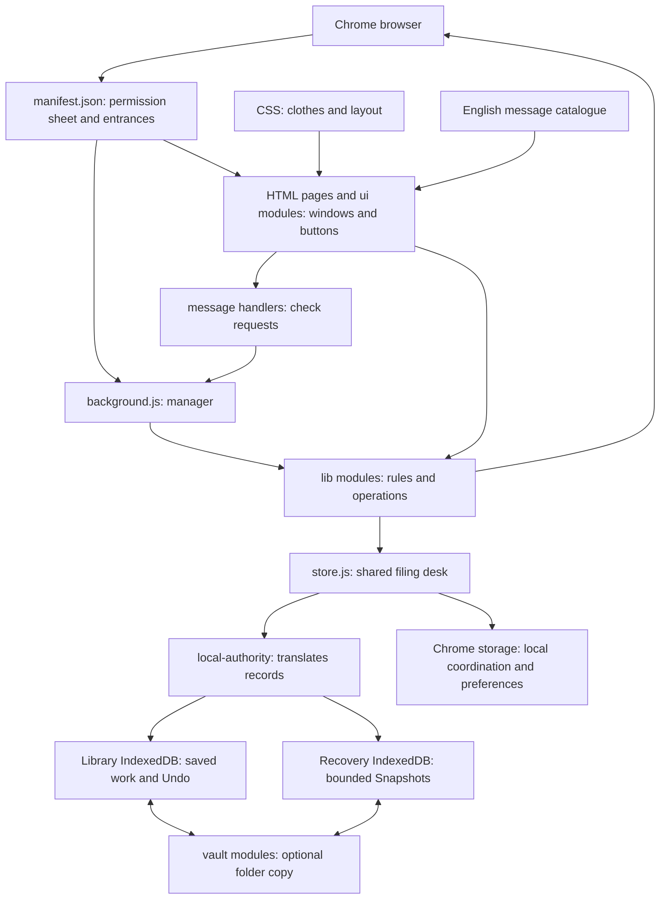

# EveryTab, explained simply

Open the [searchable file explorer](CODEBASE-EXPLORER.html). Generated for source **{{VERSION}}**.

Imagine your browser is a desk covered in picture cards. Each card is a web page.

- **Open** is what is on your desk now.
- **Inbox** is a tray where you put cards for later.
- **Archive** is the cupboard for older cards.
- **Named Sessions** are named sets of cards you can put back on the desk again.
- **Labels** are stickers; Label groups and Session groups are lists that organize stickers or sets.
- **Snooze** is an alarm clock attached to a card.
- **Suspend** leaves a lightweight placeholder where a page was open.
- **Focus** is a helper asking you to leave distracting pages until later.
- **Snapshots** are automatic lists of what was open earlier.
- **Vault** is an optional second copy in your own folder.

These cards mostly remember addresses and titles. They do not preserve everything inside a website, such as an unfinished form.

## The building

The browser can put the background manager to sleep and wake it later. Important unfinished work therefore needs a saved receipt; a JavaScript variable alone is not enough.

## Follow a card

1. You press **Inbox** beside a live tab in Dashboard or Popup.
2. The screen sends a request. A message handler checks its shape.
3. A domain operation captures the page and saves a record through the shared store.
4. Only after saving does it ask Chrome to close the page, checking that the live page is still the intended one.
5. Other screens hear that storage changed and refresh their lists.
6. If connected, a later Vault sync copies the durable change into the chosen folder.

The filing cabinet, browser tabs, and folder are separate things. Saving, closing a tab, and copying a file cannot all be one indivisible action. Receipts, identity checks, retries, and honest partial results are what make the process recoverable.

## Read the project in this order

Start with `manifest.json`, one HTML page, its `ui` entry point, its feature `*-surface.js`, `list-configs.js`, the corresponding `lib` operation, and then `store.js`. Read storage and Vault internals when working on durability. Start from the matching test when investigating a particular behavior.

| Location | Like a five-year-old would describe it | Actual job |
|---|---|---|
| `extension/*.html` | Doors and empty rooms | Page markup and script/style entry points |
| `extension/js/ui/` | Buttons, shelves, and labels you see | Presentation, input, refresh, and focus |
| `extension/js/background/` | The manager's mailboxes | Chrome event owners and validated messages |
| `extension/js/lib/` | The rule book and helpers | Product operations and shared data contracts |
| `extension/js/lib/storage/` | The filing cabinet machinery | Transactions, records, versions, assets, and recovery |
| `extension/js/vault/` | The helper making a second copy | Folder permission, replication, checkpoints, and Restore |
| `extension/css/` | Clothes and room layout | Appearance tokens and shared/page styles |
| `extension/_locales/` | The word book | Translatable product text |
| `extension/test/` | Practice games for the helpers | Assertions, browser fixtures, and synthetic adapters |
| `tools/` | The workshop | Testing, diagnostics, capture, marketing production, packaging tools |
| `.github/` | The automatic examiner | CI jobs selected from the shared test inventory |
| Root Markdown files | The instruction books | Product, engineering, design, testing, and current work |

## How to read the file atlas

Every current runtime JavaScript file has a plain-language description below. The maintained files in `extension/`, `tools/`, `.github/`, and the selected root guides are indexed. Runtime files show their literal local imports, their reverse importers, and declared exports. HTML/CSS/test references appear separately.

**An import means “uses code from.” It does not mean “owns,” “calls every function,” or “has full test coverage.”** The scan includes literal dynamic imports; computed paths, messages, Chrome events, and dependency-injected calls are not a complete static call graph. JSDoc type imports and quoted source examples are excluded. Template bodies and destructured export declarations are not expanded; the scanner is intentionally a partial static graph. Review the architecture story above for those non-import relationships. Tests that merely read source text are references, not runtime imports.

Other folders have different roles: `docs/` contains guides, prototypes and launch material; `plans/` contains proposals; `design/`, `campaign-assets/`, and `screenshots/` contain design assets; `review-evidence/` contains dated receipts; `dist/` holds preserved packages; `archive/` is historical material. Those trees are not the shipped source and are not individually audited here. Personal Vault/test-data folders and installed browser data were not inspected. Hidden skill packages are instructions/tooling, not extension runtime.

The companion [CODEBASE-ATLAS.json](CODEBASE-ATLAS.json) contains source hashes and literal relationships. Regenerate with `node tools/build-codebase-guide.mjs --write`; verify without changing files with `node tools/build-codebase-guide.mjs --check`.

Generated learning files are excluded from their own input scan. The scan reads regular files in `extension/`, `tools/`, and `.github/`, plus a fixed list of root guides and configuration. It skips hidden files, dependency folders and all symlinks. It never scans arbitrary root files or personal data folders.

## What happens when a helper stops halfway?

Imagine asking the helper to put two cards back on your desk. It writes a little
to-do note first. If it falls asleep after placing the cards but before ticking
the note, it cannot safely assume the cards are missing and place two more.
It reports an incomplete result and asks you to check the desk.

`close-day.js` owns that note for Close-the-day Undo. It updates the note and
Activity together. `background.js` finishes checking old notes before letting new
actions start. Saved records, browser pages and Vault files still remain separate
steps. A successful database change does not prove every browser action finished.

For the Vault, cancelling the folder picker leaves the old folder alone. A new
handle is retained only after its database transaction commits. The profile-owned
filesystem test proves storage/reload behavior; it does not prove native folder
permissions or two-device cloud transport. See [TESTING.md](TESTING.md) for the
evidence types and [the handoff](handoff-prompt.md) for remaining acceptance.

Suspended pages also need identity: two cards with the same address can still be
two different tabs in different windows. The suspension owner tracks each
occurrence so deliberately closing one does not erase or reopen another.

The shared diagnostic helper records only a fixed operation name and an error
class. It does not print page addresses, titles, or raw error messages.

